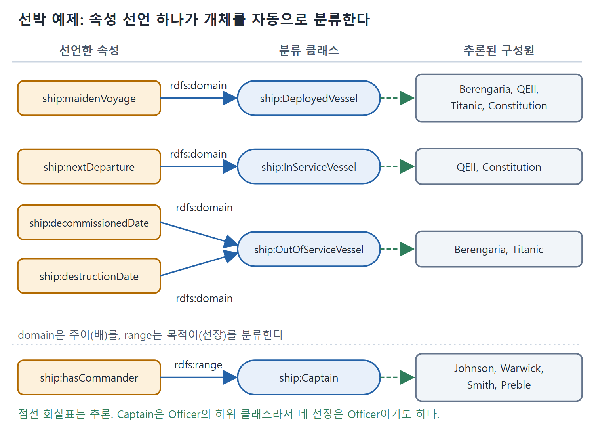

# 쓰임새로 자동 분류하기

domain과 range를 "검사 규칙"으로 생각하면 계속 어색하다. 그러나 "쓰인 모양을 보고 정체를 알아내는 규칙"으로 보면 쓸모가 분명해진다. 이 문서는 선박 관리 예제로 domain과 range가 개체를 자동으로 분류하고, 정보가 있는 개체만 걸러 내는 방법을 보여 주고, 왜 이것이 "지식 기술"이 아니라 "지식 발견" 도구인지 설명한다.

---

## 1. 선박 표 예제

해운 회사가 선단을 관리한다고 하자. 건조 중인 배, 수리 중인 배, 운항 중인 배, 퇴역한 배가 섞여 있다. 회사가 배에 대해 보관하는 정보는 다음 표와 같다(원서의 표 8.1을 다시 구성했다).

| 배 이름 | 처녀 항해 | 다음 출발 | 퇴역일 | 파괴일 | 선장 |
|---|---|---|---|---|---|
| Berengaria | 1913년 6월 16일 | 없음 | 1938년 11월 7일 | 없음 | Johnson |
| QEII | 1969년 5월 2일 | 2010년 3월 4일 | 없음 | 없음 | Warwick |
| Titanic | 1912년 4월 10일 | 없음 | 없음 | 1912년 4월 14일 | Smith |
| Constitution | 1798년 7월 22일 | 2009년 1월 12일 | 없음 | 없음 | Preble |

Berengaria의 퇴역일은 원서 표에는 1938까지만 읽히고, 그림 8.3의 값(1938-11-07)으로 보충했다. 날짜 표기는 읽기 좋게 한국식으로 옮겼다.

이 표는 3장에서 배운 방식대로 RDF 트리플로 옮길 수 있다. 각 행은 ship:Vessel 타입 리소스이고 칸의 내용은 트리플이 된다.

```turtle
ship:Berengaria ship:maidenVoyage "June 16, 1913" .
ship:QEII ship:nextDeparture "Mar 4, 2010" .
```

ship:Vessel 아래에 선박의 상태에 따른 하위 클래스를 둘 수 있다.

```turtle
ship:DeployedVessel rdfs:subClassOf ship:Vessel .
ship:InServiceVessel rdfs:subClassOf ship:Vessel .
ship:OutOfServiceVessel rdfs:subClassOf ship:Vessel .
```

| 클래스 | 뜻 |
|---|---|
| ship:DeployedVessel | 일생 중 한 번이라도 배치(운항)된 적이 있는 배 |
| ship:InServiceVessel | 현재 운항 중인 배 |
| ship:OutOfServiceVessel | 현재 운항하지 않는 배(퇴역한 배와 아직 배치되지 않은 배도 포함) |

OutOfServiceVessel에는 이유가 무엇이든 지금 운항하지 않는 모든 배가 들어간다는 점을 눈여겨봐야 한다.

## 2. 과제 10 자동 분류

Table 8.1의 정보를 바탕으로 각 배를 더 구체적인 하위 클래스로 자동 분류하려면 어떻게 할까. 규칙은 이렇다.

- 처녀 항해가 있으면 ship:DeployedVessel이다.
- 다음 출발이 정해졌으면 ship:InServiceVessel이다.
- 퇴역일이나 파괴일이 있으면 ship:OutOfServiceVessel이다.

해법은 rdfs:domain이다.

```turtle
ship:maidenVoyage rdfs:domain ship:DeployedVessel .
ship:nextDeparture rdfs:domain ship:InServiceVessel .
ship:decommissionedDate rdfs:domain ship:OutOfServiceVessel .
ship:destructionDate rdfs:domain ship:OutOfServiceVessel .
```

이 선언들이 있으면 어떤 배에 maidenVoyage 트리플이 하나라도 있는 순간 domain 규칙이 작동해 그 배를 DeployedVessel로 분류한다. 아래 표는 원서 그림 8.3이 보여 주는 분류 결과를 정리한 것이다.

| 배 | 가진 속성 | 추론된 분류 |
|---|---|---|
| Berengaria | maidenVoyage, decommissionedDate | DeployedVessel, OutOfServiceVessel |
| QEII | maidenVoyage, nextDeparture | DeployedVessel, InServiceVessel |
| Titanic | maidenVoyage, destructionDate | DeployedVessel, OutOfServiceVessel |
| Constitution | maidenVoyage, nextDeparture | DeployedVessel, InServiceVessel |

네 척 모두 maidenVoyage가 있으므로 모두 DeployedVessel이다. QEII와 Constitution은 nextDeparture가 있어 InServiceVessel이고, Titanic과 Berengaria는 각각 destructionDate와 decommissionedDate가 있어 OutOfServiceVessel이다. 속성 하나로 클래스 하나가 결정되는 구조라서 손으로 분류 작업을 할 일이 없다.

## 3. 과제 11 참조로 분류하기

지금까지의 추론은 표의 행에 해당하는 주어, 곧 배 자신에 관한 것이었다. 표의 다른 칸에 있는 개체에 대해서도 추론할 수 있다. 예를 들어 배의 선장이 Captain 계급이라는 사실은 어떻게 표현할까.

계급을 클래스로 표현한다.

```turtle
ship:Captain rdfs:subClassOf ship:Officer .
ship:Commander rdfs:subClassOf ship:Officer .
ship:LieutenantCommander rdfs:subClassOf ship:Officer .
ship:Lieutenant rdfs:subClassOf ship:Officer .
ship:Ensign rdfs:subClassOf ship:Officer .
```

그리고 배의 선장은 Captain이라는 사실을 rdfs:range로 말한다.

```turtle
ship:hasCommander rdfs:range ship:Captain .
```

표에 있는 hasCommander 정보로부터 Johnson, Warwick, Smith, Preble이 모두 ship:Captain의 구성원이라고 추론된다. Captain은 Officer의 하위 클래스이므로 이들은 Officer이기도 하다. 이 추론과 근거 트리플은 원서 그림 8.4에 나와 있다.

| 속성 | 선언 | 추론 대상 | 추론 결과 |
|---|---|---|---|
| ship:maidenVoyage 등 | rdfs:domain | 주어(배) | 해당 상태 클래스에 속함 |
| ship:hasCommander | rdfs:range | 목적어(선장) | ship:Captain에 속함 |

표에서 보듯 domain은 트리플의 주어를, range는 목적어를 분류한다. 같은 방식이 칸마다 다른 개체에 적용된다.



그림은 속성 선언(domain 또는 range)이 분류 클래스를 정하고, 그 결과로 어떤 배와 선장이 구성원으로 추론되는지를 한 줄씩 이어서 보여 준다.

## 4. 과제 12 정의되지 않은 데이터 거르기

관련된 과제는 어떤 정보가 정의된 개체만 골라내는 일이다. 특정 값이 정의된 개체의 집합은 이후 처리에 쓸 수 있게 하고, 정의되지 않은 개체는 처리하지 않도록 한다.

앞의 선박 예에서 nextDeparture가 있는 배는 단체 관광을 계획하는 일정 시스템의 입력이 될 수 있다. nextDeparture를 알 수 없는 배는 고려하지 말아야 한다.

해법은 역시 rdfs:domain이다. 먼저 그런 배를 구성원으로 갖는 클래스 DepartingVessel을 만들고 그것을 nextDeparture의 domain으로 정한다.

```turtle
ship:DepartingVessel rdf:type rdfs:Class .
ship:nextDeparture rdfs:domain ship:DepartingVessel .
```

Table 8.1에서는 Constitution과 QEII만 DepartingVessel에 속하고 일정 프로그램이 이들만 쓸 수 있다(원서 그림 8.5). 원서 본문은 클래스 이름을 ship:DepartingVessels로 복수형으로 한 번 적었는데 오타로 보인다.

| 목적 | 만드는 것 | 결과 집합 |
|---|---|---|
| 처녀 항해가 있는 배 | maidenVoyage의 domain | 네 척 모두 |
| 일정 계획에 쓸 배 | nextDeparture의 domain(DepartingVessel) | QEII, Constitution |

이 방식은 "값이 있는 개체만 고른다"를 쿼리 조건이 아닌 스키마의 추론으로 해결한다. 일정 시스템은 DepartingVessel만 읽으면 된다.

## 5. 지식 기술이 아니라 지식 발견 도구

RDFS(그리고 OWL)는 추론에 기반한 의미를 가지므로 domain과 range는 OO 모델링이나 XML에서처럼 정보를 검증하는 데 쓰이지 않는다. 대신 이미 아는 정보에서 새 정보를 알아내는 데 쓰인다. 위 과제들이 보여 준 분류와 필터링이 이 독특한 성질의 활용이다.

초보 모델러에게 이 정의는 가장 받아들이기 어려운 것 중 하나라서 도구가 어설프고 쓰기 불편하다는 반응이 흔하다. 이 어려움은 RDFS 전반, 특히 domain과 range를 지식 기술(knowledge description)이 아니라 지식 발견(knowledge discovery)의 도구로 이해하면 어느 정도 덜어진다. 시맨틱 웹에서는 다른 곳에서 온 정보가 새 맥락에서 어떻게 해석될지 미리 알 수 없다. domain과 range의 정의는 데이터가 쓰이는 모양으로부터 새로운 사실을 알아내게 해 준다.

| 관점 | 지식 기술 | 지식 발견 |
|---|---|---|
| domain과 range의 역할 | 속성이 소속된 클래스를 적어 둔다 | 쓰인 속성으로 개체의 타입을 알아낸다 |
| 데이터와의 관계 | 데이터가 선언에 맞는지 확인한다 | 데이터에서 새 트리플을 만든다 |
| 원서의 입장 | 이렇게 쓰지 않는다 | 이렇게 이해하고 써야 한다 |

그러므로 domain과 range는 클래스 주변에 속성 몇 개를 묶어 두는 용도로 가볍게 쓰면 안 된다. 앞 과제들이 보여 준 것처럼 이 선언은 필터링과 분류라는 결과를 낳는다. 권장하는 사용법은 한 걸음 더 나가서, 지식을 거르거나 발견하려는 특정 패턴(예를 들어 domain으로 어떤 배가 출발 예정인지 알아내는 것)이 의도된 경우에 쓰는 것이다. 이렇게 쓰면 웹 환경에서도 domain과 range의 의미가 알맞게 작동한다는 것이 보장된다.

<br>
<br>
<br>

[Semantic Web for the Working Ontologist](../)
