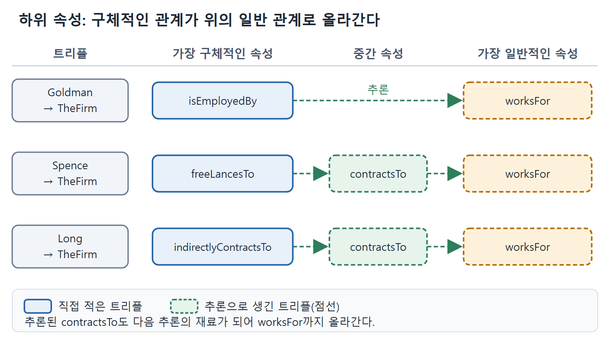

# 하위 속성과 관계 전파

클래스에 상위와 하위가 있듯이 속성(프로퍼티)에도 상위와 하위가 있다. "형제"는 "동기간"의 한 종류라서, 누가 내 형제라면 그 사람은 내 동기간이기도 하다. RDFS의 rdfs:subPropertyOf는 이 직관을 추론 규칙 하나로 정리한 것이다. 이 문서에서는 규칙의 모양과 직원·계약자 예제, 그리고 객체지향 프로그래머가 헷갈리기 쉬운 지점을 다룬다.

---

## 1. 명사만이 아니라 동사도 정리해야 한다

용어를 다른 출처와 맞추는 일은 명사(클래스)에만 필요한 것이 아니다. 관계를 뜻하는 동사(속성)도 똑같이 맞춰야 한다. 일상 표현에도 예가 많다. brother(형제)는 sibling(동기간)보다 구체적인 관계다. 그래서 누가 내 brother라면 그는 내 sibling이기도 하다. RDFS는 이를 rdfs:subClassOf 규칙만큼 간단한 규칙으로 형식화한다.

```sparql
CONSTRUCT { ?x ?r ?y . }
WHERE { ?x ?q ?y .
        ?q rdfs:subPropertyOf ?r }
```

이 규칙은 어떤 트리플에서든 서술어를 그 속성의 상위 속성으로 바꿔 놓은 트리플을 새로 만들 수 있다는 뜻이다. ?q 관계가 성립하고 ?q가 ?r의 하위 속성이면 ?r 관계도 성립한다.

| 구분 | rdfs:subClassOf | rdfs:subPropertyOf |
|---|---|---|
| 연결하는 대상 | 클래스와 클래스 | 속성과 속성 |
| 전파되는 것 | 구성원 자격(rdf:type) | 두 개체 사이의 관계(서술어) |
| 새로 생기는 트리플 | ?x rdf:type 상위 클래스 | ?x 상위 속성 ?y |
| 예 | 외과의사 → 의사 | isEmployedBy → worksFor |

표를 보면 두 규칙은 "구체적인 것에서 일반적인 것으로 올라간다"는 같은 방향이다. 다만 하나는 개체의 소속을, 다른 하나는 개체 사이의 연결을 옮긴다.

## 2. 예제 3 고용 관계

큰 회사가 여러 방식으로 사람들과 관계를 맺는다고 하자. 직접 고용한 직원도 있고 계약자도 있다. 계약자 중에는 프리랜서로 직접 계약한 사람, 장기 위임 계약을 맺은 사람, 중간에 다른 회사를 끼고 계약한 사람이 있다. 이들은 모두 그 회사를 위해 일한다고 말할 수 있다.

먼저 어떤 상황에서 어떤 결론을 얻고 싶은지 정리한다. 사람과 회사 사이에 가능한 관계는 contractsTo, freeLancesTo, indirectlyContractsTo, isEmployedBy, worksFor다. 이 가운데 하나라도 어떤 사람에게 성립하면 그 사람이 회사에 worksFor라고 추론하고 싶다. 또 중간 결론도 있다. 프리랜서와 간접 계약자는 둘 다 회사에 contractsTo이고, 따라서 회사를 위해 일하는 사람이다.

```turtle
:freeLancesTo rdfs:subPropertyOf :contractsTo .
:indirectlyContractsTo rdfs:subPropertyOf :contractsTo .
:isEmployedBy rdfs:subPropertyOf :worksFor .
:contractsTo rdfs:subPropertyOf :worksFor .
```

속성 계층은 이렇게 그릴 수 있다. 원서의 그림 8.1이 같은 구조를 화살표로 보여 준다.

```text
worksFor
 ├─ isEmployedBy
 └─ contractsTo
      ├─ freeLancesTo
      └─ indirectlyContractsTo
```

이제 개체 데이터를 넣는다.

```turtle
:Goldman :isEmployedBy :TheFirm .
:Spence :freeLancesTo :TheFirm .
:Long :indirectlyContractsTo :TheFirm .
```

규칙은 하위 속성을 상위 속성으로 바꾼 트리플을 만들어 낸다. 아래 표가 결과다.

| 출발 트리플 | 한 단계 추론 | 추론으로 나온 트리플로 다시 추론 |
|---|---|---|
| :Goldman :isEmployedBy :TheFirm | :Goldman :worksFor :TheFirm | 없음 |
| :Spence :freeLancesTo :TheFirm | :Spence :contractsTo :TheFirm | :Spence :worksFor :TheFirm |
| :Long :indirectlyContractsTo :TheFirm | :Long :contractsTo :TheFirm | :Long :worksFor :TheFirm |

표의 세 번째 열이 중요하다. 추론으로 얻은 트리플도 직접 적어 둔 트리플과 똑같이 다음 추론의 재료가 되므로, Spence와 Long은 한 단계 위로 올라간 뒤 다시 한 번 올라가 worksFor까지 닿는다. 이렇게 계층 아래쪽에 있는 구체적인 속성이 성립하면, 그 위에 있는 모든 속성도 성립한다.



그림은 Goldman, Spence, Long의 관계가 하위 속성 규칙을 따라 위로 올라가는 모습을 보여 준다. 실선은 직접 적은 트리플이고 점선은 추론된 트리플이며, 세 사람 모두 마지막에 worksFor에 닿는다.

활용 면에서도 이득이 크다. 회사를 위해 일하는 모든 사람을 찾는 쿼리는 worksFor 하나만 물으면 된다. 계약 형태가 새로 늘어도 하위 속성 선언만 추가하면 쿼리는 그대로 둘 수 있다.

## 3. 객체지향과 견주어 본 하위 속성

원서는 객체지향(OO) 관점의 보충 설명을 단다. OOP에서는 속성(필드)이 독립된 일급 개체가 아니라서, 그것이 정의된 클래스와 상관없이 속성끼리 관계를 맺을 수 없다. 그래서 rdfs:subPropertyOf에는 직접 대응하는 OOP 개념이 없다. 이 점이 오히려 장점이다. rdfs:subClassOf에서는 OO 프로그래머의 기존 지식이 충돌을 일으키지만, 하위 속성에는 충돌할 기존 개념이 없다. 혼란이 생긴다면 위 같은 하위 속성 다이어그램을 클래스 다이어그램으로 착각할 때 정도다.

| 헷갈리기 쉬운 점 | 바로잡기 |
|---|---|
| 하위 속성 그림을 클래스 그림으로 읽는다 | 그림의 노드는 클래스가 아니라 속성이고, 화살표는 rdfs:subPropertyOf다 |
| 필드 상속과 같다고 생각한다 | 속성끼리의 포함 관계다. 두 개체를 잇는 관계가 위로 전파될 뿐이다 |

한 줄로 말하면, 하위 속성은 "관계의 계층"이고 클래스는 "집합의 계층"이다. 두 그림은 비슷하게 생겼어도 담고 있는 것이 다르다.

<br>
<br>
<br>

[Semantic Web for the Working Ontologist](../)
