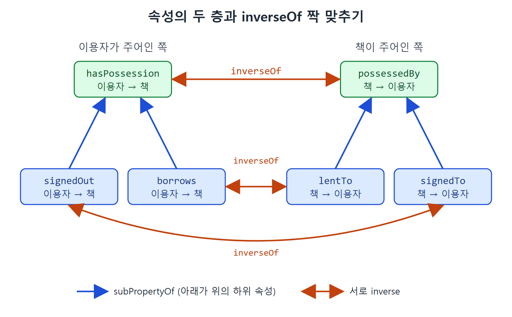

# RDFS-Plus 소개와 inverseOf

RDFS는 추론 기능이 아주 제한적이다. 그래도 여러 출처의 정보를 합치는 데는 쓸모가 크다는 것을 앞 장에서 봤다. 이 장은 거기서 한 걸음 더 나가 웹 온톨로지 언어인 OWL(Web Ontology Language)로 넘어간다. OWL을 통째로 배우는 것이 아니라, RDFS에서 크게 벗어나지 않으면서 힘이 훨씬 세지는 구성 요소 몇 개만 골라서 배운다. 이 묶음을 책에서는 RDFS-Plus라고 부른다.

이 문서는 RDFS-Plus가 무엇이고 왜 이 구성 요소들을 골랐는지 설명한 다음, 첫 번째 구성 요소인 `owl:inverseOf`(속성의 방향을 뒤집는 관계)를 다룬다. 단순해 보이는 구성 요소가 기존 RDFS 도구와 만나면 어떤 문제를 풀어 주는지 두 가지 도전 과제로 확인한다.

---

## 1. RDFS-Plus란 무엇인가

RDFS-Plus는 OWL 가운데 일부만 뽑아 RDFS에 얹은 묶음이다. 새로운 문법이 생기는 것은 아니다. RDFS와 마찬가지로 전부 RDF 안에서 표현되고, 다른 점은 `owl:` 네임스페이스에 속한 리소스가 몇 개 더 생긴다는 것뿐이다. 리소스의 의미도 RDFS 때와 같은 방식으로 정해진다. 그 리소스가 나오면 어떤 추론을 할 수 있는지를 규칙으로 적어 두는 것이다. 이 책은 그 규칙을 SPARQL CONSTRUCT 쿼리로 보여 준다.

저자들은 이 구성 요소를 고른 이유를 세 가지로 든다.

| 관점 | 이유 |
|---|---|
| 학습 | RDFS에서 이미 익숙한 것에 조금만 보태면 되므로, 개념적으로 크게 뛰어넘을 필요가 없다 |
| 실무 | 정보 통합 프로젝트에서 이 묶음이 매우 쓸모 있었다. RDFS 단독으로 쓴 사례보다 RDFS에 이 묶음을 더한 사례를 찾고 설명하기가 훨씬 쉽다 |
| 계산 | 이 부분집합은 다양한 추론 기술로 구현할 수 있어서, 시맨틱 웹이 특정 기술 하나에 묶이지 않는다 |

표를 보면 세 번째 이유가 의외로 중요하다. 구현하기 쉬운 부분집합이어야 도구를 만드는 쪽에서도 빨리 지원할 수 있기 때문이다. 이름의 유래도 같은 맥락이다. 저자들은 시맨틱 웹 도구 업체와 웹 애플리케이션 설계자들이 "쓸모 있으면서 빨리 구현할 수 있는 OWL 부분집합"을 따로 정하는 경향이 있다는 것을 보고, 최신 업체들에 대한 비공식 조사와 초기 도입자들과의 경험을 바탕으로 이 묶음을 정했다고 한다.

RDFS에서 구성 요소를 서로 조합해 새로운 효과를 냈던 것처럼, RDFS-Plus에서도 같은 흐름이 이어진다. 구성 요소가 많아질수록 조합할 수 있는 경우의 수도 늘어난다. 이 장의 도전 과제는 대부분 그런 조합 사례다.

## 2. inverseOf의 뜻

OWL 구성 요소 이름은 수학 용어에서 온 것이 많다. 하지만 이름과 달리 일상에서 쓰는 뜻으로 풀어도 거의 맞는다. `owl:inverseOf`가 대표적이다.

`hasParent`(부모가 있다)라는 관계가 모델에 들어갈 만큼 중요하다면, `hasChild`(자식이 있다)도 중요할 가능성이 높다. 사람은 이름만 봐도 두 관계가 어떤 사이인지 짐작하지만 컴퓨터는 그렇지 못하다. `owl:inverseOf`는 그 사이를 명시적으로, 그리고 정확하게 적어 주는 도구다.

수학에서 함수 f의 역함수 f⁻¹는 f(x) = y일 때 f⁻¹(y) = x를 만족하는 함수다. OWL에서도 같다. 속성의 inverse는 방향만 뒤집은 다른 속성이다.

주의할 점이 있다. inverse는 의미상 반대말이 아니다. `hasFriend`와 `hasEnemy`는 "친구는 적일 수 없다"는 점에서 반대처럼 보이지만 역방향 관계가 아니다. 내가 당신의 친구라고 해서 당신이 나의 적이 되는 것은 아니기 때문이다. 이런 "반대" 관계를 형식적으로 적는 방법은 OWL에 없다.

의미는 규칙으로 정해진다.

```sparql
CONSTRUCT {?y ?q ?x}
WHERE {?p owl:inverseOf ?q .
       ?x ?p ?y .}
```

`?p`가 `?q`의 inverse이고 `?x ?p ?y` 트리플이 있으면, 주어와 목적어를 맞바꾼 `?y ?q ?x` 트리플을 추론한다는 뜻이다.

셰익스피어 예시로 확인한다. 아래 트리플이 있다고 하자.

```turtle
lit:Shakespeare lit:wrote lit:Macbeth .
lit:Macbeth lit:setIn geo:Scotland .
```

여기에 inverse를 선언한다.

```turtle
lit:wrote owl:inverseOf lit:writtenBy .
lit:settingFor owl:inverseOf lit:setIn .
```

그러면 다음이 추론된다.

```turtle
lit:Macbeth lit:writtenBy lit:Shakespeare .
geo:Scotland lit:settingFor lit:Macbeth .
```

| 선언 | 원래 트리플 | 추론되는 트리플 |
|---|---|---|
| `lit:wrote` inverseOf `lit:writtenBy` | Shakespeare wrote Macbeth | Macbeth writtenBy Shakespeare |
| `lit:settingFor` inverseOf `lit:setIn` | Macbeth setIn Scotland | Scotland settingFor Macbeth |

두 번째 줄을 보면 선언은 `settingFor`를 주어로 적었지만, 추론은 `setIn` 트리플에서 출발했다. inverse는 어느 쪽을 주어로 적어도 양쪽 관계를 이어 주기 때문이다. 이 점은 뒤의 도전 과제 17에서 정확히 다룬다.

## 3. 쿼리만 바꾸면 되는데 왜 필요한가

여기서 의문이 생긴다. 스코틀랜드가 배경인 극을 찾을 때 `{ geo:Scotland lit:settingFor ?play }`로 써도 되지만, 그냥 `{ ?play lit:setIn geo:Scotland }`로 쓰면 같은 답이 나온다. 쿼리를 바꾸는 것만으로 되니 모델링 언어에 이런 구성 요소가 꼭 있어야 하는지 의심스럽다.

쿼리를 쓰는 사람 입장에서만 보면 맞는 말이다. 그러나 `owl:inverseOf`의 진짜 쓸모는 다른 구성 요소와 만났을 때 나온다. 이어지는 도전 과제가 그것을 보여 준다.

## 4. 도전 과제 13: 계층 데이터를 변환하기

6장에서 SPARQL로 계층 데이터를 변환하는 문제를 풀었다. 원본 데이터는 `hasSon`, `hasMother`, `hasDaughter`, `hasFather` 같은 속성으로 되어 있었고, 이를 `hasParent` 하나로 모으기 위해 비슷한 CONSTRUCT 쿼리를 여러 개 썼다.

```sparql
CONSTRUCT {?s :hasParent ?o}
WHERE {?s :hasMother ?o}
```

이 쿼리가 하는 일은 "`hasMother`를 쓴 트리플마다 같은 모양의 `hasParent` 트리플을 추론한다"는 것이다. 이것은 RDFS의 `subPropertyOf`로 그대로 표현된다.

```turtle
:hasMother rdfs:subPropertyOf :hasParent .
```

그런데 쿼리 중에는 주어와 목적어 자리가 뒤바뀐 것도 있었다.

```sparql
CONSTRUCT {?s :hasParent ?o}
WHERE {?o :hasSon ?s}
```

`?o hasSon ?s`(o의 아들이 s)에서 `?s hasParent ?o`(s의 부모가 o)를 뽑는 쿼리다. 방향이 뒤집혀 있어서 `subPropertyOf`만으로는 표현할 수 없다. 여기서 `inverseOf`가 쓰인다. `hasSon`의 inverse인 새 속성 `isSonOf`를 만들고, 이를 `hasParent`의 하위 속성으로 둔다.

```turtle
:isSonOf owl:inverseOf :hasSon .
:isSonOf rdfs:subPropertyOf :hasParent .
```

`hasSon` 트리플에서 inverse 규칙으로 `isSonOf` 트리플이 나오고, 다시 `subPropertyOf` 규칙으로 `hasParent` 트리플이 나온다. SPARQL 쿼리 여러 개를 돌린 것과 같은 결과를 선언 몇 줄로 얻는다.

이 방식의 장점은 속성 사이의 모든 관계가 하나의 모델 안에 들어 있다는 점이다. 아들, 딸, 부모 같은 변형을 전부 정의하면 한 화면에 그려서 볼 수도 있다. 원서에는 `subPropertyOf` 관계만 그린 가족 관계 그림이 있다. 속성의 계층과 그에 대응하는 inverse의 계층을 함께 정의하는 것은 RDFS-Plus에서 꽤 흔한 모델링 패턴이다.

| 방법 | 표현 | 한계 또는 장점 |
|---|---|---|
| SPARQL CONSTRUCT | 변환마다 쿼리 하나 | 쿼리가 흩어져 있고 한눈에 보기 어렵다 |
| subPropertyOf만 | `hasMother` → `hasParent` | 방향이 같을 때만 가능 |
| inverseOf + subPropertyOf | `isSonOf` 도입 | 방향이 반대인 경우까지 선언으로 해결, 모델 한곳에 모임 |

## 5. 도전 과제 14: 합칠 수 없을 것 같은 속성 합치기

예제 7에서는 `borrows`와 `checkedOut`을 둘 다 `hasPossession`의 하위 속성으로 만들어 합쳤다. 두 데이터 출처가 모두 Patron(이용자)을 주어로, Book(책)을 목적어로 썼기 때문에 가능했다. 즉 도메인과 범위가 같았다.

이번에는 두 번째 출처가 책 색인이어서, 책마다 `signedTo`(누구에게 대출 기록이 되어 있는가) 필드를 갖는다고 하자. 주어가 책이고 목적어가 이용자이니 도메인과 범위가 거꾸로다. 이런 `signedTo`와 `borrows`를 어떻게 합칠지가 문제다.

**해법.** 도메인과 범위가 맞는 속성을 `inverseOf`로 하나 더 만든다. `signedTo`의 inverse인 `signedOut`을 정의한 뒤, 예전의 속성 합치기 패턴을 그대로 쓴다.

```turtle
:signedTo owl:inverseOf :signedOut .
:signedOut rdfs:subPropertyOf :hasPossession .
:borrows rdfs:subPropertyOf :hasPossession .
```

데이터가 아래와 같다고 하자.

```turtle
:Amit :borrows :MobyDick .
:Marie :borrows :Orlando .
:LeavesOfGrass :signedTo :Jim .
:WutheringHeights :signedTo :Yoshi .
```

그러면 `inverseOf` 규칙으로 `:Jim :signedOut :LeavesOfGrass`, `:Yoshi :signedOut :WutheringHeights`가 추론되고, `subPropertyOf` 규칙으로 네 사람 모두의 `hasPossession` 트리플이 나온다.

| 단계 | 사용한 규칙 | 결과 |
|---|---|---|
| 1 | inverseOf | `:Jim :signedOut :LeavesOfGrass`, `:Yoshi :signedOut :WutheringHeights` |
| 2 | subPropertyOf | `:Amit :hasPossession :MobyDick`, `:Marie :hasPossession :Orlando` |
| 3 | subPropertyOf | `:Jim :hasPossession :LeavesOfGrass`, `:Yoshi :hasPossession :WutheringHeights` |

## 6. 또 다른 해법과 체계적인 구조

위 해법은 약간 비대칭이다. `signedTo`에 inverse를 붙일지 `hasPossession`에 붙일지는 사실 임의로 고른 것이다. 다음 해법도 같은 규칙을 다른 순서로 써서 똑같은 `hasPossession` 트리플을 얻는다.

```turtle
:signedTo rdfs:subPropertyOf :possessedBy .
:borrows rdfs:subPropertyOf :hasPossession .
:possessedBy owl:inverseOf :hasPossession .
```

어느 쪽이 나은지는 `hasPossession` 추론만 본다면 차이가 없다. 하지만 시맨틱 웹 모델링은 원하는 추론을 얻는 데서 끝나지 않고 다른 사람이 재사용할 수 있게 만드는 일이기도 하다. 나중에 누군가는 `hasPossession` 쪽으로, 다른 누군가는 `possessedBy` 쪽으로 질의할 수 있다. 또 이 속성을 다른 속성과 합치고 싶어질 수도 있다.

그래서 두 해법을 함께 쓰는 선택이 가능하다. `subPropertyOf` 계층의 모든 층에서 모든 속성에 inverse를 빠짐없이 정의하는 것이다.

```turtle
:signedTo owl:inverseOf :signedOut .
:signedTo rdfs:subPropertyOf :possessedBy .
:signedOut rdfs:subPropertyOf :hasPossession .
:lentTo owl:inverseOf :borrows .
:lentTo rdfs:subPropertyOf :possessedBy .
:borrows rdfs:subPropertyOf :hasPossession .
:possessedBy owl:inverseOf :hasPossession .
```

| 층 | 소유하는 쪽이 주어 | 소유되는 쪽이 주어 |
|---|---|---|
| 하위(출처별) | `borrows`, `signedOut` | `lentTo`, `signedTo` |
| 상위(통합) | `hasPossession` | `possessedBy` |



그림은 표의 구조를 그린 것이다. 아래 층의 속성 두 개는 각각 위 층의 속성으로 올라가고(파란 화살표), 왼쪽 열과 오른쪽 열은 서로 inverse(주황 화살표)로 짝지어진다.

이 구조는 왼쪽 열과 오른쪽 열이 서로 inverse이고, 각 열 안에서는 `subPropertyOf`로 올라가는 모양이 된다. 원서의 그림 9.2가 이 구조를 보여 준다.

꼼꼼한 독자라면 한 가지가 마음에 걸릴 수 있다. 위 inverse 선언은 모두 한 방향으로만 적혀 있다. 어느 쪽을 주어로 쓸지는 임의로 정한 것이고, 반대 방향의 `owl:inverseOf` 트리플 세 개가 더 있어야 완전해 보인다. 맞는 지적이다. 그런데 직접 적을 필요가 없다. 이유는 다음 문서의 도전 과제 17에서 설명한다.

<br>
<br>
<br>

[Semantic Web for the Working Ontologist](../)
