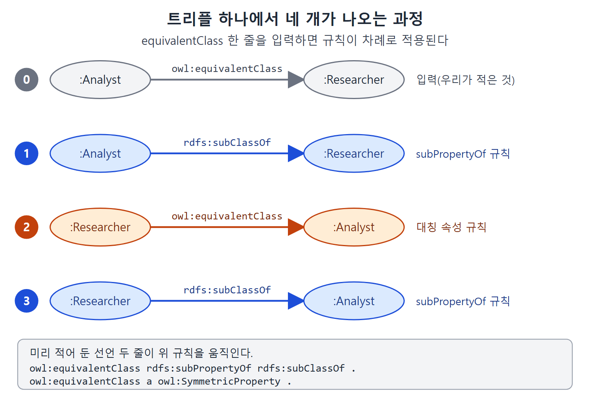
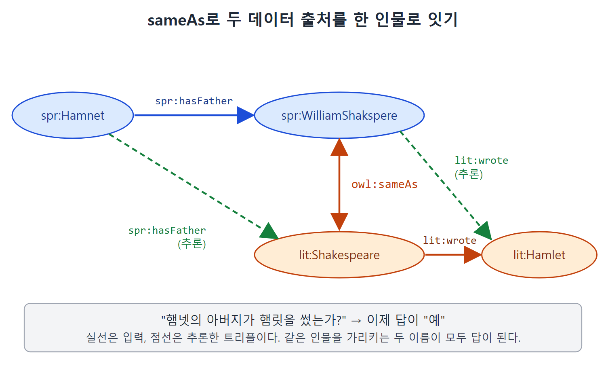

# 같음을 표현하는 세 가지 방법

RDF에서 리소스의 정체는 URI로 정해진다. URI는 여러 데이터 출처에서 통하는 전역 식별자이므로, 하나의 대상을 분산된 곳에서 가리킬 수 있다. 그런데 서로 다른 조직이 가진 정보를 합칠 때는 같은 대상을 같은 URI로 가리킨다는 보장이 없다. 그래서 "이 두 URI는 사실 같은 대상이다"라고 선언할 수단이 필요하다.

문제는 같다는 말에도 층이 있다는 점이다. 클래스가 같다, 속성이 같다, 개체가 같다는 서로 다른 이야기다. RDFS-Plus는 이 세 가지를 각각 `owl:equivalentClass`, `owl:equivalentProperty`, `owl:sameAs`로 표현한다. 이 문서는 세 구성 요소의 규칙을 보고, 새 구성 요소를 기존 구성 요소로 정의하는 방법까지 살펴본다.

---

## 1. 세 가지 같음 한눈에 보기

| 구성 요소 | 무엇이 같은가 | 의미 |
|---|---|---|
| `owl:equivalentClass` | 클래스 둘 | 두 클래스의 멤버가 서로 똑같다 |
| `owl:equivalentProperty` | 속성 둘 | 한 속성으로 성립하는 관계는 다른 속성으로도 성립한다 |
| `owl:sameAs` | 개체 둘 | 한 개체에 대한 모든 진술이 다른 개체에도 성립한다 |

앞의 둘은 RDFS만으로도 표현할 수 있던 것을 읽기 쉽게 만든 것이고, 셋째인 `sameAs`는 개체 수준의 같음이라서 RDFS에는 없던 새 능력이다.

## 2. 동치 클래스

앞에서는 "한 클래스의 멤버는 다른 클래스의 멤버이기도 하다"를 `subClassOf` 두 개로 표현했다.

```turtle
:Analyst rdfs:subClassOf :Researcher .
:Researcher rdfs:subClassOf :Analyst .
```

모든 Analyst는 Researcher이고, 모든 Researcher는 Analyst라는 뜻이다. `subClassOf`의 규칙을 양쪽에 적용하면 각각의 멤버 추론이 이루어진다. 두 클래스가 항상 같은 멤버를 갖는 경우 두 클래스가 동치(equivalent)라고 한다. RDFS로도 표현은 되지만 직관적이지 않다.

RDFS-Plus는 `owl:equivalentClass`로 한 줄에 표현한다.

```turtle
:Analyst owl:equivalentClass :Researcher .
```

의미는 두 규칙으로 정해진다.

```sparql
CONSTRUCT {?r a ?b .}
WHERE {?a owl:equivalentClass ?b .
       ?r a ?a . }
```

```sparql
CONSTRUCT {?r a ?a .}
WHERE {?a owl:equivalentClass ?b .
       ?r a ?b . }
```

첫 규칙은 `subClassOf`의 타입 전파 규칙(7장)과 같고, 둘째는 방향만 반대다. 두 클래스 `?a`와 `?b`가 정확히 같은 멤버를 갖는다는 뜻이다.

## 3. 규칙을 더 줄이기

단순한 동치에 규칙이 두 개나 필요한 것은 아쉽다. 두 규칙이 서로 거울이다. 그래서 `equivalentClass`를 대칭 속성으로 선언하면 둘째 규칙은 첫째 규칙과 대칭에서 이끌어 낼 수 있다.

```turtle
owl:equivalentClass a owl:SymmetricProperty .
```

더 나아가 규칙이 하나도 필요 없게 만들 수 있다. `equivalentClass`를 `subClassOf`의 하위 속성으로 선언하면 된다.

```turtle
owl:equivalentClass rdfs:subPropertyOf rdfs:subClassOf .
```

그러면 `subPropertyOf`와 `subClassOf` 규칙만으로 `equivalentClass`에 대한 모든 추론이 나온다. Analyst와 Researcher로 따라가 본다.

| 단계 | 쓰는 규칙 | 결과 |
|---|---|---|
| 0 | 입력 | `:Analyst owl:equivalentClass :Researcher` |
| 1 | `subPropertyOf` (equivalentClass가 subClassOf의 하위 속성) | `:Analyst rdfs:subClassOf :Researcher` |
| 2 | 대칭 속성 | `:Researcher owl:equivalentClass :Analyst` |
| 3 | `subPropertyOf` 다시 | `:Researcher rdfs:subClassOf :Analyst` |



그림의 0번 줄이 입력이고, 1~3번 줄이 규칙을 적용해 차례로 얻은 트리플이다. 선언 두 줄만으로 `subClassOf` 두 개가 모두 나오는 것을 볼 수 있다.

트리플 하나에서 `subClassOf` 두 개가 모두 나온다. 이미 배운 `rdfs:subClassOf`와 `owl:SymmetricProperty`만 적용했을 뿐이다.

두 클래스가 동치라는 것은 멤버가 같다는 뜻일 뿐이다. 다른 성질까지 공유하지는 않는다. 예를 들어 각 클래스는 자기 `rdfs:label`을 그대로 유지한다. 두 응용 프로그램의 클래스를 합쳤다면 각 프로그램은 여전히 원래 이름으로 클래스를 표시하고, 바뀌는 것은 멤버뿐이다.

## 4. 동치 속성

속성도 같은 방식이다. 속성이 같게 행동하도록 `subPropertyOf`를 두 번 쓸 수 있다.

```turtle
:borrows rdfs:subPropertyOf :checkedOut .
:checkedOut rdfs:subPropertyOf :borrows .
```

RDFS-Plus는 `owl:equivalentProperty`로 더 직관적으로 적는다.

```turtle
:borrows owl:equivalentProperty :checkedOut .
```

두 속성이 동치이면 한쪽을 서술어로 쓴 트리플에서 다른 쪽으로 바꿔 써도 된다는 뜻이다. SPARQL로는 `CONSTRUCT {?a :checkedOut ?b .} WHERE {?a :borrows ?b .}`와 그 반대 방향이다.

`equivalentClass`와 같은 방식으로 다른 구성 요소를 이용해 정의한다.

```turtle
owl:equivalentProperty rdfs:subPropertyOf rdfs:subPropertyOf .
owl:equivalentProperty a owl:SymmetricProperty .
```

첫 줄은 "동치 속성은 `subPropertyOf`의 하위 속성"이라는 뜻이다. 입력으로 `borrows`와 `checkedOut`의 동치만 주면 `borrows subPropertyOf checkedOut`, `checkedOut equivalentProperty borrows`, `checkedOut subPropertyOf borrows`가 차례로 나오고, 서로 `subPropertyOf`가 되었으므로 모든 추론이 가능하다.

원서의 해설도 짚어 둘 만하다. 새 구성 요소를 이미 아는 구성 요소로 표현하면, 언어의 각 부분이 어떻게 맞물리는지를 명시적으로 적는 셈이다. `equivalentProperty`가 `subPropertyOf`의 규칙과 같다는 사실(단지 양방향으로 작동할 뿐)을 말로 알아차리는 데 그치지 않고 모델로 적는다. 하위 속성으로 선언하는 것은 "같은 규칙을 따른다"는 단언이고, 대칭 속성으로 선언하는 것은 "그 규칙이 양방향으로 작동한다"는 단언이다. 즉 OWL 언어의 구조를 OWL로 모델링하는 것이다.

## 5. 같은 개체: owl:sameAs

클래스 동치와 속성 동치는 RDFS로 이미 표현할 수 있던 것을 편하고 읽기 쉽게 바꿨을 뿐, 표현력이 늘지는 않았다. 그런데 세상의 것을 기술할 때는 클래스와 속성만이 아니라 그 멤버인 개체(individual)도 기술한다. 지금까지 분석가 Wenger, 외과의사 Kildare, 올스타 선수 Kaneda 같은 개체를 만났고, 클래스가 정해지지 않은 Wales, The Firm, Moby Dick도 봤다.

3장에서 본 비고유 명명 가정(Nonunique Naming Assumption)을 떠올린다. 여러 출처가 서로 조율하지 않고 개체를 가리키면, 처음에는 별개로 봤던 두 개체가 실은 같은 개체라는 사실이 나중에 드러날 수 있다. RDFS-Plus에서는 `owl:sameAs` 하나로 이를 처리한다.

셰익스피어의 문학 경력은 3장에서 이렇게 적었다.

```turtle
lit:Shakespeare lit:wrote lit:AsYouLikeIt ;
                lit:wrote lit:HenryV ;
                lit:wrote lit:Hamlet ;
                lit:wrote lit:Othello .
```

원서는 이 밖에 LovesLaboursLost, MeasureForMeasure, TwelfthNight, WintersTale까지 모두 여덟 편을 적는다. 여기서는 일부만 옮겼다.

이제 Stratford Parish Register(스트랫퍼드 교구 등록부)의 세례 기록이 있다고 하자. 이 데이터의 네임스페이스는 `spr:`이다.

```turtle
spr:Gulielmus spr:hasFather spr:JohannesShakspere .
spr:Susanna spr:hasFather spr:WilliamShakspere .
spr:Hamnet spr:hasFather spr:WilliamShakspere .
spr:Judeth spr:hasFather spr:WilliamShakspere .
```

조사 결과 `spr:Gulielmus`, `spr:WilliamShakspere`, `lit:Shakespeare`가 모두 같은 인물이라고 결정했다고 하자. 그러면 "햄넷의 아버지가 햄릿을 썼는가"의 답은 "예"가 되어야 한다. RDF로 옮기기 전에 알았다면 처음부터 같은 URI를 썼겠지만, 우리는 이미 만들어진 데이터의 야생 속에 있어서 URI는 출처마다 정해져 버렸다.

질문을 SPARQL 그래프 패턴으로 쓰면 이렇다. `spr:hasFather`와 `lit:wrote`라는 두 연결로 Hamnet과 Hamlet을 잇는 리소스 하나를 찾는 것이다.

```sparql
{ spr:Hamnet spr:hasFather ?d .
  ?d lit:wrote lit:Hamlet . }
```

지금 상태로는 `?d`에 맞는 것이 없다. `spr:WilliamShakspere`는 `lit:wrote` 트리플이 없고, `lit:Shakespeare`는 `spr:hasFather`의 목적어가 아니다. 그래서 같음을 선언한다.

```turtle
spr:WilliamShakspere owl:sameAs lit:Shakespeare .
```

## 6. sameAs 규칙

`owl:sameAs`의 규칙은 직관과 맞는다. A가 B와 sameAs이면, A가 나온 트리플마다 A를 B로 바꾼 같은 트리플을 추론한다. 주어, 서술어, 목적어 어느 자리에 있든 마찬가지다. 그래서 세 규칙이 필요하다.

```sparql
CONSTRUCT {?s ?p ?x . }
WHERE {?s ?p ?y .
       ?x owl:sameAs ?y .}
```

```sparql
CONSTRUCT {?x ?p ?o . }
WHERE {?y ?p ?o .
       ?x owl:sameAs ?y .}
```

```sparql
CONSTRUCT {?s ?x ?o . }
WHERE {?s ?y ?o .
       ?x owl:sameAs ?y .}
```

| 규칙 | 바뀌는 자리 | 설명 |
|---|---|---|
| 1 | 목적어 | `?y`가 목적어인 트리플에서 `?x`가 목적어인 트리플을 추론 |
| 2 | 주어 | `?y`가 주어인 트리플에서 `?x`가 주어인 트리플을 추론 |
| 3 | 서술어 | `?y`가 서술어인 트리플에서 `?x`가 서술어인 트리플을 추론 |

이 규칙들은 `?x sameAs ?y`일 때 `?y`를 `?x`로 바꾸는 방향이다. 반대로 바꾸는 규칙 세 개가 더 필요할 텐데, 규칙을 늘리는 대신 `owl:sameAs`를 대칭 속성으로 선언한다.

```turtle
owl:sameAs a owl:SymmetricProperty .
```

그러면 `lit:Shakespeare owl:sameAs spr:WilliamShakspere`도 추론되어, `lit:Shakespeare`가 나온 트리플은 `spr:WilliamShakspere`로도 바꿔 쓸 수 있다.

## 7. 추론 결과 확인

원서는 입력 트리플과 추론 트리플을 모두 나열한다. 요약하면 다음과 같다.

| 구분 | 트리플 |
|---|---|
| 입력 | `lit:Shakespeare lit:wrote lit:Hamlet` 등 작품 여덟 편 |
| 입력 | `spr:Hamnet spr:hasFather spr:WilliamShakspere` 등 |
| 추론 (주어 바꿈) | `spr:WilliamShakspere lit:wrote lit:Hamlet` 등 여덟 편 |
| 추론 (목적어 바꿈) | `spr:Hamnet spr:hasFather lit:Shakespeare` 등 |



그림에서 `owl:sameAs` 한 줄이 두 출처의 인물을 잇고, 그 덕분에 점선으로 표시한 두 트리플이 추론되어 햄넷에서 햄릿까지 길이 생긴다.

이제 "햄넷의 아버지가 햄릿을 썼는가"에 "예"라고 답할 수 있다. 위의 그래프 패턴에서 `?d`에 대한 바인딩이 두 개 생기기 때문이다. `?d = lit:Shakespeare`이고 `?d = spr:WilliamShakspere`다. 한 사람을 가리키는 두 이름이 양쪽 모두 답으로 나오는 것이다.

<br>
<br>
<br>

[Semantic Web for the Working Ontologist](../)
