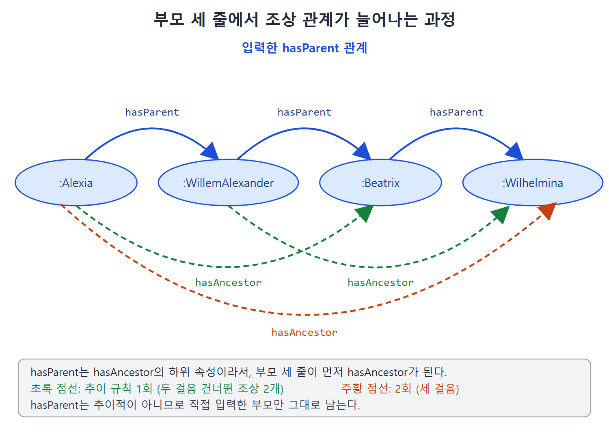

# 추이적 속성

"A의 조상은 B이고 B의 조상은 C다. 그러면 A의 조상은 C다." 이런 연쇄 추론은 우리가 늘 하는 생각이다. OWL에서는 `owl:TransitiveProperty`(추이적 속성)가 이 일을 맡는다. 이 문서는 추이적 속성의 규칙과, `subPropertyOf`와 짝지어 쓰는 두 가지 대표 패턴을 설명한다. 부모와 조상처럼 한쪽은 추이적이고 다른 쪽은 아닌 관계를 한 모델에서 함께 관리하는 방법이 핵심이다.

---

## 1. 추이성이란

수학에서 관계 R이 추이적이라는 것은 R(a,b)와 R(b,c)가 성립하면 R(a,c)도 성립한다는 뜻이다. OWL의 `owl:TransitiveProperty`도 같은 개념이다. `owl:SymmetricProperty`처럼 속성들의 클래스이므로, 모델에서 속성을 이 클래스의 멤버로 선언한다.

```turtle
:P a owl:TransitiveProperty .
```

의미는 지금까지 본 규칙 중 가장 긴 규칙으로 정해진다.

```sparql
CONSTRUCT {?x ?p ?z .}
WHERE {?x ?p ?y .
       ?y ?p ?z .
       ?p a owl:TransitiveProperty . }
```

`?x`에서 `?y`로, `?y`에서 `?z`로 같은 속성이 이어지면 `?x`에서 `?z`로 바로 가는 트리플을 추론한다는 뜻이다.

세 단계 이상 이어지는 경우를 위한 규칙(`?a ?p ?b . ?b ?p ?c . ?c ?p ?d`에서 `?a ?p ?d`)은 따로 필요 없다. 위의 간단한 규칙을 반복해서 적용하면 같은 결론에 도달하기 때문이다. 처음에 `a`에서 `c`를, 다음에 `a`에서 `d`를 얻는 식이다.

| 예 | 연쇄 | 결론 |
|---|---|---|
| 조상과 후손 | Victoria는 Edward의 조상, Edward는 Elizabeth의 조상 | Victoria는 Elizabeth의 조상 |
| 지리적 포함 | Osaka는 Japan 안에 있고, Japan은 Asia 안에 있다 | Osaka는 Asia 안에 있다 |

## 2. 부모와 조상을 함께 모델링하기

족보 모델에는 부모와 조상이 모두 들어가는 것이 보통이고, 두 개념이 서로 맞물려야 한다. 그런데 부모 관계는 추이적이지 않다. 부모의 부모는 내 부모가 아니다. 조상은 추이적이다.

**도전 과제 18: 추이적 상위 속성.** 부모 정보만 주어졌을 때 조상 정보를 일관되게 유지하려면 어떻게 하는가.

**해법.** 두 단계로 선언한다. 먼저 부모를 조상의 하위 속성으로 만든다.

```turtle
:hasParent rdfs:subPropertyOf :hasAncestor .
```

그리고 조상만 추이적 속성으로 선언한다.

```turtle
:hasAncestor a owl:TransitiveProperty .
```

네덜란드 왕실 예시로 보자. 부모 관계만 입력한다.

```turtle
:Alexia :hasParent :WillemAlexander .
:WillemAlexander :hasParent :Beatrix .
:Beatrix :hasParent :Wilhelmina .
```

`subPropertyOf` 규칙으로 직접 부모 관계 세 개가 모두 `hasAncestor` 트리플이 되고, 이어서 추이 규칙이 적용되어 아래가 추론된다.

| 추론 단계 | 추론된 `hasAncestor` 트리플 |
|---|---|
| `subPropertyOf` 적용 | Alexia - WillemAlexander, WillemAlexander - Beatrix, Beatrix - Wilhelmina |
| 추이 규칙 1회 | Alexia - Beatrix, WillemAlexander - Wilhelmina |
| 추이 규칙 2회 | Alexia - Wilhelmina |



그림은 입력한 `hasParent` 세 줄(파란 화살표)에서 추이 규칙이 한 번(초록 점선), 두 번(주황 점선) 적용되어 `hasAncestor`가 늘어나는 모습을 보여 준다.

결국 조상 관계 정보는 `hasParent`에서 왔든 `hasAncestor`에서 왔든 한곳에 합쳐진다. 반면 `hasParent`는 추이적으로 선언하지 않았으므로 직접 입력한 것만 남는다. 원서의 그림 9.4가 이 결과를 그림으로 보여 준다.

이 패턴의 핵심은 추이성을 상위 속성에만 부여하는 것이다. 하위 속성(`hasParent`)은 그대로 직접 관계만 나타내고, 상위 속성(`hasAncestor`)은 연쇄 전체를 담는다.

## 3. 관계의 층 나누기: partOf 문제

어떤 속성이 추이적인지를 두고 의견이 갈리는 경우가 있다. 영어의 "part of"가 대표적이다.

| 문장 | 추이적으로 읽히는가 |
|---|---|
| 피스톤은 엔진의 일부이고, 엔진은 자동차의 일부다. 그러면 피스톤은 자동차의 일부인가 | 그렇다고 보는 것이 자연스럽다 |
| Mick Jagger의 엄지손가락은 Mick Jagger의 일부이고, Mick Jagger는 Rolling Stones의 일부다. 그러면 그 엄지손가락은 Rolling Stones의 일부인가 | 그렇지 않다고 보는 사람이 많다 |

같은 "part of"인데 한쪽에서는 연쇄가 성립하고 다른 쪽에서는 이상하다. 모델이 앞으로 어떻게 쓰일지 알 수 없으니, 논란이 생길 만한 곳에서는 두 관점을 모두 지원하는 편이 좋다.

**도전 과제 19: 추이적 버전과 비추이적 버전을 함께 두기.**

**해법.** 같은 의미의 속성을 두 벌 만든다. 서로 다른 네임스페이스에 두거나 이름을 다르게 하고, 하나를 다른 하나의 상위 속성으로 만든 다음 상위 쪽만 추이적으로 선언한다.

```turtle
dm:partOf rdfs:subPropertyOf gm:partOf .
gm:partOf a owl:TransitiveProperty .
```

| 속성 | 추이성 | 어떤 관점에 쓰나 |
|---|---|---|
| `dm:partOf` | 추이적이지 않음, 직접 입력한 것만 | 엄지손가락이 Rolling Stones의 일부는 아니라고 보는 응용 |
| `gm:partOf` | 추이적, 연쇄가 전부 추론됨 | 엄지손가락도 Rolling Stones의 일부라고 보는 응용 |

응용 프로그램은 자기 관점에 맞는 속성을 골라 쿼리하면 된다. 원서의 그림 9.5가 두 해석의 차이를 보여 준다. 이 패턴은 앞의 부모와 조상 해법과 같은 모양이다. 추이적인 상위 속성과 비추이적인 하위 속성을 짝지어 두고, 필요에 따라 어느 층을 쓸지 고르는 방식이다.

## 4. 정리

| 패턴 | 하위 속성 | 상위 속성 | 얻는 것 |
|---|---|---|---|
| 부모와 조상 | `hasParent` (직접 관계) | `hasAncestor` (추이적) | 직접 관계와 연쇄 관계를 모두 보존 |
| 부분과 전체 | `dm:partOf` (비추이적) | `gm:partOf` (추이적) | 두 가지 해석 동시 지원 |

두 패턴 모두 "하위 속성은 그대로 두고, 추이성은 상위 속성에 붙인다"는 공통 구조를 쓴다. 이 구조는 다음 문서의 의존 관계 네트워크에서 더 복잡한 모양으로 다시 나온다.

<br>
<br>
<br>

[Semantic Web for the Working Ontologist](../)
