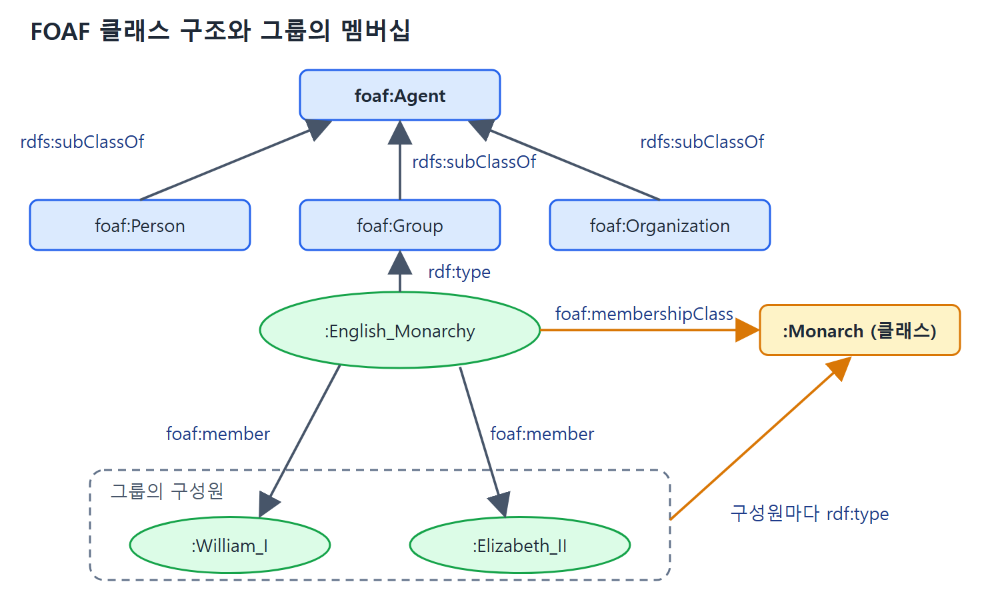

# FOAF로 사람과 모임 설명하기

FOAF(Friend of a Friend, "친구의 친구")는 사람과 사람 사이의 관계를 여러 곳에 흩어 놓고도 설명할 수 있게 해 주는 어휘다. 이름에는 사회 연결망의 기본 성질이 담겨 있다. 내 친구는 내가 직접 알지만, 친구의 친구는 친구를 거쳐야만 닿는다.

이 문서는 FOAF의 설계 철학과 핵심 어휘(에이전트, 이름, 별명, 홈페이지, 그룹, 만든 것)를 다룬다. FOAF는 RDFS-Plus 구성 요소를 어떻게 쓸지 보여 주는 좋은 교재다. 신원 식별과 사람 사이의 연결은 다음 문서에서 다룬다.

---

## 1. FOAF가 풀려는 문제

FOAF 프로젝트는 2000년 초에 시작되어 Instagram, LinkedIn, Facebook 같은 인기 소셜 네트워킹 사이트보다 앞선다. 그런데 FOAF가 다루려던 문제인 프라이버시, 소유권, 데이터 분산은 10년 뒤 소셜 네트워크 업계의 핵심 논쟁이 되었고 지금도 그렇다.

출발점은 단순한 관찰이었다. 웹에서 소셜 네트워크를 지원하려면 개인이 자기 데이터를 직접 통제해야 한다. 원하는 곳에 호스팅하고 원하는 도구로 관리하되, 다른 사용자가 어떤 선택을 하든 그들과 상호작용할 수 있어야 한다. 성공한 소셜 사이트들은 처음에 이런 점을 고려하지 않았다. FOAF는 사용자가 여러 소셜 사이트와 응용에 흩어진 자기 정보를 통합하려는 "오픈 소셜" 노력의 바탕이기도 하다.

### AAA 원칙

FOAF는 AAA 원칙(Anyone can say Anything about Any topic, 누구나 어떤 주제에 대해서도 무엇이든 말할 수 있다)을 따른다. FOAF에서는 주로 사람이 그 주제다. 사람과 함께 얘기할 만한 대상인 조직(사람이 속한 곳), 프로젝트(사람이 하는 일), 문서(사람이 만들었거나 사람을 설명하는 것), 이미지(사람이 찍힌 것)도 핵심 FOAF 설명에 들어 있다.

한 사람에 대한 정보는 웹 여기저기에 서로 다른 형태로 흩어져 있기 마련이다.

| 정보가 있는 곳 | 담긴 내용 |
|---|---|
| 본인 웹 페이지 | 관심사, 현재 프로젝트, 이미지 |
| 파티나 학회의 사진 모음 | 본인이 목록에 올리지 않은, 그 사람이 찍힌 사진 |
| 학회 주최 측 페이지 | 저자 목록에 이름이 오른 논문(저자가 자기 사이트에 안 올렸더라도) |
| 연구실이나 사무실 페이지 | 구성원 목록 |

FOAF는 RDF가 가진 분산 성질을 이용해 이런 정보를 분산된 채로 표현한다. 일부 소셜 네트워킹 사이트는 FOAF로 정보를 제공하기 시작했다.

### 왜 또 하나의 방식인가

사이트마다 구성원, 정보, 관계를 표현하는 자기 방식이 있는데 왜 또 하나가 필요할까. FOAF의 목적은 이들을 대체하는 것이 아니라 이 정보를 분산시킬 틀을 제공하는 것이다. 게다가 RDF 기반이라 확장 가능하다. AAA 원칙 덕에 누구나 사람, 프로젝트 등에 대해 새 진술을 할 수 있고, 그 진술을 이미 있는 진술과 연결할 수 있다.

### 점진적으로 자라는 어휘

FOAF는 늘 진행 중인 작업이다. 일부 어휘는 의미가 FOAF "표준" 문서의 자연어 설명으로만 정의되어 있다. 다른 어휘는 RDFS-Plus로 나머지 설명과 형식적으로 연결되어 있다. FOAF는 직관적인 용어 몇 개로 시작해서 쓰이는 동안 의미를 다듬는 유기적 성장을 지향한다. 처음에 어휘를 확정할 필요가 없다. 원하는 관계가 정해지면 RDFS-Plus로 새 어휘와 옛 어휘를 연결하면 되기 때문이다.

FOAF는 시작점으로 클래스와 속성을 소수만 둔다. 이들은 일관성을 유지하고 정보 병합 정책을 구현하는 데 RDFS-Plus의 기본 구성 요소를 쓴다. 중심 클래스는 세 개다.

| 클래스 | 설명 |
|---|---|
| foaf:Person | 사람 |
| foaf:Group | 사람의 모임 |
| foaf:Document | 문서(웹 페이지, 블로그 등) |

## 2. 사람과 에이전트

FOAF가 주로 사람을 다루기는 하지만, 사람에 대해 하려는 말 중에는 그룹, 회사 같은 다른 대상에도 맞는 것이 있다. 그래서 `foaf:Person`을 `foaf:Agent`라는 더 일반적인 묶음 아래에 둔다.

```turtle
foaf:Person rdfs:subClassOf foaf:Agent .
foaf:Group rdfs:subClassOf foaf:Agent .
foaf:Organization rdfs:subClassOf foaf:Agent .
```

`foaf:Person`에 할 수 있는 말의 상당수는 `foaf:Agent` 전체에 성립한다. 사실 FOAF는 이 점에서 꽤 너그러워서 여기서 설명하는 속성 대부분이 에이전트 일반에 적용된다. 클래스별 속성의 상세는 FOAF Vocabulary Specification(`http://xmlns.com/foaf/0.1/`)에 있다.

## 3. 이름

사람에 대해 가장 기본적인 것은 이름이다. 그런데 이름조차 복잡할 수 있다. FOAF는 단순한 개념인 `foaf:name`으로 시작한다.

```turtle
foaf:name rdfs:domain owl:Thing .
foaf:name rdfs:subPropertyOf rdfs:label .
```

세상의 무엇이든 이름을 가질 수 있고(`foaf:Person`도 포함), 그 이름은 그것의 출력용 라벨로도 쓰인다는 뜻이다. 사람의 경우 이름은 보통 "William Shakespeare", "Anne Hathaway" 같은 전체 이름이다.

상황에 따라 이름의 부분이 필요하다. FOAF는 `foaf:firstName`, `foaf:givenname`, `foaf:family_name`, `foaf:surname` 네 속성을 정의한다. 각각 직관적인 뜻이 있지만 형식적인 의미론은 없고, 뜻은 글 설명과 진화하는 사용 관행으로만 주어진다. 문화에 따라 이름 쓰는 법이 다르다는 점이 문제가 된다. 개인 이름이 항상 앞에 오는 것은 아니고, 가족 이름이 늘 성(surname)이라는 보장도 없다. 일부 문화에서 아직 쓰는 "Christian name" 같은 문화권 특유의 이름을 다른 이름과 어떻게 연결할지도 정해지지 않았다.

RDF 기반의 장점은 이 모든 문제를 풀지 않고도 FOAF 어휘로 데이터에 표시를 시작할 수 있다는 것이다. FOAF의 전략은 사람 이름을 일단 `foaf:name`으로 표시하고, 성, 이름 같은 다른 이름 어휘도 같이 제공하는 것이다. 어느 것이 유용할지는 사용 양상이 정한다. 예를 들어 두 속성이 완전히 똑같이 쓰인다는 사실이 드러나면 OWL로 관계를 선언하면 된다.

```turtle
foaf:surname owl:equivalentProperty foaf:family_name .
```

## 4. 별명과 온라인 이름

FOAF는 주로 웹에서 쓰이므로 설명 대상 중 다수가 인터넷 공동체에서 활동할 것으로 본다. 예를 들어 어떤 사람은 온라인 채팅 서비스에서 쓰는 화면 이름이 있다. FOAF는 현재 `foaf:aimChatID`, `foaf:icqChatID`, `foaf:msnChatID`, `foaf:yahooChatID`를 식별한다. 확장성 정신에 따라 필요하면 ID 속성을 더할 수 있다.

이 속성들의 의미는 일부는 자연어 설명(예: `foaf:yahooChatID`가 채팅 서비스 Yahoo!와 연결됨)으로 주어지지만, FOAF는 이들 사이의 형식적 연결도 둔다. 모두 `foaf:nick`의 하위 속성이다.

```turtle
foaf:aimChatID rdfs:subPropertyOf foaf:nick .
foaf:icqChatID rdfs:subPropertyOf foaf:nick .
foaf:msnChatID rdfs:subPropertyOf foaf:nick .
foaf:yahooChatID rdfs:subPropertyOf foaf:nick .
foaf:jabberID rdfs:subPropertyOf foaf:nick .
```

6장에서 배운 `rdfs:subPropertyOf` 규칙(하위 속성으로 쓴 트리플은 상위 속성으로 쓴 트리플로도 성립한다는 규칙)에 따르면, 채팅 공간에서 활동하는 사람은 `foaf:nick` 값이 여러 개일 것이다. 별명이 여러 개라는 뜻이다. 물론 그 밖의 별명도 가질 수 있다. 셰익스피어가 인터넷 채팅방에서 활동하게 되었다고 하면, FOAF 관점에서 그 화면 이름은 전부 별명이다.

```turtle
lit:Shakespeare foaf:aimChatID "Willie1564".
lit:Shakespeare foaf:msnChatID "TempestMan".
lit:Shakespeare foaf:nick "Willie1564".
lit:Shakespeare foaf:nick "TempestMan".
```

앞 두 줄은 직접 쓴 사실이고, 뒤 두 줄은 위 하위 속성 규칙으로 추론되는 사실이다. 화면 이름으로 쓰지 않는 별명도 직접 쓸 수 있다.

```turtle
lit:Shakespeare foaf:nick "The Bard of Avon".
```

## 5. 온라인 모습: 메일과 홈페이지

인터넷은 사람이 자신을 표현하는 여러 방법을 제공하고, FOAF는 그에 맞춰 속성을 계속 고친다. 사람은 대체로 전자 우편함이 있고, FOAF는 이를 위해 `foaf:mbox`를 둔다. 개인 홈페이지, 직장이나 학교 홈페이지를 둘 다 가진 사람도 있고, 직장 자체의 홈페이지도 있다. FOAF는 여기서도 이름과 같은 전략을 쓴다. 자연어로 비형식적으로 정의한 속성을 다양하게 제공한다.

| 속성 | 의미 | 적용 범위 |
|---|---|---|
| foaf:homepage | 주된 홈페이지 | FOAF의 모든 대상 |
| foaf:workplaceHomepage | 그 사람의 직장 홈페이지 | foaf:Person만 가질 수 있다 |
| foaf:workInfoHomepage | 직장에서 그 사람의 홈페이지. 보통 고용주가 호스팅하되 본인의 업무에 대한 페이지 | 원서에 별도 제한은 적혀 있지 않다 |
| foaf:schoolHomepage | 그 사람이 다닌 학교의 홈페이지 | foaf:Person을 위한 속성으로 소개된다 |
| foaf:weblog | 그 사람의 블로그 주소 | 원서에 별도 제한은 적혀 있지 않다 |

어떤 것이든 홈페이지를 가질 수 있지만(고용주도 가능), 직장 홈페이지(workplaceHomepage)는 `foaf:Person`만 가질 수 있다. 인터넷이 새 표현 수단을 주면 FOAF도 따라간다. 이 속성들의 값은 모두 `foaf:Document`의 인스턴스다. 웹 페이지도, 블로그도 `foaf:Document`다.

## 6. 사람들의 모임: Group

사람에게서 흥미로운 점은 소속된 모임이다. FOAF는 이를 정의하는 `foaf:Group` 클래스를 두고, 그룹과 구성원은 `foaf:member`로 잇는다. 그룹의 정의는 아주 느슨해서 사람의 어떤 묶음이든 이렇게 표현할 수 있다. 예로 영국 왕실을 그룹으로 정의해 본다.

```turtle
:English_Monarchy
    a foaf:Group ;
    foaf:name "English Monarchy" ;
    foaf:homepage "http://www.monarchy.com/" ;
    foaf:member :William_I, :Henry_I, :Henry_II,
                :Elizabeth_I, :Elizabeth_II .
```

FOAF에서 그룹은 `foaf:Group` 타입의 개체다. 그래서 `foaf:name`처럼 개체에 쓸 수 있는 속성을 쓸 수 있다. 사실 `foaf:Group`은 `foaf:Person`과 공통점이 많아서 채팅 ID, 별명, 메일함, 홈페이지, 블로그도 가질 수 있다.

### 그룹과 클래스의 연결: membershipClass

그룹 구성원을 클래스의 인스턴스로 보면 편할 때가 있다. 즉 `foaf:Group` 인스턴스를 `rdfs:Class`와 잇는다. FOAF는 이를 위해 그룹에서 클래스로 가는 `foaf:membershipClass`를 제공한다. English_Monarchy의 멤버십 클래스가 `Monarch`라면 이렇게 쓴다.

```turtle
:English_Monarchy foaf:membershipClass :Monarch .
:William_I a :Monarch .
:Elizabeth_II a :Monarch .
```

원서는 다섯 명 전부에 `a :Monarch`를 적는다. 위에서는 두 줄만 옮겼다.

이상적으로는 이 트리플들이 자동으로 유지되어야 한다. 타입이 Monarch인 개체는 모두 English_Monarchy의 구성원으로 나타나야 하고, English_Monarchy의 구성원은 모두 Monarch 타입이어야 한다. 이 조건은 FOAF 설명에 명시되어 있다. 12장에서 OWL로 이 트리플을 추론할 수 있는 모델을 만드는 방법을 본다.



위쪽은 Person, Group, Organization이 모두 foaf:Agent의 하위 클래스임을 보여 주고, 아래쪽은 :English_Monarchy가 foaf:member로 구성원을 잇고 foaf:membershipClass로 :Monarch 클래스를 가리키는 모습을 보여 준다.

### 인스턴스와 클래스의 미묘한 차이

| 대상 | 정체 | 말할 수 있는 것 |
|---|---|---|
| Monarch | RDFS의 타입(클래스) | 속성의 domain, 하위 클래스 같은 스키마적인 사항 |
| English_Monarchy | foaf:Group의 개체 | 군주제라는 제도 자체: 역사, 그에 대한 웹 페이지와 책 등 |

지금까지 예에서는 클래스의 세계와 인스턴스의 세계를 따로 뒀고, 인스턴스와 클래스의 유일한 관계는 `rdf:type`이었다. `foaf:membershipClass`의 직관은 이 속성이 가리키는 클래스의 인스턴스가 그룹의 구성원과 정확히 같다는 것이다. 한 대상을 어떤 때는 인스턴스(English_Monarchy는 `foaf:Group`의 인스턴스)로, 어떤 때는 클래스(Monarch는 그룹의 `foaf:member`인 모든 인스턴스를 나타내는 클래스)로 보는 이런 표현을 메타모델링(metamodeling, 모델을 설명하는 모델링)이라 한다. OWL의 나머지를 배울 때 메타모델링을 더 보고, OWL로 `foaf:Group`과 `foaf:membershipClass`의 관계를 형식화하는 방법도 본다.

## 7. 사람이 만들고 하는 일

흥미로운 사람은 뭔가를 만든다. 책을 쓰고, 웹 페이지를 내고, 예술 작품을 만들고, 회사를 세우고, 조직을 시작한다. FOAF는 사람과 창작물을 잇는 `foaf:made`와 `foaf:maker`를 둔다. 서로 역(inverse) 관계이며, `foaf:Agent`와 `owl:Thing`을 잇는다.

```turtle
foaf:made rdfs:domain foaf:Agent .
foaf:made rdfs:range owl:Thing .
foaf:maker rdfs:domain owl:Thing .
foaf:maker rdfs:range foaf:Agent .
foaf:made owl:inverseOf foaf:maker .
```

설명 가능한 세계의 어떤 것이든 어느 에이전트가 만들 수 있다는 뜻이다. 다른 에이전트에게도 maker가 있을 수 있다.

저자는 보통 출판물이 있다. `foaf:publications` 속성은 `foaf:Person`을 발표된 `foaf:Document`와 잇는다. 흥미롭게도 FOAF는 사람이 자신의 publications를 `foaf:made`했다고 명시하지 않는다. AAA 정신에 따라 그렇게 말하고 싶다면 직접 한 줄 추가하면 된다.

```turtle
foaf:publications rdfs:subPropertyOf foaf:made .
```

## 8. 정리

| 개념 | FOAF의 모델링 | 쓰인 구성 요소 |
|---|---|---|
| Person, Group, Organization | 모두 foaf:Agent의 하위 클래스 | rdfs:subClassOf |
| name | 모든 것이 가질 수 있고, rdfs:label의 하위 속성 | rdfs:domain, rdfs:subPropertyOf |
| surname과 family_name | 같은 쓰임이면 동등 속성으로 선언 | owl:equivalentProperty |
| 채팅 ID들 | 전부 foaf:nick의 하위 속성 | rdfs:subPropertyOf |
| made와 maker | 서로 역 속성 | owl:inverseOf, rdfs:domain, rdfs:range |
| publications | made의 하위 속성으로 선언할 수 있다 | rdfs:subPropertyOf |
| Group과 membershipClass | 인스턴스와 클래스를 잇는 메타모델링 | 12장에서 OWL로 형식화 |

이 표에서 보듯 FOAF는 새 문법이 아니라 이미 배운 몇 가지 구성 요소의 조합만으로 사람 설명 어휘를 만든다.

<br>
<br>
<br>

[Semantic Web for the Working Ontologist](../)
