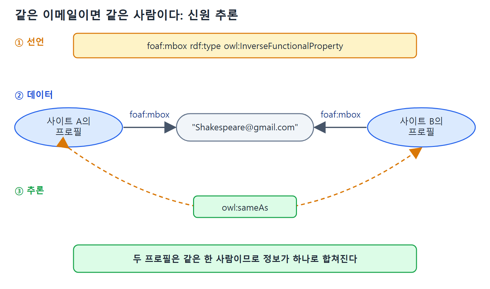

# FOAF의 신원 식별과 사람 연결

누구나 누구에 대해서든 말할 수 있다는 AAA 원칙에는 현실적인 문제가 따라온다. 내 정보는 내가 직접 쓰면 된다. 하지만 다른 사람이 나에 대한 정보를 쓰려면 나를 가리킬 방법이 있어야 한다. 사이트마다 따로 만든 내 프로필을 하나로 합칠 때도 "나"라는 하나의 대상에 묶을 근거가 필요하다.

이 문서는 FOAF가 이 신원 식별 문제를 이메일과 owl:InverseFunctionalProperty로 푸는 방법, 이메일을 그대로 공개할 수 없어서 해시값으로 가리는 방법, 그리고 사람을 서로 잇는 foaf:knows를 일부러 느슨하게 둔 이유를 설명한다.

---

## 1. 신원 문제와 URI

이것은 오늘날 소셜 네트워킹의 핵심 문제다. OpenID 같은 시스템은 개인이 여러 소셜 네트워크를 가로지르는 단일 신원을 갖도록 이름 짓기 서비스를 제공한다.

RDF의 접근은 단순하다. RDF는 설명하는 대상을 URI로 가리킨다. 그러니 나를 가리키는 URI가 있고, 나에 대해 말하고 싶은 사람은 모두 그 URI로 말하면 된다. 간단하고 우아하고 표준적인 해법이다. OpenID가 쓰는 방식이고, 어느 정도는 모든 소셜 네트워크 시스템이 쓰는 방식이다. 사용자의 화면 이름이 URI가 되고, 같은 시스템에서는 두 사용자가 같은 이름을 못 쓰므로 `http://www.facebook.com/…` 같은 URI가 가리키는 대상은 모호하지 않다.

### 그런데 분산 시스템에서는

FOAF는 분산된 소셜 네트워킹 시스템이다. 사람들이 각자 URI를 임의로 만들어 쓰기를 기대하기는 어려워 보인다. 그래도 소셜 네트워킹이 성숙하면서 이 해법이 점점 현실적이 되고 있다. 실제로 많은 응용에서 Facebook 신원이 다른 소셜 네트워크에서도 공유 신원으로 쓰여 웹의 이름 짓기 권위(naming authority) 노릇을 한다. OpenID도 마찬가지다.

하지만 이런 것들이 널리 퍼졌어도 보편적이지는 않다. Facebook 계정 없이도 활발한 인터넷 시민이 될 수 있다. 특히 FOAF가 어렸던 시절에는 이런 이름 짓기 권위가 널리 쓰이지 않았다. FOAF에는 이미 어디서나 쓰이고 익숙한 인터넷 기반을 이용해 서로를 가리킬 방법이 필요했다. 인터넷 사용자가 모두 이미 갖고 있고 익숙한 식별 표지로 가장 분명한 것은 이메일이다.

## 2. 이메일이 신원이 된다

웹에서 어떤 식으로든 설명되는 사람은 거의 모두 이메일 주소가 있다. 2010년에도 Webfinger 같은 노력은 소셜 웹의 신원 문제를 다루려고 같은 방식, 즉 이메일 주소의 보편성과 친숙함을 이용하는 접근을 취했다.

이메일은 식별 수단으로 꽤 잘 맞는다. 두 사람이 같은 이메일 주소를 쓰는 일은 매우 드물고, 그런 경우도 이메일 시스템 관점에서는 같은 사용자로 취급할 수 있다. FOAF의 목적에서는 이메일을 사람의 고유 식별자로 써도 될 만큼 드물다.

| 상황 | FOAF에서 문제가 되나 |
|---|---|
| 한 사람이 이메일 주소를 둘 이상 갖는다 | 문제없다 |
| 이메일 주소가 한정된 기간에만 유효하다 | 문제없다 |
| 다른 사람이 같은 주소를 (동시에 또는 나중에) 공유한다 | FOAF가 요구하는 유일한 금지 사항이다 |

FOAF가 이메일 주소에 요구하는 것은 다른 사람과 공유되지 않는다는 한 가지뿐이다.

### owl:InverseFunctionalProperty로 선언한다

이 제약을 평범한 말로 하면 같은 이메일 주소를 공유하는 두 사람은 실은 두 사람이 아니라 같은 한 사람이라는 뜻이다. 이미 배운 것처럼 RDFS-Plus에 이 관계를 형식화하는 방법이 있다. 값이 개체를 유일하게 식별하는 속성을 `owl:InverseFunctionalProperty`(역함수 속성)라 한다. FOAF에서 `foaf:mbox`가 신원 식별에 하는 핵심 역할은 트리플 하나로 표현된다.

```turtle
foaf:mbox rdf:type owl:InverseFunctionalProperty .
```

추론은 이렇게 작동한다. 두 주어가 같은 `foaf:mbox` 값을 가지면, 두 주어는 같은 대상이라고 추론한다(owl:sameAs). 서로 다른 사이트에서 같은 이메일로 만든 두 프로필이 하나의 사람으로 합쳐지는 이유다.



선언, 데이터, 추론 순서로 읽는다. foaf:mbox가 역함수 속성으로 선언되어 있으므로 같은 이메일 값을 가리키는 두 프로필은 owl:sameAs로 이어진다. 그림의 두 프로필은 설명을 위해 만든 가상의 예이다.

같은 말을 다른 속성에도 할 수 있다. 두 사람이 같은 `yahooChatID`나 `aimChatID`를 가지는 일도 드물다. FOAF에서 다음 속성이 모두 `owl:InverseFunctionalProperty`다.

| 속성 | 식별에 쓰이는 값 |
|---|---|
| foaf:aimChatID | AIM 채팅 ID |
| foaf:homepage | 홈페이지 |
| foaf:icqChatID | ICQ 채팅 ID |
| foaf:jabberID | Jabber ID |
| foaf:mbox | 이메일 주소 |
| foaf:msnChatID | MSN 채팅 ID |
| foaf:yahooChatID | Yahoo 채팅 ID |

이 표의 모든 속성은 `rdf:type owl:InverseFunctionalProperty` 선언을 한 줄씩 가진다. 값이 같으면 같은 대상이라고 본다는 점에서 데이터 병합의 열쇠가 된다. 개발자 비유로는 관계형 DB의 유니크 키(unique key)와 비슷하다. 다만 DB는 중복을 거부하지만 RDF는 중복을 "같은 대상"이라고 추론해서 합친다.

## 3. 프라이버시: 이메일을 그대로 쓸 수 없다

이메일이나 비슷한 속성을 식별자로 쓰면 기술 문제는 풀리지만 새 문제가 생긴다. 이메일 주소를 공개하면 프라이버시 침해로 여겨진다. 이메일 주소와 채팅 ID는 원치 않는 메일, 불쾌한 메일, 대용량 메일로 사람을 괴롭히거나 공격하는 데 쓰일 수 있다.

셰익스피어에 AAA 원칙을 적용하려 하는데 그의 이메일 주소가 `Shakespeare@gmail.com`이라고 해 보자. "이 이메일을 가진 사람"이라고 빈 노드로 가리키면 된다.

```turtle
[ foaf:mbox "Shakespeare@gmail.com" ]
```

그러나 그러면 그의 이메일 주소를 평문으로 공개하게 되어 정보를 가로채는 사람들이 쓸 수 있다. 아는 사람, 존경하는 사람에게 할 짓이 못 된다.

### 해시로 가린 foaf:mbox_sha1sum

그래서 FOAF는 `foaf:mbox`를 가린 버전인 `foaf:mbox_sha1sum`을 둔다. 이메일 주소에 SHA-1이라는 해시 함수(입력을 고정 길이의 문자열로 바꾸는 함수)를 적용한 결과다. SHA-1은 공개된 함수지만 결과에서 원래 값을 거꾸로 알아내기가 매우 어렵다. 셰익스피어의 이메일에 적용해 얻은 문자열이 `f964f2dfd4784fe9d68ada960099e0b592e16a95`이고, 이 값으로 그를 가리킬 수 있다.

```turtle
[ foaf:mbox_sha1sum
    "f964f2dfd4784fe9d68ada960099e0b592e16a95" ]
```

이렇게 하면 프라이버시를 침해하지 않고 같은 대상을 가리킬 수 있다. 같은 이메일은 항상 같은 해시가 되기 때문이다.

한계도 있다. FOAF는 `foaf:aimChatID`, `foaf:yahooChatID` 같은 다른 식별 속성을 가리는 표준 방법은 제공하지 않는다. FOAF를 갱신하자는 제안 여럿이 이를 포함하고 있다고 원서는 밝힌다.

| 방식 | 값 | 프라이버시 | 같은 사람 판별 |
|---|---|---|---|
| foaf:mbox | 이메일 평문 | 노출된다 | 가능 |
| foaf:mbox_sha1sum | 이메일의 SHA-1 해시 | 원래 주소를 알아내기 매우 어렵다 | 같은 이메일이면 같은 값이라 가능 |
| 채팅 ID 속성들 | 평문 ID | 가리는 표준 방법이 없다 | 가능 |

## 4. 아는 사이: foaf:knows

FOAF가 소셜 네트워킹 시스템인 핵심은 한 사람을 다른 사람에게 잇는 능력이다. FOAF는 이 관계를 상위 수준 속성 하나, `foaf:knows`로 둔다. 발상은 단순하다. 어떤 사람이 다른 사람을 알고, 그 사람은 또 다른 사람을 아는 식으로 사람이 사람을 아는 연결망이 형성된다. `foaf:knows`에 대한 추론은 많지 않다. 정의된 트리플은 다음뿐이다.

```turtle
foaf:knows rdfs:domain foaf:Person .
foaf:knows rdfs:range foaf:Person .
```

즉 `foaf:knows`는 한 `foaf:Person`을 다른 `foaf:Person`에 이을 뿐이다.

### 일부러 느슨하게 둔 이유

추론이 거의 없는 것은 설계 의도다. `foaf:knows`는 사람 사이의 어떤 관계를 나타내되 일부러 모호하게 정의되어 있다. 그런 관계는 다른 정보에서 비형식적으로 결론 낼 수도 있다. 예를 들어 공저자는 보통 서로 안다고 가정할 수 있다.

또 한 사람이 다른 사람을 알면 그 관계가 서로 같을 것이라고 생각하기 쉽다. 그런데 FOAF 설계자들은 `foaf:knows`를 `owl:SymmetricProperty`(대칭 속성)로 선언하지 않았다. 한 사람이 다른 사람을 아는지에 대해 의견이 갈릴 수도 있다고 보았기 때문이다.

| 속성 선언 | foaf:knows에서 | 이유 |
|---|---|---|
| rdfs:domain, rdfs:range | foaf:Person으로 선언한다 | 사람과 사람을 잇는다 |
| owl:SymmetricProperty | 선언하지 않는다 | 서로 안다는 데 의견이 다를 수 있다 |
| 그 밖의 추론 규칙 | 거의 없다 | 일부러 모호하게 둔다 |

정의가 모호해도 `foaf:knows`는 FOAF를 소셜 네트워킹에 쓰기 위한 기반 시설을 제공한다. 한 사람을 다음 사람에게, 다시 그다음 사람에게 잇기 때문이다.

## 5. 정리

- 신원 문제의 RDF식 해법은 URI다. 그러나 분산 환경에서는 모두가 URI를 일관되게 쓰기를 기대하기 어렵다.
- FOAF는 누구나 이미 가진 이메일을 식별에 쓰고, `owl:InverseFunctionalProperty`로 "값이 같으면 같은 대상"이라는 규칙을 선언한다.
- 이메일 평문의 공개는 프라이버시 문제라서 SHA-1 해시를 쓰는 `foaf:mbox_sha1sum`이 있다. 다른 식별 속성에는 표준 가림 방법이 아직 없다.
- `foaf:knows`는 의도적으로 느슨해서 domain과 range 외에는 추론 규칙을 거의 두지 않는다.

<br>
<br>
<br>

[Semantic Web for the Working Ontologist](../)
