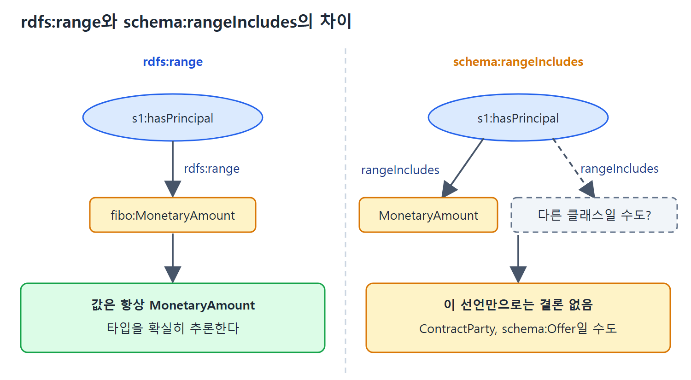

# Schema.org의 모델링 방식과 의미

Schema.org는 RDFS와 매우 비슷하게 생긴 모델링 방식을 쓰면서도, 핵심 부분에서는 RDFS의 구성 요소를 쓰지 않고 자기만의 속성을 정의했다. 이 문서는 그 선택이 무엇이고, 왜 그렇게 했으며, 그 결과 추론에서 무엇이 달라지는지 설명한다. 처음 보면 "그냥 같은 걸 이름만 바꿨나" 싶지만, 의미가 꽤 다르다.

앞 문서의 Plush Beauty Bar 예제를 이어서 쓴다. 따라서 Schema.org의 기본 구조를 먼저 읽고 오면 좋다.

---

## 1. Schema.org의 규모와 클래스 정의

원서가 쓰인 시점에 Schema.org에는 클래스 약 600개, 속성 약 900개가 있었다. 열린 커뮤니티가 관리하기 때문에 이 숫자는 계속 늘어난다. 이 수치는 책 집필 시점 기준이다.

클래스 정의는 `rdfs:Class`로 표현한다. Plush 예제에 필요한 클래스 몇 개는 다음처럼 정의된다.

```turtle
schema:DaySpa rdf:type rdfs:Class ;
    rdfs:label "DaySpa" ;
    rdfs:subClassOf schema:HealthAndBeautyBusiness .
schema:UnitPriceSpecification rdf:type rdfs:Class ;
    rdfs:label "UnitPriceSpecification" ;
    rdfs:subClassOf schema:PriceSpecification .
```

원서의 그림 10.4에는 Offer, Service, TypeAndQuantityNode(상위 클래스는 StructuredValue)의 정의도 같은 형태로 있다. 이 정의들은 `rdfs:subClassOf` 같은 간단한 RDFS 개념만 쓴다. 이 클래스에 어떤 속성을 쓰면 되는지는 여기서 알 수 없다.

| 클래스 | 상위 클래스 |
|---|---|
| schema:DaySpa | schema:HealthAndBeautyBusiness |
| schema:TypeAndQuantityNode | schema:StructuredValue |
| schema:UnitPriceSpecification | schema:PriceSpecification |
| schema:Offer, schema:Service | 원서의 그림에는 상위 클래스 줄이 없다 |

## 2. 클래스와 속성을 잇는 방법: domain과 range

RDFS에서는 클래스와 속성의 관계를 `rdfs:domain`(이 속성을 쓰는 주어의 클래스)과 `rdfs:range`(속성 값의 클래스)로 말한다. 그런데 8.5절에서 봤듯이 RDFS에서 domain 선언을 여러 개 하면 그 선언들의 교집합을 말한 셈이 된다. range도 마찬가지다.

Schema.org가 원한 것은 반대로 합집합이다. 같은 속성을 여러 클래스에 쓰고 싶다는 뜻이다. 8.3절에서 RDFS로 합집합 비슷한 것을 표현할 수 있다고 했지만, 원하는 합집합마다 특별한 클래스를 하나씩 만들어야 한다. Schema.org가 필요한 것은 "이 클래스도 domain(또는 range)이다"라고 쓰기만 하면 실제 domain이 그 클래스들의 합집합이 되는 방식이다.

그래서 Schema.org는 자체 속성 두 개를 정의했다.

| 속성 | 쓰는 법 | 의미 |
|---|---|---|
| schema:domainIncludes | rdfs:domain처럼 쓴다 | 속성의 실제 domain에 이 클래스가 포함된다 |
| schema:rangeIncludes | rdfs:range처럼 쓴다 | 속성의 실제 range에 이 클래스가 포함된다 |

예를 들어 `schema:unitCode`는 복합 값의 단위를 가리키는 속성이다. Plush 예제에서는 1.5시간의 단위로 썼지만 `UnitPriceSpecification`의 단위에도 쓸 수 있다. 이를 domain 트리플 두 개로 표현한다.

```turtle
schema:unitCode rdf:type rdf:Property ;
    schema:domainIncludes schema:TypeAndQuantityNode ;
    schema:domainIncludes schema:UnitPriceSpecification .
```

이 선언으로 unitCode는 모든 `TypeAndQuantityNode`와 모든 `UnitPriceSpecification`에 쓸 수 있다. 같은 일을 `rdfs:domain`으로 두 줄 쓰면 "둘 다에 속하는 것"만 주어가 된다.

Schema.org 의미론 전체를 다루는 일은 이 책의 범위를 넘는다. 원서는 Patel-Schneider(2014) 문헌을 참고하라고 안내한다.

## 3. 왜 rdfs:range 대신 rangeIncludes인가

Schema.org가 자기 모델링 언어를 만들기로 한 결정이 어떤 결과를 낳는지, 원서는 금융 예시로 설명한다.

### 비유: 같은 단어, 다른 뜻

금융에서 "principal"은 두 가지 뜻이 있다. 하나는 대출의 원금, 즉 빌린 돈의 액수다. 다른 하나는 계약의 주요 당사자다. 같은 단어를 두 데이터 소스가 다른 뜻으로 쓸 수 있다.

두 데이터셋이 모두 `hasPrincipal`이라는 속성을 쓴다고 하자. 각각을 `s1:hasPrincipal`, `s2:hasPrincipal`이라 부른다. 영어 문서로 설명해 둘 수도 있지만, 그런 설명은 모호하고 기계가 못 읽는다. 대신 모델 정보를 기계가 읽는 형태로 준다고 해 보자.

```turtle
s1:hasPrincipal rdfs:range fibo:MonetaryAmount .
s2:hasPrincipal rdfs:range fibo:ContractParty .
```

`fibo:`는 금융 업계의 표준 온톨로지인 FIBO(Financial Industry Business Ontology)의 네임스페이스로, 14.4절에서 더 다룬다. 지금은 금융 용어의 기준이 되는 자료라고만 알면 된다.

### rdfs:range를 쓰면 확실히 알 수 있다

위 두 줄에서 `s1:hasPrincipal`은 돈의 액수를 가리킨다고 결론 내릴 수 있다. 이 속성을 s1 데이터셋에서 쓰면 값은 항상 `fibo:MonetaryAmount`의 구성원이기 때문이다. 8.2절의 range 정의가 정확히 그 결론이다. `s2`도 마찬가지로 계약 당사자라는 결론이 난다.

이 선언은 열린 세계 가정(Open World Assumption, 모르는 것은 거짓이 아니라 아직 모르는 것으로 두는 전제) 아래서도 유지된다. `s1:hasPrincipal`에 대해 앞으로 더 많은 것을 알게 되더라도 값은 계속 MonetaryAmount다. 데이터를 재사용할 사람(곧 우리)에게 쓰임새를 명확하고 모호함 없이 알려 준 셈이다.

### rangeIncludes를 쓰면 결론이 안 난다

이제 같은 정보를 `schema:rangeIncludes`로 썼다고 하자.

```turtle
s1:hasPrincipal schema:rangeIncludes fibo:MonetaryAmount .
s2:hasPrincipal schema:rangeIncludes fibo:ContractParty .
```

여기서 s1의 값이 돈의 액수라고 결론 낼 수 있을까. 없다. 이 선언은 값이 MonetaryAmount일 수도 있고, 모델의 다른 곳이나 웹의 다른 곳에 적힌 다른 클래스일 수도 있다고 말할 뿐이다. ContractParty일 수도 있고 전혀 다른 `schema:Offer`일 수도 있다. 이 시점에서 끌어낼 결론은 없다.



왼쪽은 rdfs:range로 선언해서 값의 타입이 확실히 정해지는 경우이고, 오른쪽은 rangeIncludes로 선언해서 다른 클래스일 가능성이 남아 결론을 낼 수 없는 경우이다.

### 두 방식의 비교

| 관점 | rdfs:range | schema:rangeIncludes |
|---|---|---|
| 의미 | 값은 반드시 이 클래스의 구성원이다 | 값은 이 클래스일 수도 있다 |
| 추론에서 끌어낼 수 있는 것 | 값의 타입 | 이 선언만으로는 없다 |
| 열린 세계 가정과의 관계 | 새 정보가 와도 계속 참이다 | 모델이 한곳에 다 모여 있다고 알 때만 결론이 난다 |
| 어울리는 환경 | 메타데이터가 여기저기 분산된 환경 | 모든 메타데이터가 한곳에 있는 마스터 데이터 모델링 환경 |
| 모델러의 부담 | 틀림없이 참인 진술을 해야 한다 | 아는 용도를 하나씩 모아 적으면 된다 |

분산된 메타데이터라는 관점에서는 `rdfs:range`가 훨씬 정보가 많다. RDFS가 원래 그런 환경을 염두에 두고 설계되었기 때문이다. 반면 모든 메타데이터를 한곳에서 볼 수 있는 마스터 데이터 모델링 관점에서는 `schema:rangeIncludes`가 훨씬 실용적이다. 모델러가 열린 세계 가정에서도 틀리지 않을 강한 진술을 할 필요가 없기 때문이다. 알고 있는 올바른 용도를 모아서 하나씩 rangeIncludes로 달면 된다.

사용하는 쪽에서는 이렇게 된다. 내가 `s1:hasPrincipal`에 대한 모든 정의를 다 봤다고 확신할 수 있다면, 즉 더 이상의 정의 트리플이 없다고 알면 rangeIncludes에서도 결론을 낼 수 있다. 예제에서는 s1의 principal이 `fibo:MonetaryAmount`라고 결론 낼 수 있다.

## 4. Schema.org 요약

- Schema.org는 웹 콘텐츠 제공자가 페이지를 표시해 사업 제안을 설명할 수 있게 한다.
- RDFS의 모델링 구조를 느슨하게 바탕으로 삼고, QUDT와 FIBO처럼 Schema.org 밖에서 정의된 자원을 가리킬 수 있어 시맨틱 웹의 일부로 참여한다.
- 지금까지 주된 용도는 검색 엔진 최적화(SEO)와 리치 스니펫이다. 웹 데이터를 참조하려는 챗봇, 개인 비서 같은 응용도 Schema.org 마크업의 도움을 받는다.
- 웹 개발자를 염두에 두고 설계되어, 사이트를 관리한다면 표시하기가 쉽다.

### 내 데이터에 적용하는 순서

1. 이 장의 예제처럼 데이터를 Schema.org로 모델링한다.
2. RDFa, Microdata(4.1절), JSON-LD(3.8절) 중 하나로 웹 페이지에 심는다.
3. Google Structured Data Testing Tool(`https://search.google.com/structured-data/testing-tool`)이나 W3C의 RDFa distiller(`https://www.w3.org/2012/pyRdfa/`)로 Schema.org가 이 마크업을 어떻게 해석하는지 확인한다.

<br>
<br>
<br>

[Semantic Web for the Working Ontologist](../)
