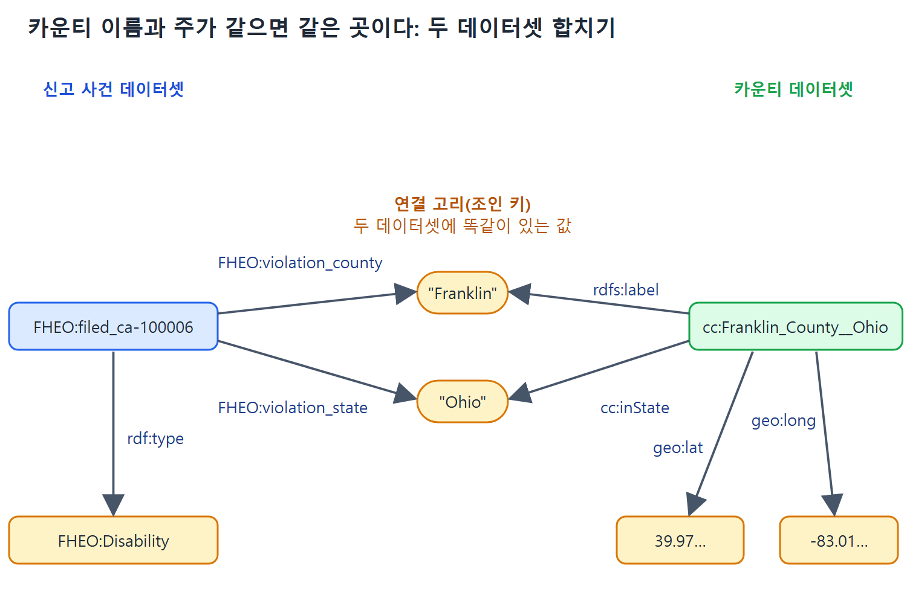

# 관계 검증과 지도 매시업

앞 문서에서 FHEO 신고 사건을 요인별 클래스로 나눴다. 이 문서는 그다음 단계를 다룬다. 클래스끼리 어떤 관계가 있는지 데이터로 확인해서 RDFS 한 줄로 못 박고, 그 모델이 현재 데이터와 맞는지 SPARQL로 검증하고, 마지막으로 다른 데이터셋과 합쳐 지도에 찍을 수 있는 결과를 만든다.

이 과정은 정부 데이터에 한정되지 않는다. "데이터에서 관계를 발견하고, 모델로 선언하고, 검증하고, 다른 데이터와 섞는다"는 흐름은 어떤 데이터에도 쓸 수 있다.

---

## 1. 데이터 속 관계를 찾아 RDFS로 쓰기

원본 속성에는 `:race`, `:national_origin`, `:religion` 같은 것이 있고, `:race_asian`, `:race_white`, `:national_origin_hispanic` 같은 것도 있다. 이 둘 사이에 관계가 있을 것 같다. 예를 들어 `:race_asian`으로 올라온 사건은 `:race`로도 올라와 있어야 하지 않을까. 그렇다면 어떻게 표현할까.

### 1단계: 데이터로 확인한다

Asian을 근거로 올린 사건 중에 Race도 근거로 올리지 않은 사건이 있는지 찾는다. 클래스로 말하면 `FHEO:Asian` 구성원이면서 `FHEO:Race` 구성원이 아닌 것이 있는지 묻는 것이다. SPARQL ASK(참, 거짓만 답하는 쿼리)로 쓴다.

```sparql
ASK
{ ?a a FHEO:Asian .
  FILTER NOT EXISTS {?a a FHEO:Race }}
```

이 RDF 데이터셋에서 실행하면 답은 false다. 즉 Asian 차별 사건은 모두 인종 차별 사건이기도 하다.

### 2단계: 모델에 못 박는다

이 관계를 RDFS로 표현하면, 지금까지 관측한 데이터뿐 아니라 앞으로 들어올 모든 데이터에도 성립한다는 우리의 의견을 표현한 셈이 된다. 한 줄이면 된다.

```turtle
FHEO:Asian rdfs:subClassOf FHEO:Race .
```

이 데이터의 다른 관계도 비슷하게 표현할 수 있다. 원서의 그림 10.5는 신고 유형 사이의 관계를 차별 근거별로 보여 준다. 그림에서 읽을 수 있는 구조를 글로 정리하면 다음과 같다.

| 상위 클래스 | 아래에 달린 하위 클래스 |
|---|---|
| FHEO:Race | Asian, AsianAndWhite, Black, BlackAndWhite, HPI, NA, NABlack, NAWhite, Other, White |
| FHEO:NationalOrigin | Hispanic |
| FHEO:Complaint | Color, Disability, FamilialStatus, NationalOrigin, Race, Religion, Retaliation, Sex 등 |

위 표의 Race 아래 항목은 다음 절의 검증 결과(표 10.1)에서 확인되는 관계이고, Complaint 바로 아래 항목은 원서가 모든 요인에 단 선언이다. 일부 항목(Color, Disability 등)이 Complaint 바로 아래인지는 원서 그림의 글자 배치만으로는 완전히 확정하기 어렵다.

## 2. 모델을 현재 데이터로 검증하기

만든 모델이 현재 데이터와 맞는지는 SPARQL 쿼리 하나로 확인한다. 쿼리는 FHEO:Complaint의 하위 클래스마다 "자기 상위 클래스의 구성원이 아닌 구성원이 있는지" 센다. 6장에서 배운 여러 SPARQL 기능이 쓰인다.

```sparql
SELECT (COUNT(?suball) AS ?total)
       (COUNT(?subonly) AS ?mismatch) ?class ?parent
WHERE {
  ?class rdfs:subClassOf+ FHEO:Complaint .
  ?class rdfs:subClassOf ?parent .
  FILTER (?parent != FHEO:Complaint)
  { {?suball a ?class}
    UNION
    {?subonly a ?class .
     FILTER NOT EXISTS {?subonly a ?parent} } }
}
GROUP BY ?class ?parent
```

원서에는 UNION 중괄호가 줄바꿈으로 나뉘어 있으나, 위에서는 한 줄로 줄여 썼다. 구조는 같다.

쿼리를 풀어 읽으면 이렇다.

- `rdfs:subClassOf+`는 하나 이상의 단계를 거친 하위 클래스를 모두 찾는다. 그중 `FHEO:Complaint` 바로 아래 클래스는 FILTER로 뺀다. 상위 클래스가 Complaint 자체인 경우는 비교할 의미가 없기 때문이다.
- `?suball`은 부모와 상관없이 그 하위 클래스에 속한 모든 신고다.
- `?subonly`는 그 하위 클래스에는 속하지만 부모 클래스에는 속하지 않는 신고다.
- 마지막으로 `?class`와 `?parent`별로 개수를 센다.

결과는 원서의 표 10.1이다. 모든 줄에서 mismatch가 0이다.

| Total | Mismatch | Class | Parent |
|---:|---:|---|---|
| 56 | 0 | FHEO:AsianAndWhite | FHEO:Race |
| 7932 | 0 | FHEO:Hispanic | FHEO:NationalOrigin |
| 483 | 0 | FHEO:Other | FHEO:Race |
| 59 | 0 | FHEO:HPI | FHEO:Race |
| 148 | 0 | FHEO:NABlack | FHEO:Race |
| 698 | 0 | FHEO:Asian | FHEO:Race |
| 2674 | 0 | FHEO:White | FHEO:Race |
| 472 | 0 | FHEO:NA | FHEO:Race |
| 89 | 0 | FHEO:NAWhite | FHEO:Race |
| 26842 | 0 | FHEO:Black | FHEO:Race |
| 1273 | 0 | FHEO:BlackAndWhite | FHEO:Race |

Mismatch가 전부 0이므로 우리가 선언한 하위 클래스 관계는 현재 데이터에서 모두 성립한다. 읽을 때 주의할 점은 이것이 "지금까지 본 데이터에서 맞다"는 확인이지 "앞으로도 반드시 맞다"는 증명이 아니라는 것이다. 그 보장은 모델링을 하는 사람의 의견이다.

## 3. RDF와 SPARQL로 다른 데이터와 합치기

이 데이터에는 신고 유형 외에 위치 정보도 있다. 다만 정밀하지는 않아서, 미국 각 주의 수백 개 카운티(county, 한국의 군, 구 정도의 행정 구역) 단위까지만 나와 있다. 이 위치 정보를 다른 데이터와 연결해서 사건이 어디서 일어났는지 알아낼 수 있다. 사건의 위치 정보는 이런 모양이다.

```turtle
FHEO:filed_ca-100006
    rdf:type FHEO:Disability ;
    FHEO:violation_county "Franklin" ;
    FHEO:violation_state "Ohio" .
```

이제 카운티 이름과 위치(위도와 경도, 도로명 주소 등)를 대응시키는 다른 데이터 소스가 있다고 하자. 주소 서비스들이 이런 데이터를 제공하고, 일부는 Google 지도에 표시할 수 있는 형태로 준다. 설명을 위해 다음 형태의 데이터를 쓴다.

```turtle
cc:Franklin_County__Ohio
    rdfs:label "Franklin" ;
    cc:inState "Ohio" ;
    geo:lat "39.970001220703125"^^xsd:float ;
    geo:long "-83.010002136230469"^^xsd:float .
```

### 카운티 이름과 주가 같으면 같은 곳이다

두 소스의 카운티 이름과 주가 일치하는지 확인해서 사건 기록과 카운티 기록을 맞춘다.

```sparql
SELECT *
WHERE {
  ?complaint a ?type ;
      FHEO:violation_county ?county_name ;
      FHEO:violation_state ?state .
  ?county rdfs:label ?county_name ;
      cc:inState ?state .
}
```

이 쿼리는 두 데이터셋 사이에 공통 키(카운티 이름과 주)로 조인(join)을 건 것과 같다. 관계형 데이터베이스 조인에 익숙한 개발자라면 같은 발상으로 읽으면 된다.



왼쪽 신고 사건과 오른쪽 카운티가 "Franklin"과 "Ohio"라는 같은 값을 가리키므로, 쿼리는 이 값을 연결 고리로 삼아 사건의 유형과 카운티의 좌표를 한 줄로 합친다.

### 양쪽에서 필요한 값을 꺼낸다

사건 기록에서는 유형을, 카운티 기록에서는 지리 좌표를 꺼낸다.

```sparql
SELECT ?typel ?county_name ?lat ?long
WHERE {
  ?type rdfs:subClassOf+ FHEO:Complaint ;
        rdfs:label ?typel .
  ?complaint a ?type ;
      col:violation_county ?county_name ;
      col:violation_state ?state .
  ?county rdfs:label ?county_name ;
      cc:inState ?state ;
      wgs:lat ?lat ; wgs:long ?long .
}
```

원서의 이 쿼리와 다음 쿼리는 사건 속성에 `FHEO:` 대신 `col:` 접두어를 쓰고 있다. 앞의 데이터 예와 접두어 표기가 일치하지 않는데, 원서의 표기가 그렇다는 점만 밝혀 둔다. 같은 속성을 가리키는 것으로 보는 것이 맥락상 자연스럽다.

이 쿼리는 사건의 유형을 구하되, 그림 10.5에 나온 `FHEO:Complaint`의 하위 유형 안에서만 찾는다. 마지막 두 줄 패턴이 두 번째 데이터 소스에서 지리 정보를 가져온다.

### 심각도를 세고, 300건 넘는 곳만 거른다

유형별, 장소별 신고 수를 세어서, 같은 장소에서 300건 넘게 접수된 심한 경우만 남겨 본다.

```sparql
SELECT ?typel (COUNT(?complaint) AS ?severity) ?county_name
       ?lat ?long
WHERE {
  ?type rdfs:subClassOf+ FHEO:Complaint ; rdfs:label ?typel .
  ?complaint a ?type ;
      col:violation_county ?county_name ; col:violation_state ?state .
  ?county rdfs:label ?county_name ; cc:inState ?state ;
      wgs:lat ?lat ; wgs:long ?long .
}
GROUP BY ?type ?typel ?county_name ?lat ?long
HAVING (?severity > 300)
```

앞의 매칭 위에 유형별, 카운티별 묶음(GROUP BY)과 집계(COUNT), 조건(HAVING)을 더했다. 원서는 이 쿼리가 6장의 SPARQL 기능을 여럿 합친 것이라 설명한다. 결과에서 심각도는 해당 유형과 카운티의 신고 건수이고, 300 초과인 것만 남는다. 원서는 심각도 순으로 정렬한다고 적었으나 위 쿼리 본문에는 ORDER BY가 없다.

### 결과 표

원서의 표 10.2는 이 쿼리 결과 중 처음 열 줄이다. 좌표는 원서의 값을 지면에 맞게 줄여 적었다.

| Type | Severity | County | 위도 | 경도 |
|---|---:|---|---:|---:|
| Race | 376 | Cuyahoga | 41.54 | -81.66 |
| Black | 340 | Cuyahoga | 41.54 | -81.66 |
| Disability | 468 | Palm Beach | 26.71 | -80.05 |
| Race | 379 | Jackson | 39.01 | -94.34 |
| NationalOrigin | 353 | Dallas | 32.77 | -96.78 |
| Black | 342 | Jackson | 39.01 | -94.34 |
| Disability | 501 | Bexar | 29.45 | -98.52 |
| Disability | 332 | Jackson | 39.01 | -94.34 |
| Disability | 358 | Cuyahoga | 41.54 | -81.66 |
| Black | 451 | Harris | 29.86 | -95.39 |

이 표는 어느 유형의 신고가 어느 카운티에 몰리는지 한눈에 보여 준다. 같은 카운티(예: Cuyahoga, Jackson)에서 여러 유형이 동시에 300건을 넘기도 한다.

## 4. 지도 위에 올리기와 일반화

이 결과에는 지도를 그리는 API(Application Programming Interface)를 구동하기에 충분한 정보가 들어 있다. 신고 근거와 심각도마다 크기와 농도가 다른 아이콘을 고르면 지도에 표시할 수 있다. 원서는 그림 10.6에서 그 지도 화면을 보여 준다.

같은 방법을 다른 데이터셋으로 넓힐 수 있다. 카운티 이름을 쓰는 데이터셋이면 같은 쿼리가 통한다. 여러 데이터셋을 섞는 일은 새 데이터셋의 클래스를 읽어 들이고 나머지는 SPARQL에 맡기는 것만큼 쉽다. 원서는 이 방식이 미국 정부 데이터에서 매일 쓰이고 있으며, 관리하기 어려운 데이터에 통찰을 준다고 말한다.

## 5. 정리: Data.gov 사례가 보여 주는 것

| 단계 | 쓴 도구 | 효과 |
|---|---|---|
| 요인 칸을 클래스로 바꾼다 | SPARQL CONSTRUCT | "1" 값을 클래스 구성원 트리플로 변환한다 |
| 관계를 찾는다 | SPARQL ASK | 반례가 있는지 확인한다 |
| 관계를 선언한다 | rdfs:subClassOf | 앞으로의 데이터에도 적용될 규칙이 된다 |
| 모델을 검증한다 | SELECT, COUNT, UNION, FILTER NOT EXISTS | 하위 클래스마다 상위 클래스와 어긋나는 개수를 센다 |
| 다른 데이터와 합친다 | 공통 키로 조인하는 SPARQL | 지리 정보를 붙인다 |
| 보고용으로 요약한다 | GROUP BY, HAVING | 장소별 건수가 많은 곳만 남긴다 |

<br>
<br>
<br>

[Semantic Web for the Working Ontologist](../)
