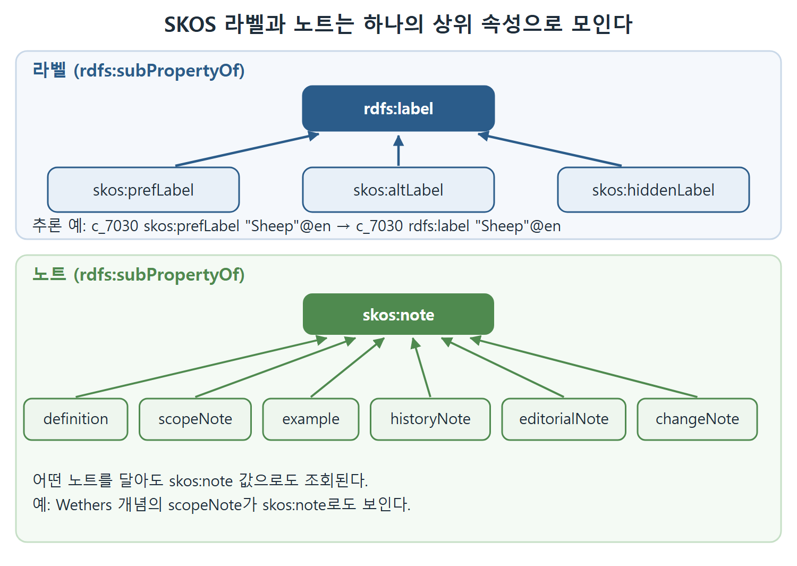

# 라벨과 노트 속성

용어 사전에서 한 항목에는 대표 이름 하나만 있지 않다. 흔히 쓰는 이름이 있고, 같은 뜻의 다른 이름이 있고, 검색에는 걸려야 하지만 화면에는 보이고 싶지 않은 철자 변형도 있다. SKOS는 이런 구분을 라벨 속성 세 가지로 나눠 둔다. 이 문서는 라벨 속성이 RDFS의 `rdfs:label`과 어떤 관계인지, 그 관계에서 어떤 추론이 나오는지, 그리고 문서화용 노트 속성이 같은 패턴으로 묶여 있다는 점을 다룬다.

---

## 1. 세 가지 라벨

`rdfs:label`은 RDFS에 이미 있는 속성으로, 리소스의 사람이 읽는 이름을 뜻한다. 다만 형식적 의미(semantics)는 정해져 있지 않다. 즉 `rdfs:label`로 추론되는 결과는 없고, "화면에 찍을 이름"이라는 비공식적 의미만 있다. SKOS는 시소러스의 관행에 맞춰 이를 더 세분한다.

| 속성 | 읽는 법 | 쓰임 |
|---|---|---|
| `skos:prefLabel` | preferred label, 대표 이름 | 화면에 보여 줄 공식 이름 |
| `skos:altLabel` | alternative label, 대체 이름 | 같은 개념을 가리키는 다른 이름 |
| `skos:hiddenLabel` | hidden label, 숨은 이름 | 화면에는 안 보이지만 검색 등에 쓰는 이름 |

원서는 이 세 속성의 용도를 이렇게까지 풀어 쓰지는 않고 이름과 종류만 밝힌다. 위 표의 "쓰임" 열은 이름에서 자연스럽게 읽히는 일반적인 뜻이다.

SKOS는 이 속성들을 다음과 같은 트리플로 정의한다.

```turtle
skos:prefLabel
    a rdf:Property ;
    rdfs:label "preferred label"@en ;
    rdfs:subPropertyOf rdfs:label .

skos:altLabel
    a rdf:Property ;
    rdfs:label "alternative label"@en ;
    rdfs:subPropertyOf rdfs:label .
```

`skos:hiddenLabel`도 똑같은 모양이고 라벨 문구만 "hidden label"이다. 원서는 SKOS 정의에 이 밖에도 여러 트리플이 있지만 여기서는 이것들에 집중한다고 밝힌다.

각 속성에 세 가지가 선언되어 있다는 점을 짚어 두자.

- `rdfs:label`이 붙어 있어 속성 자체의 이름을 사람이 읽을 수 있다.
- `rdf:Property` 타입이다.
- `rdfs:subPropertyOf rdfs:label`, 곧 `rdfs:label`의 하위 속성이다.

---

## 2. 하위 속성이라서 생기는 추론

`rdfs:subPropertyOf`는 하위 속성으로 쓴 트리플을 상위 속성으로 쓴 같은 트리플로 전파한다. 비유하면 "푸들이라고 적은 장부 항목이 자동으로 개 장부에도 적히는" 식이다. 따라서 `skos:prefLabel`을 서술어로 쓴 트리플이 있으면 서술어만 `rdfs:label`로 바꾼 트리플이 추론된다. `skos:altLabel`과 `skos:hiddenLabel`도 마찬가지다.

AGROVOC 예제에서는 다음 트리플들이 추론된다(그 밖에도 많다).

```turtle
agrovoc:c_7030 rdfs:label "Sheep"@en .
agrovoc:c_7030 rdfs:label "Ovin"@fr .
```

정리하면 모든 SKOS 라벨은 `rdfs:label`로도 보인다. 그래서 `rdfs:label` 값이 개념 하나에 여러 개 추론되는 일이 생긴다.

| 입력 트리플의 서술어 | 추론되는 서술어 |
|---|---|
| `skos:prefLabel` | `rdfs:label` |
| `skos:altLabel` | `rdfs:label` |
| `skos:hiddenLabel` | `rdfs:label` |

이것은 RDFS-Plus에서 완전히 합법이다. `rdfs:label`은 `owl:FunctionalProperty`가 아니기 때문이다. 즉 값이 하나로 제한되지 않는다. 다만 출력 이름이 여러 개인 리소스를 화면에 어떻게 보여 줄지는 개발자가 풀어야 할 과제가 된다. 대표 이름만 보이고 싶다면 `rdfs:label`이 아니라 `skos:prefLabel`을 직접 골라 쓰는 편이 안전하다. 이 마지막 문장은 위 설명에서 이어지는 필자의 해석이다.

---

## 3. 노트 속성도 같은 패턴

SKOS는 이 패턴을 여러 곳에서 되풀이한다. 설명을 달기 위한 문서화(documentation) 속성이 일곱 개 있는데, 그중 여섯 개가 나머지 하나인 `skos:note`의 하위 속성이다.

```turtle
skos:definition rdfs:subPropertyOf skos:note .
skos:scopeNote rdfs:subPropertyOf skos:note .
skos:example rdfs:subPropertyOf skos:note .
skos:historyNote rdfs:subPropertyOf skos:note .
skos:editorialNote rdfs:subPropertyOf skos:note .
skos:changeNote rdfs:subPropertyOf skos:note .
```

| 속성 | 이름이 뜻하는 것 |
|---|---|
| `skos:note` | 모든 노트의 상위 속성 |
| `skos:definition` | 정의 |
| `skos:scopeNote` | 적용 범위 설명 |
| `skos:example` | 예시 |
| `skos:historyNote` | 이력 |
| `skos:editorialNote` | 편집자 메모 |
| `skos:changeNote` | 변경 기록 |

두 번째 열은 속성 이름을 풀이한 것이다. 라벨과 같은 이유로, 정의든 예시든 어떤 노트를 달아도 `skos:note` 값으로도 조회된다. 노트를 종류와 상관없이 한꺼번에 읽고 싶을 때 `skos:note` 하나만 물으면 된다.

AGROVOC의 Wethers 개념이 쓰는 `skos:scopeNote`가 이 노트 속성의 실제 사례다. 같은 의미를 영어("Castrated male sheep")와 프랑스어로 다 달아 두었다.



그림은 세 라벨 속성이 `rdfs:label` 아래로, 여섯 노트 속성이 `skos:note` 아래로 모이는 같은 모양의 구조를 나란히 보여 준다. 하위 속성으로 쓴 값은 화살표를 따라 상위 속성의 값으로도 조회된다.

<br>
<br>
<br>

[Semantic Web for the Working Ontologist](../)
