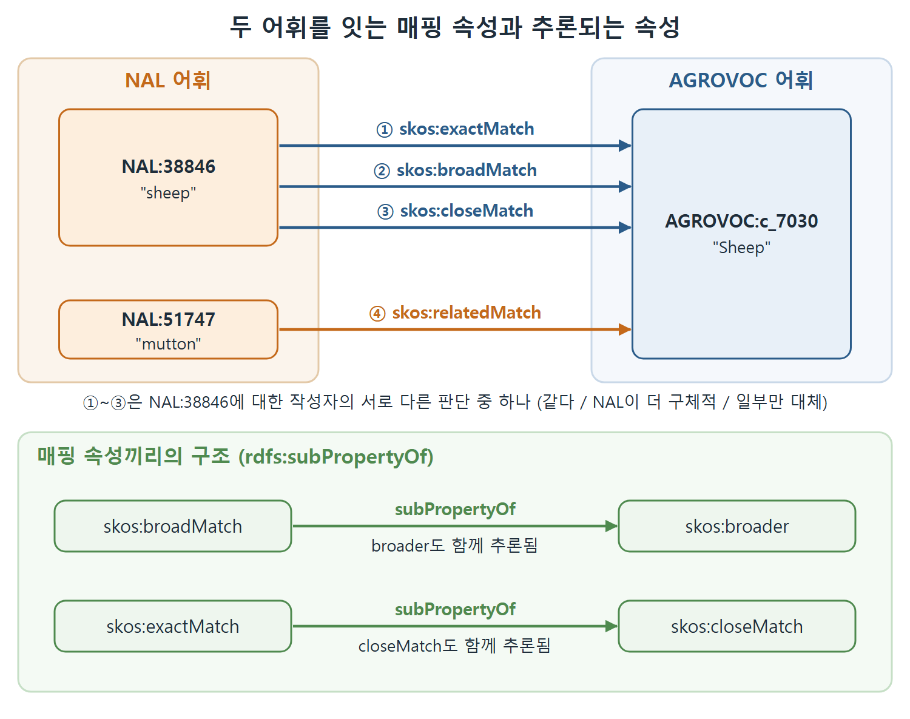

# 어휘 사이 매핑

SKOS가 해결하려는 현실적인 문제 하나는 서로 따로 만든 어휘를 이어 붙이는 일이다. 두 회사가 합쳐지면 각자 쓰던 코드표와 용어집이 만나고, 같은 독자에게 서로 다른 분류 체계로 정리한 자료가 함께 제공된다. 이 문서는 SKOS가 어휘 사이의 연결을 위해 준비한 매핑 속성 다섯 가지와, 이것들이 의미 관계 속성과 어떻게 이어져 있는지를 다룬다.

---

## 1. 왜 어휘끼리 연결이 필요한가

통제 어휘와 시소러스는 컴퓨터보다 먼저 있었다. 상당수는 컴퓨터나 네트워크에 올릴 것을 생각하지 않고 만든 독립 어휘다. 어떤 영역을 설명할 때 어떤 단어를 쓸지에 대해 각자 자기 관점을 가진다.

네트워크 세계에서는 어휘끼리 만나는 일이 흔하다. 한 어휘로 정리한 콘텐츠 모음이 다른 어휘로 정리한 콘텐츠 모음과 같은 독자에게 노출된다. 어휘 자체가 서로 연결되는 정보 리소스가 된다.

SKOS는 RDF로 표현되므로 모든 용어가 고유한 식별자인 URI를 갖고 웹에서 참조할 수 있다. 그래서 "한 어휘의 이 용어는 다른 어휘의 저 용어와 이런 관계다"라는 문장을 쓸 수 있다.

---

## 2. 매핑 속성 네 가지와 related 버전

SKOS가 이 목적에 맞춰 둔 매핑 속성은 `skos:exactMatch`, `skos:narrowMatch`, `skos:broadMatch`, `skos:closeMatch`다. 원서는 여기에 더해 미국 국립농업도서관(NAL)의 "mutton" 사례로 `skos:relatedMatch`도 쓴다.

사례는 이렇다. AGROVOC의 c_7030은 "Sheep"이다. 미국 NAL에는 자체 어휘가 있고 그 안에 NAL:38846("sheep")이라는 용어가 있다. 둘의 관계를 어떻게 적을지는 작성자의 판단에 달려 있다.

| 판단 | 쓰는 속성 | 예 |
|---|---|---|
| 같다고 본다 | `skos:exactMatch` | `NAL:38846 skos:exactMatch AGROVOC:c_7030 .` |
| NAL 쪽이 더 구체적이라고 본다 | `skos:broadMatch` | `NAL:38846 skos:broadMatch AGROVOC:c_7030 .` |
| 정보 검색에서 몇몇 경우만 바꿔 쓸 수 있다고 본다 | `skos:closeMatch` | `NAL:38846 skos:closeMatch AGROVOC:c_7030 .` |
| 같은 것은 아니지만 관련은 있다 | `skos:relatedMatch` | `NAL:51747 skos:relatedMatch AGROVOC:c_7030 .` |

세 번째까지는 NAL:38846 하나를 두고 서로 다른 사람이 서로 다른 주장을 하는 장면이다. 원서는 이 상황을 "USDA가 UN보다 양에 대해 더 구체적인 개념을 가진다고 믿는 사람이 있을 수 있다"고 설명한다. 위 표에서 `broadMatch` 행의 코드는 원서 그대로다. 앞 문서에서 본 것처럼 `broader`는 "has broader"로 읽으므로 이 줄은 NAL:38846의 broader가 c_7030이라는 뜻이므로 c_7030이 더 넓은 쪽이고, NAL의 개념이 더 구체적이라는 원서 설명과 방향이 맞는다.

넷째 `relatedMatch`는 NAL의 "mutton"(NAL:51747)과 AGROVOC의 "Sheep"처럼 같은 것이라고는 못 하지만 관계가 있는 경우에 쓴다. 양고기를 찾는 사람에게 Sheep 아래 색인된 콘텐츠가 유용할 수 있으니, 검색 시스템이 이를 알려 주는 것이 합리적이라는 이유다.

---

## 3. 추론이 아니라 관례로 읽는 속성

`skos:exactMatch`에는 추론 기반 의미가 없다. exactMatch 트리플에서 추론해 낼 수 있는 트리플 중 의미 이해에 도움이 되는 것이 없다는 뜻이다. 대신 관례적 의미가 있다. 두 용어를 광범위한 정보 검색 응용에서 서로 바꿔 쓸 수 있다는 것이다.

`subClassOf`, `sameAs`, `inverseOf`처럼 RDFS-Plus 단어의 의미가 추론으로 풀리는 것과 비교하면, SKOS 단어의 의미는 대부분 관례다. 정보 검색 시스템이 이 속성들을 어떻게 다룰지가 의미의 핵심이다.

| 구분 | RDFS-Plus 속성 | SKOS 매핑 속성 |
|---|---|---|
| 의미의 기반 | 추론 규칙 | 주로 관례 |
| 예 | `rdfs:subClassOf`, `owl:sameAs`, `owl:inverseOf` | `skos:exactMatch`, `skos:closeMatch` |
| 의미가 가리키는 것 | 그래프에서 나오는 새 트리플 | 정보 검색 시스템의 처리 방식 |

그렇다고 SKOS가 이 속성들의 관계를 아무렇게나 두는 것은 아니다. 표준은 RDFS-Plus로 이들의 관계를 정의해 둔다.

---

## 4. 매핑 속성의 subPropertyOf 구조

`broadMatch`와 `broader` 중 무엇을 써야 할지 헷갈릴 수 있다. 비공식적으로 `broadMatch`는 한 어휘를 다른 어휘에 매핑할 때, 곧 따로 정의된 두 용어가 서로 관련된다고 말할 때 쓴다. 그러면 `skos:broader`도 함께 적어야 빠지는 정보가 없을지 걱정이 된다.

원서의 그림 11.2를 보면 걱정할 필요가 없다.

```turtle
skos:broadMatch rdfs:subPropertyOf skos:broader .
skos:exactMatch rdfs:subPropertyOf skos:closeMatch .
```

- `broadMatch`를 적으면 두 용어가 `skos:broader` 관계라는 것도 함께 추론된다. `broadMatch`만 써도 잃는 것이 없다.
- 같은 이유로 NAL의 Sheep과 AGROVOC의 Sheep이 `exactMatch`라고 적으면 `closeMatch`도 추론된다.
- 정보 검색 시스템이 `skos:closeMatch`로 상호 참조할 용어를 고른다면 `exactMatch`로 적힌 것들도 모두 잡힌다.

| 적은 속성 | 추가로 추론되는 속성 |
|---|---|
| `skos:broadMatch` | `skos:broader` |
| `skos:exactMatch` | `skos:closeMatch` |



위쪽 그림은 NAL:38846 "sheep"과 AGROVOC:c_7030 "Sheep"을 잇는 매핑 속성 후보 셋과 NAL:51747 "mutton"의 `relatedMatch`를 보여 준다. 아래쪽은 `broadMatch`와 `exactMatch`가 각각 `broader`, `closeMatch`의 하위 속성이라 상위 속성이 함께 추론되는 구조다.

원서는 `closeMatch`와 `exactMatch`에 같은 설명이 적용된다고 쓰며, `narrowMatch`와 `relatedMatch`의 상위 속성은 코드로 보이지 않는다. 위 표에는 원서가 코드로 보여 준 두 줄만 담았다.

---

## 5. 실제 사례: AGROVOC와 NAL

SKOS가 나온 직후 유엔은 두 시소러스를 서로 매핑하는 프로젝트를 진행했다. 필요한 것은 두 출처의 용어를 구분할 수 있는 표현 방식이었다. 예를 들어 AGROVOC의 "Groundwater"와 NAL의 "groundwater"는 따로 관리해야 하지만 둘의 관계도 표현해야 한다.

프로젝트의 핵심은 제안된 관계를 비교하고 관리하는 일이었다. 같은 개념인지, 더 넓은지, 더 좁은지, 아니면 가까운 정도인지를 판단하는 것이다. 어떤 결론을 내든 AGROVOC의 용어와 NAL의 용어를 한 문장에서 말할 수 있어야 한다. 용어가 URI가 되면 트리플 하나로 가능하다.

```turtle
NAL:11571 skos:broadMatch AGROVOC:c_3391 .
```

<br>
<br>
<br>

[Semantic Web for the Working Ontologist](../)
