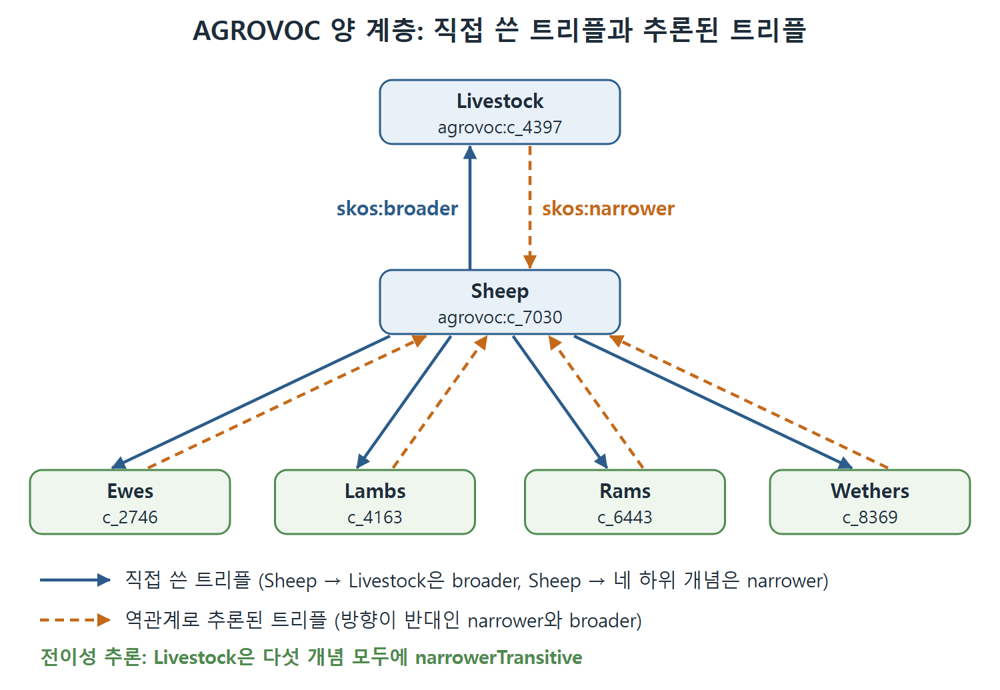

# 의미 관계와 계층

시소러스에서 용어를 연결하는 말은 거의 정해져 있다. "더 넓은 용어", "더 좁은 용어", "관련 용어"다. SKOS는 이 관계를 속성으로 만들고, 그 속성들이 서로 어떤 관계인지까지 RDFS-Plus로 정의한다. 이 문서는 의미 관계(semantic relations)의 구조와, 그 구조 덕분에 AGROVOC 예제에서 어떤 트리플이 추론되는지 따라간다.

---

## 1. 의미 관계의 지도

SKOS의 의미 관계는 개념과 개념을 이어 주는 속성이다. 원서의 그림 11.2가 이 속성들이 서로 어떻게 연결되는지 보여 준다(단일 화살표는 `rdfs:subPropertyOf`, 이중 화살표는 `owl:inverseOf`). 그림 대신 표로 정리한다.

| SKOS 속성 | 시소러스 용어 | 성질 |
|---|---|---|
| `skos:broader` | BT (Broader Term) | `skos:narrower`의 역관계. `skos:broaderTransitive`의 하위 속성 |
| `skos:narrower` | NT (Narrower Term) | `skos:broader`의 역관계. `skos:narrowerTransitive`의 하위 속성 |
| `skos:related` | RT (Related Term) | 대칭(`owl:SymmetricProperty`). 전이적이지 않음 |
| `skos:broaderTransitive` | | 전이적. 서로 역관계인 `skos:narrowerTransitive`가 있음 |
| `skos:narrowerTransitive` | | 전이적 |

`skos:broader`와 `skos:narrower`가 서로 역관계이고, 각각 전이적 상위 속성을 갖는다는 것이 핵심 구조다. 역관계(inverse)는 9장에서 다룬 개념이다.

---

## 2. 전이적 상위 속성 패턴

9장의 도전 과제 18, 19에서 한 관계의 두 버전을 일관되게 유지하는 문제를 풀었다. 하나는 전이적이고 하나는 (엄밀히는 반드시 전이적이지는 않은) 전이적이 아닌 버전이다. 해법은 간단한 설계 패턴이었다. 전이적이라고 선언하지 않은 속성을, 전이적으로 선언한 다른 속성의 하위 속성으로 둔다.

SKOS 속성 트리에 이 패턴이 두 번 나온다. `broader`와 `narrower` 각각에 한 번씩이다.

- 직접 관계만 보고 싶으면 `skos:broader`를 쓴다. 한 단계 위, 곧 바로 위의 부모만 나온다.
- 조상 전체가 필요하면 `skos:broaderTransitive`를 쓴다.

이 장치 덕에 모델 사용자가 전이적인 의미의 broader를 쓸지 말지 직접 고를 수 있다. 직접 연결과 전체 계보를 따로 저장하지 않아도 된다는 점이 장점이다.

---

## 3. AGROVOC에서 추론 따라가기

앞 문서의 AGROVOC 예제를 쓴다. 트리는 Livestock(c_4397) 아래 Sheep(c_7030), 그 아래 Ewes(c_2746), Lambs(c_4163), Rams(c_6443), Wethers(c_8369)다.



그림은 직접 쓴 `broader`, `narrower` 트리플(파란 실선)과, 역관계로 새로 생기는 반대 방향 트리플(주황 점선)을 한 트리에 겹쳐 보여 준다. 맨 아래 줄은 전이성 때문에 Livestock이 다섯 개념 모두에 `narrowerTransitive`로 이어진다는 점을 뜻한다.

### 첫째, 역관계 추론

`skos:narrower`가 `skos:broader`의 역이므로 방향이 반대인 트리플이 생긴다.

```turtle
agrovoc:c_4397 skos:narrower agrovoc:c_7030 .
agrovoc:c_2746 skos:broader agrovoc:c_7030 .
agrovoc:c_4163 skos:broader agrovoc:c_7030 .
agrovoc:c_6443 skos:broader agrovoc:c_7030 .
agrovoc:c_8369 skos:broader agrovoc:c_7030 .
```

원래 데이터에는 Sheep이 Livestock을 broader로 가리키고 Ewes 등을 narrower로 가리키는 줄만 있었다. 역관계 덕분에 Livestock 쪽에서 본 narrower 줄과, Ewes 등 쪽에서 본 broader 줄이 새로 생긴다. 이 `broader` 줄을 읽는 방향은 다음 문서에서 따로 다룬다.

### 둘째, 하위 속성에 의한 전이적 버전 추론

`skos:narrower`는 `skos:narrowerTransitive`의, `skos:broader`는 `skos:broaderTransitive`의 하위 속성이다. 따라서 위 트리플들이 전이적 버전으로도 성립한다.

```turtle
agrovoc:c_4397 skos:narrowerTransitive agrovoc:c_7030 .
agrovoc:c_2746 skos:broaderTransitive agrovoc:c_7030 .
agrovoc:c_4163 skos:broaderTransitive agrovoc:c_7030 .
agrovoc:c_6443 skos:broaderTransitive agrovoc:c_7030 .
agrovoc:c_8369 skos:broaderTransitive agrovoc:c_7030 .
```

원서는 이런 줄들을 개념 쌍마다 다 나열한다. 여기서는 방향이 맞는 줄만 옮겼다. 원서의 목록에는 주어와 목적어 방향이 맞지 않아 보이는 줄(예를 들어 Sheep이 Livestock의 `narrowerTransitive`라고 적은 줄)이 섞여 있는데, 추출 과정에서 생긴 오류인지 원서의 표기인지 확실하지 않아 여기서는 방향이 맞는 줄만 옮겼다.

### 셋째, 체인을 따라 이어지는 추론

전이성 덕분에 트리 맨 위의 Livestock(c_4397)은 이 예제의 모든 개념에 대해 `narrowerTransitive` 관계를 갖는다.

```turtle
agrovoc:c_4397 skos:narrowerTransitive agrovoc:c_7030 .
agrovoc:c_4397 skos:narrowerTransitive agrovoc:c_2746 .
agrovoc:c_4397 skos:narrowerTransitive agrovoc:c_4163 .
agrovoc:c_4397 skos:narrowerTransitive agrovoc:c_6443 .
```

c_8369도 같은 방식으로 묶인다. `skos:broaderTransitive`에 대해서도 주어와 목적어를 바꾼 같은 트리플들이 추론된다.

| 추론 단계 | 근거 | 결과 |
|---|---|---|
| 역관계 | `owl:inverseOf` | broader와 narrower 방향이 맞은 쌍이 생김 |
| 하위 속성 | `rdfs:subPropertyOf` | 전이적 버전에도 같은 관계가 생김 |
| 전이성 | `owl:TransitiveProperty` | 한 칸 건너 조상, 자손까지 연결 |

표를 읽으면, 직접 쓴 트리플 몇 줄만으로도 세 가지 규칙이 차례로 적용되어 전체 계보가 완성된다.

---

## 4. related는 전이적이지 않다

`skos:related`는 `owl:TransitiveProperty`가 아니다. 따라서 관련 항목의 사슬로는 추론하지 않는다. AGROVOC에서 Meat는 Meat Animals와, Meat Animals는 Turtles와, Turtles는 Aquatic Animals와, Aquatic Animals는 Mollusca와, Mollusca는 Mother of Pearl과 관련이 있다. 그렇다고 Meat가 Mother of Pearl과 관련 있다고 하면 어색하다. 전이적이지 않기 때문에 이런 엉뚱한 결론이 나오지 않는다.

반면 `skos:related`는 `owl:SymmetricProperty`다. "Mother of Pearl"(c_4951)이 "Decorative uses"(c_2149)와 관련 있다면, 거꾸로 c_2149도 c_4951과 관련 있다고 추론된다.

| 성질 | broader/narrower | related |
|---|---|---|
| 전이성 | 전이적 상위 속성 쪽에서 성립 | 성립하지 않음 |
| 대칭성 | 대칭이 아니라 서로 역관계 | 대칭 |

<br>
<br>
<br>

[Semantic Web for the Working Ontologist](../)
