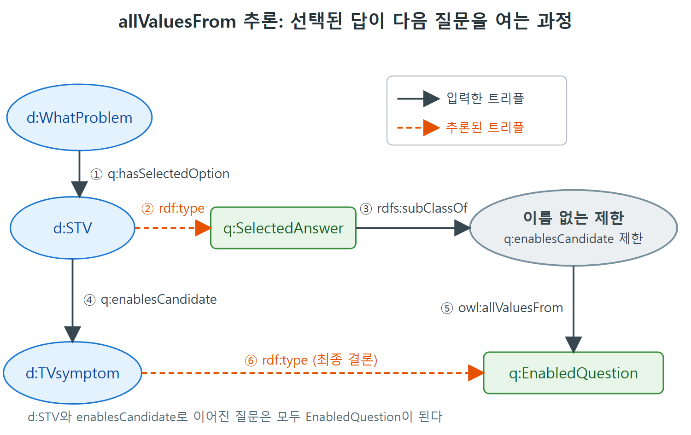

# allValuesFrom과 질문 의존 관계

이 문서는 두 번째 제한인 owl:allValuesFrom을 다룬다. someValuesFrom과 비슷해 보이지만 추론 방향이 완전히 다르다. 질문지 예시에서는 "어떤 답을 고르면 다음 질문이 열린다"는 의존 관계를 만드는 데 쓰고, 이어서 여러 선행 조건이 모두 충족돼야 열리는 질문이라는 더 어려운 문제(도전 27)까지 본다. 이 문제는 열린 세계 가정 때문에 아직 풀리지 않은 채로 남는다.

---

## 1. allValuesFrom: "모든 값이 ~에서 온다"

owl:allValuesFrom은 "속성 P의 모든 값이 클래스 C에 속하는 개체"라는 제한을 만든다.

```turtle
[ a owl:Restriction ;
  owl:onProperty P ;
  owl:allValuesFrom C ]
```

이 제한 클래스의 구성원 x가 있으면 x의 P 값마다 하나씩 결론이 따라 나온다. 요점은 x의 P 값은 모두 C의 구성원으로 추론된다는 점이다.

원서의 예를 보자. "내가 뽑은 올스타 팀"에 속한 선수는 전원 스타 플레이어라는 제한을 걸었다면, 그 팀의 선수는 모두 스타 플레이어다. Kaneda와 Gonzales가 그 팀에서 뛴다면 두 사람 모두 스타 플레이어여야 한다. 책은 추론으로 새로 생긴 트리플 앞에 별표(*)를 붙이는 관례를 쓴다.

```turtle
:MyFavoriteAllStarTeam a :BaseballTeam ;
  a [ a owl:Restriction ;
      owl:onProperty :hasPlayer ;
      owl:allValuesFrom :StarPlayer ] ;
  :hasPlayer :Kaneda , :Gonzales .
* :Gonzales a :StarPlayer .
* :Kaneda a :StarPlayer .
```

### someValuesFrom과의 미묘한 차이

두 제한은 이름이 비슷하지만 의미가 다르다.

| 비교 항목 | owl:someValuesFrom | owl:allValuesFrom |
|---|---|---|
| 조건 | 적어도 하나의 값이 클래스 C에 속한다 | 모든 값이 클래스 C에 속한다 |
| 값이 반드시 존재하는가 | 존재해야 한다(그런 구성원이 있다는 뜻) | 존재한다는 보장이 없다 |
| 기술적으로 읽는 법 | "그런 값이 있다" | "값이 있다면, 전부 이 조건을 만족한다" |
| 주된 추론 | 값을 가진 개체가 제한 클래스의 구성원이 된다 | 제한 클래스 구성원의 값이 C의 구성원이 된다 |

표의 핵심은 allValuesFrom이 "값이 있다면 전부"라는 조건부 문장이라는 것이다. 값이 하나도 없는 개체도 allValuesFrom 제한을 문제없이 만족한다. 이 차이는 뒤의 장들에서 더 중요해진다고 원서가 예고한다.

일상 비유로는 "우리 반 학생은 모두 안경을 쓴다"와 "우리 반에는 안경 쓴 학생이 있다"를 구분하면 된다. 앞의 문장은 학생이 한 명도 없어도 거짓이 되지 않는다.

## 2. 예 12: 질문 의존 관계

질문지에서 어떤 질문은 특정한 답이 나온 뒤에만 물어야 한다. 이 예시는 selected answer 클래스를 만들고, 그 답에 의존하는 질문을 열어 주는 과정을 보여 준다. 8장에서 배운 기법을 빌려 쓴다.

### 2-1. 선택된 답의 클래스

선택된 답의 클래스를 정의한다.

```turtle
q:SelectedAnswer a owl:Class ;
  rdfs:subClassOf q:Answer .
```

선택된 옵션이 이 클래스에 모두 들어가게 하려면 hasSelectedOption의 range를 지정하면 된다.

```turtle
q:hasSelectedOption rdfs:range q:SelectedAnswer .
```

이제 q:hasSelectedOption의 목적어 V는 모두 SelectedAnswer의 구성원이다. 사용자가 "Cable TV"를 골라 d:WhatProblem q:hasSelectedOption d:STV가 들어가면 d:STV a q:SelectedAnswer가 추론된다.

### 2-2. 열린 질문(EnabledQuestion)과 enablesCandidate

다음으로 지금 실제로 물을 수 있는 질문의 클래스를 둔다. EnabledQuestion 타입이 붙은 질문만 정말 물을 수 있다.

```turtle
q:EnabledQuestion a owl:Class .
```

답 하나가 어떤 질문을 후보로 만든다는 관계를 q:enablesCandidate 속성으로 표현한다. 이 답을 고르면 시스템이 그 질문을 다음 질문 후보로 고려한다는 뜻이다.

```turtle
q:enablesCandidate a owl:ObjectProperty ;
  rdfs:domain q:Answer ;
  rdfs:range q:Question .
```

예시에서는 첫 질문의 답이 Cable TV 또는 Both일 때만 텔레비전 증상 질문을 하고 싶다.

```turtle
d:STV q:enablesCandidate d:TVsymptom .
d:SBoth q:enablesCandidate d:TVsymptom .
```

### 2-3. allValuesFrom 제한과 subClassOf 연결

다음 제한은 "enablesCandidate 값이 모두 EnabledQuestion에 속하는 것들"의 클래스를 만든다.

```turtle
[ a owl:Restriction ;
  owl:onProperty q:enablesCandidate ;
  owl:allValuesFrom q:EnabledQuestion ]
```

이 제한을 모든 답에 적용하면 안 된다. 선택된 답에만 적용해야 한다. 이때 쓰는 것이 rdfs:subClassOf다. 선택된 답은 위 제한 클래스의 하위 클래스라고 선언한다.

```turtle
q:SelectedAnswer rdfs:subClassOf
  [ a owl:Restriction ;
    owl:onProperty q:enablesCandidate ;
    owl:allValuesFrom q:EnabledQuestion ] .
```

즉 선택된 답은 이름 없는 제한 클래스의 하위 클래스다. 이제 한 단계씩 추론이 이어지는 모습을 따라가 보자.

| 단계 | 트리플 | 근거 |
|---|---|---|
| 1 | d:STV a q:SelectedAnswer | 사용자가 "Cable TV"를 골랐다(앞 절의 range 추론) |
| 2 | d:STV a [제한: enablesCandidate allValuesFrom EnabledQuestion] | subClassOf 때문에 제한 클래스의 구성원이 된다 |
| 3 | d:STV q:enablesCandidate d:TVsymptom | 입력해 둔 트리플 |
| 4 | d:TVsymptom a q:EnabledQuestion | allValuesFrom 제한이 값마다 만들어 내는 결론 |

표의 4번이 핵심이다. 3번처럼 d:STV와 연결된 모든 후보는 EnabledQuestion이 되어야 하므로, 앱은 EnabledQuestion 클래스만 쿼리하면 지금 물을 수 있는 질문 목록을 얻는다. 책의 그림 12.4가 이 추론 사슬을 보여 준다.



위 표의 네 단계를 그래프로 그린 것이다. 선택된 답(d:STV)이 제한 클래스의 구성원이 되면(②, ③), 그 답과 enablesCandidate로 이어진 d:TVsymptom이 EnabledQuestion으로 추론된다(⑥).

d:SBoth에도 같은 트리플이 있으므로 사용자가 "Both"를 골라도 같은 결론이 나온다. 인터넷 증상 질문 d:InternetSymptom을 더하면 의존 관계는 다음처럼 전부 표현된다.

```turtle
d:STV q:enablesCandidate d:TVsymptom .
d:SBoth q:enablesCandidate d:TVsymptom .
d:SBoth q:enablesCandidate d:InternetSymptom .
d:SInternet q:enablesCandidate d:InternetSymptom .
```

| 선택한 답 | 열리는 질문 |
|---|---|
| d:STV (Cable TV) | d:TVsymptom |
| d:SInternet (High-speed Internet) | d:InternetSymptom |
| d:SBoth (Both) | d:TVsymptom, d:InternetSymptom |

이 질문들의 의존 관계를 나무 모양으로 그린 것이 책의 그림 12.5다. 의존 규칙이 앱 코드 안의 if 문이 아니라 데이터 안의 트리플로 들어 있다는 점이 이 설계의 장점이다.

## 3. 예 13: 선행 질문(prerequisites)

앞의 예시는 질문 하나에 답하면 그에 딸린 질문이 모두 후보가 되는 경우였다. 질문 사이에는 다른 종류의 관계도 있다. 질문에 선행 조건이 여럿 있으면 그것을 모두 충족해야 그 질문을 물을 수 있다.

예로 다음 질문을 본다.

```turtle
d:NeighborsToo a q:Question ;
  q:hasOption d:NTY , d:NTN , d:NTDK ;
  q:questionText "Are other customers in your building
    also experiencing problems?" .
```

세 답은 "예, 이웃도 같은 문제를 겪는다", "아니오, 겪지 않는다", "모르겠다"이다.

이 질문은 고객이 다른 고객이 함께 사는 건물에 살고 있고 기술적 문제를 겪는 경우에만 의미가 있다. 즉 두 질문에 의존한다. 첫 질문 d:othersinbuilding의 답이 d:OYes여야 하고, 둘째 질문 d:whatIssue의 답이 d:PTech여야 한다.

| 질문 | 질문 내용(요지) | 답 옵션 |
|---|---|---|
| d:othersinbuilding | 다른 고객이 있는 다세대 주택에 사는가 | d:ONo, d:OYes |
| d:whatIssue | 오늘 고객 서비스에서 어떤 도움을 받고 싶은가 | d:PBilling, d:PNew, d:PCancel, d:PTech |
| d:NeighborsToo | 같은 건물의 다른 고객도 문제를 겪는가 | d:NTY, d:NTN, d:NTDK |

whatIssue의 옵션은 요금 문의, 새 계정, 계정 해지, 기술적 어려움이다. 책의 그림 12.6이 이 세 질문과 답을, 그림 12.7이 NeighborsToo의 선행 조건 둘과 답 셋을 보여 준다.

### 도전 27: 제한된 선택

d:whatIssue와 d:othersinbuilding 둘 모두에 알맞은 답이 있을 때만 d:NeighborsToo를 묻게 하려면 어떻게 모델링하는가.

먼저 질문과 그 선행 조건을 이어 주는 속성을 둔다.

```turtle
q:hasPrerequisite rdfs:domain q:Question ;
  rdfs:range q:Answer .
d:NeighborsToo q:hasPrerequisite d:PTech , d:OYes .
```

그다음 "선행 답이 모두 선택된 질문은 EnabledQuestion이다"를 쓰고 싶다. 이렇게 시작한다.

```turtle
[ a owl:Restriction ;
  owl:onProperty q:hasPrerequisite ;
  owl:allValuesFrom q:SelectedAnswer ]
  rdfs:subClassOf q:EnabledQuestion .
```

여기서 보듯이 제한 클래스도 다른 클래스와 똑같이 쓸 수 있다. 이 경우에는 제한을 다른 클래스의 하위 클래스로 만들었다. 이 제한을 만족하는 질문은 subClassOf 덕분에 EnabledQuestion으로 추론된다.

### 열린 세계 가정이 막아서는 곳

그런데 어떤 개체 ?x가 이 제한을 만족한다는 것을 어떻게 알 수 있는가. ?x q:hasPrerequisite ?y 형태의 트리플이 있을 때마다 ?y가 d:SelectedAnswer의 구성원이어야 한다. 하지만 열린 세계 가정(open-world assumption)에서는 같은 형태의 다른 트리플이 어딘가에 더 있고, 그 ?y는 SelectedAnswer가 아닐 가능성을 배제할 수 없다. 우리가 아는 선행 조건이 전부라는 보장이 없는 것이다. 그러니 모든 선행 조건이 충족됐다는 것을 어떻게 확인할 수 있는가.

원서는 이 문제를 여기서 풀지 않고, OWL에서 세계를 부분적으로 닫는 여러 방법을 다룬 뒤로 미룬다. 기본 아이디어만 제시한다.

- 질문의 선행 조건이 몇 개인지 말할 수 있으면 모두 충족됐는지 알 수 있다.
- 선행 조건이 정확히 하나뿐임을 알고, 그중 하나가 충족됐다면 그것이 그 하나다.
- 선행 조건이 하나도 없다는 것을 알면, SelectedAnswer를 하나도 확인하지 않고 곧바로 EnabledQuestion이라고 판단할 수 있다.

| 상황 | 알고 있는 것 | 결론 낼 수 있는가 |
|---|---|---|
| 선행 조건 개수를 모른다 | 충족된 선행 조건 몇 개 | 모른다(열린 세계라 아직 모르는 선행 조건이 있을 수 있다) |
| 선행 조건이 하나뿐이라고 안다 | 그 하나가 충족됨 | 모두 충족됐다고 결론 낼 수 있다 |
| 선행 조건이 없다고 안다 | 없음 | 확인 없이 EnabledQuestion이라고 결론 낼 수 있다 |

개수를 말하는 기수(cardinality, 개수 제약)가 이 문제의 열쇠라는 것을 이 표가 보여 준다. 기수 제한은 다음 장의 주제다.

## 4. 정리

- allValuesFrom은 "값이 있다면 모두 C에 속한다"는 조건이고, 그 개체의 값들을 C의 구성원으로 추론하게 한다.
- someValuesFrom과 달리 값이 존재한다는 점은 보장하지 않는다.
- subClassOf로 제한 클래스에 연결하면 특정 클래스(선택된 답)에만 이 조건을 적용할 수 있다.
- 열린 세계 가정 아래에서는 "모든 값이 충족됐다"를 확인하기 어렵다. 이 약점은 개수를 알려 주는 방식으로 부분적으로 보완한다.

<br>
<br>
<br>

[Semantic Web for the Working Ontologist](../)
