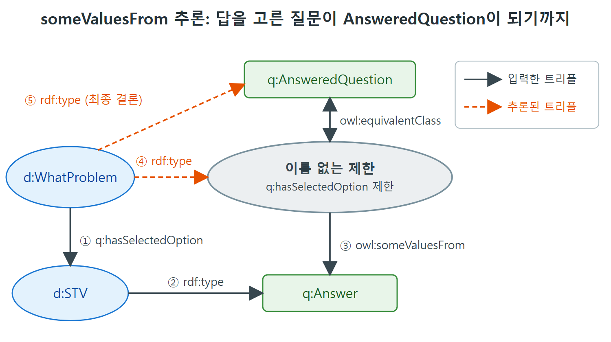

# someValuesFrom과 답변한 질문

이 문서는 장 전체에서 쓰는 질문지 예시의 데이터 모양을 소개하고, 첫 번째 제한인 owl:someValuesFrom을 배운다. 질문지에서 이미 답을 고른 질문을 자동으로 골라내는 문제가 이 제한의 좋은 사례다.

---

## 1. 질문지 예시: 데이터 모양

질문지는 여러 질문으로 이루어지고, 각 질문에는 고를 수 있는 답이 여러 개 있다. 질문에는 질문 문장 문자열이, 답에는 답 문장 문자열이 들어 있다. 퀴즈나 시험과 달리 설문에는 보통 "정답"이 없다. 질문지든 퀴즈든 시험이든 어떤 답을 고르면 다른 질문은 건너뛰게 되는 일이 있다.

이 구조는 OWL의 클래스와 속성으로 그대로 표현된다. 개별 질문지는 질문, 답, 개념의 개체들과 그 사이의 관계로 이루어진다.

책은 네임스페이스를 둘로 나눠 쓴다.

| 접두어 | 가리키는 것 | 예 |
|---|---|---|
| q: | 질문지 일반에 대한 어휘(클래스와 속성) | q:Question, q:Answer, q:hasOption |
| d: | 지금 다루는 특정 질문지의 데이터 | d:WhatProblem, d:STV |

q: 쪽은 설계도, d: 쪽은 그 설계도로 채운 실제 내용이라고 보면 된다. 책의 그림 12.1이 클래스와 속성의 관계를, 그림 12.2가 구체적인 질문과 답을 보여 주는데, 이 노트에서는 글과 코드로 풀었다.

### 케이블 TV·인터넷 업체 헬프데스크 예

예시는 케이블 TV와 인터넷 서비스 업체의 헬프데스크 상담을 가정한다. 질문은 두 개로 시작한다.

| 질문 | 고를 수 있는 답 |
|---|---|
| 어떤 시스템에 문제가 있는가 | Cable TV, High-speed Internet, Both (3개) |
| 어떤 텔레비전 증상이 보이는가 | No Picture, No Sound, Tiling, Bad Reception (4개) |

이 데이터를 Turtle로 쓰면 다음과 같다(첫 질문과 답 일부만 옮긴다).

```turtle
d:WhatProblem a q:Question ;
  q:hasOption d:STV , d:SInternet , d:SBoth ;
  q:questionText "What system are you having trouble with?" .
d:STV a q:Answer ;
  q:answerText "Cable TV" .
d:SInternet a q:Answer ;
  q:answerText "High-speed Internet" .
d:SBoth a q:Answer ;
  q:answerText "Both" .
```

두 번째 질문 d:TVsymptom도 같은 모양이다. q:hasOption으로 d:TVSnothing, d:TVSnosound, d:TVStiling, d:TVSreception 네 개를 갖고, 각각 q:Answer이며 answerText가 "No Picture", "No Sound", "Tiling", "Bad reception"이다.
## 2. 질문지 앱이 필요로 하는 것

웹 포털에서 질문지를 관리하는 앱을 생각해 보자. 이 앱은 위의 데이터를 쿼리해서 다음에 물을 질문을 정하고, 질문 문장과 답 문장을 보여 주고, 각 답 옆에 라디오 버튼 같은 선택 위젯을 붙인다.

하지만 지금까지의 정의만으로는 앱이 동작하지 못한다. 어떤 질문을 다른 질문보다 먼저 물어야 하는지 정한 규칙이 없고, 사용자가 고른 답을 기록할 방법도 없다. 이 문서는 뒤쪽인 답 기록부터 해결한다.

### 선택한 답 기록하기: hasSelectedOption

q:hasOption의 하위 속성으로 q:hasSelectedOption을 정의한다.

```turtle
q:hasSelectedOption a owl:ObjectProperty ;
  rdfs:subPropertyOf q:hasOption .
```

사용자가 질문에 답하면 선택한 옵션을 가리키는 트리플이 하나 추가된다. 사용자가 첫 질문에서 "Cable TV"를 고르면 앱은 다음 트리플을 트리플 저장소에 넣는다.

```turtle
d:WhatProblem q:hasSelectedOption d:STV .
```

여기서 기억할 점이 있다. 저장소에서 지워야 할 트리플은 없다. d:WhatProblem과 d:STV 사이의 원래 관계인 hasOption은 여전히 사실이다. 기존 사실 위에 새 사실이 쌓이기만 한다. 앞으로 예시가 발전하면서 모델이 어떤 질문을 할지 더 많이 안내해 준다.

## 3. someValuesFrom: "적어도 하나는 ~에서 온다"

owl:someValuesFrom은 "속성 P의 값 가운데 적어도 하나가 클래스 C에서 온 개체"라는 형태의 제한을 만든다. 원서의 예로 AllStarPlayer를 보자. "playsFor 속성의 값 중 적어도 하나가 AllStarTeam 클래스에 속하는 모든 개체"로 정의할 수 있다.

```turtle
[ a owl:Restriction ;
  owl:onProperty :playsFor ;
  owl:someValuesFrom :AllStarTeam ]
```

이 제한이 가리키는 클래스는 정확히 위 조건을 만족하는 개체들이다. 어떤 개체가 playsFor로 AllStarTeam 클래스의 값을 실제로 하나라도 갖고 있으면 이 제한 클래스의 구성원이다. 앞에서 본 것처럼 이 클래스에는 이름이 없고, 제한의 속성들로만 정의된다.

일상의 말로 바꾸면 "동아리 중 적어도 한 곳에 가입한 학생"이다. 가입한 동아리가 열 곳이든 한 곳이든 그 가운데 하나만 조건에 맞으면 된다.

## 4. 예 11: 답변한 질문 찾기

질문을 고르는 기준은 여러 가지가 있겠지만, 대개의 경우 이미 답을 받은 질문은 다시 묻지 않는다. 그렇다면 "이미 답한 질문"의 클래스가 필요하다. 비형식적으로 정의하면 선택된 옵션이 있는 질문이다. 다시 말해 hasSelectedOption 속성의 값 중 적어도 하나가 Answer 클래스에 속하는 개체다. 이것을 owl:equivalentClass로 이름 있는 클래스에 붙인다.

```turtle
q:AnsweredQuestion owl:equivalentClass
  [ a owl:Restriction ;
    owl:onProperty q:hasSelectedOption ;
    owl:someValuesFrom q:Answer ] .
```

이제 추론이 어떻게 흐르는지 보자. 다음 두 트리플이 이미 들어 있다고 하자.

```turtle
d:WhatProblem q:hasSelectedOption d:STV .
d:STV a q:Answer .
```

d:WhatProblem은 hasSelectedOption의 값으로 Answer 클래스의 개체인 d:STV를 가지므로, 제한의 조건(적어도 하나의 값이 있다)을 만족한다. 제한 클래스의 조건을 만족하는 개체는 그 클래스의 구성원이라고 추론된다.

```turtle
d:WhatProblem a [ a owl:Restriction ;
  owl:onProperty q:hasSelectedOption ;
  owl:someValuesFrom q:Answer ] .
```

그리고 owl:equivalentClass의 의미에 따라, 두 클래스는 같으므로 다음 결론에 이른다.

```turtle
d:WhatProblem a q:AnsweredQuestion .
```

책의 그림 12.3은 이 정의와 추론을 한 그림에 보여 준다. 줄여 말하면 "답을 하나 고른 질문은 자동으로 AnsweredQuestion에 들어간다"이다.



그림에서 실선은 입력한 트리플이고 주황색 점선은 추론된 트리플이다. d:WhatProblem이 제한의 구성원이 되고(④), 제한이 q:AnsweredQuestion과 같은 클래스이므로 최종 결론(⑤)이 나온다.

| 단계 | 내용 | 종류 |
|---|---|---|
| 1 | d:WhatProblem q:hasSelectedOption d:STV | 입력한 트리플 |
| 2 | d:STV a q:Answer | 입력한 트리플 |
| 3 | d:WhatProblem이 someValuesFrom 제한의 구성원 | 추론 |
| 4 | d:WhatProblem a q:AnsweredQuestion | 추론(equivalentClass 덕분) |

표처럼 앱이 넣는 것은 1번과 2번뿐이다. 3번과 4번은 모델이 알아서 이어 준다. 앱이 "이 질문은 답했는지"를 따로 계산하거나 표시를 남길 필요가 없다는 점이 요점이다.

## 5. 정리

- owl:someValuesFrom은 "최소 하나는 그 클래스의 값이다"라는 조건을 건다.
- 제한은 이름이 없는 클래스이므로 owl:equivalentClass로 이름 있는 클래스에 연결해 쓰는 경우가 많다.
- 조건을 만족하는 개체는 제한 클래스의 구성원으로 추론되고, 같은 클래스 사이의 equivalentClass 덕분에 이름 있는 클래스의 구성원으로도 추론된다.
- someValuesFrom은 "그런 값이 실제로 있어야 한다"는 뜻을 담고 있다. 이 점은 다음 문서에서 allValuesFrom과 비교한다.

<br>
<br>
<br>

[Semantic Web for the Working Ontologist](../)
