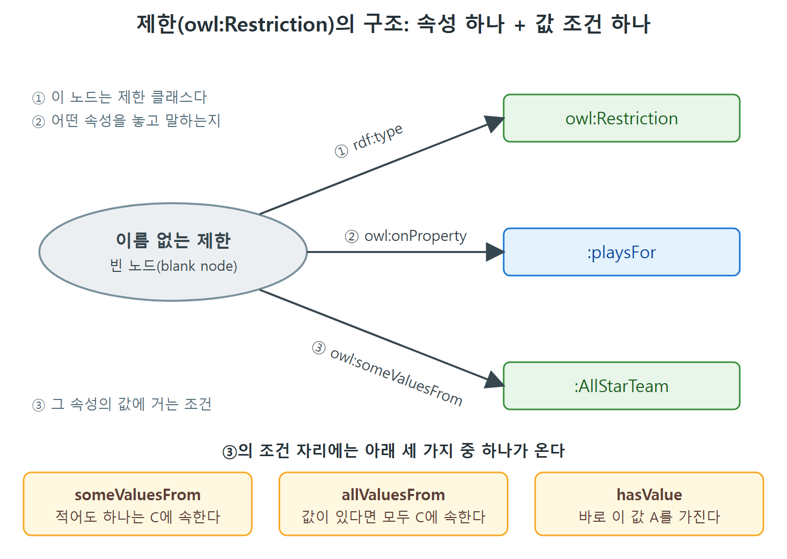

# 제한이란 무엇인가

이 문서는 OWL의 가장 기본이 되는 도구인 owl:Restriction(제한)을 소개한다. RDFS-Plus까지는 클래스와 속성을 이름 붙여 놓고 서로 잇는 일이 중심이었다. OWL은 여기서 한 걸음 더 나아가 "이런 속성을 이런 식으로 가진 개체들의 모임"처럼 개체의 모습을 묘사해서 새 클래스를 만들 수 있게 해 준다. 그 도구가 제한이다.

먼저 OWL 버전 이야기와 제한이 필요해지는 상황을 보고, 이어서 제한이 무엇인지, 어떤 종류가 있는지를 정리한다. 종류별 자세한 예시는 다음 문서들에서 다룬다.

---

## 1. OWL 버전에 대한 짧은 메모

OWL의 권고안(표준 문서)은 지금 2.0 버전이다. 2.0은 1.0에 새 모델링 구성 요소를 여럿 보탰지만, OWL이 동작하는 기본 원리는 바꾸지 않았다. 이 책의 모델링 패턴 대부분은 1.0과 2.0 양쪽에서 똑같이 쓸 수 있고, 2.0에서만 되는 기능이 나오면 책이 따로 밝힌다. OWL의 기능을 빠짐없이 훑는 자료는 Uschold의 2018년 책이라고 원서가 소개한다.

이 장은 owl:Restriction 하나에 집중한다. 이미 만들어 둔 것들로 클래스를 설명하게 해 주는 이 구성 요소 하나만으로도 모델링 폭이 크게 넓어진다.

| 구분 | RDFS-Plus까지 | 이 장의 OWL |
|---|---|---|
| 클래스를 만드는 방법 | 이름을 붙여 선언하고 subClassOf 등으로 잇는다 | 개체가 가진 속성 값을 묘사해서 만든다 |
| 클래스의 이름 | 항상 이름이 있다 | 이름 없는 클래스도 만들 수 있다 |
| 표현의 초점 | 속성·클래스·개체를 서로 맞춰 준다 | 클래스 구성원이 가져야 할 조건을 적는다 |

표를 보면, 이 장에서 새로 생기는 능력은 "묘사로 클래스를 만든다"는 점이다. 이름 없는 클래스를 쓸 수 있다는 점이 가장 눈에 띄는 차이다.

## 2. 왜 제한이 필요한가

야구 예시로 시작한다. RDFS로 BaseballTeam 클래스를 정의하고, 그 하위 클래스로 MajorLeagueTeam을 둔다. 따로 BaseballPlayer 클래스도 있다. 한 시즌의 선수 명단은 playsFor라는 속성으로 표현한다. BaseballPlayer와 BaseballTeam을 이어 주는 속성이다.

여기서 메이저리그 팀에서 뛰는 선수만 따로 모아 MajorLeaguePlayer라는 클래스를 만들고 싶다고 하자. 재무 쪽까지 관심이 있다면 그 선수들을 대리하는 에이전트의 클래스, 그 에이전트가 관리하는 은행 계좌의 클래스 같은 것으로 계속 이어 갈 수도 있다.

시맨틱 웹의 큰 장점은 한 사람이 한 맥락에서 정의한 정보를 다른 사람이 다른 맥락에서 다시 쓸 수 있다는 점이다. 선수 명단을 만든 쪽이 에이전트나 은행 계좌까지 정의해 줄 거라고 기대할 수는 없다. 여러 출처의 정보를 함께 쓰려면 한쪽 맥락의 개념을 다른 쪽 개념으로 풀어 쓸 방법이 있어야 한다. OWL에서는 이미 정의된 클래스를 써서 새 클래스를 묘사하는 기능으로 이 일을 한다. 앞에서 본 구성 요소로는 MajorLeaguePlayer 같은 설명을 만들 수 없고, 이 일을 하는 언어 요소가 Restriction이다.

비유하면 도서관의 "분류표"와 "검색 조건"의 차이와 비슷하다. 분류표는 책에 직접 붙이는 이름표다. 검색 조건은 "저자가 김 아무개인 책" 같은 조건에 맞는 책 전체를 가리킨다. 제한은 이 검색 조건을 그대로 클래스로 만든 것이다.

## 3. 제한의 정의

MajorLeaguePlayer는 MajorLeagueTeam에서 뛰는 사람이라고 비형식적으로 정의했다. 이 클래스에 들어올 수 있는 자격이 "MajorLeagueTeam에서 뛰는 것"으로 좁혀진다는 뜻에서 제한(Restriction)이라는 이름이 붙었다. 제한은 클래스의 특수한 경우이므로, 이 점을 분명히 하려고 책은 때로 "제한 클래스(Restriction Class)"라고 부른다. OWL에서는 다음과 같이 선언되어 있다.

```turtle
owl:Restriction rdfs:subClassOf owl:Class .
```

정리하면 제한은 "개체를 묘사해서 정의한 클래스"다. 이 단순한 생각이 OWL 모델 확장의 바탕이다.

- 알려진 클래스로 어떤 개체 집합을 묘사할 수 있으면, 그 묘사로 새 클래스를 정의할 수 있다.
- 새로 만든 클래스도 이제 존재하는 클래스이므로, 다른 새 클래스를 묘사하는 데 다시 쓸 수 있다.
- 이 과정을 얼마든지 되풀이할 수 있다.

### 제한은 어떻게 "제한"하는가

RDF와 OWL에는 AAA 슬로건이 적용된다. 누구나(Anyone) 무엇이든(Anything) 어떤 주제에 대해서든(Any topic) 말할 수 있다는 뜻이다. 그래서 OWL의 모든 것을 담는 owl:Thing 클래스에는 아무 제한이 없다. 제한은 그 클래스 구성원에 대해 말할 수 있는 내용에 조건을 건다.

원서의 예를 보자. orbitsAround라는 속성이 있다면 무엇이든 다른 무엇의 둘레를 돈다고 말해도 문제가 없다. 그런데 이 속성의 값, 즉 목적어가 TheSun이어야 한다고 제한하면, 태양 둘레를 도는 모든 것의 클래스, 곧 태양계가 만들어진다.

## 4. 제한의 구성: onProperty와 값 조건

제한은 항상 두 가지 정보로 이루어진다.

1. 어떤 속성을 놓고 말하는가. 이것은 owl:onProperty로 지정한다.
2. 그 속성의 값에 어떤 조건을 거는가. 이것은 제한의 종류(owl:allValuesFrom, owl:someValuesFrom, owl:hasValue 중 하나)로 정한다.

예를 들어 태양 둘레를 도는 것들의 제한은 owl:onProperty orbitsAround를 쓰고, 메이저리그 선수의 제한은 owl:onProperty playsFor를 쓴다.

제한도 클래스이므로 구성원(개체)이 있다. 어떤 개체가 제한 클래스의 구성원이 되려면 onProperty 지정과 제한 종류가 요구하는 조건을 함께 만족해야 한다.



그림은 이름 없는 제한 하나가 빈 노드 하나로 표현되고, 이 노드에서 "제한 클래스다", "어떤 속성인가", "값 조건은 무엇인가"를 말하는 세 화살표가 나간다는 것을 보여 준다. 값 조건 자리에는 someValuesFrom, allValuesFrom, hasValue 중 하나가 온다.

| 제한 종류 | 한국어로 읽는 법 | 거는 조건 |
|---|---|---|
| owl:someValuesFrom | 적어도 하나는 ~에서 온다 | 속성 값 중 최소 하나가 클래스 C에 속한다 |
| owl:allValuesFrom | 모든 값이 ~에서 온다 | 속성 값 전부가 클래스 C에 속한다 |
| owl:hasValue | 이 값을 가진다 | 속성 값 가운데 특정한 값 A가 있다 |

세 종류 모두 owl:onProperty와 짝을 이룬다. 다음 문서부터 이 세 가지를 하나씩 예시와 함께 본다.

## 5. 이름 없는 클래스

제한은 보통 이름이 없다. 속성에 대한 조건으로만 정의되기 때문에 문헌에서는 "이름 없는 클래스(unnamed class)" 또는 "익명 클래스(anonymous class)"라고 부르기도 한다. Turtle에서는 대괄호로 쓴다. 3장에서 배운 빈 노드(blank node)를 묘사하는 표기와 같다.

```turtle
[ a owl:Restriction ;
  owl:onProperty :playsFor ;
  owl:someValuesFrom :AllStarTeam ]
```

대괄호 안의 내용은 하나의 빈 노드가 세 개의 트리플(주어·서술어·목적어 세 쌍으로 이루어진 문장 하나)의 주어가 된다는 뜻이다. 줄마다 세미콜론으로 이어져 있어서 한 노드에 대한 세 줄로 읽는다. 이름이 없는 클래스를 가리키는 일은 이 빈 노드로 한다.

이름이 없다 보니 다른 문장에서 쓰기 불편할 때가 있다. 그럴 때는 owl:equivalentClass로 이름 있는 클래스와 같다고 선언해 둔다. 이 방법은 다음 문서들에서 자주 나온다.

## 6. 앞으로의 흐름

이 장은 질문지(questionnaire) 예시를 이어서 쓰면서 세 가지 제한을 차례로 배운다. 그다음 제한을 활용하는 도전 문제들을 풀고, 마지막으로 OWL 문헌에서 제한을 설명할 때 쓰는 다른 용어들을 정리한다.

| 순서 | 다루는 내용 | 문서 |
|---|---|---|
| 1 | 제한의 기본 개념 | 이 문서 |
| 2 | someValuesFrom, 답변한 질문 | someValuesFrom과 답변한 질문 |
| 3 | allValuesFrom, 질문 의존 관계, 선행 질문 | allValuesFrom과 질문 의존 관계 |
| 4 | hasValue, 우선순위 | hasValue와 우선순위 질문 |
| 5 | 채식주의자 문제 | 채식주의자 문제와 로컬 범위 제한 |
| 6 | 표 데이터 자동 분류 | 표 데이터 자동 분류 |
| 7 | 거울 패턴, 관계 전달 | 클래스-개체 거울 패턴과 관계 전달 |
| 8 | 용어 정리 | 필요 조건과 충분 조건 용어 |
| 9 | 장 정리 | 요약과 핵심 개념 |

원서는 야구 선수 예시를 이 장 뒤에서 다시 다루겠다고 예고하지만, 이 장의 본문은 질문지와 몇 가지 도전 문제 중심으로 흘러간다.

<br>
<br>
<br>

[Semantic Web for the Working Ontologist](../)
