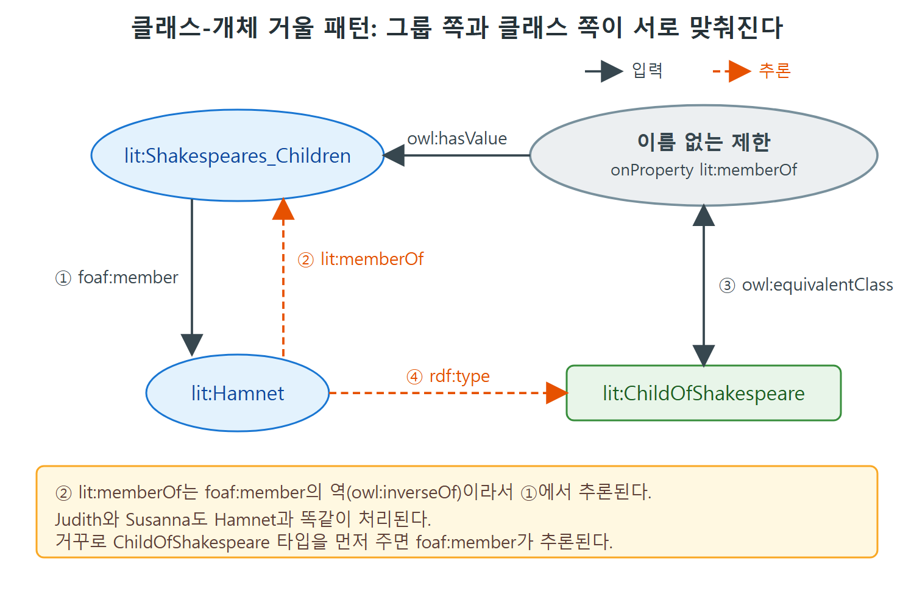

# 클래스-개체 거울 패턴과 관계 전달

이 문서는 도전 문제 31과 32를 다룬다. hasValue 제한을 쓰면 "개체 하나"와 "그 개체와 어떤 관계인 것들의 집합(클래스)"을 서로 거울처럼 맞춰 둘 수 있다. 책은 이 용법을 설계 패턴으로 보고 클래스-개체 거울(Class-Individual Mirror) 패턴이라고 부른다. 소프트웨어 관리, FOAF 그룹, 왕가 족보 예시로 이 패턴이 어떻게 쓰이는지 본다.

---

## 1. 도전 31: 클래스와 개체를 연결하기

OWL과 RDFS는 클래스에 대해 말하는 능력이 뛰어나다. RDFS에서는 한 클래스의 구성원이 모두 다른 클래스의 구성원이라고 말할 수 있다(subClassOf). OWL에서는 한 클래스의 모든 구성원에 대해 "이 속성에 이 값을 가진다"처럼 말할 수 있다. 이 둘을 합치면 개체들끼리의 관계에 대한 규칙도 표현할 수 있다.

예로 소프트웨어 시스템 관리를 든다. 데스크톱 응용 프로그램은 모두 1990년 미국 장애인법(ADA90)을 준수해야 한다는 정책이 있다고 하자. 이것을 RDFS와 OWL로 어떻게 표현하는가. 책의 그림 12.10이 이 모델을 보여 준다.

### 모델 구성

세 부분으로 나뉜다.

1. 위쪽: 데스크톱 응용 프로그램의 집합을 정의한다. 데스크톱에서 실행되는 것이므로 runsOn 속성에 Desktop을 값으로 갖는 hasValue 제한으로 모델링한다. 집합을 개체 하나(Desktop)와 연결하는 전형적인 패턴이다.
2. 아래쪽: 같은 패턴을 한 번 더 쓴다. ADA90을 준수하는 응용 프로그램의 집합을 ADA90이라는 개체와 hasValue 제한으로 연결한다.
3. 가운데: 한쪽 제한을 다른 쪽의 부분집합으로 만든다.

```turtle
:DesktopApplication rdfs:subClassOf :ConformantApplication .
```

### 추론의 흐름

그림이 보이는 추론을 따라가 보자. Desktop이 MSExcel을 지원한다고 하자. runsOn과 그 반대 속성은 서로 역(inverse) 관계이므로 MSExcel은 Desktop에서 실행된다. 그러면 MSExcel은 데스크톱 응용 프로그램이다. 여기서 앞의 subClassOf 덕분에 MSExcel은 준수 응용 프로그램(ConformantApplication)이기도 하다. 준수 응용 프로그램은 ADA90을 준수하므로 MSExcel도 그렇다.

```turtle
:MSExcel :conformsTo :ADA90 .
```

| 단계 | 결론 | 근거 |
|---|---|---|
| 1 | Desktop이 MSExcel을 지원한다 | 입력 |
| 2 | MSExcel이 Desktop에서 실행된다 | 두 속성이 역 관계 |
| 3 | MSExcel은 DesktopApplication | runsOn hasValue Desktop 제한 충족 |
| 4 | MSExcel은 ConformantApplication | DesktopApplication subClassOf ConformantApplication |
| 5 | MSExcel conformsTo ADA90 | ConformantApplication의 hasValue 제한 |

표의 5단계가 최종 결론이다. 정책 하나가 클래스 사이의 subClassOf 선언 한 줄로 요약되고, 이후 새 응용 프로그램이 들어와도 자동으로 정책이 적용된다.

### 패턴의 이름과 해석

이 hasValue 용법은 아주 중요해서 책은 설계 패턴으로 이름을 붙였다. 클래스-개체 거울(Class-Individual Mirror) 패턴이다. 구현은 단순해서 어떤 속성에 걸린 hasValue 제한 하나면 된다. 해석은 "어떤 개체와 특정한 방식으로 관계 맺은 모든 것의 집합"을 통해 개체와 집합의 관계를 묘사한다는 것이다. 이 패턴이 메타모델링(metamodeling, 모델에 대한 모델링)에서 중요하다는 점은 15.2절에서 다시 본다고 원서가 예고한다.

## 2. 관계 전달(relationship transfer)

한 모델을 다른 모델로 매핑하거나 모델의 한 부분이 다른 부분과 어떻게 이어지는지 정할 때, 이런 문장이 자주 필요하다. "A와 속성 p로 이어진 모든 것은 B와도 속성 q로 이어져야 한다." 원서의 예는 다음과 같다.

- 올스타 팀에서 뛰는 모든 선수는 리그 계약의 적용을 받는다.
- 셰익스피어 전집의 모든 작품은 셰익스피어가 썼다.

이런 매핑을 관계 전달(relationship transfer)이라 부른다. 한 개체와의 관계를 맺고 있는 개체들을 다른 개체와의 다른 관계로 옮겨 놓는 일이기 때문이다.

이 상황은 FOAF(Friend of a Friend) 어휘의 그룹에서 나타난다. FOAF에는 그룹의 구성원을 나타내는 방법이 두 가지다.

| 방법 | 설명 |
|---|---|
| foaf:member | foaf:Group의 개체 G를 그 그룹에 속한 개체들과 잇는다(그룹에서 구성원으로) |
| foaf:membershipClass | 같은 그룹 G를 owl:Class와 잇는다 |

셰익스피어의 자녀들로 그룹을 만들어 보자.

```turtle
lit:Shakespeares_Children a foaf:Group ;
  foaf:name "Shakespeare's Children" ;
  foaf:member lit:Susanna , lit:Judith , lit:Hamnet ;
  foaf:membershipClass lit:ChildOfShakespeare .
lit:ChildOfShakespeare a owl:Class .
```

원문에는 membershipClass의 값이 b:ChildOfShakespeare로 찍혀 있는데, 바로 아래 줄에서 lit:ChildOfShakespeare를 클래스로 선언하므로 접두어 오타로 보고 lit:으로 옮겼다.

FOAF는 다음 규칙이 성립해야 한다고 정한다.

```
IF   lit:Shakespeares_Children foaf:member ?x
THEN ?x rdf:type lit:ChildOfShakespeare
```

원문에는 rdfs:type으로 적혀 있지만 타입 속성은 rdf:type이므로 바로잡았다. 책의 그림 12.11이 셰익스피어 가족의 추론 결과를 보여 준다. 실선은 입력한 트리플, 점선 세 개는 추론될 트리플이다.

### 도전 32: FOAF의 관계 전달

별도 규칙 언어 없이 OWL 구성 요소만으로 이 추론을 얻으려면 어떻게 하는가.

해법은 구성원에서 그룹 쪽으로 향하는 속성에 제한을 거는 것이다. 그런데 foaf:member는 방향이 반대다. 그룹에서 구성원으로 향한다. 그래서 foaf:member의 역 속성이 필요하고 이를 lit:memberOf라고 부른다.

```turtle
lit:memberOf owl:inverseOf foaf:member .
```

이제 ChildOfShakespeare를 "lit:memberOf의 값이 lit:Shakespeares_Children인 개체들"과 같은 클래스로 정의한다. owl:hasValue 제한을 쓴다.

```turtle
lit:ChildOfShakespeare a owl:Class ;
  rdfs:label "Child of Shakespeare" ;
  owl:equivalentClass
    [ a owl:Restriction ;
      owl:hasValue lit:Shakespeares_Children ;
      owl:onProperty lit:memberOf ] .
```

추론을 따라간다. 처음에 세 트리플이 있다.

```turtle
lit:Shakespeares_Children foaf:member lit:Hamnet .
lit:Shakespeares_Children foaf:member lit:Judith .
lit:Shakespeares_Children foaf:member lit:Susanna .
```

owl:inverseOf의 의미로 다음 셋이 추론된다.

```turtle
* lit:Hamnet lit:memberOf lit:Shakespeares_Children .
* lit:Judith lit:memberOf lit:Shakespeares_Children .
* lit:Susanna lit:memberOf lit:Shakespeares_Children .
```

세 사람 모두 위에서 정의한 제한의 구성원이므로 다음 결론이 나온다.

```turtle
* lit:Hamnet rdf:type lit:ChildOfShakespeare .
* lit:Judith rdf:type lit:ChildOfShakespeare .
* lit:Susanna rdf:type lit:ChildOfShakespeare .
```

| 단계 | 사용한 도구 | 결과 |
|---|---|---|
| 1 | owl:inverseOf | member 트리플에서 memberOf 트리플 생성 |
| 2 | hasValue 제한 충족 | 세 사람이 제한 클래스의 구성원 |
| 3 | equivalentClass | 세 사람이 ChildOfShakespeare 타입 |



그림은 Hamnet 한 사람을 예로 들어 위 표의 흐름을 보여 준다. foaf:member가 역 속성 lit:memberOf로 바뀌고, hasValue 제한과 equivalentClass를 거쳐 rdf:type 결론이 나온다.

### 거꾸로도 성립한다

같은 논리를 뒤집으면, 세 사람이 ChildOfShakespeare 타입이라고 입력했을 때 그룹의 foaf:member 트리플이 추론된다.

```turtle
lit:Hamnet rdf:type lit:ChildOfShakespeare .
* lit:Shakespeares_Children foaf:member lit:Hamnet .
```

(Judith와 Susanna도 마찬가지다.) 그룹 쪽으로 데이터를 넣든 클래스 쪽으로 넣든 반대편이 자동으로 채워진다.

## 3. 거울 패턴을 반복해서 쓰기: 왕가 족보

이 패턴을 되풀이해서 나무 구조의 데이터에 대한 추론을 만들 수 있다. 앞서 18번 도전 문제에서 본 추이적(transitive) 상위 속성의 예로 돌아가자. 조상의 가계가 있다.

```turtle
:WillemAlexander :hasParent :Beatrix .
:Beatrix :hasParent :Wilhelmina .
:hasParent rdfs:subPropertyOf :hasAncestor .
:hasAncestor a owl:TransitiveProperty .
```

원문에는 첫 줄이 :haParent로 적혀 있는데 오타로 보고 :hasParent로 옮겼다.

각 부모에 대해 후손들의 클래스를 거울 패턴으로 만든다.

```turtle
:DescendantOfWillemAlexander a owl:Class ;
  owl:equivalentClass
    [ a owl:Restriction ;
      owl:onProperty :hasAncestor ;
      owl:hasValue :WillemAlexander ] .
```

DescendantOfBeatrix와 DescendantOfWilhelmina도 값만 :Beatrix, :Wilhelmina로 바꿔 같은 모양으로 정의한다.

이제 빌렘 알렉산더 가족에 새 구성원이 생겼다고 하자.

```turtle
:Alexia a :DescendantOfWillemAlexander .
```

| 단계 | 추론 | 근거 |
|---|---|---|
| 1 | :Alexia :hasAncestor :WillemAlexander | 후손 클래스의 hasValue 제한 |
| 2 | :Alexia :hasAncestor :Beatrix, :Wilhelmina | hasAncestor가 추이적 속성 |
| 3 | :Alexia는 DescendantOfBeatrix, DescendantOfWilhelmina의 구성원 | 각 후손 클래스의 hasValue 제한 |

이 논리는 Alexia만이 아니라 빌렘 알렉산더 후손 클래스의 어느 구성원에게든 똑같이 적용된다. 모든 구성원이 빌렘 알렉산더를 조상으로 가지고, 따라서 베아트릭스와 빌헬미나도 조상으로 가지므로, 두 후손 클래스의 구성원이다. 결국 다음 하위 클래스 관계가 성립함을 증명한 셈이다.

```turtle
* :DescendantOfWillemAlexander rdfs:subClassOf :DescendantOfBeatrix .
* :DescendantOfBeatrix rdfs:subClassOf :DescendantOfWilhelmina .
```

원문 본문에서 클래스 이름이 DescendantOfWillem으로 줄여 적힌 곳이 있는데, 앞 정의와 같은 클래스로 보고 맞췄다. 책의 그림 12.12가 이 재귀 적용의 추론을 보여 준다.

## 4. 이 패턴이 말해 주는 것

모델링에서는 어떤 대상을 클래스로 둘지 개체로 둘지 논란이 되는 경우가 많다. 다른 개체들의 집합으로 볼 것인가, 그 자체로 하나의 대상으로 볼 것인가의 문제다. 원서의 예를 표로 정리한다.

| 대상 | 클래스로 보는 관점 | 개체로 보는 관점 |
|---|---|---|
| 생물 종(species) | 표본들의 집합 | 구성원의 표현형이나 유전자형 기술 |
| 장르(genre) | 문학 작품들의 집합 | 글로 쓸 수 있는 주제 |
| 듀이 십진분류 항목 | 책들의 집합 | 분류 체계의 한 항목 |

클래스-개체 거울 패턴은 이 두 관점을 모두 모델링하고, OWL로 둘이 서로 어긋나지 않게 동기화하는 방법을 보여 준다. 개체 쪽에 추가한 것(빌렘 가족에 Alexia를 더한 것)은 클래스 쪽에 반영된다. 반대로도 동작한다. 빌렘의 후손이 곧 베아트릭스의 후손이라고 선언하면 Alexia에게도 베아트릭스가 조상으로 추론된다.

## 5. 정리

- hasValue 제한 하나로 "어떤 개체와 이런 관계인 것들의 집합"을 클래스로 만들 수 있고, 이것이 클래스-개체 거울 패턴이다.
- 이 패턴으로 정책 같은 규칙을 클래스 사이의 subClassOf로 쓰면 개체에게 자동으로 적용된다.
- 관계 전달은 owl:inverseOf로 방향을 맞추고 hasValue 제한과 equivalentClass를 연결해서 구현한다.
- 추이적 속성과 함께 반복해서 쓰면 족보 같은 나무 구조에서 후손 클래스 사이의 하위 클래스 관계까지 추론된다.

<br>
<br>
<br>

[Semantic Web for the Working Ontologist](../)
