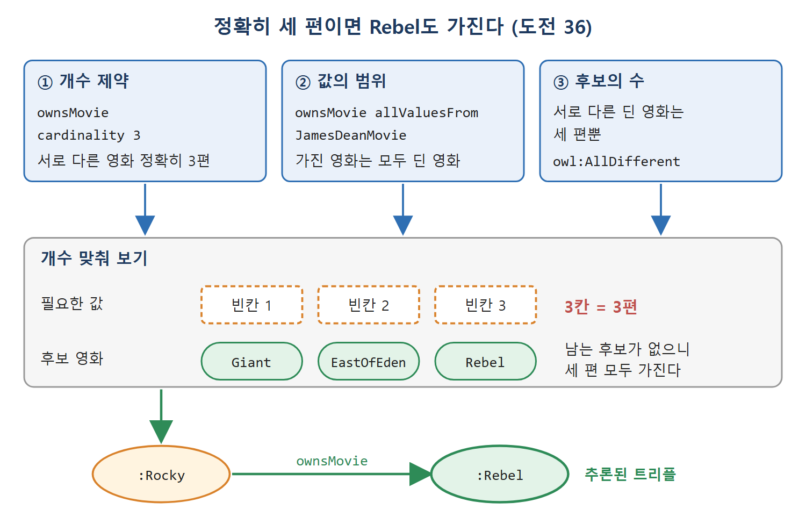

# 기수 제약

기수(cardinality)는 개수 제약이다. 12장의 제약은 "어떤 값을 가졌는가"로 클래스를 정했지만, 기수 제약은 "서로 다른 값을 몇 개 가졌는가"로 클래스를 정한다. 야구팀의 선발 라인업은 정확히 아홉 명이고, 사람의 생물학적 부모는 두 명이며, 한 막짜리 연극이나 두 권 이상으로 인쇄된 책도 개수로 정의할 수 있다.

단순해 보이지만 OWL에서 개수를 세는 일에는 의외의 미묘함이 있다. 이 문서는 기수 제약의 문법과 의미, 한정 기수(qualified cardinality), 0과 1 같은 작은 값의 쓰임, 그리고 제임스 딘 영화 대화에서 나온 도전 문제 35와 36을 다룬다.

---

## 1. 기수 제약의 문법과 의미

문법은 앞에서 본 다른 제약과 비슷하다. 정확히 아홉 명의 선수를 가진 것들의 클래스는 다음과 같다.

```turtle
[ a owl:Restriction ;
  owl:onProperty :hasPlayer ;
  owl:cardinality 9 ]
```

9 자리에는 음이 아닌 정수 어떤 것이든 쓸 수 있다. 최소와 최대는 따로 지정한다.

```turtle
[ a owl:Restriction ;
  owl:onProperty :hasPlayer ;
  owl:minCardinality 10 ]
```

```turtle
[ a owl:Restriction ;
  owl:onProperty :hasPlayer ;
  owl:maxCardinality 2 ]
```

각각 선수가 10명 이상인 것들, 2명 이하인 것들의 집합이다.

| 키워드 | 뜻 | 예 |
|---|---|---|
| owl:cardinality n | 서로 다른 값이 정확히 n개 | 야구팀 선발 라인업 9명 |
| owl:minCardinality n | 서로 다른 값이 n개 이상 | 선수 10명 이상 |
| owl:maxCardinality n | 서로 다른 값이 n개 이하 | 선수 2명 이하 |

owl:cardinality n은 minCardinality n과 maxCardinality n을 동시에 건 것과 같다. 또 기수는 "서로 다른 값"의 개수이므로, 비유일 이름 가정과 owl:differentFrom이 아주 가깝게 얽힌다. 두 이름이 같은 대상일 수 있다면, 다르다고 밝혀지기 전까지는 둘로 셀 수 없다.

의미는 다른 제약과 비슷하게 작동한다. 어떤 개체가 속성 P에 대해 서로 다른 값을 정확히(또는 적어도, 많아야) n개 가진다는 것을 증명할 수 있으면, 그 개체는 해당 제약 클래스의 멤버가 된다. 예를 들어 럭비 유니언 팀(15명)과 축구팀(11명)은 둘 다 최소 기수 10 제약 클래스에 들어간다. 브리지 팀(2명)은 여기에 들지 않지만 최대 기수 2 제약 클래스에는 들어간다.

반대 방향도 성립한다. 어떤 개체가 기수 제약 클래스의 멤버라고 단언하면, 그 개체는 속성 P에 대해 서로 다른 값을 정확히 n개 가진다. 야구팀을 정확한 기수 9 제약 클래스의 하위 클래스로 정의하면 야구팀은 서로 다른 선수 아홉 명을 가진다고 결론 낼 수 있다. 최소와 최대에도 같은 결론이 따른다.

---

## 2. 도전 35: 셋까지 세기

대화가 이어진다. 랭보가 "제임스 딘 영화를 가지고 있어?"라고 묻자 로키는 "내가 가진 영화는 그것들뿐이야"라고 답한다. 랭보는 "그럼 영화가 많지는 않겠네. 세 편 이하겠어"라고 결론짓는다. 이 결론이 OWL 의미론에서 따라 나오도록 모델을 만들어 보자.

먼저 영화를 소유한다는 속성을 만든다.

```turtle
:ownsMovie a owl:ObjectProperty .
```

OWL에서 개체에 대한 일반적인 진술은 그 개체를 제약 클래스의 멤버로 단언하는 방식으로 한다. "제임스 딘 영화만 가졌다"는 12장의 allValuesFrom으로 쓴다.

```turtle
:JamesDeanExclusive owl:equivalentClass
  [ a owl:Restriction ;
    owl:onProperty :ownsMovie ;
    owl:allValuesFrom :JamesDeanMovie ] .
:Rocky a :JamesDeanExclusive .
```

로키는 ownsMovie의 모든 값이 JamesDeanMovie에서 나오는 개체들의 클래스에 속한다. 이어서 "영화가 많지 않다"를 최대 3편으로 정의한다.

```turtle
:FewMovieOwner owl:equivalentClass
  [ a owl:Restriction ;
    owl:onProperty :ownsMovie ;
    owl:maxCardinality 3 ] .
```

그러면 랭보의 결론은 다음 트리플이다.

```turtle
:Rocky a :FewMovieOwner .
```

이 트리플은 모델에서 추론된다. 로키의 ownsMovie 값은 모두 JamesDeanMovie에서 나오고, 그 클래스에는 서로 다른 영화가 세 편뿐이라 로키는 많아야 세 편을 가진다. 여기서 세 영화가 서로 다르다는 사실(앞 문서의 AllDifferent)이 개수 계산의 바탕이 된다.

---

## 3. 도전 36: 정확히 셋을 가졌다면

랭보가 "그럼 몇 편 가졌어?"라고 묻자 로키가 "세 편"이라 답한다. 랭보는 "그게 전부네. 내가 어젯밤 본 Rebel Without a Cause도 가졌겠군"이라 말한다.

정확히 세 편을 가졌다는 것은 기수 3 제약 클래스의 멤버라는 단언으로 쓴다.

```turtle
:ThreeMovieOwner owl:equivalentClass
  [ a owl:Restriction ;
    owl:onProperty :ownsMovie ;
    owl:cardinality 3 ] .
:Rocky a :ThreeMovieOwner .
```

로키는 서로 다른 영화를 정확히 세 편 가졌고, 가진 영화는 모두 JamesDeanMovie의 멤버이며, 서로 다른 제임스 딘 영화는 세 편뿐이다. 따라서 로키는 세 편을 모두 가져야 한다. 그 결과 다음이 추론된다.

```turtle
:Rocky :ownsMovie :Rebel .
```



그림은 세 전제(개수 3, 값의 범위, 후보 세 편)를 합치면 빈칸 3개와 후보 3편이 딱 맞아 :Rocky가 :Rebel도 가진다는 결론이 나오는 흐름을 보여 준다.

이 두 도전의 추론을 표로 정리한다.

| 도전 | 전제 | 결론 | 결론을 이끄는 근거 |
|---|---|---|---|
| 35 | allValuesFrom JamesDeanMovie, 딘 영화는 서로 다른 세 편 | Rocky는 FewMovieOwner(최대 3) | 값이 모두 세 편 중에서만 나옴 |
| 36 | cardinality 3, allValuesFrom JamesDeanMovie, 딘 영화는 세 편 | Rocky가 Rebel을 가짐 | 서로 다른 세 값이 세 후보를 전부 채움 |

읽는 법은 이렇다. 35는 "상한을 정하는" 추론이고, 36은 "정확히 채우는" 추론이다. 상한과 정확한 개수가 각각 다른 결론을 낳는다.

---

## 4. 한정 기수(OWL 2.0)

기수 제약은 "속성 값이 몇 개인가"를 말해 준다. 다른 제약은 값이 어떤 클래스의 멤버인지를 말해 준다. 그런데 두 제약은 서로 독립적이라서, 특정 클래스에서 나온 값이 몇 개인가는 말하지 못한다. 한정 기수는 이 틈을 메운다. 손에는 손가락이 다섯 개이고 그중 하나는 엄지라는 문장이 간단한 예다.

한정 기수는 사소한 모델링 디테일처럼 보일 수 있고 실제로 많은 모델이 없어도 잘 굴러간다. 하지만 복잡한 물체의 구조를 모델링할 때 자주 필요해진다. 예를 들어 자동차는 타이어가 다섯 개이고, 그중 네 개는 일반 도로용이며 다섯 번째는 일반 타이어의 속성을 다 갖지 않을 수 있는 예비 타이어라고 할 수 있다. 금융 상품도 비슷해서 대출은 두 당사자가 있는 계약이고, 한쪽은 대여자, 다른 쪽은 차용자다.

제임스 딘 예에서는 영화에 출연하는 사람 수에는 제한이 없지만, 아카데미상 수상 배우가 출연한 영화에 관심이 있다고 하자. 먼저 수상 배우 클래스를 만든다.

```turtle
:BestActor a owl:Class .
:BestSupportingActor a owl:Class .
:OscarWinningActor owl:unionOf
  ( :BestActor :BestSupportingActor ) .
```

그리고 별이 많은 영화를 "수상 배우가 두 명 이상 출연한 영화"로 정의한다.

```turtle
:StarstuddedMovie owl:intersectionOf (
  :Movie
  [ a owl:Restriction ;
    owl:onClass :OscarWinningActor ;
    owl:onProperty :stars ;
    owl:minQualifiedCardinality 2 ]
) .
```

한정 기수 제약은 일반 기수 제약과 같은 모양이고, owl:onClass로 클래스를 지정하는 부분만 더해진다. 비유일 이름 가정과 열린 세계 가정이 한정 기수에도 똑같이 적용된다. 이 예에서 :EastOfEden이 :StarStuddedMovie라고 추론할 수 있다. 버를 아이브스와 조 반 플릿이 조연상을 받았고 둘이 이 영화에 함께 출연했기 때문이다. 단 둘을 두 명으로 세려면 다음 트리플도 알아야 한다.

```turtle
:BurlIves owl:differentFrom :JoVanFleet .
```

이 선언이 없으면 같은 사람의 두 이름일 수 있어 둘로 셀 수 없다. 한정 기수에도 owl:maxQualifiedCardinality와 owl:minQualifiedCardinality 같은 일반 기수의 모든 변형이 있다.

| 종류 | 키워드 | 무엇을 세는가 |
|---|---|---|
| 일반 기수 | owl:cardinality / minCardinality / maxCardinality | 속성의 서로 다른 값 전체 |
| 한정 기수 | owl:minQualifiedCardinality / owl:maxQualifiedCardinality 등 + owl:onClass | 속성의 값 중 지정한 클래스에 속하는 것 |

일반 기수는 값 전체를 세고, 한정 기수는 지정한 클래스에 속한 값만 센다.

---

## 5. 작은 기수: 0과 1

OWL은 기수로 어떤 자연수도 쓸 수 있다. 개수를 세서 클래스 멤버 여부를 판단할 정보를 추론기에 줄 수 있다는 의미다. 그중 0과 1은 모델링에서 특별히 유용하다. 다음은 ownsMovie를 예로 한 네 가지 경우다.

| 제약 | 뜻 | 쓰임 |
|---|---|---|
| minCardinality 1 | 값이 적어도 하나 필요 | 영화를 하나 이상 가진 개체의 집합. 값이 필수 |
| maxCardinality 1 | 값이 있다면 하나뿐 | 영화를 많아야 한 편 가진 개체. 값이 유일하되 꼭 있을 필요는 없음 |
| minCardinality 0 | 값이 있어도 없어도 됨 | OWL 의미로는 사족이지만 선택 사항임을 명시해 모델 가독성을 높임 |
| maxCardinality 0 | 값이 허용되지 않음 | 영화를 하나도 가지지 않은 개체 |

minCardinality 0은 OWL의 의미론에서 원래 속성은 항상 생략할 수 있으므로 하는 일이 없다. 그래도 "여기는 선택이다"를 눈에 보이게 쓰는 용도로 도움이 된다.

이 네 경우는 서로 밀접하다. minCardinality 1과 maxCardinality 0은 minCardinality 0을 분할(partition)한다. 서로소이고, 둘 다 minCardinality 0의 하위 클래스이며, 합집합이 정확히 minCardinality 0이다. minCardinality 0은 모든 개체의 클래스 owl:Thing과 같다. 영화를 하나 이상 가진 개체와 하나도 안 가진 개체를 합치면 모든 개체가 된다는 말이다.

<br>
<br>
<br>

[Semantic Web for the Working Ontologist](../)
