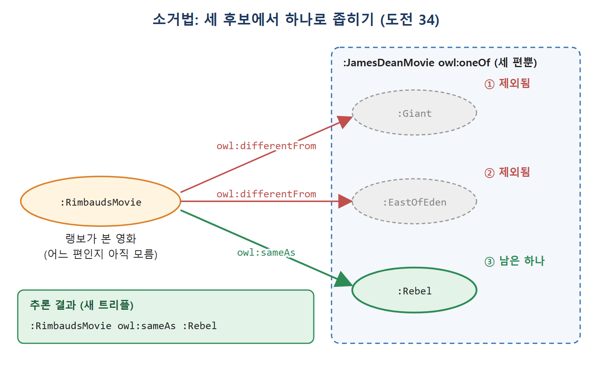

# 세계 닫기와 열거

OWL은 기본적으로 열린 세계 가정(open-world assumption)을 따른다. 지금 모르는 사실이 나중에 새로 알려질 수 있다고 보는 태도다. 이 가정 때문에 "이 클래스에 속하지 않는다"거나 "이게 전부다"라는 결론을 내리기가 까다롭다. 그래도 세상의 일부분만 닫아서 추론을 선명하게 만드는 방법이 OWL에 준비되어 있다.

이 문서는 그 방법 중 owl:oneOf(멤버를 전부 나열), owl:differentFrom(서로 다름을 선언), owl:AllDifferent(여럿이 서로 모두 다름)를 다룬다. 원서는 제임스 딘의 영화를 예로 든 대화로 이 내용을 푼다.

---

## 1. 왜 세계를 닫아야 하나

집합의 여집합조차 열린 세계에서는 미묘하다. 어떤 개체가 어느 클래스의 멤버가 아니라고 말한 바로 다음 문장에서 누군가 "사실은 멤버다"라고 주장할 수 있기 때문이다. 개수 세기는 더 어렵다. 한 대상이 이름(URI)을 여러 개 가질 수 있고, 모르던 대상이 언제든 새로 나타날 수 있어서다.

원서의 대화는 이런 상황을 이렇게 보여 준다.

| 순서 | 대화 | 숨은 추론 |
|---|---|---|
| 1 | 랭보가 어젯밤 제임스 딘 영화를 봤다고 말한다 | 영화 한 편이 있다 |
| 2 | 로키가 "Giant였어?"라고 묻고 아니라는 답을 듣는다 | Giant 후보 제거 |
| 3 | 로키가 "East of Eden이었어?"라고 묻고 아니라는 답을 듣는다 | East of Eden 후보 제거 |
| 4 | 로키가 "딘은 영화를 세 편만 찍었으니 Rebel Without a Cause겠네"라고 말한다 | 세 편뿐이라는 전제로 남은 하나를 결정 |

(원서의 대화 인물은 Rimbaud와 Rocky다. 표에서는 편의상 한글로 옮겼다.) 이 추론은 "제임스 딘 영화는 딱 세 편"이라는 사실에 기대고 있다. 열린 세계라면 누군가 네 번째 영화를 알려 줄 수도 있으니 이 주장은 위험하다. 그렇다고 열린 세계 가정을 통째로 버릴 필요는 없다. 특정 클래스에 대해 "멤버를 전부 알고 있다"고만 선언하면 된다. 멤버를 전부 나열할 수 있을 때 여러 추론이 가능해진다.

---

## 2. owl:oneOf로 멤버 나열하기

owl:oneOf는 클래스의 멤버를 리스트로 모두 적는다.

```turtle
ss:SolarPlanet rdf:type owl:Class ;
  owl:oneOf ( ss:Mercury ss:Venus ss:Earth ss:Mars
              ss:Jupiter ss:Saturn ss:Uranus ss:Neptune ) .
```

SolarPlanet 클래스는 이 여덟 개체를 포함하고 다른 개체는 없다는 뜻이다. 이 선언은 "누구나 어떤 주제에 대해서든 무엇이든 말할 수 있다"는 AAA 원칙(Anyone can say Anything about Any topic)에 제한을 건다. 이 클래스가 정확히 이 항목들로 이루어졌다고 했으므로, 다른 누군가가 이 클래스에 속하는 새로운 구별되는 개체를 주장할 수 없다.

그래서 owl:oneOf는 정의가 잘 바뀌지 않는 경우에만 조심해서 써야 한다. 태양계 행성은 50년 동안 바뀌지 않았으니 한동안은 괜찮을 것이다. 바뀐다 해도 AAA 원칙에 따라 의견이 다른 사람이 원하는 천체를 넣은 다른 모델을 공개하면 된다.

oneOf가 제한하는 것과 제한하지 않는 것을 구분해야 한다.

| 가정 | oneOf가 제한하는가 | 설명 |
|---|---|---|
| AAA 원칙 / 열린 세계 | 제한한다 | 이 클래스에는 나열한 멤버만 있다 |
| 비유일 이름 가정(Nonunique Naming Assumption, 이름이 다르다고 해서 다른 대상이라는 보장은 없다는 가정) | 제한하지 않는다 | Mercury와 Venus가 같은 대상일 수 있다는 가능성은 여전히 열려 있다 |

oneOf가 멤버를 닫아 주기는 해도 멤버끼리 서로 다르다는 보장까지 주지는 않는다는 점이 중요하다. 이 부분은 뒤에서 AllDifferent로 메운다.

참고로 someValuesFrom과 oneOf를 함께 쓰면 hasValue의 일반화가 된다. hasValue는 속성이 가질 수 있는 값 하나를 지정하지만, someValuesFrom에 oneOf 클래스를 주면 속성이 가질 수 있는 값의 집합을 지정한다.

---

## 3. 도전 33: 논의 범위 제한하기

제임스 딘 영화 클래스는 oneOf로 이렇게 쓴다. 딘은 50년 넘게 전에 세상을 떠났으니 새 영화를 찍을 가능성이 없는 안전한 선택이다.

```turtle
:JamesDeanMovie a owl:Class ;
  owl:oneOf ( :Giant :EastOfEden :Rebel ) .
```

이 선언에서 얻는 추론은 두 가지다.

1. 리스트에 있는 각 개체는 이 클래스의 멤버다. 즉 :Giant, :EastOfEden, :Rebel이 각각 :JamesDeanMovie 타입이라는 트리플이 추론된다.
2. 이 클래스의 멤버는 이들뿐이다. 누군가 새 개체를 이 클래스의 멤버라고 주장하면, 그 개체는 리스트의 개체 중 하나와 owl:sameAs여야 한다.

```turtle
:RimbaudsMovie rdf:type :JamesDeanMovie .
```

이 트리플이 추가되면 :RimbaudsMovie는 세 영화 중 하나와 같은 대상이어야 한다는 결론이 나온다.

이 추론은 지금까지 본 것과 성격이 다르다. 지금까지는 "이 트리플이 새로 생긴다"는 식으로 결과를 트리플로 쓸 수 있었다. 이번에는 "세 가지 트리플 중 하나가 참이다"라는 결론이라, 어느 것인지 모르니 새 트리플을 단언할 수 없고 쿼리 결과도 달라지지 않는다. 마치 로키가 영화가 세 편 중 하나라는 건 알지만 어느 것인지는 모르는 단계와 같다. 로키는 후보를 하나씩 지워 가며 답을 좁힌다. OWL에서 후보를 지우려면 "이 개체는 저 개체와 다르다"를 말할 수 있어야 한다.

---

## 4. owl:differentFrom으로 후보 지우기

부동산 가격에 영향을 주는 세 요소가 "위치, 위치, 위치"라는 오래된 농담이 있다. 세 가지를 말하라 했는데 같은 것을 세 번 말하니 웃기다는 이야기다. 사람은 세 가지라면 서로 다른 세 가지를 기대하지만, 시맨틱 웹에는 비유일 이름 가정이 있어서 다르다는 사실을 명시해야 한다. 그 도구가 owl:differentFrom이다. 트리플 하나로 선언한다.

```turtle
ss:Earth owl:differentFrom ss:Mars .
```

이 트리플이 있으면 개수 세기나 소거법 논증을 할 때 ss:Earth와 ss:Mars가 서로 다른 자원을 가리킨다고 믿고 써도 된다. owl:cardinality, owl:oneOf 같은 구성 요소와 함께 쓸 때 여러 추론이 만들어진다.

### 도전 34: 소거법

로키의 추론은 다음 순서로 OWL에 옮겨진다.

```turtle
:RimbaudsMovie owl:differentFrom :Giant .
:RimbaudsMovie owl:differentFrom :EastOfEden .
```

처음에 로키는 영화가 세 편 중 하나라는 사실(oneOf)만 안다. 추측이 맞았다면 `:RimbaudsMovie owl:sameAs :Giant`로 쓰면 끝이었을 것이다. 하지만 아니었으므로 differentFrom을 쓰고, East of Eden도 아니라는 답을 받아 differentFrom을 하나 더 쓴다. 이제 OWL은 세 가지를 함께 본다. 영화는 세 편뿐이고, 랭보의 영화는 Giant도 East of Eden도 아니다. 따라서 다음 결론이 나온다.

```turtle
:RimbaudsMovie owl:sameAs :Rebel .
```

| 단계 | 아는 사실 | 남은 후보 |
|---|---|---|
| 시작 | 세 편 중 하나(oneOf) | Giant, East of Eden, Rebel |
| 1차 소거 | differentFrom :Giant | East of Eden, Rebel |
| 2차 소거 | differentFrom :EastOfEden | Rebel |
| 결론 | 후보가 하나 | sameAs :Rebel |



그림은 :RimbaudsMovie가 세 후보 중 두 개와 differentFrom으로 구별되어 제외되고, 남은 :Rebel과 owl:sameAs로 이어지는 과정을 보여 준다.

이 과정은 사람이 스무고개로 정답을 좁히는 과정과 같다. OWL 추론기도 같은 논리로 마지막 결론을 낸다.

---

## 5. 여러 개체를 한 번에 구별하기: owl:AllDifferent

비유일 이름 가정은 모든 자원에 적용된다. 우리는 ss:Earth와 ss:Mars가 다르다고 직관적으로 알지만, 모델에는 그렇게 적어야 한다. ss:Earth와 ss:Jupiter, ss:Venus와 ss:Mars도 마찬가지라 모든 쌍을 일일이 쓰면 끝이 없다.

이를 줄여 주는 도구가 owl:AllDifferent와 owl:distinctMembers다. 개체를 RDF 리스트로 묶고, 이 리스트를 owl:distinctMembers 속성의 값으로 지정하면 리스트 안 개체들은 서로 모두 다르다는 뜻이 된다. owl:distinctMembers의 정의역(domain)은 owl:AllDifferent다. 주어는 관례적으로 빈 노드(bnode)를 쓴다.

```turtle
[ a owl:AllDifferent ;
  owl:distinctMembers ( ss:Mercury ss:Venus ss:Earth ss:Mars
                        ss:Jupiter ss:Saturn ss:Uranus ss:Neptune )
] .
```

형식적으로 이 한 문장은 owl:differentFrom 트리플 28개를 쓴 것과 같다. 여덟 개체에서 고를 수 있는 쌍이 28개(8×7÷2)이기 때문이다. 제임스 딘 영화 세 편도 같은 방식이다.

```turtle
[ a owl:AllDifferent ;
  owl:distinctMembers ( :EastOfEden :Giant :Rebel )
] .
```

이 Turtle을 트리플 그래프로 보면 영화들이 rdf:first와 rdf:rest로 이어진 RDF 리스트에 들어 있다. 리스트가 길어지면 개체마다 연결 고리가 하나씩 늘어난다.

oneOf와 AllDifferent를 짝으로 쓰는 일이 흔하다. oneOf는 "이 클래스의 멤버는 이것들뿐"이라는 닫힘을, AllDifferent는 "그 멤버들은 서로 다르다"는 구별을 말하므로, 둘을 합치면 "서로 구별되는 개체들의 정해진 목록으로 이루어진 클래스"가 된다.

| 도구 | 하는 일 | 대신 쓰면 |
|---|---|---|
| owl:oneOf | 클래스의 멤버를 닫는다 | 멤버 하나하나에 rdf:type 선언 + 새 멤버 금지 |
| owl:differentFrom | 두 개체가 다름을 선언한다 | 쌍마다 한 줄 |
| owl:AllDifferent | 리스트 안의 모든 개체가 서로 다름을 선언한다 | differentFrom을 쌍마다 쓴 것과 같음(여덟 개체면 28개) |

읽는 법은 단순하다. 닫기(oneOf)와 구별(differentFrom, AllDifferent)은 별개의 일이다. 개수 세기에서는 이 둘이 모두 필요하다.

<br>
<br>
<br>

[Semantic Web for the Working Ontologist](../)
