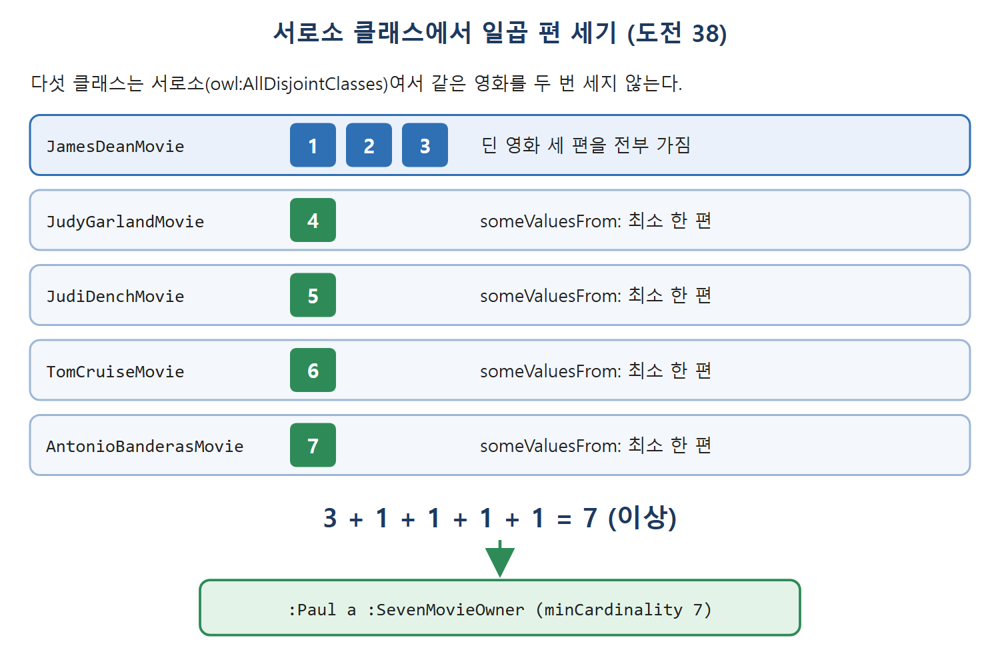

# 여집합과 서로소 집합

앞 문서까지는 "무엇에 속하는가"를 말하는 도구를 봤다. 이번에는 "무엇에 속하지 않는가"를 말하는 도구인 여집합(complement)과 서로소(disjoint) 선언을 본다. 이 둘은 쓰기는 쉬운데 잘못 쓰기도 쉽다. OWL은 형식 체계라서 그런 실수에 너그럽지 않다.

여집합과 서로소를 개수 세기와 결합하면 "서로 겹치지 않는 영화들이니 최소한 이만큼은 가졌다"는 식의 추론이 가능해진다. 원서의 도전 37과 38이 바로 그 예다.

---

## 1. 여집합: owl:complementOf

집합의 여집합은 그 집합에 없는 모든 것의 집합이다. OWL 클래스도 마찬가지로, 클래스의 여집합은 그 클래스에 속하지 않는 모든 개체를 멤버로 가진 클래스다. 여집합은 클래스 하나에만 적용하므로 트리플 하나로 정의한다.

```turtle
ex:ClassA owl:complementOf ex:ClassB .
```

여집합은 간단해 보여도 오용하기 쉽다. 마이너 리그 선수는 메이저 리그 선수의 여집합이라고 쓰고 싶은 유혹이 생긴다. 이 둘 말고 다른 종류의 선수는 없고 둘 다에 속하는 선수도 없다고 주장하는 셈이다.

```turtle
bb:MinorLeaguePlayer owl:complementOf bb:MajorLeaguePlayer .
```

이렇게 쓰면 bb:MajorLeaguePlayer가 아닌 모든 개체가 bb:MinorLeaguePlayer가 된다. 의욕 넘치는 신인뿐 아니라 감독, 팬, 영화, 행성까지 우주의 모든 것이 포함된다.

| 정의 | 포함되는 것 | 의도에 맞는가 |
|---|---|---|
| MinorLeaguePlayer = complementOf MajorLeaguePlayer | 메이저 선수가 아닌 모든 것(신인, 감독, 팬, 영화, 행성 등) | 맞지 않음 |
| MinorLeaguePlayer = Player ∩ complementOf MajorLeaguePlayer | 선수이면서 메이저 선수가 아닌 것 | 맞음 |

표처럼 여집합 하나만 쓰면 범위가 너무 넓어진다.

---

## 2. 여집합은 교집합과 짝지어 쓴다

실무에서는 여집합을 직접 쓰지 않고 교집합과 함께 쓰는 것이 관행이다.

```turtle
bb:MinorLeaguePlayer owl:intersectionOf
  ( [ a owl:Class ;
      owl:complementOf bb:MajorLeaguePlayer ]
    bb:Player ) .
```

마이너 리그 선수는 선수(Player)이면서 메이저 리그 선수가 아닌 개체다. 멤버는 bb:Player 클래스 안에서만 나오고, 그중 bb:MajorLeaguePlayer에 속한 선수는 빠진다. 이름이 주는 자연스러운 의미에 훨씬 가깝다.

이 정의는 빈 노드로 이름 없는 클래스를 만든다. bb:MajorLeaguePlayer의 여집합에 굳이 이름을 붙일 필요가 없으니 대괄호 표기 `[ a owl:Class … ]`로 익명 클래스를 쓴다.

---

## 3. 도전 37: 이미 아는 것 너머로 세기

로키의 친구 폴이 대화에 들어온다. 폴은 "제임스 딘 이야기야? 나 그 사람 좋아해! 그의 영화는 다 갖고 있어"라고 말한다. 랭보가 "너무 집착하는 건 아니지? 다른 영화도 있지?"라고 묻자 폴은 "물론 딘 영화가 아닌 것도 있지"라고 답한다. 로키는 "그럼 최소 네 편은 가졌겠네!"라고 결론 낸다.

이 결론을 이끌기 위해 먼저 ownsMovie의 역속성이 필요하다.

```turtle
:ownedBy owl:inverseOf :ownsMovie .
```

폴이 가진 영화들의 클래스는 이렇게 정의한다.

```turtle
:PaulsMovie a owl:Class ;
  owl:intersectionOf
    ( [ a owl:Restriction ;
        owl:onProperty :ownedBy ;
        owl:hasValue :Paul ]
      :Movie ) .
```

"소유자가 폴"이라는 hasValue 제약과 Movie 클래스의 교집합이다. 폴이 제임스 딘 영화는 모두 가졌다는 말은 JamesDeanMovie가 PaulsMovie의 하위 클래스라는 뜻이다(반대 방향까지 성립할 필요는 없다).

```turtle
:JamesDeanMovie rdfs:subClassOf :PaulsMovie .
```

딘 영화가 아닌 영화도 가졌다는 말은 someValuesFrom에 여집합을 넣어 표현한다.

```turtle
:Paul a [ a owl:Restriction ;
          owl:onProperty :ownsMovie ;
          owl:someValuesFrom [ owl:complementOf :JamesDeanMovie ]
        ] .
```

안쪽부터 풀어 읽자.

| 조각 | 의미 |
|---|---|
| `[ owl:complementOf :JamesDeanMovie ]` | 제임스 딘 영화가 아닌 모든 것을 담은 익명 클래스 |
| 바깥 제약 전체 | ownsMovie 값 중 딘 영화가 아닌 것이 하나라도 있는 개체의 익명 클래스 |
| `:Paul a ...` | 폴이 그런 개체라는 단언 |

마지막으로 네 편 이상 가진 사람의 클래스를 minCardinality로 정의한다.

```turtle
:ManyMovieOwner owl:equivalentClass
  [ a owl:Restriction ;
    owl:onProperty :ownsMovie ;
    owl:minCardinality 4 ] .
```

폴은 제임스 딘 영화 세 편을 모두 가졌고 딘 영화가 아닌 영화도 최소 하나 가졌다. 그러면 적어도 네 편이므로 `:Paul rdf:type :ManyMovieOwner`가 추론된다. 딘 영화가 아닌 영화는 딘 영화 세 편 중 어느 것과도 같을 수 없다는 점이 핵심이다. 여집합이 그 구별을 보장해 주기 때문이다.

---

## 4. 서로소 집합: owl:disjointWith

어떤 클래스에도 공통 멤버가 없을 때 두 집합이 서로소라 한다. OWL에서는 owl:disjointWith로 쓴다.

```turtle
:Reptile owl:disjointWith :Mammal .
:Meat owl:disjointWith :Fruit .
:Fish owl:disjointWith :Fowl .
```

서로소인 두 클래스의 멤버끼리는 owl:differentFrom이라는 결론이 나온다.

```turtle
:Lassie a :Mammal .
:Godzilla a :Reptile .
```

이 두 줄이 있고 Reptile과 Mammal이 서로소이면 `:Lassie owl:differentFrom :Godzilla`가 추론된다. 서로소 선언은 클래스 단위의 differentFrom이라 개수 세기에 아주 쓸모가 많다.

| 선언 | 대상 | 규모 | 추론 |
|---|---|---|---|
| owl:differentFrom | 개체 두 개 | 개체 쌍 | 다른 개체 |
| owl:AllDifferent | 개체 목록 | 개체 전체 | 목록 내 모든 쌍이 다름 |
| owl:disjointWith | 클래스 두 개 | 클래스 쌍 | 두 클래스의 멤버끼리 서로 다름 |
| owl:AllDisjointClasses | 클래스 목록 | 클래스 전체 | 목록 내 모든 쌍이 서로소 |

세로로 읽으면 개체용 도구와 클래스용 도구가 짝을 이룬다. 원서는 disjointWith를 differentFrom을 한꺼번에 선언하는 방식이라고 설명한다.

---

## 5. 도전 38: 서로소 클래스 속에서 세기

대화가 이어진다. 폴은 "나는 영화광이야. 딘 영화를 다 가진 데다 주디 갈랜드, 톰 크루즈, 주디 덴치, 안토니오 반데라스 영화도 있어!"라고 말한다. 로키는 "최소 일곱 편은 가졌겠네!"라고 한다. 폴이 이유를 묻자 로키는 "그 사람들이 같은 영화에 같이 나온 적이 없으니까!"라고 답한다.

폴이 어떤 배우의 영화를 가졌다는 말은 someValuesFrom 제약을 가진 개체라는 단언이다. 배우마다 하나씩이다.

```turtle
:Paul a [ a owl:Restriction ;
          owl:onProperty :ownsMovie ;
          owl:someValuesFrom :JudyGarlandMovie ] .
```

같은 모양의 단언을 :JudiDenchMovie, :TomCruiseMovie, :AntonioBanderasMovie에도 적는다. 일곱 편 이상 가진 사람의 클래스는 minCardinality 7로 정의한다.

```turtle
:SevenMovieOwner a owl:Restriction ;
  owl:onProperty :ownsMovie ;
  owl:minCardinality 7 .
```

폴이 이 클래스의 멤버임은 언제 알 수 있을까. 로키가 지적했듯 이 영화 집합들이 서로소라는 사실을 알아야 한다. 열 개의 서로소 쌍을 쓸 수도 있지만 owl:AllDisjointClasses로 한 번에 선언한다.

```turtle
:DisjointMovies
  rdf:type owl:AllDisjointClasses ;
  rdfs:label "Disjoint movies" ;
  owl:members (
    :AntonioBanderasMovie :JamesDeanMovie :JudiDenchMovie
    :JudyGarlandMovie :TomCruiseMovie
  ) .
```

클래스가 다섯 개이므로 서로소 쌍은 10개(5×4÷2)다. 이제 폴은 딘 영화 세 편에 나머지 배우들의 영화를 각각 적어도 한 편씩 가졌고, 집합이 서로소라 같은 영화가 두 번 세어지지 않는다. 3 + 1 + 1 + 1 + 1 = 7이므로 `:Paul a :SevenMovieOwner`가 추론된다.



그림은 서로소인 다섯 클래스에서 영화를 3편, 1편, 1편, 1편, 1편씩 세어 합이 7이 되고, 그래서 폴이 SevenMovieOwner가 되는 과정을 보여 준다.

여기서 someValuesFrom과 기수의 관계가 보인다. someValuesFrom 제약 하나는 값 하나의 존재를 보장한다. 그 값들이 서로 다르다고 알려져 있으면 제약 하나당 하나씩 센다. 개체를 서로 구별하는 AllDifferent가 있듯, 클래스 여럿을 서로 겹치지 않게 만드는 도구가 AllDisjointClasses다.

원서의 그림 13.6은 편의상 모든 서로소 공리를 그리지 않았지만, 결론에는 논리적으로 모두 필요하다고 밝혔다.

<br>
<br>
<br>

[Semantic Web for the Working Ontologist](../)
