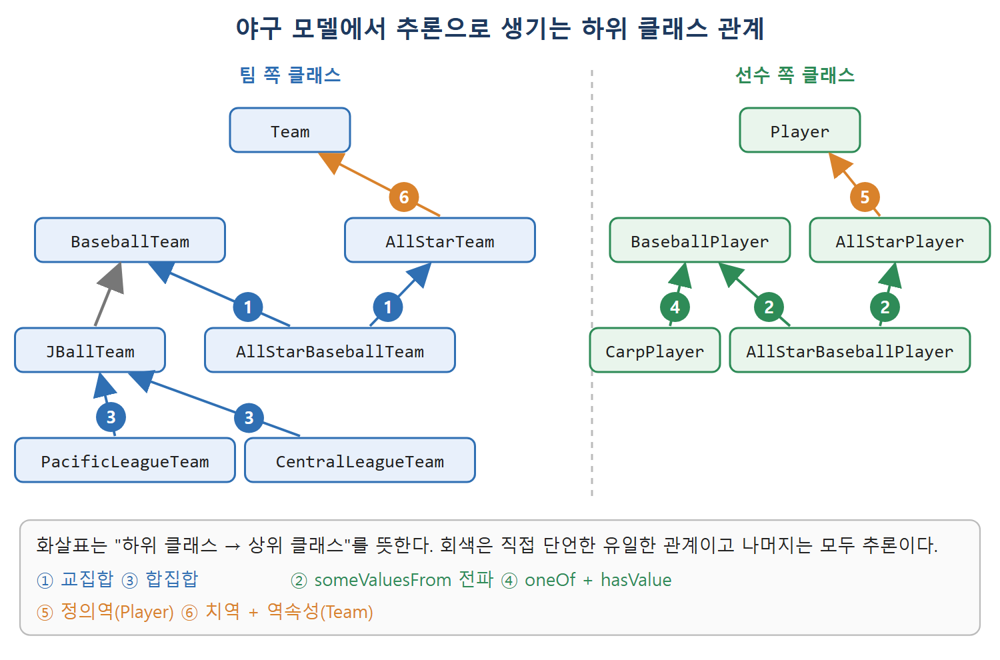

# 클래스 관계 추론

지금까지 대부분의 추론은 개체에 관한 것이었다. 웽거는 분석가다, 목성은 태양계 행성이다, 가네다는 스타 선수다, 셰익스피어는 앤 해서웨이와 결혼했다 같은 결론이다. 이 장에서는 클래스에 관한 결론도 나왔다. JDJG가 만족 불가능하다는 결론이 그런 예다.

OWL은 클래스에 대해서도 폭넓은 결론을 낼 수 있다. 한 클래스가 다른 클래스의 하위 클래스라는 결론, 어떤 클래스가 속성의 정의역이나 치역이라는 결론도 가능하다. 경우의 수는 무한하지만 자주 나오는 패턴이 있다. 이 문서는 그 패턴을 야구팀 예제로 정리하고, 개체 추론과 클래스 추론의 차이를 설명한다.

---

## 1. 하위 클래스를 추론하는 패턴

| 패턴 | 규칙 | 야구 예 |
|---|---|---|
| 교집합과 하위 클래스 | 교집합은 그것을 이루는 각 클래스의 하위 클래스 | AllStarBaseballTeam이 AllStarTeam과 BaseballTeam의 교집합이면 두 클래스 각각의 하위 클래스 |
| 합집합과 하위 클래스 | 합집합은 그것을 이루는 각 클래스의 상위 클래스 | JBallTeam이 PacificLeagueTeam과 CentralLeagueTeam의 합집합이면 두 리그 팀 클래스가 JBallTeam의 하위 클래스 |
| 여집합과 하위 클래스 | 여집합은 하위 클래스 순서를 뒤집는다 | AllStarBaseballTeam이 BaseballTeam의 하위 클래스이면, BaseballTeam의 여집합이 AllStarBaseballTeam의 여집합의 하위 클래스 |
| 제약을 통한 전파 | 하위 클래스 관계가 allValuesFrom, someValuesFrom 제약을 통해 전파 | 아래 설명 |
| hasValue와 someValuesFrom | 값 하나를 지정한 제약은 그 개체가 속한 클래스에 대한 someValuesFrom 제약의 하위 클래스 | playsFor hasValue TokyoGiants는 playsFor someValuesFrom BaseballTeam의 하위 클래스 |
| 기수 간의 관계 | 정수의 산수 규칙으로 하위 클래스 관계가 생김 | 최소 9명인 ViableBaseballTeam과 정확히 10명인 FullBaseballTeam이면 FullBaseballTeam이 ViableBaseballTeam의 하위 클래스 |
| someValuesFrom과 minCardinality | 어떤 값이 있다면 최소 하나 있다 | 선수 중 투수가 있으면 투수가 최소 한 명 있음 |

표 하나로는 이해하기 어려운 항목이 있어서 아래에서 풀어 쓴다.

### 제약을 통한 전파

하위 클래스 관계는 제약 안으로 따라 들어간다. AllStarBaseballTeam이 BaseballTeam의 하위 클래스라고 하자. 그러면 playsFor 속성의 `allValuesFrom AllStarBaseballTeam` 제약은 같은 속성의 `allValuesFrom BaseballTeam` 제약의 하위 클래스다. 이 두 제약에 이름을 붙여 첫째를 AllStarBaseballPlayer, 둘째를 BaseballPlayer라 하면 AllStarBaseballPlayer가 BaseballPlayer의 하위 클래스라는 뜻이다. 어떤 속성에서도, someValuesFrom에서도 같은 원리가 성립한다.

### hasValue와 someValuesFrom

hasValue는 클래스가 아닌 개체를 가리키기 때문에 전파 방식이 조금 다르다. 개체 TokyoGiants가 BaseballTeam의 멤버라고 하자. 그러면 `playsFor hasValue TokyoGiants` 제약은 `playsFor someValuesFrom BaseballTeam` 제약의 하위 클래스다.

### 기수와 someValuesFrom

BaseballTeam이 `hasPlayer someValuesFrom Pitcher` 제약의 하위 클래스라면, 투수가 적어도 한 명 있다는 `hasPlayer minCardinality 1` 제약의 하위 클래스이기도 하다. 반대 방향인 allValuesFrom에는 같은 결론이 성립하지 않는다. someValuesFrom은 값이 있음을 보장하지만 allValuesFrom은 보장하지 않기 때문이다.

---

## 2. 사이드바: 객체지향 모델링과의 차이

OWL이 클래스 관계를 추론할 수 있다는 점은 객체지향(OO) 모델링과 크게 다르다. OO에서는 클래스 구조가 모델 구성의 뼈대다. 모든 인스턴스는 어떤 클래스의 멤버로 만들어지고 동작도 클래스 구조가 정한다. 클래스 구조를 바꾸면 시스템 동작이 크게 달라진다. OWL에서는 클래스나 개체에 대해 더 많은 정보를 알게 되면 클래스 구조가 바뀔 수 있다.

이는 설계자의 변덕이 아니라 웹의 기본 가정에서 나온 결과다. AAA 원칙, 열린 세계라는 웹의 성격, 웹의 이름이 유일하지 않다는 사실이 그 가정이다. 엄격한 데이터 모델(객체 모델 같은 것)은 소프트웨어를 만들 때처럼 위에서 아래로 통제하는 환경에 맞지만, 웹처럼 열린 자유로운 시스템에는 맞지 않는다. 더 많은 것을 알아 가면 지식의 구조에 대한 이해도 바뀌게 마련이고 그것을 피할 수는 없다. OWL은 적어도 그 변화를 일관되고 체계적으로 이해할 방법을 제공한다.

| 비교 | 객체지향 모델 | OWL 모델 |
|---|---|---|
| 클래스 구조의 역할 | 모델의 뼈대. 인스턴스는 클래스의 멤버로 생성 | 정의에서 추론되는 결과 |
| 구조가 바뀌는 때 | 설계자가 고칠 때 | 새 정보를 알게 될 때 |
| 잘 맞는 환경 | 위에서 통제하는 시스템 | 열린 웹 |

OWL의 논리는 위의 전파 패턴 이상을 다룬다. 기수에 관한 하위 클래스 추론도 포함하며, 논리의 기술적 세부는 이 책의 범위를 벗어난다. 요점은 제약, 합집합, 교집합 등의 의미에서 증명할 수 있는 클래스 관계는 모두 추론된다는 것이다. 위 패턴이 모든 경우를 다 덮지는 않지만 실제 모델에서 가장 흔한 것들이다.

이 능력 덕에 하위 클래스를 거의 직접 선언하지 않는 모델링 스타일이 가능하다. 클래스 사이의 관계를 합집합, 교집합, 여집합, 제약으로 서술해 두면 클래스 구조는 추론기가 정한다. 클래스나 개체에 관해 새 정보가 알려지면 클래스 구조가 더 추론된다. 하위 클래스 관계는 한 클래스의 멤버가 다른 클래스에 포함된다는 의미로만 선언한다.

---

## 3. 야구 모델로 보는 클래스 추론

원서의 표 13.1은 야구 모델의 정의를 정리한다. 표기에서 ≡는 왼쪽 클래스가 오른쪽 식과 동치, ⊆는 왼쪽이 오른쪽의 하위 클래스를 뜻한다.

| 클래스 | 정의 |
|---|---|
| AllStarBaseballPlayer | ≡ playsFor some AllStarBaseballTeam |
| AllStarBaseballTeam | ≡ BaseballTeam ∩ AllStarTeam |
| AllStarPlayer | ≡ playsFor some AllStarTeam |
| AllStarTeam | ⊆ Employs only AllStarPlayer |
| BaseballPlayer | ≡ playsFor some BaseballTeam |
| BaseballTeam | ⊆ Employs some BaseballPlayer |
| JBallTeam | ≡ PacificLeagueTeam ∪ CentralLeagueTeam, ⊆ BaseballTeam |
| CarpPlayer | ≡ playsFor hasValue Carp(히로시마 야구팀 이름) |
| CentralLeagueTeam | ≡ oneOf Carp, Giants, BayStars, Tigers, Dragons, Swallows |
| PacificLeagueTeam | ≡ oneOf Lions, Hawks, Fighters, BlueWave, Buffaloes, Marines |
| Player | playsFor의 정의역 |
| Team | playsFor의 치역 |
| playsFor | Employs의 역 |

이 표에서 직접 단언한 하위 클래스 관계는 JBallTeam이 BaseballTeam의 하위 클래스라는 것 하나뿐이다. 나머지는 모두 집합 연산이나 제약으로 쓴 것이다. 단언된 그대로의 클래스 트리는 아주 납작하다. 그런데 정의만 가지고 다음 여섯 가지 하위 클래스 관계를 추론할 수 있다.

1. AllStarBaseballTeam은 BaseballTeam과 AllStarTeam의 교집합이므로 둘 각각의 하위 클래스다.
2. AllStarBaseballPlayer와 AllStarPlayer는 같은 속성 playsFor의 someValuesFrom 제약으로, 각각 AllStarBaseballTeam과 AllStarTeam을 가리킨다. AllStarBaseballTeam이 AllStarTeam의 하위 클래스라는 사실이 전파되어 AllStarBaseballPlayer가 AllStarPlayer의 하위 클래스임이 추론된다. 같은 방식으로 AllStarBaseballPlayer가 BaseballPlayer의 하위 클래스도 된다.
3. JBallTeam이 PacificLeagueTeam과 CentralLeagueTeam의 합집합이므로 두 리그 팀 클래스는 JBallTeam의 하위 클래스다.
4. 히로시마 카프는 센트럴 리그 팀이므로 JBallTeam이고, 따라서 BaseballTeam이다. CarpPlayer는 카프에 대한 hasValue 제약의 멤버이므로 BaseballPlayer의 하위 클래스다.
5. 정의역도 쓰인다. AllStarPlayer는 playsFor someValuesFrom 제약과 동치라서 모든 멤버가 어떤 팀에서 뛴다. playsFor의 정의역이 Player이므로 그 멤버는 Player여야 하고, 따라서 AllStarPlayer는 Player의 하위 클래스다.
6. 치역도 쓰인다. AllStarTeam은 어떤 AllStarPlayer를 고용하고, employs가 playsFor의 역이므로 각 AllStarTeam에서 뛰는 누군가가 있다. playsFor의 치역이 Team이므로 AllStarTeam은 Team이기도 하다.

| 번호 | 사용한 도구 | 얻은 결론 |
|---|---|---|
| 1 | 교집합 | AllStarBaseballTeam은 BaseballTeam과 AllStarTeam의 하위 클래스 |
| 2 | someValuesFrom 전파 | AllStarBaseballPlayer는 AllStarPlayer와 BaseballPlayer의 하위 클래스 |
| 3 | 합집합 | 두 리그 팀은 JBallTeam의 하위 클래스 |
| 4 | oneOf + hasValue | CarpPlayer는 BaseballPlayer의 하위 클래스 |
| 5 | 정의역 | AllStarPlayer는 Player의 하위 클래스 |
| 6 | 치역 + 역속성 | AllStarTeam은 Team의 하위 클래스 |

그림은 팀 쪽과 선수 쪽 클래스를 나누어, 추론된 하위 클래스 관계를 위 표의 번호와 같은 번호의 화살표로 보여 준다. 직접 단언한 관계는 회색 화살표 하나뿐이고 나머지는 모두 정의에서 추론된 것이다.

2번을 따로 짚을 만하다. 이름만 보면 AllStarBaseballPlayer가 AllStarPlayer라는 것이 당연해 보인다. 하지만 증명할 수 있을까. AllStarBaseballPlayer는 AllStarBaseballTeam에서 뛰고, 그 팀은 AllStarTeam이므로 그 선수는 AllStarPlayer가 맞다. 이 결론은 선수 한 명의 기록을 보지 않고 나왔다. 데이터를 잔뜩 살펴서 얻은 것이 아니라 용어의 정확한 논리적 정의만 보고 얻은 것이다. 클래스 설명만으로 이런 정교한 결론을 낼 수 있다는 점이 OWL 모델의 고유한 힘이다.

추론으로 얻은 클래스 구조를 보면 모든 클래스가 어떤 추론 패턴에 관여하고, 단언된 모델에 비해 클래스 트리가 훨씬 깊어진다.

---

## 4. 개체 추론과 클래스 추론

RDF 관점에서 개체에 대한 추론과 클래스에 대한 추론은 매우 비슷하다. 어느 쪽이든 단언된 트리플을 바탕으로 새 트리플이 모델에 더해진다. 하지만 모델링 관점에서는 매우 다르다. 하나는 데이터 흐름 속 특정 개체에 대한 구체적인 결론을 내고, 다른 하나는 개체들의 클래스에 대한 일반적인 결론을 낸다. 두 방식을 A-box 추론(개체)과 T-box 추론(클래스)이라 부른다. A-box는 단언(assertion) 상자, T-box는 용어(terminology) 상자의 줄임말인데, 이 이름은 역사적 유산이라 지금은 의미가 없다.

개체 추론의 쓸모는 분명하다. 이 책 전반에서 셰익스피어의 아내, 어떤 영화가 누구의 것인지, 어떤 용어가 더 넓은 용어인지를 추론했다. 한 정보원에 적힌 정보를 모델에 따라 바꿔 다른 맥락에서 쓰는 일이다. 한 맥락에서 다른 맥락으로의 매핑은 rdfs:subClassOf, rdfs:subPropertyOf, 여러 owl:Restriction으로 정의한다. 그러면 RDFS와 OWL 표준이 정한 추론에 따라 데이터가 변환되고 처리된다.

클래스 추론의 쓸모는 좀 더 미묘하다. 데이터가 전혀 없어도 가능하다. 개체들의 클래스 사이 관계를 정하고, 데이터 사이의 일반적인 관계를 알려 준다. 퍼시픽 리그 데이터를 하나도 보기 전에, 이 리그의 모든 팀이 야구팀임을 결정할 수 있다. 특정 팀을 하나하나 처리할 필요가 없다. 새 팀이 리그에 들어와도 이 사실은 그대로 참이다. 이런 의미에서 클래스 추론은 모델의 컴파일과 비슷하다. 개체 추론은 구체적인 데이터를 입력으로 처리하지만, 클래스 추론은 데이터 사이의 일반적 관계를 정하고 그 결과를 rdfs:subClassOf, rdfs:subPropertyOf, rdfs:domain, rdfs:range로 기록한다. 이 일반 관계가 추론되어 있으면 개별 데이터 처리가 훨씬 쉬워진다.

| 비교 | A-box 추론(개체) | T-box 추론(클래스) |
|---|---|---|
| 대상 | 데이터 흐름 속 개별 개체 | 개체의 클래스 사이 관계 |
| 결론의 성격 | 구체적 | 일반적 |
| 데이터 필요 여부 | 필요 | 없어도 가능 |
| 결과의 기록 | 개체에 대한 새 트리플 | rdfs:subClassOf, subPropertyOf, domain, range |
| 비유 | 실행 | 컴파일 |

둘을 하나의 시스템에서 같이 쓰면 일반적 추론과 구체적 데이터 변환이 매끄럽게 합쳐진다. 일반적이든 구체적이든 접하는 정보에 맞추어 정보를 부드럽게 관리할 수 있다.

 
 
 

[Semantic Web for the Working Ontologist](../)
