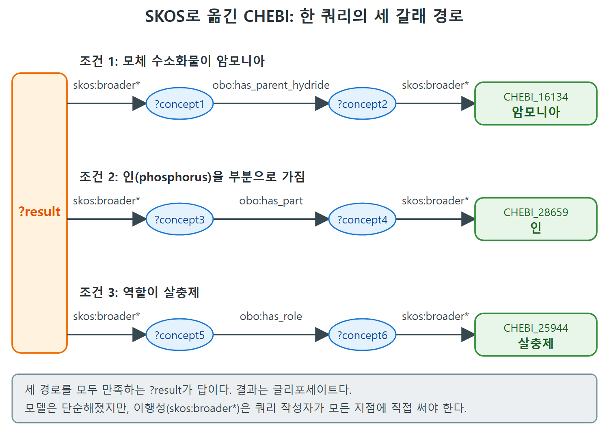

# CHEBI의 SKOS 변환과 BridgeDb

앞 문서에서 CHEBI가 클래스와 제약으로 복잡한 관계를 표현하는 것을 봤다. 그 복잡함은 대가다. 이 문서의 첫 부분은 같은 정보를 SKOS로 단순하게 옮기면 무엇을 얻고 무엇을 잃는지 비교하는 도전 과제를 다룬다. 이 비교에서 "모델이 일을 더 할 것인가, 쿼리가 일을 더 할 것인가"라는 모델링의 영원한 맞교환이 드러난다. 둘째 부분은 생물 데이터에서 "같다"가 얼마나 어려운 문제인지, 그리고 그 연구 결과를 공유하는 BridgeDb를 소개한다.

---

## 1. 도전 과제 41: CHEBI를 SKOS로 표현하기

CHEBI처럼 풍부한 모델은 앞 문서와 같은 질의에 유연하게 답하는 힘이 있지만, 모델 자체가 복잡하다. 글리포세이트와 제초제의 관계가 특정 제약 패턴으로 주어진다. 앞서 왜 트리플 하나로 쓰지 않았느냐고 물었는데, 여기서는 CHEBI를 SKOS로 나타내면서 같은 정보 추출 요구를 어떻게 만족시킬 수 있는지 살펴본다.

CHEBI의 경우 하위 클래스와 제약 정보를 SKOS로 바꾸는 것은 간단하다. 아래 세 규칙이다.

| OWL에서 | SKOS에서 |
|---|---|
| 클래스 하나 | SKOS 개념(skos:Concept) 하나 |
| rdfs:subClassOf 관계 | skos:broader |
| owl:someValuesFrom 제약 | 직접 참조(속성으로 개념을 바로 가리킨다) |

그림 14.3은 그림 14.2와 같은 정보를 이렇게 바꾼 것이다. 많은 면에서 더 단순하다. 글리포세이트의 역할이 제초제라는 사실은 트리플 하나이고, organic amino compound의 모체 수소화물이 암모니아라는 사실도 트리플 하나다. 포함 관계는 subClassOf 대신 broader로 표현된다.

그렇다면 앞의 질문, "인을 포함하고 모체 수소화물이 암모니아인 살충제를 찾아라"는 이 구조에서 어떻게 쿼리할까. SPARQL로 쓰면 이렇다.

```sparql
SELECT ?result
WHERE {
  ?result skos:broader* ?concept1 .
  ?concept1 obo:has_parent_hydride ?concept2 .
  ?concept2 skos:broader* chebi:CHEBI_16134 .  # ammonia
  ?result skos:broader* ?concept3 .
  ?concept3 obo:has_part ?concept4 .
  ?concept4 skos:broader* chebi:CHEBI_28659 .  # phosphorus
  ?result skos:broader* ?concept5 .
  ?concept5 obo:has_role ?concept6 .
  ?concept6 skos:broader* chebi:CHEBI_25944 .  # pesticide
}
```

결과는 OWL 추론과 같다. 글리포세이트가 모든 조건을 만족한다. 표현은 단순해졌지만 쿼리가 더 복잡해졌다.



위 쿼리가 ?result에서 출발해 세 갈래 경로를 따라가는 모습이다. 각 경로마다 skos:broader*와 직접 속성이 번갈아 나오므로, 조건이 늘수록 쿼리 작성자가 챙길 부분도 늘어난다.

---

## 2. 맞교환: 모델이 일할까, 쿼리가 일할까

위 쿼리에서 쿼리 작성자가 모든 이행적(transitive) 관계를 책임져야 한다. 매번 skos:broader*를 써야 하고, 모든 지점에 빠짐없이 들어가야 한다. 이것이 표현에서 흔한 맞교환이다.

| 방식 | 모델 | 쿼리 | 잘 맞는 질의 | 불리한 질의 |
|---|---|---|---|---|
| OWL(제약 + 하위 클래스) | 복잡하다 | 단순하다(모델 구조가 일을 한다) | 설계 때 염두에 둔 질의 | 다른 용도의 질의("이 샘플을 식별하라")는 모델의 복잡성 때문에 오히려 어렵다 |
| SKOS(broader + 직접 속성) | 단순하다 | 복잡하다(작성자가 이행성을 챙긴다) | 단순한 탐색 | 같은 복합 질의를 쓸 때 부담이 커진다 |

읽는 법은 이렇다. OWL 버전은 설계 대상 질의를 모델 구조가 거의 다 처리해 주지만, 복잡성 때문에 다른 응용을 만들기가 더 까다로워진다. SKOS는 반대다.

---

## 3. 변환이 늘 쉬운 것은 아니다

OWL에서 SKOS로의 변환이 이렇게 쉬웠던 것은 CHEBI가 한 개념을 다른 개념에 잇는 데 단일 패턴(owl:someValuesFrom)만 쓰기 때문이다. 어떤 모델은 개념을 잇는 데 더 복잡한 OWL 패턴을 쓴다.

예로 OBO Foundry 온톨로지 중 하나는 미국 국립암연구소(NCI)가 관리하는 암 관련 개체 시소러스다. NCI 시소러스에는 질병 설명이 있는데(여기에 옮기기에는 기술적 세부가 너무 많다), 한 질병이 여러 증후군으로 특징지어진다. 즉 어떤 질병은 어떤 증상 모음, 또는 다른 증상 모음, 또는 또 다른 모음이 있을 때 지시된다. 합집합과 교집합의 복잡한 조합은 OWL에서 표준 방식으로 표현할 수 있지만 SKOS로의 변환은 간단하지 않다. OWL 추론 엔진은 이런 정의를 일관되고 올바르게 다룬다.

---

## 4. BridgeDb: "같다"가 어려울 때

9장에서 RDFS-Plus로 여러 데이터셋에 걸친 동일성을 관리하는 법을 봤다. owl:InverseFunctionalProperty로 핵심 식별자를 지정해 한 데이터셋 안, 또는 데이터셋 사이에서 같은 개체임을 추론했다. 그러나 이렇게 단순한 구조로는 날것 그대로의 데이터에 있는 대부분의 동일성 개념을 담지 못한다. 휴리스틱, 속성의 새로운 조합, 때로는 기계 학습으로 두 개체가 같은지 판단해야 한다.

많은 경우 "같다"의 뜻이 분명치도 않다. 분자생물학에서 두 화학 물질은 여러 면에서 비슷할 수 있고, 그 비슷함이 많은 화학 반응에서의 행동을 정한다. 화학식이 같아도 분자 구조에 따라 대사 경로에서 다르게 행동할 수 있고, 약리학적으로 매우 다른 결과를 낼 수 있다.

대표적인 유명 사례가 탈리도마이드다. 화학식이 같은 두 형태가 있는데, 한 형태의 분자는 다른 형태의 거울상이다. 이 거울상 이성질체(stereoisomer) 가운데 하나는 치료 효과(입덧 증상)가 있고, 다른 하나는 심각한 선천성 결손을 일으킨다. 화학의 관점에서는 같고, 약리학의 관점에서는 다르다.

두 화학 물질이 어떤 의미에서 같은지 정하는 일은 데이터 레코드의 몇 필드를 맞추는 문제가 아니다. 어떤 경우에는 화학 물질이 취할 수 있는 모든 형태를 알아내는 일이 연구 프로젝트 하나가 된다.

---

## 5. BridgeDb의 역할

시맨틱 웹이 그런 연구를 하는 특정 방법을 제공하지는 않는다. 하지만 1장에서부터 봤듯 연구를 마친 사람이 그 결과를 표준화된 방식으로 공개하게 해 준다. 이것이 BridgeDb(van Iersel 외, 2010)의 아이디어다.

| 항목 | 내용 |
|---|---|
| 배경 | 화학, 분자생물학, 유전학, 대사체학 쪽에는 CHEBI처럼 화학 물질, 유전자, 대사 정보를 담은 데이터베이스가 이미 많다 |
| 필요 | 신약 개발 같은 종합적 생물 연구에는 이 데이터베이스들의 정보를 정확하게 교차 참조해야 한다 |
| 문제 | 데이터셋 사이의 대응 관계는 잘 알려져 있었지만 최근까지 한곳에 모여 있지 않았다 |
| 핵심 데이터 | 링크 세트(link set): 한 데이터베이스의 개체를 다른 데이터베이스의 개체에 잇는다. 어떤 원본 데이터셋을 잇는지, 어떤 종류의 개체를 잇는지에 따라 정리된다 |
| 제공 방법 | API, 데이터 내려받기, 매칭 개체를 질의하는 웹 페이지 |
| 관계의 종류 | 유전자, 화합물, 단백질 등이 어떻게 대응할 수 있는지에 대한 매칭 관계가 수십 가지다. 그림 14.4는 BridgeDb가 쓰는 하위 속성 트리의 일부를 보여 준다 |

BridgeDb가 유용한 이유는 원본 데이터베이스 하나를 쓰려는 누구에게나 다른 데이터베이스의 데이터를 쓸 기회가 생기기 때문이다. 데이터셋을 잇는 독립 자원이 있으면, 어떤 연구가 찾아낸 대응 관계가 각 데이터베이스의 모든 사용자에게 열린다. 데이터셋 사이의 링크는 데이터셋 자체만큼, 어떤 경우에는 그보다 더 유용하다.

<br>
<br>
<br>

[Semantic Web for the Working Ontologist](../)
