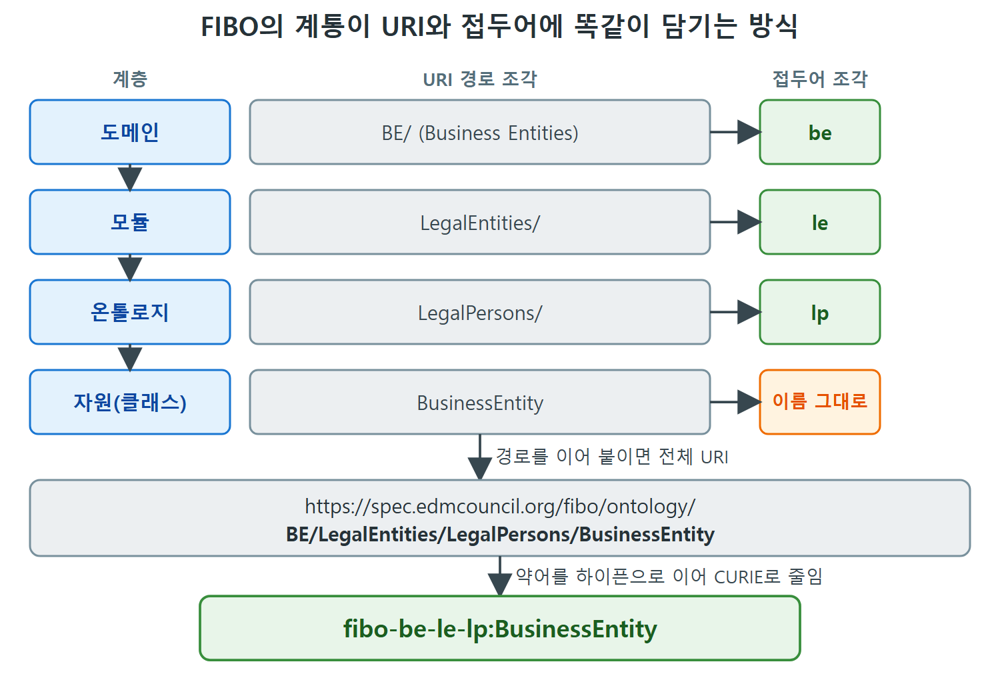

# FIBO 금융 온톨로지의 구조

FIBO는 금융 상품을 설명하는 온톨로지를 만들려는 거대한 사업이다. 한 장에서 FIBO의 모든 면을 다룰 수는 없다. 더 포괄적인 내용은 FIBO Primer(EDM Council, 2018)에 있다. 이 문서는 FIBO를 왜 만들었는지, 200개가 넘는 온톨로지를 어떻게 도메인으로 나누고 이름을 붙여 관리하는지를 살펴본다. 앞에서 본 owl:Ontology와 owl:imports가 극단적인 규모로 쓰인 사례다.

---

## 1. FIBO를 만든 이유

산업 쪽 동기는 금융 상품에 관한 정보를 모든 수준에서 더 투명하게 만드는 것이다. 구체적으로 FIBO는 네 가지를 돕는다.

| 번호 | FIBO가 돕는 일 | 쉬운 설명 |
|---|---|---|
| 1 | 금융 기관이 서로 호환되는 방식으로 정보를 보고하게 한다 | 규제 기관이 여러 제공자의 데이터를 받아 전체를 이해할 수 있다 |
| 2 | 금융 기관 안팎의 소통 일관성을 높인다 | 같은 말을 같은 뜻으로 쓴다 |
| 3 | 금융 기관이 자체 데이터 관리 품질을 개선하게 한다 | 자신이 참여한 상품 기준으로 내부 위험 노출을 더 잘 파악한다 |
| 4 | 회사 전체의 정보를 하나의 기업 전체 지식 그래프로 관리하려는 기관의 출발점이 된다 | 사내 모든 정보를 이어 붙이는 기초가 된다 |

---

## 2. 계속 자라는 큰 온톨로지

Schema.org처럼 FIBO도 금융 업계 구성원이 새로 인지한 필요에 맞춰 계속 개발된다. 이 글을 쓸 당시 FIBO는 4,000개가 넘는 클래스와 2,500개에 가까운 속성을 가진다. 개발이 계속되면 숫자는 바뀐다. 늘기만 하지는 않는다. 클래스나 속성을 합치면 FIBO가 성숙하면서 오히려 숫자가 줄 수도 있다.

이 클래스들은 200개가 넘는 온톨로지로 나뉘어 있다. 온톨로지 모듈화를 극한까지 밀고 간 셈이다. 그래서 FIBO는 11개의 도메인으로 조직된다. (FIBO 도메인은 rdfs:domain과 혼동하면 안 된다.)

| 약어 | 도메인 | 우리말 풀이 |
|---|---|---|
| FND | Foundations | 기반. 여러 산업에서 쓸 수 있는 개념 |
| BE | Business Entities | 사업 개체 |
| FBC | Financial Business and Commerce | 금융 사업과 상거래 |
| LOAN | Loans | 대출 |
| SEC | Securities | 증권 |
| IND | Indices and Indicators | 지수와 지표 |
| DER | Derivatives | 파생상품 |
| CIV | Collective Investment Vehicles | 집합 투자 기구 |
| BP | Business Processes | 업무 프로세스 |
| CAE | Corporate Actions and Events | 기업 활동과 이벤트 |
| MD | Market Data | 시장 데이터 |

도메인마다 두 글자에서 네 글자의 짧은 약어가 있다. FND는 여러 산업에 걸쳐 유용한 개념을 제공하고, 나머지 도메인은 금융 산업의 각각 특정한 측면을 다룬다. (원문은 Collective Investment Vehicles를 "Invesment"로 오타 인쇄했다.)

---

## 3. 이름을 어떻게 붙이는가: URI에 구조를 담기

온톨로지가 이렇게 많으면 이름 짓기가 어렵다. FIBO는 각 도메인을 하위 도메인과 모듈로 조직해 이 문제를 푼다. 5장에서 본 것처럼 HTTP URI는 이름에 임의의 구조를 담을 만큼 표현력이 있다. FIBO는 이를 활용해 도메인(그 아래 필요하면 모듈, 하위 도메인)을 각 온톨로지의 URI에 반영한다.

예를 들어 BE(Business Entities) 도메인에는 Legal Entities라는 모듈이 있고, 그 안에 여러 온톨로지가 있는데 하나가 LegalPersons다. 이 온톨로지의 HTTP URI는 FIBO 안의 계통을 모두 담는다.

```
https://spec.edmcouncil.org/fibo/ontology/BE/LegalEntities/LegalPersons/
```

FIBO는 5.1절의 따라가기(Follow-Your-Nose) 패턴을 구현한다. 이 HTTP URI를 웹 브라우저로 열면 온톨로지를 설명하는 웹 자원이 나온다. 직접 열어 볼 수 있다.

FIBO에서는 자원의 정의가 여러 온톨로지에 걸쳐 분산될 수 있다. 하지만 각 자원(클래스, 속성, 온톨로지, 개체)에는 그것을 정의한 것으로 간주되는 온톨로지가 단 하나 있다. 자원의 HTTP URI는 그 정의 온톨로지의 HTTP URI를 반영한다. 예컨대 LegalPersons 온톨로지가 정의하는 BusinessEntity 클래스의 URI는 아래와 같다.

```
https://spec.edmcouncil.org/fibo/ontology/BE/LegalEntities/LegalPersons/BusinessEntity
```

FIBO에는 도메인, 하위 도메인, 모듈, 온톨로지가 너무 많아 여기서 다 나열할 수 없다. 전체 색인은 EDMC가 관리한다.

---

## 4. 네임스페이스 접두어도 체계적으로

온톨로지가 수백 개이니 네임스페이스 접두어도 수백 개다. 이것도 HTTP URI의 체계적인 구조에 대응하여 체계적으로 관리된다. 도메인뿐 아니라 하위 도메인과 모듈에도 짧은 약어가 있다. 이 약어를 하이픈으로 이어 붙여 접두어를 만든다.

| 구성 | 값 |
|---|---|
| 도메인 | BE |
| 모듈 | LE (Legal Entities) |
| 온톨로지 | LP (LegalPersons) |
| 접두어 | fibo-be-le-lp: |
| 클래스 | BusinessEntity |
| CURIE(Compact URI, 줄여 쓴 URI) | fibo-be-le-lp:BusinessEntity |

이 장의 예제에서는 공식 FIBO CURIE만 쓰고, 접두어마다 한 번씩만 풀어 쓴다.

| URI 경로 | 접두어 |
|---|---|
| .../BE/LegalEntities/LegalPersons/ | fibo-be-le-lp: |

읽는 법은 간단하다. 경로의 BE, LegalEntities, LegalPersons가 접두어의 be, le, lp에 같은 순서로 대응한다. 접두어도 URI와 같은 계층 구조를 반영한다.



도메인, 모듈, 온톨로지, 클래스가 URI 경로 조각과 접두어 조각에 같은 순서로 대응하는 모습이다. 경로를 이으면 전체 URI가 되고, 약어를 하이픈으로 이으면 fibo-be-le-lp:BusinessEntity라는 CURIE가 된다.

---

## 5. 정리

| 문제 | FIBO의 해법 |
|---|---|
| 온톨로지가 200개 넘게 많다 | 11개 도메인, 하위 도메인, 모듈로 나눈다 |
| 이름이 충돌하고 찾기 어렵다 | HTTP URI에 도메인-모듈-온톨로지 계통을 담는다 |
| 자원을 정의한 곳이 불분명하다 | 자원마다 정의 온톨로지를 하나로 정하고 URI가 이를 반영한다 |
| 접두어가 너무 많다 | 계층별 약어를 하이픈으로 이어 규칙적으로 만든다 |
| 온톨로지 설명을 보고 싶다 | 따라가기 패턴으로 URI를 열면 설명이 나온다 |

다음 문서에서는 FIBO의 진짜 어려움인 "아직 보지 못한 데이터셋과의 매핑"을 본다.

<br>
<br>
<br>

[Semantic Web for the Working Ontologist](../)
