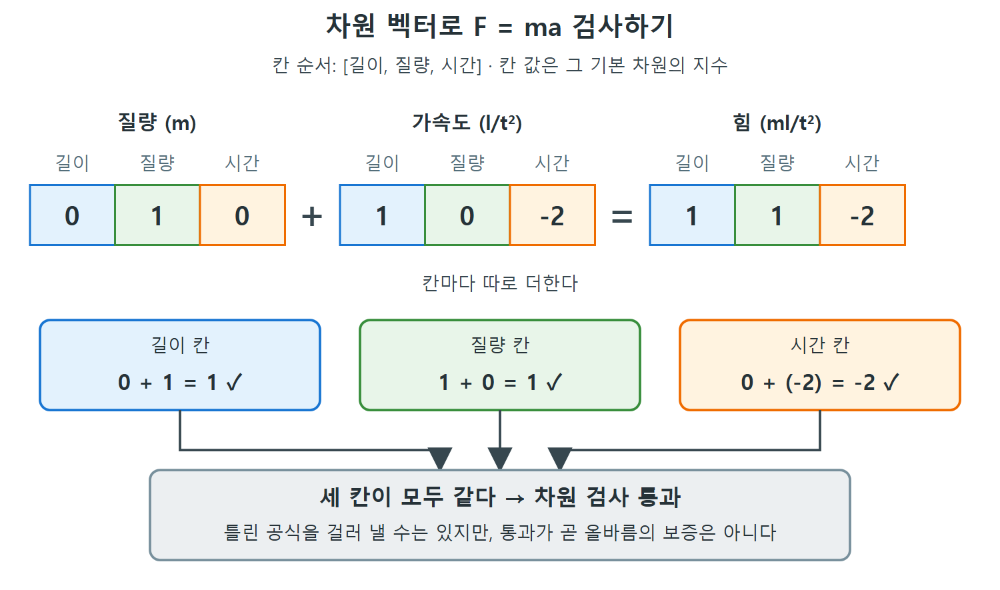

# QUDT 차원 분석

공학이나 물리 공식이 맞는지 가장 빨리 확인하는 방법 하나는 단위를 따져 보는 것이다. 좌변과 우변의 차원이 같아야 공식이 성립한다. 이 방법을 차원 분석이라 부른다. 책 한 권이 따로 있을 정도로 깊은 주제여서 이 장에서는 겉만 훑고, 참고문헌을 안내한다. 이 문서는 QUDT가 차원을 벡터로 저장하는 방식과, F = ma 같은 공식을 SPARQL 한 번으로 검증하는 쿼리를 단계별로 만든다.

---

## 1. 차원 벡터

수량 종류에는 기본 차원(길이, 시간, 질량 등)으로 이루어진 서명이 있다. QUDT는 이런 기본 차원을 여덟 개 정의한다. 이 장에서는 그중 셋만 쓴다. 복합 수량 종류의 서명은 기본 차원들의 거듭제곱 조합으로 쓴다. 예를 들어 속도는 거리를 시간으로 나눈 것이므로 길이/시간이다.

서명은 벡터로 쓸 수 있다. 기본 차원마다 칸 하나를 두고, 칸 안의 값은 그 기본 차원이 공식에 들어가는 지수다. 칸 순서를 [길이, 질량, 시간]으로 정하면 다음과 같다.

| 수량 종류 | 정의 | 벡터 [길이, 질량, 시간] |
|---|---|---|
| 질량 | 기본 차원 | [0, 1, 0] |
| 속도 | 거리/시간 | [1, 0, -1] |
| 가속도 | 속도/시간 | [1, 0, -2] |
| 힘 | 질량 x 길이 / 시간^2 | [1, 1, -2] |

기본 차원의 벡터는 정확히 한 칸만 1이다. 이 벡터를 복합 단위의 차원(dimensionality)이라고 부른다.

---

## 2. 손으로 하는 차원 검사: F = ma

운동의 기본 법칙은 F = ma, 즉 힘은 질량과 가속도의 곱이다. 같은 차원인 양끼리만 의미 있게 비교할 수 있으므로, 이 공식은 힘의 차원이 질량과 가속도 곱의 차원과 같아야 성립한다.

- 힘의 차원은 ml/t^2 (질량 곱하기 길이를 시간 제곱으로 나눈 것)
- 가속도의 차원은 l/t^2
- 질량의 차원은 m

각 항을 차원으로 바꾸면 ml/t^2 = m(l/t^2)가 되어 양쪽이 같다. 벡터로 하면 곱셈이 덧셈이 된다. 질량 벡터와 가속도 벡터를 칸별로 더해 힘 벡터와 같은지 본다.

```
[0,1,0] + [1,0,-2] = [1,1,-2]
```



질량 벡터와 가속도 벡터를 칸별로 더해 힘 벡터와 같은지 확인하는 과정을 그림으로 나타냈다. 길이, 질량, 시간 세 칸이 모두 맞아떨어지면 검사를 통과한다.

실제로 같으므로 공식은 차원 검사를 통과한다. 다만 중요한 주의가 있다. 이 간단한 분석은 틀린 공식을 걸러 낼 수는 있어도, 통과했다고 해서 공식에 다른 문제가 없다는 보장은 아니다. 필요조건이지 충분조건이 아니다.

---

## 3. QUDT가 차원을 저장하는 구조

QUDT는 200개가 넘는 차원 벡터를 수량 종류와 서로 참조되게 저장한다. 구조는 그림 14.1(F = ma의 시간 차원 분석)처럼 계층을 이룬다. 여기서는 글과 표로 풀어 본다.

| 계층 | 설명 |
|---|---|
| 수량 종류의 체계(System of Quantity Kinds) | 한 체계에서 측정 가능한 차원을 정한다. QUDT에는 여덟 가지가 있다. 국제단위계(SI, 미터법), 여러 CGS(센티미터-그램-초) 변형, 미국 관용 단위계(인치, 야드, 마일, 파운드 등) 등이다 |
| 차원 벡터 | 체계마다 보통 수십 개가 붙는다 |
| 지수 속성 | 차원 벡터에서 각 기본 차원의 지수를 알려 준다 |

SI 체계에는 예를 들어 세 가지 벡터가 붙는다.

| 이름 | 뜻 |
|---|---|
| DIM_SI-M | 질량 |
| DIM_SI-ms-2 | 길이/시간^2 (가속도) |
| DIM_SI-mkgs-2 | 길이 x 질량/시간^2 (힘) |

이름 규칙은 체계 이름(SI) 뒤에 길이, 질량, 시간 순서로 각 기본 차원과 지수를 붙인다. 하지만 이 이름들은 쿼리 메커니즘이 쓰지 않는다. 사람이 읽기 위한 것일 뿐이다.

그러므로 벡터를 쿼리하려면 지수를 트리플로 표현해야 한다. QUDT는 용도에 따라 여러 방식으로 표현하는데, 이 예제는 가장 단순한 방식을 쓴다. 기본 차원마다 계수를 나타내는 속성이 있고, 이름이 아주 구체적이다. 예컨대 질량 지수를 나타내는 속성은 qudt:dimensionExponentForMass다. 다른 차원도 비슷하다(qudt:dimensionExponentForLength, qudt:dimensionExponentForTime).

그림 14.1에서 시간 차원만 보면 질량(0) + 가속도(-2) = 힘(-2)이어서 0 + (-2) = -2로 맞는다. 이제 이 계산을 SPARQL로 옮긴다.

---

## 4. SPARQL로 검증 쿼리를 만들어 가기

### 4.1 시간 차원의 항별 값 구하기

처음에는 한 차원, 시간만 본다. 공식의 각 항에 대해 시간 지수를 가져온다(Query 14.8).

```sparql
SELECT ?term ?val
WHERE {
  VALUES ?term { qudt:DIM_SI-M qudt:DIM_SI-ms-2 qudt:DIM_SI-mkgs-2 }
  ?term qudt:dimensionExponentForTime ?val .
}
```

6.8절에서 본 VALUES로 항을 나열했다.

### 4.2 양변을 구분해 합 구하기

아직 어느 항이 등호의 어느 쪽인지 알려 주지 않았으므로 더할 수 없다. 한쪽 값은 더하고 다른 쪽 값은 빼야 한다. 즉 한쪽 값에 -1을 곱한 뒤 모두 더해 0이 되는지 본다. 이를 위해 확장된 VALUES로 각 항의 변(left, right)을 적고, BIND와 IF로 오른쪽 값만 -1을 곱한다(Query 14.9).

```sparql
SELECT (SUM(?val) AS ?formtotal)
WHERE {
  VALUES (?term ?side) { (qudt:DIM_SI-M :left)
    (qudt:DIM_SI-ms-2 :left) (qudt:DIM_SI-mkgs-2 :right) }
  ?term qudt:dimensionExponentForTime ?exp .
  BIND (IF(?side = :right, -1*?exp, ?exp) AS ?val)
}
```

### 4.3 모든 차원에 대해 적용하기

이제 모든 차원에 대해 같은 계산을 한다. 시맨틱 웹에서는 속성도 클래스만큼 중요한 구성 요소이므로, 세 기본 차원을 "지수 속성 세 개"로 표현한다. 두 번째 VALUES로 차원 속성 목록을 따로 두면 차원과 항의 모든 조합이 나온다. 차원별로 지수 합을 구해야 하므로 GROUP BY ?dim을 쓴다(Query 14.10).

```sparql
SELECT ?dim (SUM(?exp) AS ?formtotal)
WHERE {
  VALUES ?dim { qudt:dimensionExponentForLength
    qudt:dimensionExponentForTime qudt:dimensionExponentForMass }
  VALUES (?term1 ?side) { (qudt:DIM_SI-M :left)
    (qudt:DIM_SI-ms-2 :left) (qudt:DIM_SI-mkgs-2 :right) }
  ?term1 ?dim ?val .
  BIND (IF(?side = :right, -1*?val, ?val) AS ?exp)
} GROUP BY ?dim
```

결과는 질량, 길이, 시간 세 차원 모두 formtotal이 0이다.

### 4.4 TRUE/FALSE로 답하기: ASK

공식이 균형이면 TRUE, 아니면 FALSE를 돌려주는 ASK 쿼리가 있으면 더 좋다. 여기에는 몇 단계를 거친다.

| 단계 | 방법 | 문제점 |
|---|---|---|
| 1 | 쿼리 끝에 HAVING (?formtotal = 0)을 붙이면 균형인 차원만 골라낸다 | 좋은 공식은 모든 차원이 균형이어야 한다. 한 차원만 어긋나도 공식이 틀린 것이다 |
| 2 | 반대로 불균형 차원을 찾는다. HAVING (?formtotal != 0)으로 바꾸고 SELECT를 ASK로 바꾼다(Query 14.11) | 불균형이 있으면 TRUE, 없으면 FALSE가 나와 원하는 것과 반대다 |
| 3 | FILTER NOT EXISTS로 부정한다(Query 14.12, 6.3절) | 균형이면 TRUE, 불균형이 하나라도 있으면 FALSE가 된다 |

최종 쿼리의 핵심 구조는 다음과 같다. (책 원문 코드는 WHERE 뒤 여는 중괄호가 빠진 채 인쇄되었다. 아래는 그것을 바로잡은 구조 요약이고, 서브쿼리 내용은 4.3과 같다.)

```sparql
ASK WHERE { FILTER NOT EXISTS {
  SELECT ?dim (SUM(?exp) AS ?formtotal)
  WHERE {
    ?dim rdfs:subPropertyOf qudt:dimensionExponent .
    VALUES (?term ?side) { ... }
    ?term ?dim ?val .
    BIND (IF(?side = :right, -1*?val, ?val) AS ?exp)
  } GROUP BY ?dim HAVING (?formtotal != 0)
}}
```

이 최종 쿼리는 차원 속성을 VALUES로 나열하는 대신 rdfs:subPropertyOf qudt:dimensionExponent인 것을 모두 가져온다는 점이 앞 쿼리와 다르다.

---

## 5. 틀린 공식으로 시험하기

이런 쿼리의 진짜 시험은 틀린 공식에서 제대로 FALSE를 내는지 보는 것이다. 책은 DIM_SI-ms-2를 DIM_SI-ms-1로 바꾸면 FALSE가 나온다고 설명한다. 차원이 더해지지 않기 때문이다.

쿼리를 다른 공식에 쓰려면 ?term과 ?side에 대한 바인딩(왼쪽과 오른쪽 항)을 바꾸면 된다. 더 많은 차원을 쓰려면 ?dim의 VALUES에 추가하면 된다.

---

## 6. QUDT 요약

QUDT는 정교하지만 크지는 않다. 클래스가 수십 개이고, 단위, 수량 종류, 벡터가 수백 개다. 하지만 단위를 다루는 서비스에 중요한 미묘한 구분을 표현한다. 이 절 처음에 세운 세 가지 목표를 모두 달성한다.

| 목표 | 달성 방식 |
|---|---|
| 전 세계 공통 참조 | 포괄적인 단위 체계에 URI 부여 |
| 단위 변환 | 비교 가능한 모든 단위 사이의 변환 |
| 차원 분석 | 정의된 200개 넘는 단위와 850개 넘는 수량 종류에 대해 가능 |

이를 가능하게 한 설계 원칙은 수량 종류, 단위, 차원이라는 개체의 신중한 분리다. 여기에 역사와 세계 곳곳에서 써 온 관용 단위의 포괄적인 목록이 더해진다.

<br>
<br>
<br>

[Semantic Web for the Working Ontologist](../)
