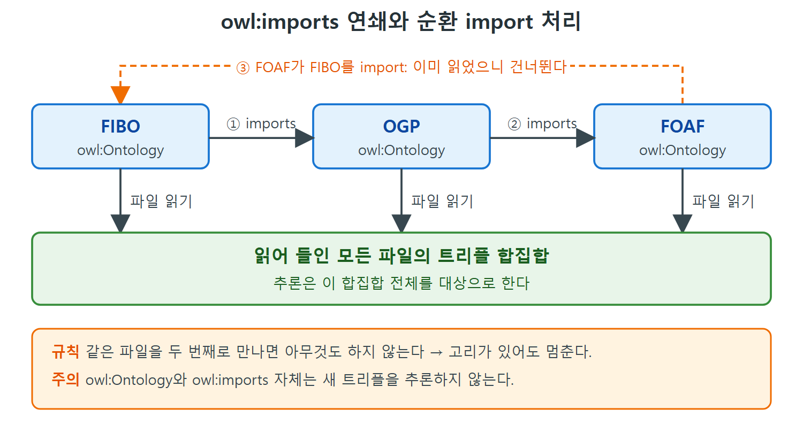

# 세 온톨로지와 모듈화

앞 장들에서 RDF, RDFS-Plus, OWL의 문법과 모델링 기법을 하나씩 익혔다. 이 장은 그 도구들이 실제 웹에서 어떻게 함께 쓰이는지 보여 주는 종합편이다. 세상의 온톨로지를 전부 나열하는 것은 웹 페이지를 전부 나열하는 것만큼 불가능하다. 새 온톨로지와 공개 데이터셋이 매일 올라오기 때문이다. 그래서 책은 OWL의 고급 기능을 잘 쓰고 영향력도 큰 세 가지 사례만 골랐다.

이 문서는 세 사례를 간단히 소개하고, 사례들이 모두 의지하는 모듈화 기능인 owl:Ontology와 owl:imports를 설명한다. 이 두 가지는 추론에 아무 영향도 주지 않지만, 큰 모델을 사람이 관리하게 해 주는 기본 도구다.

---

## 1. 이 장에서 보는 세 가지 사례

10장에서 data.gov 데이터셋을 구경했고, FOAF, Schema.org, Open Graph Protocol(OGP) 기반 데이터가 웹 곳곳에 퍼져 있다는 것도 봤다. 이 장에서는 그중 RDFS-Plus를 넘어서는 모델링 기능을 많이 쓰고 파급력도 큰 셋을 골랐다.

| 온톨로지 | 풀어 쓴 이름 | 다루는 분야 | 해결하려는 문제 |
|---|---|---|---|
| QUDT | Quantities/Units/Dimensions/Types (수량, 단위, 차원, 타입) | 과학·공학, 단위가 있는 모든 데이터 | 서로 다른 단위로 적힌 측정값을 합치려면 비교 가능한지 알아내고 변환해야 한다 |
| OBO | Open Biological and Biomedical Ontologies (열린 생물·생의학 온톨로지) | 유전체, 알려진 암 유전자 목록, 생화학 | 방대한 생물 데이터를 모호하지 않은 이름으로 정리하고 검색한다 |
| FIBO | Financial Industry Business Ontology (금융 산업 비즈니스 온톨로지) | 금융 상품과 금융 기관 | 금융 정보를 서로 교환할 수 있게 하는 기준 온톨로지를 만든다 |

표에서 보듯 세 사례는 분야가 전혀 다르다. 그래도 모두 "표준이 되는 개체에 전 세계에서 통하는 이름을 붙인다"는 시맨틱 웹의 기본 역할을 한다는 공통점이 있다.

세 사례를 조금 더 소개한다.

- **QUDT**는 서로 다른 출처의 수량 데이터를 맞출 때 꼭 필요하다. 두 값을 합치려면 같은 종류의 값인지(차원이 같은지) 확인해야 하고, 같다면 한 단위에서 다른 단위로 바꾸는 방법(단위)을 알아야 한다.
- **OBO**는 한 개의 온톨로지가 아니라 온톨로지 모음이다. 생물학과 생의학 정보를 다루며, 유전체 정보, 알려진 암 유전자 목록, 생화학 데이터까지 방대한 양을 담는다.
- **FIBO**는 EDMC(Enterprise Data Management Council)가 계속 개발하는 기준 온톨로지다. 금융 상품 정보를 주고받는 것이 목적이다. 2008년 금융 위기의 근본 원인을 정리한 바젤 위원회(Basel Committee on Banking Supervision)의 2013년 백서에서 영감을 받았다. 금융 상품을 논리적으로 자세히 정의하며, 매우 넓은 이해관계자를 위해 설계한 좋은 예다. EDMC는 FIBO를 MIT 오픈소스 라이선스로 제공한다.

---

## 2. 왜 온톨로지를 쪼개는가

본격적으로 사례를 보기 전에, OWL이 온톨로지와 그것을 담은 파일을 관리하기 위해 제공하는 기능부터 정리한다. 대부분의 프로그래밍 언어에 모듈 관리 기능이 있듯 OWL에도 있다. 다만 이 기능들은 모델의 의미에 영향을 주지 않는다. 즉 새 트리플이 추론되는 일이 없고, 사람이 모델을 모듈 단위로 정돈하는 용도로만 쓴다.

온톨로지를 모듈로 나누는 이유는 크게 두 가지다.

- **관리 책임이 다를 때.** 내가 한 부분을, 네가 다른 부분을 책임진다면 두 개의 온톨로지로 나누는 것이 낫다. 그러면 서로 조율하지 않고 각자 자기 파일만 고칠 수 있다.
- **바뀌는 속도가 다를 때.** 한 부분은 자주 바뀌고 다른 부분은 거의 안 바뀐다면 따로 빼 두는 편이 좋다.

이 장의 세 사례는 쪼개는 방식이 서로 다르다. 그렇지만 모두 같은 OWL 기능을 사용한다.

---

## 3. owl:Ontology

OWL에는 "모델의 모듈 하나"에 해당하는 개체들을 모으는 내장 클래스 owl:Ontology가 있다. 관례상 온톨로지의 URI는 그 온톨로지를 저장한 웹 파일의 URL과 같게 한다. 이때 Turtle에서는 지금까지와 조금 다른 표기가 필요하다. URI를 꺾쇠 괄호로 감싸 전체를 그대로 적는다.

```turtle
<http://www.workingontologist.com/Examples/ch14/shakespeare.owl> a owl:Ontology .
```

owl:Ontology의 멤버가 된다는 것은 다른 OWL 구성 요소와 달리 추론으로 얻는 의미가 없다. 형식적으로는 의미가 전혀 없다고 해도 된다. 비공식적으로는 "RDF 트리플 묶음 하나"에 대응한다. 그 URI를 URL로 열어 보면(역참조) RDF 데이터셋, 예를 들어 RDF 파일이 나오리라고 기대한다. 하지만 owl:Ontology의 개체와 그 파일 속 트리플 사이에는 모델 안에서 공식적인 연결이 없다.

비유하면 소프트웨어 프로젝트의 패키지 이름표와 같다. 이름표가 코드의 동작을 바꾸지는 않지만, 어디에 무엇이 있는지 정리하는 데는 아주 유용하다.

---

## 4. owl:imports

모듈 관계를 표현하는 핵심 속성이 owl:imports다. 이 속성은 owl:Ontology의 두 개체를 이어 준다. owl:Ontology와 마찬가지로 이 속성에서도 추론은 일어나지 않는다. 하지만 모듈화에서의 의미는 분명하다.

어떤 시스템이 한 온톨로지에 해당하는 파일에서 트리플을 읽어 들이면, 그 온톨로지가 import한 온톨로지의 파일도 찾아 함께 읽을 수 있다. 읽은 파일이 또 다른 import를 가지고 있으면 다시 그 파일을 읽는 식으로 연쇄적으로 이어진다. 최종 결과는 읽어 들인 모든 파일의 트리플을 합친 집합, 즉 합집합이다.

| 질문 | 답 |
|---|---|
| owl:imports로 새 트리플이 추론되는가 | 아니다. 추론 의미가 없다 |
| import한 쪽에서 import된 쪽의 트리플을 추론에 쓸 수 있는가 | 그렇다. 불러온 트리플이 함께 추론 대상이 된다 |
| 순환 import가 문제인가 | 아니다. 같은 파일을 두 번째로 만나면 아무것도 하지 않는 단순한 규칙으로 무한 반복을 막는다 |
| 최종적으로 모이는 것 | 모든 import 파일에 들어 있는 트리플의 합집합 |

순환의 예로 FIBO가 OGP를 import하고, OGP가 FOAF를 import하고, FOAF가 다시 FIBO를 import하는 경우를 들 수 있다. "이미 읽은 파일은 건너뛴다"는 정책 하나면 이런 고리가 있어도 안전하다.



FIBO, OGP, FOAF가 차례로 서로를 import하고 마지막에 FIBO로 되돌아오는 고리를 그렸다. 되돌아온 import는 이미 읽은 파일이라 건너뛰며, 읽은 모든 파일의 트리플이 합집합으로 모인다.

---

## 5. 정리: 모듈화 도구 한눈에 보기

| 도구 | 역할 | 추론 의미 | 쓰는 이유 |
|---|---|---|---|
| owl:Ontology | 모듈 하나(트리플 묶음)를 가리키는 클래스 | 없음 | 모듈에 이름과 위치를 준다 |
| owl:imports | 한 모듈이 다른 모듈을 가져다 쓴다고 선언 | 없음 | 파일 로딩 범위를 정하고 모듈을 조립한다 |

두 도구 모두 사람이 큰 모델을 관리하기 위한 장치다. 이후 문서에서 QUDT, OBO, FIBO가 이 도구를 각자의 방식으로 쓰는 모습을 볼 수 있다.

<br>
<br>
<br>

[Semantic Web for the Working Ontologist](../)
