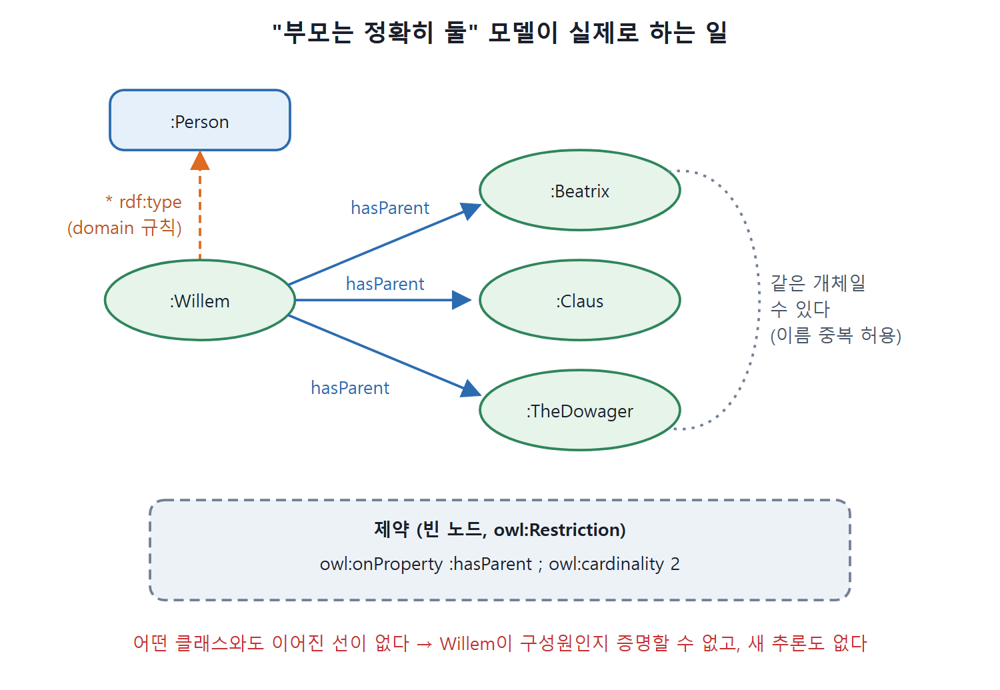

# 객체화 오류

객체지향 시스템과 똑같이 의미하고 똑같이 동작하는 시맨틱 웹 모델을 만들려는 시도가 객체화(Objectification) 안티패턴이다. 객체 시스템은 AAA, 열린 세계, 이름 중복 허용이라는 시맨틱 웹의 세 가정 아래서 일하도록 만들어지지 않았다. 그래서 모델링의 해석에서 근본적인 충돌이 난다. 이 문서는 "사람은 부모가 정확히 둘"이라는 요구를 OWL로 옮기려는 시도가 왜 의도대로 안 되는지, 요구사항 하나하나와 추론 결과로 확인한다. 이 안티패턴은 다른 것과 달리 모델을 고쳐서 해결되지 않는다는 점이 특징이다.

---

## 1. 클래스에 대한 생각이 다르다

시맨틱 웹의 세 가정을 먼저 짚는다.

| 가정 | 한 줄 뜻 |
|---|---|
| AAA | 누구든 어떤 주제에 대해서든 무엇이든 말할 수 있다 |
| 열린 세계(Open World) | 지금 모른다고 해서 없다는 뜻이 아니다. 다음에 볼 정보가 새 사실을 알려 줄 수 있다 |
| 이름 중복 허용(Nonunique Naming) | 이름이 다르다고 다른 개체라는 보장이 없다 |

객체 모델링에서 클래스는 기본적으로 틀(template)이고 인스턴스는 그 틀에서 찍혀 나온다. 틀 두 개에서 찍어 낸 인스턴스나 틀에 칸이 없는 속성은 말이 안 된다. 틀에 그 속성의 칸이 없으면 어디에 둘 것인가.

시맨틱 웹에서는 AAA와 열린 세계 가정이 이 개념과 맞지 않는다. 속성은 어느 클래스와도 독립해서 존재하고, AAA 때문에 어떤 개체든 그 속성으로 기술할 수 있다. 어떤 클래스에 속하는지와 무관하다. 클래스는 집합으로 보므로 여러 클래스에 속하는 것이 흔하다.

---

## 2. 예제 요구사항: 사람은 부모가 둘

객체 모델이 "사람은 사람인 부모가 정확히 둘"이라는 개념을 반영한다고 하자. 객체 모델이 충족해야 할 요구사항은 이렇다.

1. `hasParent` 속성의 값은 `Person` 클래스의 구성원에 대해서만 지정할 수 있다.
2. 어떤 사람에 대해 `hasParent` 값이 하나만 지정되어 있으면 실수로 인식한다.
3. `hasParent` 값이 둘을 넘게 지정되어 있어도 실수로 인식한다.

OWL 모델을 보기 전에 요구사항만으로도 말할 수 있는 점이 있다. 대부분이 시맨틱 웹의 기본 가정과 어긋난다.

| 요구사항 | 어긋나는 가정 | 이유 |
|---|---|---|
| 1. `Person`에만 `hasParent` 지정 | AAA, 열린 세계 | 누구도 어떤 것에 어떤 속성이든 주장하는 것을 막을 수 없다. 게다가 다음에 알게 될 사실이 "이것은 `Person`이다"일 수 있어서 지금 사람인지조차 확실히 알 수 없다 |
| 2. 부모가 하나뿐이면 오류 | 열린 세계 | 두 번째 부모를 적지 않았다고 없다는 뜻이 아니다. 다음에 볼 시맨틱 웹 페이지가 알려 줄 수 있다. 부모가 너무 적게 적힌 경우에는 모순이 나올 수 없다 |
| 3. 부모가 셋 이상이면 오류 | 이름 중복 허용 | 직접 어긋나지는 않는다. 부모가 둘이어야 한다고 말할 수는 있고, 셋 이상이 서로 다른 개체임이 알려졌을 때 모순을 감지할 수 있다. 서로 다름은 `owl:differentFrom`, `owl:allDifferent`, `owl:disjointWith` 같은 구성 요소로 밝혀야 한다 |

표를 읽으면, 요구사항 3만 조건부로 구현할 수 있고 1과 2는 OWL을 어떻게 쓰든 구현할 수 없다. 이 차이는 특정 모델의 세부가 아니라 OWL 언어 자체의 가정에서 나온다. 객체 모델은 OWL 모델과 목적이 크게 다르고, 그 차이가 요구사항에 드러난다.

---

## 3. 흔한 변환 시도

그런데도 이 요구사항을 OWL로 모델링하려는 시도가 흔하다. 객체 모델을 OWL로 옮기는 꽤 흔한 방식은 이렇다.

```turtle
:Person a owl:Class .
:hasParent rdfs:domain :Person .
:hasParent rdfs:range :Person .
[ a owl:Restriction ;
  owl:onProperty :hasParent ;
  owl:cardinality 2 ] .
```

원문은 마지막 줄을 `owl:Cardinality 2`로 쓰는데, 속성 이름은 소문자 `owl:cardinality`다. 소문자로 고쳐 옮겼고 닫는 점도 문맥으로 보충했다. 변환 규칙은 두 가지다.

1. OO 모델에서 클래스에 속성을 정의하면, OWL에서는 그 클래스를 속성의 `rdfs:domain`으로, OO 모델의 속성 타입을 `rdfs:range`로 적는다.
2. OO 모델의 기수(cardinality, 개수 제약) 제한은 OWL의 제약 클래스로 표현한다.

---

## 4. 이 모델이 실제로 하는 일

요구사항을 만족하지 못한다는 것은 이미 봤다. 얼마나 빗나갈까. 윌렘이라는 인물로 해 보자. 의도대로라면 다음 사실 하나만 적어도 오류가 나야 한다. 사람만 부모를 가질 수 있는데 윌렘이 사람이라고 적지 않았기 때문이다.

```turtle
:Willem :hasParent :Beatrix .
```

윌렘이 사람이라고 적어도 부모가 하나뿐이라 오류여야 하고, 부모를 더 적어 세 명이 되면 또 오류여야 한다.

```turtle
:Willem :hasParent :Claus .
:Willem :hasParent :TheDowager .
```

실제 추론은 이렇다.

**도메인 추론.** 첫 문장과 `rdfs:domain` 정보에서 `:Willem a :Person`이 추론된다. 윌렘이 사람이라고 먼저 적지 않아도 부모를 적을 수 있다. 요구사항 1이 원한 동작과 반대다. 사람인지 모른 채로도 부모를 허용한 것이다.

**기수 제약.** 이 제약에서 무엇이 추론될까. 세 가지 문제가 얽힌다.

| 문제 | 내용 | 결과 |
|---|---|---|
| 열린 세계 | 윌렘에게 아직 적히지 않은 다른 부모가 있을지 모른다 | 제약 구성원이라는 추론을 못 한다. 클라우스까지 정확히 둘을 적어도 정확히 둘이라고 확신할 수 없다. 셋째 부모가 있을 수 있다 |
| 이름 중복 허용 | `TheDowager`와 `Beatrix`는 같은 개체를 가리킬 수 있고 실제로 그렇다 | 부모 이름을 셋 적어도 서로 다른 셋을 적은 게 아니라서 제약 구성원 자격을 잃지 않는다 |
| 빈 노드로 정의된 제약 | 제약은 다른 클래스와 어떤 연결도 없다 | 윌렘이 제약의 구성원이 되더라도 더 나올 추론이 없다 |

세 번째 문제를 자세히 보자. 제약은 보통대로 빈 노드로 정의되어 있다. 소리 내어 읽으면 `hasParent`의 기수가 2라는 뜻이다. 그런데 이 빈 노드는 어떤 이름 있는 클래스와도 이어져 있지 않다. `owl:equivalentClass`도 `rdfs:subClassOf`도 없고 반대 방향도 없다. 이 제약과 관련해서 추론하려면 제약과 어떤 다른 클래스의 연결이 있어야 한다. 한편 윌렘이 제약의 구성원임을 독립적으로 증명할 수 있다면 그것에서 결론을 낼 수 있을 텐데, 제약이 다른 클래스와 이어져 있지 않으니 구성원임을 독립적으로 증명할 방법도 없다. 어느 쪽이든 이 제약에서 새 추론은 나오지 않는다.



그림처럼 윌렘에게는 도메인 규칙으로 `:Person`만 추론될 뿐이고, 기수 제약을 담은 빈 노드는 다른 클래스와 이어진 선이 없어 새 추론을 만들지 못한다. 부모 세 명 중 `:Beatrix`와 `:TheDowager`는 같은 개체일 수도 있다.

AAA 때문에 이 모델이 "틀렸다"고 하지는 못한다. 다만 모델러가 의도한 추론을 지원하지 못한다고는 안전하게 말할 수 있다. 다른 안티패턴과 달리 이 모델은 고칠 수 없다. 요구사항 자체가 시맨틱 웹 모델링의 가정과 충돌하기 때문이다.

<br>
<br>
<br>

[Semantic Web for the Working Ontologist](../)
