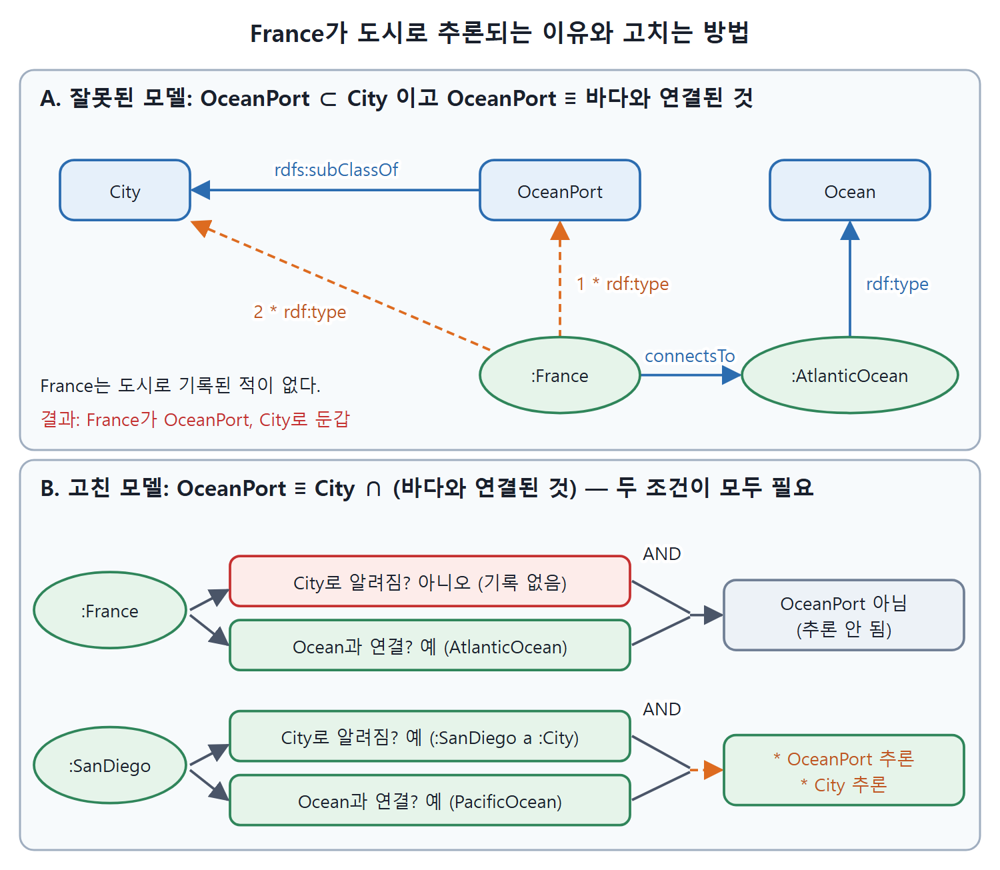

# 배타성 오류

하위 클래스의 구성원이 될 후보는 이미 상위 클래스의 구성원으로 알려진 것뿐이라고 믿는 실수를 배타성(Exclusivity) 오류라고 한다. 도서 분류나 객체지향 프로그래밍을 해 본 사람이 특히 빠지기 쉽다. 이 문서는 항구 도시 예제로 왜 틀린 결론이 나오는지 따라가 보고, 교집합 패턴으로 고치는 방법을 정리한다.

---

## 1. 오류의 정체

RDFS 추론 규칙은 하위 클래스의 구성원은 반드시 상위 클래스의 구성원이라고 말한다. 방향은 하위에서 상위다. 배타성 오류는 이것을 거꾸로 읽어서, 하위 클래스에 들어갈 수 있는 후보는 이미 상위 클래스의 구성원으로 알려진 것들뿐이라고 가정하는 것이다.

도시(`City`)와 그 하위 클래스인 해양 항구(`OceanPort`)로 보자.

```turtle
:OceanPort rdfs:subClassOf :City .
:Paris a :City .
:Zurich a :City .
:SanDiego a :City .
```

AAA 가정에 따르면 이 셋 중 누구든 `OceanPort`일 수 있고, 지금은 도시인지 모르는 뉴욕이나 리우데자네이루도 그럴 수 있다. 누구든 무엇이든 말할 수 있으니 누군가 프랑스나 달이 `OceanPort`라고 주장할 수도 있다. 그러면 RDFS 의미 체계에 따라 프랑스나 달이 도시라고 추론된다. 배타성 오류는 `OceanPort`의 후보가 현재 도시로 알려진 파리, 취리히, 샌디에이고뿐이라고 가정하는 것이다.

---

## 2. 잘못된 모델

"바다와 이어진 도시는 무엇인가?"라는 역량 질문에 답하려고 다음처럼 모델링했다고 하자.

```turtle
:OceanPort rdfs:subClassOf :City .
:OceanPort owl:equivalentClass
    [ a owl:Restriction ;
      owl:onProperty :connectsTo ;
      owl:someValuesFrom :Ocean ] .
```

원문의 첫 줄은 `rdfs:subClassof`로 소문자 o 표기가 되어 있는데, 속성 이름은 `subClassOf`가 맞아서 고쳐 적었다. 이 트리플은 원서 Figure 15.2에 그림으로 나온다. 도시만 항구가 될 수 있다고 가정하면 `OceanPort` 구성원을 조회해서 답을 얻으리라 기대한다. 하지만 경계 사례로 시험해 보자. 도시가 아닌데 바다와 이어진 것이 있으면 어떻게 되는가. 데이터가 다음과 같다고 하자.

```turtle
:Paris :connectsTo :LaSeine .
:Paris :locatedIn :France .
:France :connectsTo :Mediterranean .
:France :connectsTo :AtlanticOcean .
:SanDiego :connectsTo :PacificOcean .
:AtlanticOcean a :Ocean .
:PacificOcean a :Ocean .
```

---

## 3. 추론 결과

샌디에이고는 기대대로 나온다. 태평양과 이어져 있고 태평양은 바다이므로 `:SanDiego a :OceanPort`가 추론되고, `OceanPort`가 `City`의 하위 클래스이므로 `:SanDiego a :City`도 추론된다(추론된 결과를 별표로 표시한다).

```turtle
:SanDiego :connectsTo :PacificOcean .
:PacificOcean a :Ocean .
* :SanDiego a :OceanPort .
* :SanDiego a :City .
```

프랑스를 보자. 대서양과 이어져 있고 대서양은 바다이므로 다음이 추론된다.

```turtle
* :France a :OceanPort .
* :France a :City .
```

의도하지 않은 결과이고, 질문에 올바르게 답하지 못한다. 결함은 도시로 알려진 것만 항구가 될 수 있다는 가정에서 왔다. AAA 가정에서는 달리 말하지 않는 한 무엇이든 항구가 될 수 있다.

| 개체 | 바다와 연결 | 추론된 `OceanPort` | 추론된 `City` | 기대와 일치 |
|---|---|---|---|---|
| `:SanDiego` | 태평양 | 예 | 예 | 일치 |
| `:France` | 대서양 | 예 | 예 | 어긋남 |
| `:Paris` | 센강(바다로 선언되지 않음) | 아니오 | 예(원래 도시) | 일치 |

참고로 파리가 센강과 이어져 있다고 해서 항구가 되지는 않는다. 센강이 `Ocean`이라고 적혀 있지 않기 때문이다. 문제는 프랑스처럼 도시가 아닌 것이 도시로 끌려 들어오는 데 있다.

---

## 4. 왜 이런 생각을 하게 되나

이 오류는 하위 클래스 자체보다 AAA 구호를 어기는 데서 온다. 다른 모델링 방식에서는 맞는 가정이기 때문이다. 객체지향(OO) 프로그래밍, 도서관 목록, 제품 분류 체계 같은 많은 모델링 시스템에서는 항목을 클래스에 배치하는 일이 모델링의 큰 부분이다. 이를 보통 손으로 하고 분류(categorization), 목록화(cataloging)라고 부른다. 누군가 이 항목이 여기 속한다고 결정했기 때문에 의도적으로 클래스에 넣는다고 생각하는 방식이다. 이런 시스템에서 하위 클래스는 상위 클래스를 더 세밀하게 다듬은 것(refinement)이다. 더 구체적으로 특징짓고 싶으면 상위 클래스 대신 하위 클래스에 분류해 넣으면 된다.

시맨틱 웹에서는 클래스 멤버십이 사람의 분류 결정이 아니라 추론에서도 나온다. 그래서 같은 직관을 그대로 가져오면 어긋난다.

| 구분 | 분류 체계식 사고 | 시맨틱 웹식 사고 |
|---|---|---|
| 클래스에 들어가는 방법 | 사람이 의도적으로 넣는다 | 사실과 추론 규칙에서 따라 나온다 |
| 하위 클래스의 의미 | 상위 클래스의 세분화 | 구성원이 항상 상위 클래스 구성원이라는 규칙 |
| 후보의 범위 | 이미 상위 클래스에 분류된 것 | 알려진 것 전부, 아직 모르는 것도 포함 |

---

## 5. 고치는 방법: 교집합

그러면 어떤 모델이 맞을까. 어떤 것이 `OceanPort`의 구성원이 되려면 도시이면서 바다와 이어져 있어야 한다. 이를 교집합(intersection)으로 정의한다(원서 Figure 15.3). 원문은 이 정의를 그림으로만 보여 주므로, 아래는 설명에 맞춰 쓴 예시이며 원문 코드가 아니다.

```turtle
:OceanPort owl:equivalentClass [ a owl:Class ;
    owl:intersectionOf ( :City
        [ a owl:Restriction ;
          owl:onProperty :connectsTo ;
          owl:someValuesFrom :Ocean ] ) ] .
```

이제 `OceanPort`를 `City`와 제약의 교집합으로 정의했으니 `OceanPort`가 `City`의 하위 클래스라는 것이 추론된다. 게다가 도시로 알려진 개체만 `OceanPort` 구성원의 후보가 되므로 프랑스 같은 이상한 결과가 나오지 않는다.



위 그림의 위쪽은 잘못된 모델에서 `:France`가 바다와 이어졌다는 이유만으로 `OceanPort`, 다시 `City`로 추론되는 과정이다. 아래쪽은 교집합으로 고친 모델로, 도시이면서 바다와 이어져야 하므로 `:SanDiego`만 `OceanPort`가 된다.

배타성 오류는 다양한 모델링 방식 경험이 있는 사람이 흔히 범한다. 시맨틱 웹 모델링은 AAA 가정을 다른 어떤 일반 모델링 시스템보다 진지하게 받아들이기 때문이다. 다행히 오류는 교집합 패턴으로 쉽게 고칠 수 있다.

<br>
<br>
<br>

[Semantic Web for the Working Ontologist](../)
