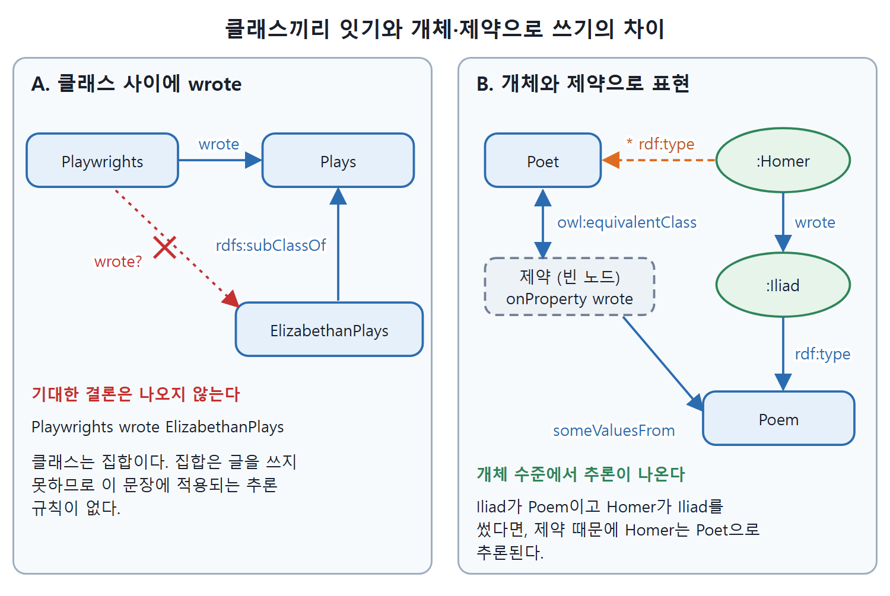

# 클래스 남발 안티패턴

모든 것을 클래스로 만들어 버리는 실수에 책은 클래시즘(Classism)이라는 이름을 붙였다. 이 문서는 먼저 "흔한 모델링 오류"라는 말을 어떻게 이해해야 하는지 짚고, 클래시즘 예제를 시험해 보면서 어떤 추론이 안 나오는지 확인한 뒤, 하고 싶은 말을 OWL로 제대로 표현하는 방법을 정리한다.

---

## 1. "오류"라는 말에 대해

AAA 구호(Anybody can say Anything about Any topic, 누구든 어떤 주제에 대해서든 무엇이든 말할 수 있다)에 따르면 엄밀한 의미의 모델링 오류는 없다. 누구든 어떤 트리플이든 주장할 수 있기 때문이다. 다만 과학자, 엔지니어, 콘텐츠 관리자, 프로젝트 관리자에게 모델링을 가르치면서 반복해서 본 습관 중에 모델 재사용이라는 목표에 방해가 되는 것들이 있다. 이런 모델이 틀렸다고 단정할 수는 없지만, 구조화된 영역에 대한 정보를 다른 이해관계자와 공유한다는 목적은 이루지 못한다.

책은 이런 흔한 함정에 다소 우스꽝스러운 이름을 붙여 안티패턴으로 기억하게 하고, 가능하면 대신 쓸 좋은 방법도 함께 보여 준다. 이 문서에서 다루는 안티패턴이 첫 번째다.

---

## 2. 클래시즘 예제

개체와 클래스의 구분이 어려우니 모두 클래스로 정의해 버리는 반응이 흔하다. 모델링 도구가 이를 부추기기도 한다. 사용자가 가장 먼저 배우는 기본 동작이 클래스 만들기이기 때문이다. 중심 개념 이름으로 클래스를 만들고, 관련 있어 보이는 개념마다 클래스를 더 만들어 가는 식이다. 시소러스 같은 다른 지식 정리물에서 자동으로 모델을 만들었을 때도 흔하다. 시소러스는 용어 사이의 관계에 대해 시맨틱 모델이 클래스 사이, 클래스와 개체 사이에 하는 만큼 약속을 하지 않기 때문이다.

셰익스피어와 작품을 모델링하는 사람이 `Shakespeare`, `Plays`, `Poems`, `Poets`, `Playwrights`, `TheTempest`를 모두 클래스로 정의한다고 하자. 그리고 `owl:ObjectProperty`로 `wrote`를 정의해서 다음 같은 트리플을 쓴다.

```turtle
:Playwrights :wrote :Plays .
:Poets :wrote :Poems .
:Shakespeare :wrote :Plays .
:ModernPlays rdfs:subClassOf :Plays .
:ElizabethanPlays rdfs:subClassOf :Plays .
:Shakespeare :wrote :TheTempest .
:Shakespeare :wrote :Poems .
:TheTempest rdfs:subClassOf :Plays .
```

원문은 마지막 줄을 "아마 이것까지도"라는 식으로 덧붙인다. 이 모델에서는 모든 노드의 `rdf:type`이 `owl:Class`다(원서의 Figure 15.1). 도구에서 `TheTempest`가 `Plays` 옆에 나란히 보이니 그럴싸해 보인다. 영어 문장으로 읽어도 "Shakespeare wrote poems", "Shakespeare wrote The Tempest"로 말이 된다. `rdfs:subClassOf`를 "~이다"로 읽으면 "The Tempest is a plays"가 되는데, 복수형만 빼면 자연스럽다.

AAA 구호 때문에 이 트리플들이 틀렸다고는 못 한다. 다만 먼저 눈에 띄는 것은 클래스 이름이 복수형이라 관습에 어긋난다는 점이다. 그럼 이 모델이 모델러의 의도를 충족하는지는 어떻게 판단할까. 시험을 해 본다.

---

## 3. 시험 1: 역량 질문

"누가 템페스트를 썼나?"에는 답할 수 있다. 모델에 답이 직접 들어 있다. "어떤 종류가 희곡을 쓰나, 시를 쓰나?"에도 직접 들어 있는 답이 나온다.

그러나 관점의 정리가 필요한 질문은 다르다. "엘리자베스 시대 희곡을 쓴 건 어떤 종류인가?"라는 질문이라면 최소한 극작가(playwright) 클래스는 답에 포함되어야 할 것 같다. 극작가는 희곡을 쓰는 것이고 엘리자베스 시대 희곡은 희곡이기 때문이다. 이 모델이 그것을 해 줄까. 관련 트리플은 이렇다.

```turtle
:Playwrights a owl:Class ;
    :wrote :Plays .
:ElizabethanPlays rdfs:subClassOf :Plays .
```

RDFS나 OWL에서 배운 어떤 추론 패턴도 여기에 해당하지 않는다. 특히 다음 같은 결론은 나오지 않는다.

```turtle
:Playwrights :wrote :ElizabethanPlays .
```

## 4. 시험 2: 희곡과 희곡의 종류를 구분하는가

이 모델에서 템페스트는 희곡이고, 엘리자베스 시대 희곡과 현대 희곡은 희곡의 종류다. 모델은 이 둘을 구분하지 못한다. 템페스트(희곡)를 돌려주는 질의는 현대 희곡도 함께 돌려준다. 엘리자베스 시대 희곡(희곡의 종류)을 돌려주는 질의는 템페스트도 함께 돌려준다. 이 기준에 대응할 만큼 구분을 충분히 하지 않은 것이다.

## 5. 왜 이런가: 클래스는 집합이다

클래스를 집합으로 해석하면 놀랄 일이 아니다. 이 모델에서 극작가와 희곡은 집합이다. "극작가가 희곡을 썼다"는 문장은 개별 극작가나 개별 희곡에 대한 말이 아니고 집합에 대한 말이다. 그런데 집합은 아무것도 쓰지 못한다. 쓰는 것은 극작가와 시인이다. 집합에 대해 한 이 문장은 말이 안 된다. OWL의 추론 의미 체계(semantics)도 그것을 뒷받침한다. 문장에 의미가 없으니 끌어낼 추론도 없다. 또 `TheTempest`는 클래스로 모델링되어 있지만 그 인스턴스가 무엇일지 상상할 수 없다. 템페스트는 집합이 아니라 희곡이다. 희곡은 사람이 쓰고 개막일 같은 속성이 있지만 집합은 그렇지 않다.

| 시험 항목 | 결과 | 이유 |
|---|---|---|
| 누가 템페스트를 썼나 | 답이 나온다 | 모델에 직접 들어 있다 |
| 무엇이 희곡을 쓰나 | 답이 나온다 | 모델에 직접 들어 있다 |
| 엘리자베스 시대 희곡을 쓴 종류 | 답이 안 나온다 | 클래스 사이의 `wrote`는 추론 규칙이 없다 |
| 희곡과 희곡의 종류 구분 | 구분하지 못한다 | 둘 다 클래스라서 같은 부류로 취급된다 |

표가 보여 주는 점은, 직접 적힌 사실을 꺼내는 일은 되지만 관점을 조직하는 일은 안 된다는 것이다.

---

## 6. 하고 싶은 말을 제대로 표현하기: "시인은 시를 쓴다"

"시인이 시를 썼다"라는 직관을 어떻게 표현할 수 있을까. 역량 질문 수준을 넘어선 문제다. "누가 시인인가", "무엇이 시인가"에는 두 클래스가 있는 어떤 모델이든 답할 수 있다. 두 답이 서로 일관되려면 시와 시인 사이에 어떤 관계를 표현할지 정해야 한다. 그리고 이럴 때는 단수 명사 이름 관습(`Poet`, `Poem`)을 따르면 문장이 더 읽기 좋아진다.

원문은 세 가지 의미를 차례로 보여 준다.

| 뜻 | OWL 표현 | 얻는 추론 |
|---|---|---|
| 시인이 쓴 것은 모두 시다 | `Poet`를 `owl:allValuesFrom :Poem` 제약의 하위 클래스로 | 시인이 쓴 것은 시로 추론된다 |
| 시인이면 시를 최소한 하나 썼다 | `owl:someValuesFrom :Poem` 제약의 하위 클래스 | 시인이면 시를 쓴 무언가가 있다고 추론되나 그게 무엇인지는 모른다 |
| 시를 쓴 것이 곧 시인이다(양방향) | `owl:equivalentClass`와 `owl:someValuesFrom` | 시를 쓴 사람이 시인으로 추론된다 |

첫째 표현은 이렇다.

```turtle
:Poet rdfs:subClassOf [ a owl:Restriction ;
    owl:onProperty :wrote ;
    owl:allValuesFrom :Poem ] .
```

호머가 시인이고 일리아드를 썼다면 일리아드가 시라고 추론된다. 호머에게는 잘 맞는다. 그런데 모델의 경계를 시험해 보면 셰익스피어는 어떨까.

```turtle
:Shakespeare :wrote :TheTempest .
:Shakespeare a :Poet .
```

그러면 `:TheTempest a :Poem`이 추론된다. 예상 밖의 결론이다. 시인은 시가 아닌 것도 쓰기 때문에 우리가 뜻한 건 아마 이게 아닐 것이다. 이것이 모델의 적용 범위를 알아내는 강력한 방법이다. 모델의 가정(여기서는 시인이면서 동시에 극작가인 사람은 없다는 가정)에 도전하는 시험을 만들면 모델의 경계를 알 수 있다.

둘째 표현은 다음과 같다.

```turtle
:Poet rdfs:subClassOf [ a owl:Restriction ;
    owl:onProperty :wrote ;
    owl:someValuesFrom :Poem ] .
```

`:Homer a :Poet`이라는 사실만으로 호머가 시를 한 편 이상 썼다는 것까지는 추론되지만, 그게 어느 작품인지 집어낼 수는 없다. 이런 추론은 미묘하다.

셋째는 더 강한 뜻이다. 시를 썼다는 것이 정확히 시인이라는 뜻이다. 시인이면 시를 썼고, 시를 썼으면 시인이다.

```turtle
:Poet owl:equivalentClass [ a owl:Restriction ;
    owl:onProperty :wrote ;
    owl:someValuesFrom :Poem ] .
```

이제 호머가 쓴 일리아드가 시임을 알면 호머가 시인이라고 추론된다.



왼쪽은 클래스끼리 `wrote`로 이어서 `Playwrights wrote ElizabethanPlays`가 나오지 않는 경우이고, 오른쪽은 `owl:equivalentClass`와 제약을 써서 `:Homer`가 `Poet`으로 추론되는 경우다.

---

## 7. 클래스끼리 객체 속성으로 이으면

일반적으로 클래스 둘을 객체 속성(object property)으로 잇는 것(예를 들면 `Poets wrote Poems`)은 어떤 추론도 일으키지 않는다. 클래스에 연결된 속성을 그 개체나 하위 클래스, 상위 클래스에 퍼뜨리는 추론은 없다. 객체 속성에 적용되는 추론, 즉 `rdfs:domain`, `rdfs:range`, `owl:Restriction`에서 나오는 추론은 모두 주어와 목적어(여기서는 셰익스피어와 시)가 클래스가 아니라 개체라고 가정한다.

이 점이 OWL이 모델링 언어로서 가진 강력한 특징을 보여 준다. OWL의 구성 요소는 추론 기준에 따라 모델이 뜻하는 바를 매우 구체적으로 말한다. "Poets wrote poems" 같은 문장은 자연어에서는 모호할 수 있지만 OWL 표현은 훨씬 구체적이다. 모델러는 그 문장이 정확히 무슨 뜻인지 정해야 하고, OWL은 그 구분을 명확하게 표현하게 해 준다.

<br>
<br>
<br>

[Semantic Web for the Working Ontologist](../)
