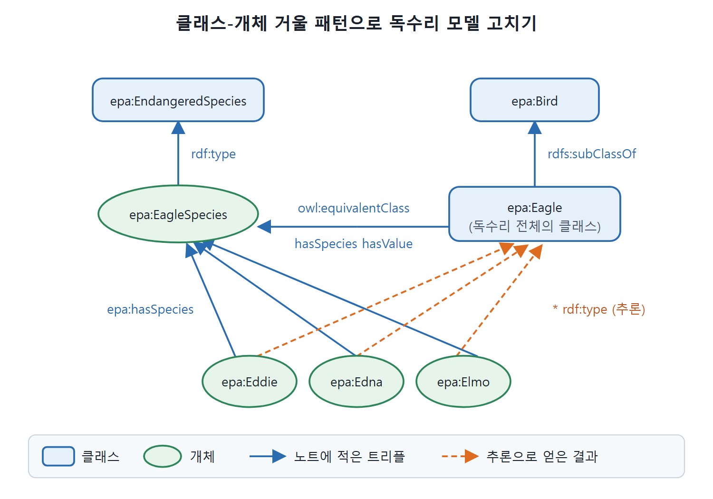

# 클래스 펀닝 안티패턴

같은 이름을 클래스로도 쓰고 개체로도 쓰는 것이 클래스 펀닝(class punning, 말장난처럼 한 식별자를 두 역할에 쓰는 것)이다. OWL 2부터 허용되지만 책은 좋은 설계가 아니라고 보고 쓰지 말라고 권한다. 이 문서는 멸종위기종 독수리 예제로 왜 문제인지 보이고, 클래스-개체 거울 패턴으로 고치는 과정을 따라간다.

---

## 1. 펀닝이란

OWL 2.0이 나오면서 펀닝이라는 선택지가 언어에 들어왔다. OWL 2.0을 설계할 때, 같은 식별자를 클래스와 개체로 함께 쓰는 것이 논리적 오류는 아니라고 판단했다. 그래서 허용되지만 책은 여전히 나쁜 엔지니어링 관행으로 보고 쓰지 말라고 한다. 같은 목적을 훨씬 정확하게 이루는 방법이 클래스-개체 거울 패턴(Challenge 31)이다.

---

## 2. 예제: 독수리와 독수리 종

멸종위기에 처한 독수리 종을 `epa:Eagle`이라 부르고, 야생에서 알려진 개체가 셋 있다고 하자. 공원 관리인이 붙인 이름은 Eddie, Edna, Elmo다.

```turtle
epa:Eddie a epa:Eagle .
epa:Edna a epa:Eagle .
epa:Elmo a epa:Eagle .
```

독수리에 대해 더 말하고 싶다. 독수리는 날개가 있고, 환경보호청(EPA)이 독수리를 멸종위기종으로 선언했다는 얘기를 들었다. 이를 펀닝으로 모델링하면 이렇다.

```turtle
epa:Eagle
    epa:hasPart epa:Wing ;
    a epa:EndangeredSpecies .
```

원문은 날개 개체 이름을 `epa:Wing`과 `epa:Wings`로 섞어 쓴다. 여기서는 `epa:Wing`으로 맞췄다. OWL에서 허용되는 문장이지만 왜 나쁜가.

---

## 3. 두 문장은 비슷해 보여도 전혀 다르다

두 문장이 비슷해 보인다. 독수리는 날개가 있고(정확히 둘이라고까지 할 수도 있다), 독수리는 멸종위기종이다. 하지만 의미가 완전히 다르다.

| 문장 | 실제 뜻 | 대상 |
|---|---|---|
| 독수리는 날개가 있다 | 독수리 한 마리 한 마리가 날개를 가진다. 에디도 날개가 있다 | 각 개체 |
| 독수리는 멸종위기종이다 | 종 전체가 위기라는 뜻이다. 어느 한 마리에 대한 말이 아니다 | 종 전체 |

그런데 OWL 추론에서 `epa:Eagle`이 `hasPart Wing`을 가진다고 하면 에디에 대해 무엇을 결론 내릴 수 있을까. 아무것도 없다. 이 클래스의 구성원인 에디에게 그 속성이 내려온다는 추론 규칙은 없다. 우리가 정말 하고 싶었던 말은 이것이다.

```turtle
epa:Eagle
    rdfs:subClassOf [ a owl:Restriction ;
        owl:onProperty epa:hasPart ;
        owl:someValuesFrom epa:Wing ] .
```

독수리이면 날개인 부품을 가진다는 뜻이다. 원문 코드의 `owl:someValuesFrm`은 오타이고 `owl:someValuesFrom`이 맞아서 고쳐 적었다.

반대로 `EndangeredSpecies`의 하위 클래스라는 문장은 어떨까. 추론 모델은 이것에 대해 아무 말도 하지 않는다. 이쪽은 우리가 원하는 동작이다. 종이 멸종위기라고 해서 특정 독수리 한 마리에 대해 뭔가 따라 나오지는 않기 때문이다.

결국 두 문장 중 `hasPart` 문장은 오류다. 앞 절에서 본 클래시즘의 특히 심한 형태다. `EndangeredSpecies` 문장은 펀닝을 기술적으로 올바르게 쓴 경우다. 오류인 쪽을 올바른 패턴으로 바꿀 수 있을까.

---

## 4. 클래스-개체 거울 패턴으로 고치기

**1단계: 종을 개체로 만든다.** `EndangeredSpecies` 클래스를 두고 독수리 종을 그 구성원으로 둔다. 다른 "Eagle"과 구별하려고 이름을 `EagleSpecies`로 한다.

```turtle
epa:EagleSpecies a epa:EndangeredSpecies .
```

**2단계: 개별 독수리와 종의 관계를 명시한다.** 이 관계에 `epa:hasSpecies`라는 속성을 쓴다.

```turtle
epa:Eddie epa:hasSpecies epa:EagleSpecies .
epa:Edna epa:hasSpecies epa:EagleSpecies .
epa:Elmo epa:hasSpecies epa:EagleSpecies .
```

**3단계: 종이 같은 것들의 클래스를 정의한다.** 아직은 펀닝 모델이 하던 일을 다 하지 못한다. 종이 독수리인 모든 것의 클래스를 가리킬 수 있으면 편하다. 예를 들어 다른 것의 하위 클래스나 상위 클래스라고 말하거나, 12.2절의 관계 전달(Relationship Transfer) 패턴에 쓸 수 있다. 이것은 클래스-개체 거울 패턴을 간단히 적용하면 된다. 종이 `EagleSpecies`인 것들의 클래스를 OWL로 정의한다.

```turtle
epa:Eagle a owl:Class ;
    owl:equivalentClass [ a owl:Restriction ;
        owl:onProperty epa:hasSpecies ;
        owl:hasValue epa:EagleSpecies ] .
```

이제 다음이 추론된다. 별표(`*`)는 추론된 결과라는 표시다.

```turtle
* epa:Eddie a epa:Eagle .
* epa:Edna a epa:Eagle .
* epa:Elmo a epa:Eagle .
```

독수리가 새라는 것도 말할 수 있고, 그러면 에디 가족이 새라는 것이 추론된다.

```turtle
epa:Eagle rdfs:subClassOf epa:Bird .
* epa:Eddie a epa:Bird .
```

원문은 에디, 에드나, 엘모 세 개체 모두에 대해 같은 결과를 적는다. 위에서는 한 줄만 보였다.



종(`epa:EagleSpecies`)은 개체로 두어 멸종위기종에 넣고, 독수리 전체는 `epa:Eagle` 클래스로 따로 정의해 `hasSpecies` 값이 종과 같은 것들을 모은다. 그러면 에디, 에드나, 엘모가 `epa:Eagle`로 추론되고(주황 점선), `epa:Bird`로도 이어진다.

---

## 5. 패턴이 해 주는 일

| 하고 싶은 일 | 펀닝 모델 | 거울 패턴 |
|---|---|---|
| 독수리 전체 클래스 갖기 | 가능하나 의미가 섞인다 | `epa:Eagle` 클래스가 별도로 있다 |
| "독수리는 멸종위기종이다" | `Eagle`을 `EndangeredSpecies`의 구성원으로 | `EagleSpecies`(개체)가 구성원이다 |
| "독수리는 날개가 있다"가 개체에 전파됨 | 안 된다 | `someValuesFrom` 제약으로 전파된다 |
| 개별 독수리와 종의 관계 | 불명확하다 | `epa:hasSpecies`로 구체적으로 표현한다 |
| 독수리가 새라는 사실 | 원문이 다루지 않는다 | 하위 클래스 선언으로 개체까지 새로 추론된다 |

표를 읽는 법은 간단하다. 독수리 전체를 가리키는 클래스도 있고, 종은 멸종위기라는 말도 하고, 개별 독수리가 종과 맺는 관계도 구체적으로 알지만, 범주 오류(category error)는 범하지 않는다. 클래스-개체 거울 패턴이 이 관계들을 훨씬 명시적으로 표현해 준다.

<br>
<br>
<br>

[Semantic Web for the Working Ontologist](../)
