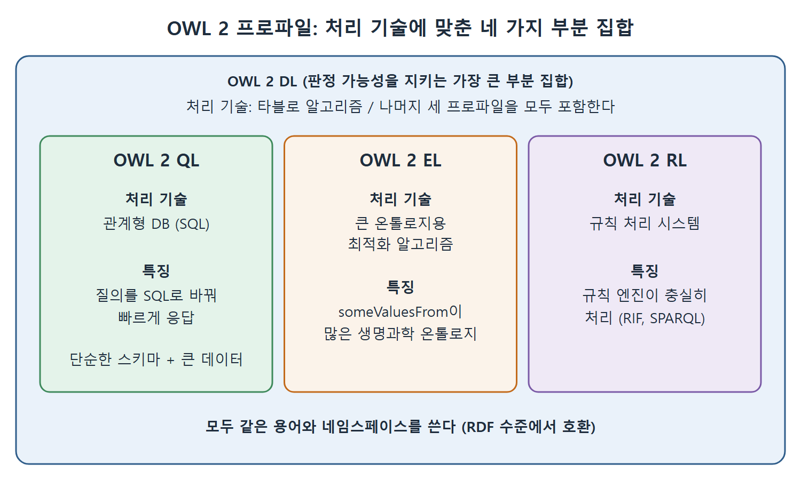

# OWL 2 프로파일

OWL 2가 OWL 1.0과 비교해 가장 크게 바꾼 기반 구조는 프로파일(profile)의 도입이다. 프로파일은 OWL의 이름 붙은 하위 집합이다. 어떤 기술은 OWL의 특정 부분만 편하게 처리할 수 있다는 관찰에서 출발했다. 이미 그런 기술을 쓰기로 정한 사람이라면 "그 기술이 OWL의 어디까지 지원하는가"가 자연스러운 질문이다. 이 문서는 네 프로파일인 DL, QL, EL, RL의 목적과 특징을 하나씩 정리하고, 프로파일끼리 어떻게 호환되는지 설명한다.

---

## 1. 네 가지 프로파일 한눈에 보기

그림은 OWL 2 DL이 QL, EL, RL을 모두 품는 가장 큰 부분 집합이며, 세 프로파일이 각각 SQL, 최적화 알고리즘, 규칙 시스템이라는 서로 다른 처리 기술에 맞춰져 있음을 보여 준다.

| 프로파일 | 맞춘 기술 | 핵심 목적 | 대표 상황 |
|---|---|---|---|
| OWL 2 DL | 타블로 알고리즘 | 판정 가능성을 지키면서 표현력을 최대로 | 판정 가능성이 모델 개발의 핵심일 때 |
| OWL 2 QL | 관계형 데이터베이스(SQL) | 질의를 SQL로 바꿔 빠르게 응답 | 단순한 스키마와 방대한 데이터 |
| OWL 2 EL | 대규모 온톨로지용 최적화 알고리즘 | 큰 온톨로지를 빠르게 처리 | someValuesFrom 제약이 많은 생명과학 온톨로지 |
| OWL 2 RL | 규칙 처리 시스템 | 규칙 엔진으로 충실히 처리 | 규칙 기반 OWL 처리기 |

표를 읽는 법은, 네 프로파일이 서로 우열을 가르는 등급이 아니라 서로 다른 기술에 맞춘 선택지라는 것이다. 어떤 기술 위에서 모델을 돌릴지 정해지면 그에 맞는 프로파일을 고르면 된다.

## 2. OWL 2 DL

판정 가능성이 모델 개발의 핵심 동기일 수 있다. 이런 경우에는 판정 가능성을 유지하는 범위 안에서 표현력이 가장 큰 언어를 원한다. OWL 2 DL이 그런 프로파일이다. 판정 가능성이라는 성질을 유지하는 OWL의 가장 큰 하위 집합이다.

- 모든 형태의 제약(restriction)을 RDFS의 모든 형태와 함께 쓸 수 있다.
- 나머지 세 프로파일(QL, EL, RL)의 상위 집합이다.
- 타블로 알고리즘이 충실하게 처리할 수 있다.

## 3. OWL 2 QL

많은 시맨틱 응용은 관계형 데이터베이스에 있는 정보를 활용하고, 그 시스템 위에 만들어져야 한다. 이런 응용은 전형적인 데이터베이스 응용의 모습이다. 비교적 단순한 스키마가 방대한 양의 데이터의 구조를 설명하고, 그 데이터셋에 대한 질의에 빨리 응답해야 한다. OWL 2 QL은 이것이 가능한 OWL의 하위 집합이다.

OWL 2 QL 온톨로지와 그에 대응하는 데이터에 대한 질의는 충실하게 SQL, 즉 관계형 데이터베이스의 질의어로 다시 쓸 수 있다. 데이터가 이미 데이터베이스에 있다면 질의를 SQL로 바꿔 그 위에서 그대로 실행할 수 있다.

## 4. OWL 2 EL

생명과학 분야의 많은 온톨로지는 14장에서 설명한 OBO Foundry 온톨로지의 유형을 따른다. 이런 온톨로지는 주로 someValuesFrom 제약으로 정의되는 클래스를 아주 많이 포함한다. 이 정도 크기의 온톨로지를 제약 없는 타블로 알고리즘으로 처리하기는 어렵다. OWL 2 EL은 바로 이 경우를 위해 설계되었다.

- 표현력과 구조 질의에 대해 알려진 최적화 사이의 균형을 잡는다.
- someValuesFrom 제약을 쓸 수 있도록 허용하므로 OBO Foundry 온톨로지가 이 한계 안에 들어온다.
- 그러면서도 제한이 충분히 엄격해서, OBO Foundry 온톨로지의 크기를 넘는 큰 온톨로지까지 처리하는 빠른 알고리즘이 알려져 있다.

## 5. OWL 2 RL

많은 OWL 처리기는 규칙 기반 기술로 OWL 처리를 정의한다. 이 책은 OWL과 RDFS의 일부 구성 요소를 정의하는 추론 규칙을 보이려고 SPARQL을 자주 썼다. 이렇게 쓰이는 SPARQL이 규칙 처리기의 한 예다.

규칙 처리기의 역사는 관계형 데이터베이스만큼 길다. Prolog나 비즈니스 규칙 엔진 같은 시스템이 그것이다. OWL 2 RL은 이런 규칙 시스템이 충실히 처리할 수 있는 OWL의 하위 집합을 정의한다. 하위 집합이 정해졌으므로 OWL 2 RL의 규칙을 각 규칙 시스템에 옮겨 담을 수 있다. 이 작업은 W3C의 규칙 교환 형식 RIF(Rule Interchange Format)와 많은 독점 규칙 처리기에서 이미 이루어졌다. OWL 2 RL을 SPARQL로 옮긴 변형도 많다.

## 6. 프로파일끼리는 호환된다

모든 OWL 하위 집합은 모델에서 똑같은 자원을 쓴다. 프로파일마다 따로 네임스페이스가 있는 것이 아니다. 따라서 어떤 프로파일의 모델이든 해당 프로파일의 제약만 지킨다면 다른 프로파일의 모델로 해석할 수 있다. 이런 식으로 모든 프로파일은 RDF 수준에서 서로 호환된다.

| 질문 | 답 |
|---|---|
| 프로파일마다 다른 용어를 쓰는가 | 아니다. 같은 자원을 쓴다 |
| 프로파일마다 별도 네임스페이스가 있는가 | 없다 |
| 한 프로파일 모델을 다른 프로파일에서 해석할 수 있는가 | 가능하다. 단 해당 프로파일의 제약을 지켜야 한다 |
| 호환되는 수준은 어디인가 | RDF 수준 |

표의 핵심은 프로파일이 문법이 아니라 사용 범위의 규칙이라는 점이다. 그래서 모델을 한 프로파일로 만들어 두고 나중에 다른 처리 기술에 옮기는 것이 가능하다.

## 7. 어떤 프로파일을 고를까

| 처한 상황 | 고려할 프로파일 | 이유 |
|---|---|---|
| 모든 추론이 유한 시간 안에 정확히 나와야 한다 | OWL 2 DL | 판정 가능성이 보장된다 |
| 이미 관계형 데이터베이스에 데이터가 있다 | OWL 2 QL | 질의를 SQL로 바꿀 수 있다 |
| someValuesFrom으로 정의한 클래스가 아주 많다 | OWL 2 EL | 큰 온톨로지를 빠르게 처리한다 |
| 규칙 엔진이나 SPARQL로 추론을 돌린다 | OWL 2 RL | 규칙 시스템이 충실히 처리할 수 있다 |

이 선택 기준은 원문이 각 프로파일에 대해 든 이유를 상황별로 다시 정리한 것이다. 모든 프로파일이 같은 구성 요소를 쓴다는 점을 기억하면, 상황이 바뀌어 프로파일을 바꿔도 지금까지 배운 지식은 그대로 쓸 수 있다.

 
 
 

[Semantic Web for the Working Ontologist](../)
