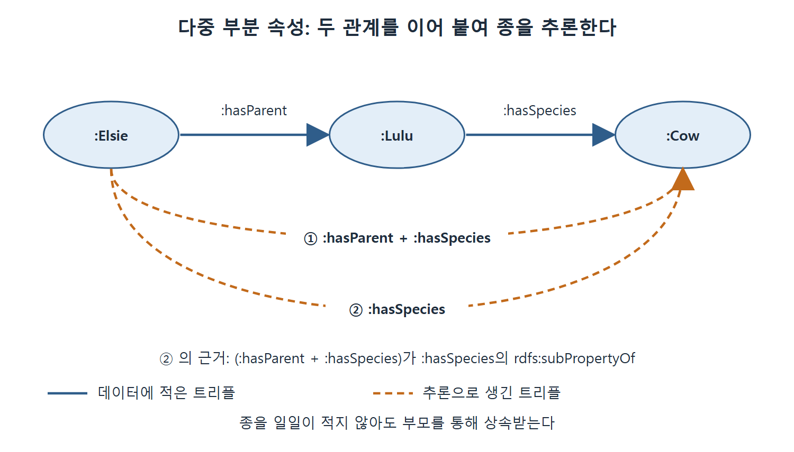

# 다중 부분 속성과 복수 키

OWL 2가 새로 갖춘 기능 가운데 데이터 통합에서 특히 쓸모 있는 두 가지가 다중 부분 속성(multipart property)과 복수 키(owl:hasKey)다. 앞의 것은 속성 둘 이상을 이어 붙여 새 관계를 만드는 기능이고, 뒤의 것은 여러 속성 값이 모두 같으면 같은 개체로 보는 기능이다. 이 문서는 두 기능이 무엇이고 어떤 추론을 만드는지, 그리고 아직 표준이 없는 불확실성 문제까지 설명한다.

---

## 1. 다중 부분 속성

### 1.1 속성 사이의 관계는 상하만 있는 것이 아니다

RDFS에서 rdfs:subPropertyOf로 속성을 계층으로 엮는 법을 배웠다. 계층의 아래쪽에서 성립하는 관계는 위쪽에서도 성립한다. 하지만 속성이 서로 관계 맺는 방식이 이것만은 아니다.

흔한 예가 삼촌(uncle)이다. A가 B의 삼촌이려면 A가 B의 부모의 형제여야 한다. 삼촌이라는 속성이 순서대로 부모(parent)와 형제(brother)라는 두 부분으로 이루어진다. 이런 것을 다중 부분 속성이라 한다. 길 안내로 비유하면, 집에서 지하철역까지 가는 길과 역에서 회사까지 가는 길을 이어 붙여 "집에서 회사까지"라는 새 길을 만드는 것과 같다. 이런 관계를 SPARQL로 정의하는 법은 5장에서 이미 보았다.

### 1.2 하위 속성과 결합하면 제약이 된다

다중 부분 속성은 다른 RDFS와 OWL 구성 요소와 함께 쓰면 강력한 모델링 수단이 된다. 예를 들어 "자식은 부모와 같은 종이어야 한다"는 제약을 이렇게 모델링한다. hasParent 다음에 hasSpecies가 이어지는 다중 부분 속성(:hasParent + :hasSpecies로 표기)이 hasSpecies의 rdfs:subPropertyOf라고 말하는 것이다.

다음 두 트리플이 있다고 하자.

```turtle
:Elsie :hasParent :Lulu .
:Lulu :hasSpecies :Cow .
```

먼저 이어 붙인 속성으로 추론이 일어난다.

```turtle
:Elsie :hasParent + :hasSpecies :Cow .
```

그런데 :hasParent + :hasSpecies가 :hasSpecies의 rdfs:subPropertyOf이므로 다음이 다시 추론된다.

```turtle
:Elsie :hasSpecies :Cow .
```

+ 기호 표기는 책이 설명용으로 쓴 것이며 정식 Turtle 문법이 아니다. 추출 텍스트에서 이 코드의 공백이 깨져 있어서 간격은 문맥으로 복원했다. 풀이하면 Elsie의 부모는 Lulu이고 Lulu의 종은 Cow라는 두 사실에서, Elsie의 종이 Cow라는 사실이 따라 나온다. 종을 일일이 적지 않아도 부모를 통해 상속받는다.



그림은 Elsie에서 Lulu를 거쳐 Cow로 이어지는 두 트리플(실선)에서 추론된 트리플(점선) 두 개가 어떻게 나오는지 보여 준다. 먼저 두 속성을 이어 붙인 관계가 생기고, 그 관계가 :hasSpecies의 하위 속성이므로 Elsie와 Cow가 :hasSpecies로 바로 이어진다.

| 단계 | 사용한 규칙 | 결과 |
|---|---|---|
| 1 | 두 트리플을 이어 붙인다 | :Elsie :hasParent + :hasSpecies :Cow |
| 2 | 이어 붙인 속성은 :hasSpecies의 rdfs:subPropertyOf다 | :Elsie :hasSpecies :Cow |

표를 읽는 법은, 1단계가 두 속성을 이어서 새 관계를 얻는 부분이고 2단계가 그 새 관계를 평범한 속성으로 끌어내리는 부분이라는 것이다.

### 1.3 판정 가능성과의 관계

OWL 1.0에 다중 부분 속성이 들어가지 못한 이유는 판정 불가능성을 일으킨다고 여겨졌기 때문이다. 그런데 최근 연구로 일정한 조건 아래에서는 판정 가능성을 해치지 않는 방식으로 OWL에서 다중 부분 속성을 표현할 수 있다고 밝혀졌다. OWL 2의 다중 부분 속성 기능은 판정 가능성을 보장하도록 설계되었다.

## 2. 복수 키

### 2.1 하나의 식별자로는 부족하다

역함수 속성(inverse functional property)은 속성 값으로 개체의 정체를 정한다. 두 사람의 주민등록번호가 같으면 같은 사람이라고 추론하는 식이다. 이런 유일한 식별자는 여러 출처의 정보를 합칠 때 꼭 필요하다.

하지만 통합 작업을 많이 해 본 사람은 안다. 이렇게 합치는 것은 겉핥기다. 실제로는 속성 몇 개의 조합이 개체의 동일성을 정하는 경우가 훨씬 흔하다.

- 같은 주소에 살고 이름과 성이 같은 두 사람은 동일인으로 봐야 한다.
- 같은 병원에서 같은 날 같은 시각에 태어난 두 사람은 동일인으로 봐야 한다.

이처럼 여러 속성의 조합이 식별자인 예가, 역함수 속성이 요구하는 단일 식별자의 예보다 훨씬 쉽게 나온다.

### 2.2 owl:hasKey

OWL 2는 이 상황을 위해 owl:hasKey를 도입했다. 관계형 데이터베이스에서 테이블에 여러 열로 이루어진 키를 선언하는 것과 비슷하게, 속성 집합을 owl:hasKey로 클래스에 연결한다. 클래스의 두 구성원이 지정한 키 속성 값을 모두 똑같이 가지면 두 개체는 같은 것(owl:sameAs)으로 본다.

:Person 클래스에 키 :firstName, :lastName, :address를 정하면, 세 속성이 모두 일치하는 두 사람은 같은 사람으로 간주된다.

```turtle
:Person owl:hasKey ( :firstName :lastName :address ) .
```

위 코드는 책 본문에 있는 줄이 아니라 설명을 돕는 예시다. 원문은 문장으로만 이 키 구성을 설명한다. 괄호 속 목록은 키로 묶을 속성들을 뜻한다.

| 비교 | owl:InverseFunctionalProperty | owl:hasKey |
|---|---|---|
| 동일성을 정하는 속성 수 | 하나 | 여러 개 가능 |
| 예 | 주민등록번호가 같으면 같은 사람 | 이름, 성, 주소가 모두 같으면 같은 사람 |
| 결론 | 같은 것(owl:sameAs) | 같은 것(owl:sameAs) |
| 데이터베이스 비유 | 유일 키 열 하나 | 여러 열로 이룬 키 |

표를 읽는 법은 두 기능 모두 sameAs 결론을 내지만, 복수 키는 속성 하나로는 구별하지 못하는 현실적인 경우를 다룰 수 있다는 것이다.

### 2.3 그래도 남는 한계: 불확실성

통합 상황에서는 이런 속성 조합조차 개체의 동일성을 보장하지 못할 때가 많다. 같은 주소에 같은 이름이면 같은 사람일 가능성이 매우 높다. 하지만 확실하지는 않다. 아버지가 같은 이름의 아들과 한집에 살 수 있기 때문이다.

OWL에 불확실성을 더하는 여러 방안이 제안되었지만 아직 표준으로 정해진 것이 없다. 따라서 이런 종류의 정보를 표현할 방법은 현재 없다.

## 3. 두 기능 정리

| 기능 | 하는 일 | 대표 예 | 한계나 주의점 |
|---|---|---|---|
| 다중 부분 속성 | 속성 여러 개를 순서대로 이어 새 속성을 만든다 | 삼촌 = 부모 다음 형제 | OWL 2에서는 판정 가능성을 보장하도록 설계되었다 |
| owl:hasKey | 속성 집합의 값이 같으면 같은 개체로 본다 | 이름·성·주소가 같은 사람 | 같다고 확신할 수 없는 경우는 표현할 수 없다 |

두 기능 모두 OWL 1.0에서는 쓸 수 없었고 OWL 2에서 들어왔다. 두 기능은 규칙(rules)으로도 쉽게 표현할 수 있는데, 이는 규칙 문서에서 다시 다룬다.

<br>
<br>
<br>

[Semantic Web for the Working Ontologist](../)
