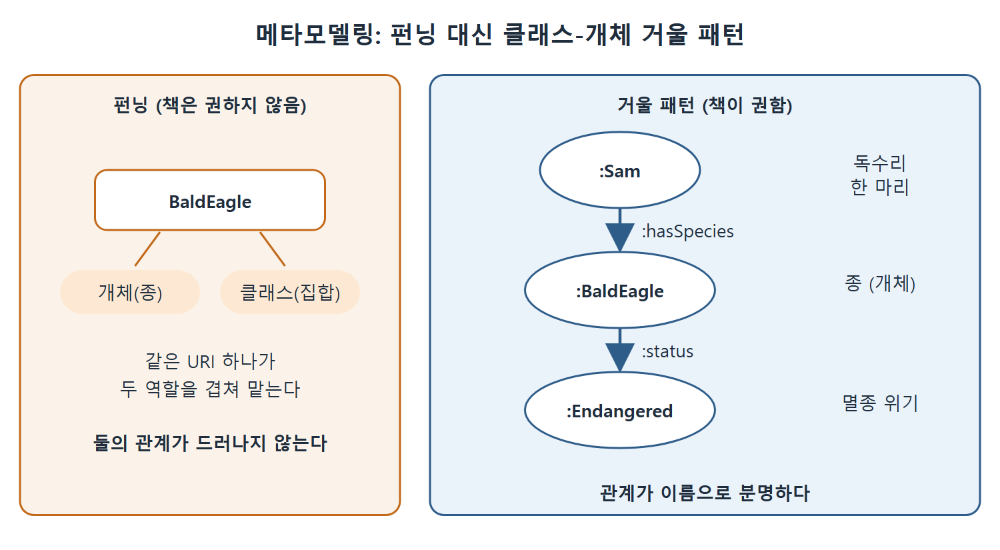

# 메타모델링

메타모델링(metamodeling)은 모델을 설명하는 모델을 만드는 일이다. 모델 안의 요소를 다른 모델의 개체(인스턴스)처럼 다루는 것이어서, 클래스에 속성을 붙일 수 있어야 한다. 이 문서는 메타모델링이 왜 필요한지, OWL 2의 펀닝(punning)이 이를 어떻게 허용하는지, 그리고 책이 왜 펀닝 대신 클래스-개체 거울 패턴을 권하는지 정리한다.

---

## 1. 메타모델링이란

일상 비유로 시작하자. 도서관에서 "해리 포터"는 어떤 때는 하나의 작품이고, 어떤 때는 책장에 꽂힌 사본 수백 권을 묶은 묶음이다. 작품으로서는 "인기 작품 목록"의 한 항목이고, 묶음으로서는 사본 하나하나가 그 구성원이다. 같은 이름이 한 번은 항목(개체)으로, 한 번은 묶음(클래스)으로 쓰인다.

메타모델링도 같은 상황이다. 모델 속 개념 하나가 어떤 역할에서는 클래스로, 다른 역할에서는 개체로 보여야 할 때가 있다. 이를 하려면 클래스에 속성값을 줄 수 있어야 한다.

이 점이 OWL 1.0에서는 문제였다. OWL 1.0은 클래스를 개체처럼 다루는 것을 허용하지 않았기 때문이다. 이것이 15.3절에서 안티 패턴으로 설명한 펀닝이 등장한 동기 중 하나다.

## 2. 메타모델링이 필요한 이유

### 2.1 한 개념이 두 역할을 맡는다

응용 하나 안에서 모델이 여러 역할을 해야 하는 경우가 흔하다. 동물을 모델링한다고 하자.

- 한 응용에서는 BaldEagle(흰머리수리)을 멸종 위기종이라고 말한다. 이때 BaldEagle은 개체다.
- 다른 응용에서는 BaldEagle을 클래스로 본다. 구성원은 동물원에 있는 흰머리수리 한 마리 한 마리다.

와인도 비슷하다. 와인 애호가는 개별 와인을 빈티지(수확 연도)로 이야기한다. 이들에게 빈티지는 하나의 개체다. 반대로 와인 상인이 팔린 병 수를 세려 한다면, 병 하나하나가 그 빈티지가 가리키는 클래스의 구성원이다.

| 개념 | 개체로 볼 때 | 클래스로 볼 때 |
|---|---|---|
| BaldEagle | 멸종 위기종이라는 속성을 가진 종 | 동물원의 개별 흰머리수리를 구성원으로 갖는 집합 |
| 와인 빈티지 | 애호가가 이야기하는 대상 | 상인이 팔고 세는 병들의 집합 |
| foaf:Group | 하나의 그룹 개체 | 그 그룹의 구성원 전체 클래스 |

표는 같은 이름이 두 역할을 맡는 모습을 보여 준다. 핵심은 개념 자체가 바뀌는 것이 아니라, 응용이 어느 쪽 관점으로 보는가가 바뀐다는 점이다.

### 2.2 이미 본 사례들

이 책에서 이런 메타모델링을 이미 보았다. 10장에서는 foaf:Group이 개체이면서, 그 그룹 구성원 전체의 클래스에 대응한다는 것을 보았다. 12장에서는 클래스-개체 거울(Class-Individual Mirror) 패턴으로 같은 상황을 다뤘다.

### 2.3 다른 모델링 체계를 흉내 내기 위해서

메타모델링의 또 다른 목적은 객체 지향 모델링 같은 다른 체계의 기능을 흉내 내는 것이다. 객체 지향에서는 어떤 속성의 값을 클래스의 모든 구성원에 한꺼번에 지정할 수 있다. 이런 일을 하려면 클래스에 속성값을 붙일 수 있어야 한다.

## 3. 펀닝: 하나의 자원이 두 역할을 맡는다

한 자원이 개체(종 BaldEagle)이면서 클래스(집합 BaldEagle)를 함께 가리키도록 같은 URI를 겹쳐 쓰는 것을 펀닝이라 한다. 이것이 OWL 2에서 허용된다.

다만 책은 분명하게 말한다. OWL 2 권고안이 펀닝을 허용하더라도, 메타모델링 목적으로는 펀닝을 쓰지 말 것을 권한다.

## 4. 펀닝 대신 거울 패턴을 권하는 이유

종과 그 종에 속한 동물 집합은 실제로 다르다. 데스크톱과 그 위에서 돌아가는 응용도 다르다. 와인 한 병과 빈티지의 관계는 독수리 한 마리와 종의 관계와 다르다. 이런 차이는 모델을 다시 쓰려는 사람에게 중요할 수 있다. 처음부터 구분해 두면 모델의 쓸모가 높아지는 경우가 많다.

그래서 12장의 클래스-개체 거울 패턴을 메타모델링에 쓰도록 권한다. 그 예에서는 데스크톱과 응용의 관계가 runsOn으로 분명했고, 1990년 장애인법(ADA90)과 응용의 관계도 conformsTo로 분명했다.

BaldEagle 같은 클래스를 모델링할 때도 특정 독수리와 클래스 사이의 관계가 정확히 무엇인지 따져서 이름을 붙이라는 것이다.

| 대상 | 관계를 명시한 속성 | 연결해서 쓸 수 있는 다른 속성 |
|---|---|---|
| 독수리 한 마리와 그 종 | hasSpecies | hasGenus, hasPhylum |
| 와인 한 병과 그 빈티지 | hasVintage | madeInYear |
| 데스크톱과 응용 | runsOn | (12장 예시) |
| 응용과 ADA90 | conformsTo | (12장 예시) |

표를 읽는 법은 다음과 같다. 관계를 속성으로 이름 붙이면, 그 속성을 다른 속성과 연결해서 모델을 풍부하게 만들 수 있다. 펀닝으로 한 이름에 뭉뚱그리면 이런 연결을 쓸 수 없다.

```turtle
:Sam :hasSpecies :BaldEagle .
:BaldEagle :status :Endangered .
```

위 코드는 책에 실린 그대로가 아니라 이 설명을 보이기 위한 짧은 예시다. 독수리 Sam은 :hasSpecies로 종 :BaldEagle과 이어지고, 종은 그 자체로 개체여서 멸종 위기 같은 속성을 가질 수 있다. 클래스 BaldEagle과 개체 BaldEagle을 한 이름으로 겹치지 않고도, 한 마리와 종의 관계가 hasSpecies로 분명해진다. :Sam, :status, :Endangered는 설명용으로 만든 이름이다.



그림은 한 이름이 두 역할을 겹쳐 맡는 펀닝과, 관계를 이름 붙인 속성으로 이어 주는 거울 패턴을 나란히 보여 준다. 오른쪽에서는 :Sam이 :hasSpecies로 종 :BaldEagle과 이어지고, 종이 :status로 :Endangered와 이어진다.

## 5. 방법 비교

| 방법 | 설명 | 책의 권고 |
|---|---|---|
| 펀닝 | 한 자원을 클래스와 개체로 동시에 사용한다. OWL 2에서 허용된다 | 메타모델링에는 쓰지 말 것을 권한다 |
| 클래스-개체 거울 패턴 | 클래스와 짝이 되는 개체를 따로 만들고 둘의 관계를 이름 붙인 속성으로 잇는다 | 메타모델링에 권한다 |

두 방법의 차이는 관계가 드러나는가 하는 점이다. 거울 패턴에서는 hasSpecies나 hasVintage처럼 관계의 이름이 분명해서, 모델을 다시 쓰는 사람이 둘 사이의 관계를 쉽게 알아본다.

<br>
<br>
<br>

[Semantic Web for the Working Ontologist](../)
