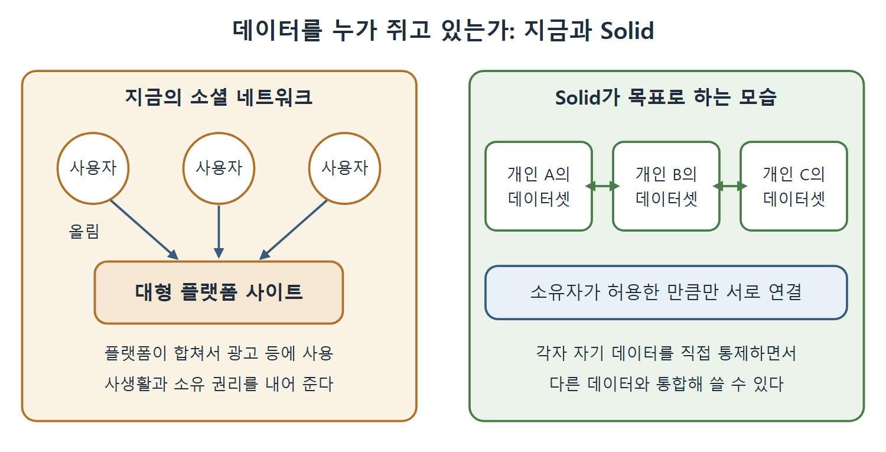

# 개인 데이터와 앞으로의 과제

웹의 데이터는 더 이상 정부나 기업이 정성껏 다듬은 고가치 데이터셋만이 아니다. 소셜 네트워크 시대에는 개인들이 전 세계 규모로 데이터를 만들고 쓴다. 이 문서는 그 상황에서 생기는 개인정보와 소유권 문제, 이를 풀려는 Solid, 그리고 책이 마지막에 짚은 앞으로의 변화를 정리한다.

---

## 1. 수백만 명이 올리는 작은 데이터

소셜 네트워크가 등장하면서 데이터의 생산과 소비는 개인이 대규모로 하게 되었다. 시맨틱 웹 표준은 이런 상황에도 똑같이 적용된다. 수백만 참여자가 하루 종일 전 세계 곳곳에서 작은 데이터를 만들어 내는 상황이다.

지금 웹에서는 이런 기여를 거대한 소셜 네트워크 사이트가 관리한다. 사이트는 데이터를 모아서 다른 사용자에게 다시 나눠 준다. 동시에 데이터를 통합해서 상품 노출이나 광고 같은 빅데이터 응용에 쓴다. 이 구조에서 데이터를 올린 사용자는 그 데이터의 사생활과 소유 권리를 내어 준 셈이 된다.

책에 따르면 데이터를 중앙에서 통제할 때의 위험에 대한 인식은 2016년 미국 대통령 선거와 같은 해 영국의 브렉시트 투표에서 소셜 데이터가 주목받는 방식으로 쓰인 일을 계기로 대중에게 알려졌다.

| 구분 | 지금의 소셜 네트워크 | Solid가 목표로 하는 모습 |
|---|---|---|
| 데이터를 쥔 쪽 | 대형 플랫폼 사이트 | 데이터를 만든 개인 |
| 통합과 활용 | 플랫폼이 합쳐서 광고 등에 사용 | 개인이 관리하면서 다른 데이터와 통합 가능 |
| 사용자의 권리 | 사생활과 소유권을 내어 준다 | 자기 데이터에 대한 통제를 유지한다 |

읽는 법: 핵심은 데이터를 흩어 두면서도 통합해서 쓸 수 있게 하는 것이다. 통합과 개인 통제를 양자택일로 보지 않는다.

왼쪽은 사용자가 올린 데이터를 플랫폼이 모아 쓰는 지금의 구조이고, 오른쪽은 각 개인이 자기 데이터셋을 직접 통제하면서 허용한 만큼만 서로 연결하는 Solid의 구조이다.

---

## 2. Solid

시맨틱 웹을 소셜 데이터에 적용하는 노력의 예가 Solid(SOcial LInked Data)다. 책은 Berners-Lee 2018을 출처로 든다. 소셜 네트워킹 플랫폼의 사용자 같은 개별 데이터 제공자가 자기 데이터를 직접 관리하면서도, 그 데이터가 다른 데이터와 통합되어 분산 환경에서 쓰이는 것을 허용한다.

여기에는 미묘한 균형이 필요하다. 데이터를 비공개로 두는 것과 공유를 허용하는 것 사이에서, 데이터를 만든 사람이 계속 통제권을 갖도록 해야 한다.

---

## 3. 균형은 모순이 아니라 설계다

책은 이런 균형 잡기가 모순이 아니라 거대한 분산 데이터 웹에서 우리가 기대하게 된 바로 그 모습이라고 말한다.

- 각 데이터셋은 그 소유자나 생성자가 통제하는 독립된 존재다.
- 동시에 각 데이터셋은 전 지구적 데이터 네트워크의 일부여서 다른 어떤 데이터셋과도 함께 동작할 수 있다.
- 이 상호 운용을 통제하는 것은 웹 기반 시설을 가진 어떤 총괄 소유자가 아니라 데이터의 소유자들이다.

책은 이것이 웹에서 새로운 생각이 아니라 처음부터 그렇게 설계된 방식이며, 시맨틱 웹이 앞으로의 방대한 정보 수요를 감당할 방식이라고 말한다.

| 관점 | 의미 |
|---|---|
| 개별 데이터셋 | 소유자가 통제한다 |
| 전체 네트워크 | 어떤 데이터셋이든 서로 상호 운용할 수 있다 |
| 상호 운용의 결정권 | 중앙 관리자가 아니라 데이터 소유자에게 있다 |

---

## 4. 앞으로의 과제

웹이 그렇듯 시맨틱 웹도 새 기술이 나올수록 계속 자라고 변할 것이다. 책은 이 판을 마무리하는 시점에 이미 보이는 시도들을 나열한다.

| 흐름 | 설명 |
|---|---|
| 딥러닝과의 결합 | 시맨틱 웹 시스템을 인공지능의 딥러닝과 연결하려는 노력 |
| 속성 그래프(property graph) | 링크가 RDF와 OWL 모델보다 더 많은 정보를 담을 수 있는 그래프 |
| 새로운 추론 모델 | 양상(modal) 논리, 의무(deontic) 논리 등 이 책에서 다룬 범위를 넘어서는 강력한 논리를 고려하는 모델 |
| 사물 인터넷(Internet of Things) | 쓸 수 있는 데이터가 기하급수적으로 늘고, 그 결과 통합해야 할 정보의 이질성이 커진다 |

읽는 법: 사물 인터넷은 새 기술의 결합이라기보다 데이터의 양과 다양성이 폭증하는 도전이다. 책은 대량의 정보가 끊임없이 변하는 흐름 속에서 통합되어야 한다는 점이 링크드 데이터와 시맨틱 웹의 계속된 발전에 새로운 도전이 된다고 본다.

---

## 5. 책이 남기는 메시지

- 시맨틱 웹의 힘은 정교한 언어가 아니라 웹이라는 규모와 개방성에서 나온다.
- 전역 식별자와 열린 세계 가정이 그 개방성을 받치는 두 기둥이다.
- 모델링은 부품을 조합해 데이터가 흐르는 시스템을 만드는 기술이다.
- 데이터 소유와 사생활, 새로운 논리와 기술의 결합, 폭증하는 데이터가 남은 과제다.

 
 
 

[Semantic Web for the Working Ontologist](../)
