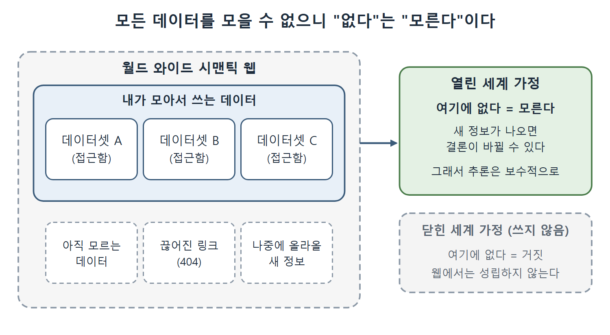

# 신뢰와 열린 세계 가정

누구나 올릴 수 있는 웹에서는 두 가지 질문이 따라온다. 올라온 정보를 믿어도 되는가, 그리고 전 세계 데이터를 한 기계에 다 담을 수 없는데 시맨틱 웹이 어떻게 가능한가. 이 문서는 책이 이 둘에 어떻게 답하는지, 그리고 그 답이 열린 세계 가정과 어떻게 이어지는지를 풀어 쓴다.

---

## 1. 웹의 정보를 얼마나 믿을까

TV 광고 속 여성은 레이더 장비에 대한 정보가 맞는지 어떻게 알았을까. 책은 가능성을 세 가지 든다.

- 믿을 만한 출처, 예를 들면 정부의 연구 보고서에서 배웠을 수 있다.
- 여러 출처를 교차 확인해서 충분한 근거를 모았을 수 있다.
- 정보가 정말 맞는지는 상관없고, 교통경찰을 설득할 수만 있으면 된다고 생각했을 수도 있다.

| 신뢰 방법 | 설명 | 일상의 비유 |
|---|---|---|
| 믿을 만한 출처 | 신뢰하는 기관의 자료를 쓴다 | 공식 통계를 인용한다 |
| 교차 확인 | 여러 출처가 같은 말을 하는지 본다 | 후기를 여러 곳에서 비교한다 |
| 목적에 맞으면 충분 | 정확성보다 설득 효과를 본다 | 논쟁에서 이길 근거만 찾는 경우 |

읽는 법: 웹의 정보에 대한 신뢰는 신문, 책, 잡지를 대할 때와 같은 방식으로, 적당한 회의를 섞어서 판단한다. 시맨틱 웹이라고 해서 신뢰를 자동으로 보장해 주는 마법이 있는 것은 아니다.

---

## 2. 세 가지 기본 원칙

책은 이 책 전체에서 시맨틱 웹의 모델링 측면을 다뤘다고 돌아본다. 웹 환경에 맞게 정보를 어떻게 표현할 것인가가 주제였다. 그 밑에 깔린 기본 원칙은 세 가지다.

| 원칙 | 풀이 |
|---|---|
| AAA 슬로건 | Anyone can say Anything about Any topic. 누구나 어떤 주제에 대해서든 무엇이든 말할 수 있다 |
| 비유일 이름 짓기 가정 | Nonunique Naming Assumption. 서로 다른 이름이 같은 대상을 가리킬 수 있다 |
| 열린 세계 가정 | Open World Assumption. 지금 모르는 것이 거짓이라는 뜻은 아니다 |

읽는 법: 세 원칙은 웹 같은 정보의 세계 위에서 작동하려는 표현 체계에 걸리는 제약이다. 링크드 데이터와 RDF, RDFS, OWL의 주요 설계 결정은 이 제약에서 나왔다.

---

## 3. 세계 전체를 담을 수 없다는 문제

정보와 그 모델링만이 웹의 전부는 아니다. 정보는 어딘가의 컴퓨터에 저장되고, 최종 사용자가 접근하고, 네트워크를 타고 전달되어야 한다. 그런데 어떤 트리플 저장소(triple store)나 추론 엔진도 월드 와이드 시맨틱 웹의 크기로 확장할 수는 없다. 웹 자체가 계속 자라니 당연히 불가능하다. 그러면 월드 와이드 시맨틱 웹은 어떻게 실현될 수 있을까.

책의 답은 이렇다. 시맨틱 웹 애플리케이션이 웹의 모든 데이터를 한꺼번에 접근하고 합칠 필요는 없다. 자기에게 필요한 데이터를 접근하고 합칠 수 있으면 충분히 유용하다. 모든 시맨틱 웹 페이지를 한 저장소에 담을 수 없으니, 지금 접근하지 못하는 정보가 언제든 더 있을 수 있다는 전제로 일해야 한다. 이것이 열린 세계 가정이 시맨틱 웹 기반 시설의 중심에 있는 이유다.

일상 비유로 보면 도서관과 같다. 어떤 사서도 세상의 모든 책을 소장하지 못하지만, 내 연구에 필요한 책을 모을 수 있으면 도서관은 쓸모가 있다. 그리고 "이 도서관에 없다"가 "세상에 없다"를 뜻하지는 않는다.

내가 모은 데이터셋 바깥에는 아직 모르는 데이터, 끊어진 링크, 나중에 올라올 정보가 있다. 그래서 열린 세계 가정은 "없다"를 "거짓"이 아니라 "모른다"로 읽고, 추론을 보수적으로 한다.

---

## 4. 작은 데이터로도 새로운 흐름이 생긴다

책은 이 책에서 다룬 응용이 소량의 정보라도 유연하게 표현해서 새로운 방식으로 합칠 수 있게 하면 정보 배포와 공유에 새로운 동력이 생긴다는 것을 보여 줬다고 정리한다.

| 사례 | 하는 일 |
|---|---|
| SKOS (Simple Knowledge Organization System) | 전 세계 시소러스 관리자들이 용어를 공유하고, 연결하고, 비교하게 한다 |
| QUDT (Quantities/Units/Dimensions/Types) | 여러 애플리케이션의 측정 가능한 양을 합치고 비교할 수 있도록 맞춘다 |
| OBO (Open Biological and Biomedical Ontologies) | 전 세계 독립적인 생명과학 연구자들의 노력을 조율한다 |

읽는 법: 세 사례 모두 중앙에서 모든 데이터를 걷어 오는 방식이 아니라, 각자 가진 정보를 같은 어휘와 식별자로 맞춰서 필요한 만큼 합치는 방식이다.

---

## 5. 정리

- 웹의 신뢰는 출처, 교차 확인, 적당한 회의로 판단한다.
- AAA, 비유일 이름 짓기, 열린 세계라는 세 원칙이 RDF, RDFS, OWL의 설계를 이끌었다.
- 모든 것을 한 곳에 모으지 못하므로, 필요한 만큼만 모으고 모르는 것이 더 있다고 가정한다.

 
 
 

[Semantic Web for the Working Ontologist](../)
