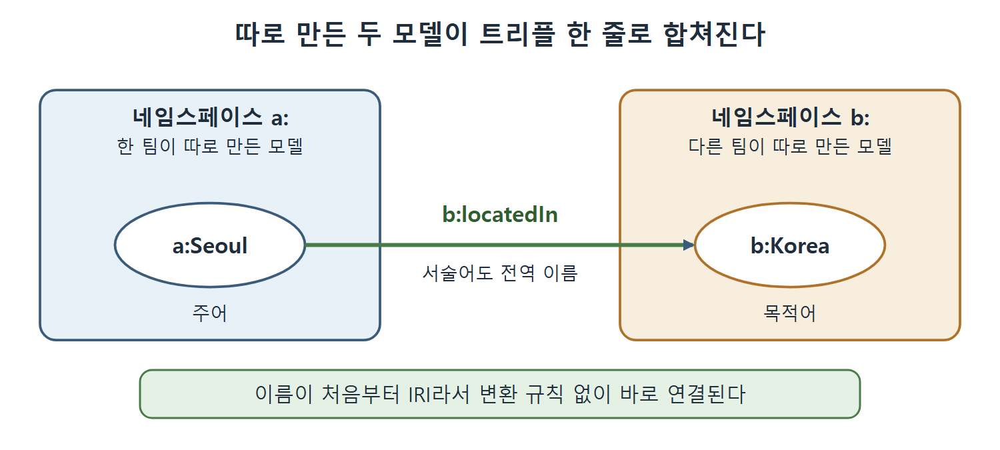

# 웹 기반 시설로서의 시맨틱 웹

시맨틱 웹이 웹의 일부가 되려면 웹의 규칙을 따라야 한다. 웹에서는 모든 참조가 전 세계에서 통하는 참조다. 이 문서는 그 사실에서 나오는 설계 결정, 즉 IRI(국제화 자원 식별자), 합치기 쉬운 모듈성, 링크드 데이터(Linked Data)의 구조를 정리한다.

---

## 1. 이름은 전 세계에서 하나여야 한다

대부분의 프로그래밍·모델링 언어에는 이름을 공간으로 묶는 장치가 있다. 그 덕분에 나와 다른 사람이 같은 이름을 서로 다른 뜻으로 써도, 두 시스템을 연결할 때 헷갈리지 않는다. 자바의 패키지나 XML 네임스페이스(namespace)를 떠올리면 된다.

웹은 이 아이디어를 전 세계 규모로 키운다. 네임스페이스 안의 이름이 웹 전체에서 유일해야 한다. 그 웹 표준 수단이 IRI(Internationalized Resource Identifier)이고, 시맨틱 웹은 전역 네임스페이스 식별에 IRI를 쓴다. 책은 IRI를 "전 세계에서 찾아갈 수 있는 자원 참조"라고 설명한다.

| 구분 | 일반 언어의 네임스페이스 | 웹의 IRI |
|---|---|---|
| 이름이 유일한 범위 | 한 프로그램, 한 조직 | 웹 전체 |
| 다른 시스템과 합칠 때 | 이름 충돌을 따로 조정 | 조정이 필요 없음 |
| 누가 관리하나 | 각 시스템 | 웹의 기반 시설 |

읽는 법: IRI를 쓰면 이름의 유일성 문제를 매번 새로 풀 필요가 없다. 웹이 이미 풀어 둔 문제를 빌려 쓰는 것이다.

---

## 2. 따로 만든 모델도 그냥 합쳐진다

IRI를 쓰면 웹의 모듈성을 빌릴 수 있다. 서로 모르고 따로 개발한 두 모델이 있어도, 양쪽 자원을 한 문장(트리플) 안에서 함께 참조하기만 하면 합쳐진다. 이름이 처음부터 전역 식별자이므로 합칠 때마다 식별자를 억지로 맞출 일이 없다. 전역 정체성 체계가 웹 기반 시설에 이미 들어 있기 때문이다.

아래는 이 아이디어를 보여 주는 가상 예시다. 원서 예시가 아니라 이해를 돕기 위해 만든 것이다.

```turtle
@prefix a: <http://example.org/a#> .
@prefix b: <http://example.org/b#> .

a:Seoul b:locatedIn b:Korea .
```

두 네임스페이스 a와 b는 따로 만들어졌지만, 이 한 줄이 둘을 잇는다. 합치려고 새 변환 규칙을 만들 필요가 없다.



위 예시를 그림으로 나타냈다. 따로 만든 a:Seoul과 b:Korea가 b:locatedIn이라는 서술어 하나로 이어지며, 서술어도 전역 이름이다.

---

## 3. 링크드 데이터: 하이퍼텍스트 웹의 자연스러운 확장

시맨틱 웹 표준은 하이퍼텍스트 웹의 구조 위에 지어져 있다. 데이터셋(dataset)끼리 IRI로 서로를 가리키고, 그렇게 링크드 데이터의 웹이 만들어진다. 둘 이상의 데이터셋이 같은 식별자를 참조하면 그것만으로 데이터셋이 연결된다.

RDF 표준은 분산 데이터 시스템에서 가능한 가장 단순한 연결 방식에 기반한다. 전역 참조 하나를 다른 전역 참조에 잇되, 그 연결 자체에도 이름을 붙이고, 그 이름도 전역 참조인 방식이다. 이 전 세계 링크드 데이터 웹은 우리가 아는 하이퍼텍스트 웹을 자연스럽게 확장한 것이다.

| 하이퍼텍스트 웹 | 링크드 데이터 웹 |
|---|---|
| 페이지가 URL로 식별된다 | 자원이 IRI로 식별된다 |
| 페이지가 다른 페이지로 링크한다 | 전역 참조가 다른 전역 참조로 링크된다 |
| 링크에는 이름이 없다 | 링크에도 이름이 있고 그 이름이 전역 참조다 |
| 사람이 따라가며 읽는다 | 기계가 따라가며 합친다 |

읽는 법: 링크에 이름이 붙는 것이 가장 큰 차이다. 이름이 있어서 기계가 링크의 의미를 알 수 있다.

---

## 4. 개방성이 가져오는 결과

웹이 성공한 이유 중 하나는 개방성이다. 누구나 정보를 올릴 수 있고, 다른 사람이 보기에 오해를 부르거나 거슬리거나 틀린 정보를 올리는 사람도 있다. 얼핏 보면 이런 무질서한 자유가 쓸모 있을 리 없다고 생각하기 쉽다. 하지만 웹 전체, 특히 위키피디아 같은 정보 보관 사이트의 성공은 양질의 데이터를 올릴 동기가 충분하다는 것을 보여 주었다. 그래서 웹은 유용하고 심지어 필수적인 구조가 되었다.

이 개방성은 시맨틱 웹의 기반 시설을 개발할 때 이전의 많은 지식 기술에서는 중요하지 않던 고려 사항을 만들어 낸다. 웹이 하이퍼카드보다 성공한 이유 중 하나는, 웹 기반 시설이 누락되거나 끊어진 링크(흔히 보는 "404 오류")에 강했기 때문이다. 시맨틱 웹도 비슷하게 강해야 한다. 그래서 시맨틱 웹의 추론(inference)은 아주 보수적으로, 열린 세계 가정(Open World Assumption)에 따라 해야 한다. 언제든 새 정보가 나타나 이미 낸 결론을 뒤집을 수 있고, 추론 정책은 그런 상황에서도 버텨야 한다.

---

## 5. 정리

- 전역 이름(IRI)이 모듈성의 바탕이다. 이름이 전 세계에서 유일하면 모델 합치기가 쉬워진다.
- RDF는 이름 붙은 전역 링크라는 가장 단순한 연결 방식에 기반한다.
- 개방성 때문에 끊어진 링크와 새 정보에 견디는 보수적 추론이 필요하다.

<br>
<br>
<br>

[Semantic Web for the Working Ontologist](../)
