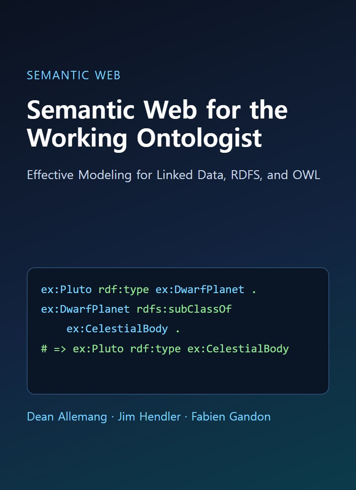
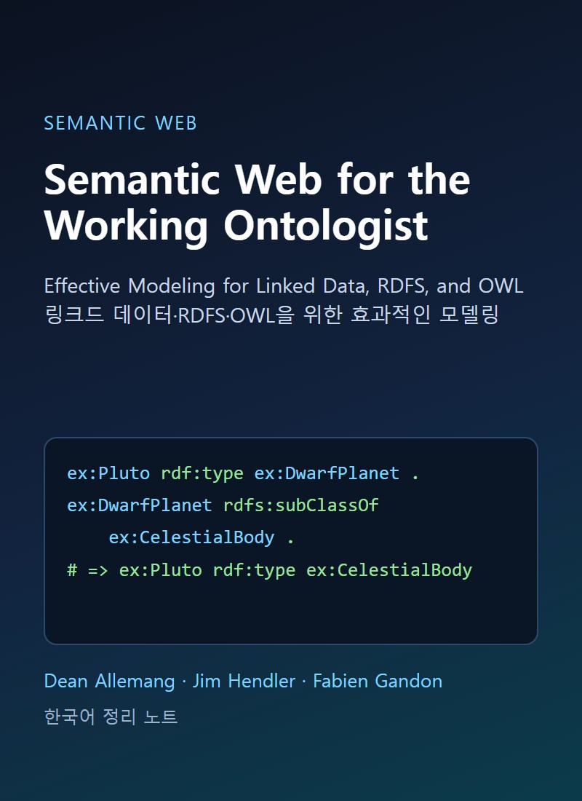
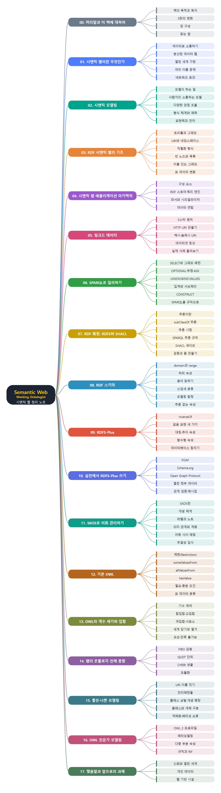

# **Semantic Web for the Working Ontologist**
(Semantic Web for the Working Ontologist: 링크드 데이터, RDFS, OWL을 위한 효과적인 모델링)
 

&nbsp;&nbsp;&nbsp;

원문 표지(왼쪽) · 한국어 표지(오른쪽)

 
 

이 문서는 Dean Allemang, Jim Hendler, Fabien Gandon이 쓴 『Semantic Web for the Working Ontologist』 3판(ACM Books)을 장별로 정리한 한국어 학습 노트입니다. 원문을 그대로 번역한 것이 아니라 내용을 풀어서 다시 설명했고, 처음 쓰는 용어는 쉬운 말로 풀이를 붙였습니다. 이해를 돕도록 장마다 비교표와 개념 그림을 넣었습니다. 책은 시맨틱 웹이 무엇이고 왜 모델링이 필요한지 설명하는 1~2장에서 시작합니다. 이어서 RDF와 트리플, 애플리케이션 구조, 링크드 데이터, SPARQL 질의를 다루고, RDFS와 SHACL, RDFS-Plus, SKOS로 모델에 의미를 더하는 방법을 설명합니다. 그다음 OWL로 제한, 개수, 집합을 표현하는 방법과 실제 온톨로지 사례를 살펴보고, 좋은 모델링과 나쁜 모델링, 전문가 수준의 모델링, 앞으로의 과제로 마무리합니다.
 
 
 

---

- [00. 머리말과 이 책에 대하여](00.%20%EB%A8%B8%EB%A6%AC%EB%A7%90%EA%B3%BC%20%EC%9D%B4%20%EC%B1%85%EC%97%90%20%EB%8C%80%ED%95%98%EC%97%AC/Readme.md)
- [01. 시맨틱 웹이란 무엇인가](01.%20%EC%8B%9C%EB%A7%A8%ED%8B%B1%20%EC%9B%B9%EC%9D%B4%EB%9E%80%20%EB%AC%B4%EC%97%87%EC%9D%B8%EA%B0%80/Readme.md)
  - [이 책의 목적과 웹의 뿌리](01.%20%EC%8B%9C%EB%A7%A8%ED%8B%B1%20%EC%9B%B9%EC%9D%B4%EB%9E%80%20%EB%AC%B4%EC%97%87%EC%9D%B8%EA%B0%80/%EC%9D%B4%20%EC%B1%85%EC%9D%98%20%EB%AA%A9%EC%A0%81%EA%B3%BC%20%EC%9B%B9%EC%9D%98%20%EB%BF%8C%EB%A6%AC.md)
  - [데이터로 소통해야 하는 이유](01.%20%EC%8B%9C%EB%A7%A8%ED%8B%B1%20%EC%9B%B9%EC%9D%B4%EB%9E%80%20%EB%AC%B4%EC%97%87%EC%9D%B8%EA%B0%80/%EB%8D%B0%EC%9D%B4%ED%84%B0%EB%A1%9C%20%EC%86%8C%ED%86%B5%ED%95%B4%EC%95%BC%20%ED%95%98%EB%8A%94%20%EC%9D%B4%EC%9C%A0.md)
  - [분산된 데이터 웹](01.%20%EC%8B%9C%EB%A7%A8%ED%8B%B1%20%EC%9B%B9%EC%9D%B4%EB%9E%80%20%EB%AC%B4%EC%97%87%EC%9D%B8%EA%B0%80/%EB%B6%84%EC%82%B0%EB%90%9C%20%EB%8D%B0%EC%9D%B4%ED%84%B0%20%EC%9B%B9.md)
  - [AAA 슬로건과 네트워크 효과](01.%20%EC%8B%9C%EB%A7%A8%ED%8B%B1%20%EC%9B%B9%EC%9D%B4%EB%9E%80%20%EB%AC%B4%EC%97%87%EC%9D%B8%EA%B0%80/AAA%20%EC%8A%AC%EB%A1%9C%EA%B1%B4%EA%B3%BC%20%EB%84%A4%ED%8A%B8%EC%9B%8C%ED%81%AC%20%ED%9A%A8%EA%B3%BC.md)
  - [의견 충돌과 이름 문제](01.%20%EC%8B%9C%EB%A7%A8%ED%8B%B1%20%EC%9B%B9%EC%9D%B4%EB%9E%80%20%EB%AC%B4%EC%97%87%EC%9D%B8%EA%B0%80/%EC%9D%98%EA%B2%AC%20%EC%B6%A9%EB%8F%8C%EA%B3%BC%20%EC%9D%B4%EB%A6%84%20%EB%AC%B8%EC%A0%9C.md)
  - [열린 세계 가정과 여러 이름](01.%20%EC%8B%9C%EB%A7%A8%ED%8B%B1%20%EC%9B%B9%EC%9D%B4%EB%9E%80%20%EB%AC%B4%EC%97%87%EC%9D%B8%EA%B0%80/%EC%97%B4%EB%A6%B0%20%EC%84%B8%EA%B3%84%20%EA%B0%80%EC%A0%95%EA%B3%BC%20%EC%97%AC%EB%9F%AC%20%EC%9D%B4%EB%A6%84.md)
  - [요약과 핵심 개념](01.%20%EC%8B%9C%EB%A7%A8%ED%8B%B1%20%EC%9B%B9%EC%9D%B4%EB%9E%80%20%EB%AC%B4%EC%97%87%EC%9D%B8%EA%B0%80/%EC%9A%94%EC%95%BD%EA%B3%BC%20%ED%95%B5%EC%8B%AC%20%EA%B0%9C%EB%85%90.md)
- [02. 시맨틱 모델링](02.%20%EC%8B%9C%EB%A7%A8%ED%8B%B1%20%EB%AA%A8%EB%8D%B8%EB%A7%81/Readme.md)
  - [모델이 하는 일 세 가지](02.%20%EC%8B%9C%EB%A7%A8%ED%8B%B1%20%EB%AA%A8%EB%8D%B8%EB%A7%81/%EB%AA%A8%EB%8D%B8%EC%9D%B4%20%ED%95%98%EB%8A%94%20%EC%9D%BC%20%EC%84%B8%20%EA%B0%80%EC%A7%80.md)
  - [사람끼리 소통하는 모델](02.%20%EC%8B%9C%EB%A7%A8%ED%8B%B1%20%EB%AA%A8%EB%8D%B8%EB%A7%81/%EC%82%AC%EB%9E%8C%EB%81%BC%EB%A6%AC%20%EC%86%8C%ED%86%B5%ED%95%98%EB%8A%94%20%EB%AA%A8%EB%8D%B8.md)
  - [설명과 예측 그리고 형식 체계](02.%20%EC%8B%9C%EB%A7%A8%ED%8B%B1%20%EB%AA%A8%EB%8D%B8%EB%A7%81/%EC%84%A4%EB%AA%85%EA%B3%BC%20%EC%98%88%EC%B8%A1%20%EA%B7%B8%EB%A6%AC%EA%B3%A0%20%ED%98%95%EC%8B%9D%20%EC%B2%B4%EA%B3%84.md)
  - [다양한 관점 조율하기](02.%20%EC%8B%9C%EB%A7%A8%ED%8B%B1%20%EB%AA%A8%EB%8D%B8%EB%A7%81/%EB%8B%A4%EC%96%91%ED%95%9C%20%EA%B4%80%EC%A0%90%20%EC%A1%B0%EC%9C%A8%ED%95%98%EA%B8%B0.md)
  - [표현력과 시맨틱 웹 언어](02.%20%EC%8B%9C%EB%A7%A8%ED%8B%B1%20%EB%AA%A8%EB%8D%B8%EB%A7%81/%ED%91%9C%ED%98%84%EB%A0%A5%EA%B3%BC%20%EC%8B%9C%EB%A7%A8%ED%8B%B1%20%EC%9B%B9%20%EC%96%B8%EC%96%B4.md)
  - [요약과 핵심 개념](02.%20%EC%8B%9C%EB%A7%A8%ED%8B%B1%20%EB%AA%A8%EB%8D%B8%EB%A7%81/%EC%9A%94%EC%95%BD%EA%B3%BC%20%ED%95%B5%EC%8B%AC%20%EA%B0%9C%EB%85%90.md)
- [03. RDF 시맨틱 웹의 기초](03.%20RDF%20%EC%8B%9C%EB%A7%A8%ED%8B%B1%20%EC%9B%B9%EC%9D%98%20%EA%B8%B0%EC%B4%88/Readme.md)
  - [RDF와 분산 데이터](03.%20RDF%20%EC%8B%9C%EB%A7%A8%ED%8B%B1%20%EC%9B%B9%EC%9D%98%20%EA%B8%B0%EC%B4%88/RDF%EC%99%80%20%EB%B6%84%EC%82%B0%20%EB%8D%B0%EC%9D%B4%ED%84%B0.md)
  - [URI와 네임스페이스](03.%20RDF%20%EC%8B%9C%EB%A7%A8%ED%8B%B1%20%EC%9B%B9%EC%9D%98%20%EA%B8%B0%EC%B4%88/URI%EC%99%80%20%EB%84%A4%EC%9E%84%EC%8A%A4%ED%8E%98%EC%9D%B4%EC%8A%A4.md)
  - [표 데이터를 RDF로 바꾸기](03.%20RDF%20%EC%8B%9C%EB%A7%A8%ED%8B%B1%20%EC%9B%B9%EC%9D%98%20%EA%B8%B0%EC%B4%88/%ED%91%9C%20%EB%8D%B0%EC%9D%B4%ED%84%B0%EB%A5%BC%20RDF%EB%A1%9C%20%EB%B0%94%EA%BE%B8%EA%B8%B0.md)
  - [진술에 대한 진술과 이름 있는 그래프](03.%20RDF%20%EC%8B%9C%EB%A7%A8%ED%8B%B1%20%EC%9B%B9%EC%9D%98%20%EA%B8%B0%EC%B4%88/%EC%A7%84%EC%88%A0%EC%97%90%20%EB%8C%80%ED%95%9C%20%EC%A7%84%EC%88%A0%EA%B3%BC%20%EC%9D%B4%EB%A6%84%20%EC%9E%88%EB%8A%94%20%EA%B7%B8%EB%9E%98%ED%94%84.md)
  - [RDF 직렬화 형식](03.%20RDF%20%EC%8B%9C%EB%A7%A8%ED%8B%B1%20%EC%9B%B9%EC%9D%98%20%EA%B8%B0%EC%B4%88/RDF%20%EC%A7%81%EB%A0%AC%ED%99%94%20%ED%98%95%EC%8B%9D.md)
  - [빈 노드와 순서 있는 목록](03.%20RDF%20%EC%8B%9C%EB%A7%A8%ED%8B%B1%20%EC%9B%B9%EC%9D%98%20%EA%B8%B0%EC%B4%88/%EB%B9%88%20%EB%85%B8%EB%93%9C%EC%99%80%20%EC%88%9C%EC%84%9C%20%EC%9E%88%EB%8A%94%20%EB%AA%A9%EB%A1%9D.md)
  - [요약과 핵심 개념](03.%20RDF%20%EC%8B%9C%EB%A7%A8%ED%8B%B1%20%EC%9B%B9%EC%9D%98%20%EA%B8%B0%EC%B4%88/%EC%9A%94%EC%95%BD%EA%B3%BC%20%ED%95%B5%EC%8B%AC%20%EA%B0%9C%EB%85%90.md)
- [04. 시맨틱 웹 애플리케이션 아키텍처](04.%20%EC%8B%9C%EB%A7%A8%ED%8B%B1%20%EC%9B%B9%20%EC%95%A0%ED%94%8C%EB%A6%AC%EC%BC%80%EC%9D%B4%EC%85%98%20%EC%95%84%ED%82%A4%ED%85%8D%EC%B2%98/Readme.md)
  - [애플리케이션의 구성 요소](04.%20%EC%8B%9C%EB%A7%A8%ED%8B%B1%20%EC%9B%B9%20%EC%95%A0%ED%94%8C%EB%A6%AC%EC%BC%80%EC%9D%B4%EC%85%98%20%EC%95%84%ED%82%A4%ED%85%8D%EC%B2%98/%EC%95%A0%ED%94%8C%EB%A6%AC%EC%BC%80%EC%9D%B4%EC%85%98%EC%9D%98%20%EA%B5%AC%EC%84%B1%20%EC%9A%94%EC%86%8C.md)
  - [RDF 파서와 시리얼라이저](04.%20%EC%8B%9C%EB%A7%A8%ED%8B%B1%20%EC%9B%B9%20%EC%95%A0%ED%94%8C%EB%A6%AC%EC%BC%80%EC%9D%B4%EC%85%98%20%EC%95%84%ED%82%A4%ED%85%8D%EC%B2%98/RDF%20%ED%8C%8C%EC%84%9C%EC%99%80%20%EC%8B%9C%EB%A6%AC%EC%96%BC%EB%9D%BC%EC%9D%B4%EC%A0%80.md)
  - [RDF 스토어와 쿼리 엔진](04.%20%EC%8B%9C%EB%A7%A8%ED%8B%B1%20%EC%9B%B9%20%EC%95%A0%ED%94%8C%EB%A6%AC%EC%BC%80%EC%9D%B4%EC%85%98%20%EC%95%84%ED%82%A4%ED%85%8D%EC%B2%98/RDF%20%EC%8A%A4%ED%86%A0%EC%96%B4%EC%99%80%20%EC%BF%BC%EB%A6%AC%20%EC%97%94%EC%A7%84.md)
  - [애플리케이션 코드와 웹 포털](04.%20%EC%8B%9C%EB%A7%A8%ED%8B%B1%20%EC%9B%B9%20%EC%95%A0%ED%94%8C%EB%A6%AC%EC%BC%80%EC%9D%B4%EC%85%98%20%EC%95%84%ED%82%A4%ED%85%8D%EC%B2%98/%EC%95%A0%ED%94%8C%EB%A6%AC%EC%BC%80%EC%9D%B4%EC%85%98%20%EC%BD%94%EB%93%9C%EC%99%80%20%EC%9B%B9%20%ED%8F%AC%ED%84%B8.md)
  - [데이터 연합](04.%20%EC%8B%9C%EB%A7%A8%ED%8B%B1%20%EC%9B%B9%20%EC%95%A0%ED%94%8C%EB%A6%AC%EC%BC%80%EC%9D%B4%EC%85%98%20%EC%95%84%ED%82%A4%ED%85%8D%EC%B2%98/%EB%8D%B0%EC%9D%B4%ED%84%B0%20%EC%97%B0%ED%95%A9.md)
  - [요약과 핵심 개념](04.%20%EC%8B%9C%EB%A7%A8%ED%8B%B1%20%EC%9B%B9%20%EC%95%A0%ED%94%8C%EB%A6%AC%EC%BC%80%EC%9D%B4%EC%85%98%20%EC%95%84%ED%82%A4%ED%85%8D%EC%B2%98/%EC%9A%94%EC%95%BD%EA%B3%BC%20%ED%95%B5%EC%8B%AC%20%EA%B0%9C%EB%85%90.md)
- [05. 링크드 데이터](05.%20%EB%A7%81%ED%81%AC%EB%93%9C%20%EB%8D%B0%EC%9D%B4%ED%84%B0/Readme.md)
  - [웹에 데이터를 엮는다는 것](05.%20%EB%A7%81%ED%81%AC%EB%93%9C%20%EB%8D%B0%EC%9D%B4%ED%84%B0/%EC%9B%B9%EC%97%90%20%EB%8D%B0%EC%9D%B4%ED%84%B0%EB%A5%BC%20%EC%97%AE%EB%8A%94%EB%8B%A4%EB%8A%94%20%EA%B2%83.md)
  - [HTTP URI 만들기](05.%20%EB%A7%81%ED%81%AC%EB%93%9C%20%EB%8D%B0%EC%9D%B4%ED%84%B0/HTTP%20URI%20%EB%A7%8C%EB%93%A4%EA%B8%B0.md)
  - [HTTP와 웹의 세 기둥](05.%20%EB%A7%81%ED%81%AC%EB%93%9C%20%EB%8D%B0%EC%9D%B4%ED%84%B0/HTTP%EC%99%80%20%EC%9B%B9%EC%9D%98%20%EC%84%B8%20%EA%B8%B0%EB%91%A5.md)
  - [해시 URI와 슬래시 URI](05.%20%EB%A7%81%ED%81%AC%EB%93%9C%20%EB%8D%B0%EC%9D%B4%ED%84%B0/%ED%95%B4%EC%8B%9C%20URI%EC%99%80%20%EC%8A%AC%EB%9E%98%EC%8B%9C%20URI.md)
  - [실제 링크드 데이터 둘러보기](05.%20%EB%A7%81%ED%81%AC%EB%93%9C%20%EB%8D%B0%EC%9D%B4%ED%84%B0/%EC%8B%A4%EC%A0%9C%20%EB%A7%81%ED%81%AC%EB%93%9C%20%EB%8D%B0%EC%9D%B4%ED%84%B0%20%EB%91%98%EB%9F%AC%EB%B3%B4%EA%B8%B0.md)
  - [데이터셋 사이에 링크 걸기](05.%20%EB%A7%81%ED%81%AC%EB%93%9C%20%EB%8D%B0%EC%9D%B4%ED%84%B0/%EB%8D%B0%EC%9D%B4%ED%84%B0%EC%85%8B%20%EC%82%AC%EC%9D%B4%EC%97%90%20%EB%A7%81%ED%81%AC%20%EA%B1%B8%EA%B8%B0.md)
  - [5스타 원칙과 LOD 클라우드](05.%20%EB%A7%81%ED%81%AC%EB%93%9C%20%EB%8D%B0%EC%9D%B4%ED%84%B0/5%EC%8A%A4%ED%83%80%20%EC%9B%90%EC%B9%99%EA%B3%BC%20LOD%20%ED%81%B4%EB%9D%BC%EC%9A%B0%EB%93%9C.md)
  - [요약과 핵심 개념](05.%20%EB%A7%81%ED%81%AC%EB%93%9C%20%EB%8D%B0%EC%9D%B4%ED%84%B0/%EC%9A%94%EC%95%BD%EA%B3%BC%20%ED%95%B5%EC%8B%AC%20%EA%B0%9C%EB%85%90.md)
- [06. SPARQL로 시맨틱 웹 질의하기](06.%20SPARQL%EB%A1%9C%20%EC%8B%9C%EB%A7%A8%ED%8B%B1%20%EC%9B%B9%20%EC%A7%88%EC%9D%98%ED%95%98%EA%B8%B0/Readme.md)
  - [알려주고 묻는 시스템](06.%20SPARQL%EB%A1%9C%20%EC%8B%9C%EB%A7%A8%ED%8B%B1%20%EC%9B%B9%20%EC%A7%88%EC%9D%98%ED%95%98%EA%B8%B0/%EC%95%8C%EB%A0%A4%EC%A3%BC%EA%B3%A0%20%EB%AC%BB%EB%8A%94%20%EC%8B%9C%EC%8A%A4%ED%85%9C.md)
  - [SELECT와 그래프 패턴](06.%20SPARQL%EB%A1%9C%20%EC%8B%9C%EB%A7%A8%ED%8B%B1%20%EC%9B%B9%20%EC%A7%88%EC%9D%98%ED%95%98%EA%B8%B0/SELECT%EC%99%80%20%EA%B7%B8%EB%9E%98%ED%94%84%20%ED%8C%A8%ED%84%B4.md)
  - [속성과 스키마 탐색, DISTINCT, FILTER](06.%20SPARQL%EB%A1%9C%20%EC%8B%9C%EB%A7%A8%ED%8B%B1%20%EC%9B%B9%20%EC%A7%88%EC%9D%98%ED%95%98%EA%B8%B0/%EC%86%8D%EC%84%B1%EA%B3%BC%20%EC%8A%A4%ED%82%A4%EB%A7%88%20%ED%83%90%EC%83%89%2C%20DISTINCT%2C%20FILTER.md)
  - [OPTIONAL, 부정, ASK](06.%20SPARQL%EB%A1%9C%20%EC%8B%9C%EB%A7%A8%ED%8B%B1%20%EC%9B%B9%20%EC%A7%88%EC%9D%98%ED%95%98%EA%B8%B0/OPTIONAL%2C%20%EB%B6%80%EC%A0%95%2C%20ASK.md)
  - [CONSTRUCT와 결과 활용](06.%20SPARQL%EB%A1%9C%20%EC%8B%9C%EB%A7%A8%ED%8B%B1%20%EC%9B%B9%20%EC%A7%88%EC%9D%98%ED%95%98%EA%B8%B0/CONSTRUCT%EC%99%80%20%EA%B2%B0%EA%B3%BC%20%ED%99%9C%EC%9A%A9.md)
  - [SPARQL을 규칙으로 쓰기](06.%20SPARQL%EB%A1%9C%20%EC%8B%9C%EB%A7%A8%ED%8B%B1%20%EC%9B%B9%20%EC%A7%88%EC%9D%98%ED%95%98%EA%B8%B0/SPARQL%EC%9D%84%20%EA%B7%9C%EC%B9%99%EC%9C%BC%EB%A1%9C%20%EC%93%B0%EA%B8%B0.md)
  - [전이 질의와 같은 대상 찾기](06.%20SPARQL%EB%A1%9C%20%EC%8B%9C%EB%A7%A8%ED%8B%B1%20%EC%9B%B9%20%EC%A7%88%EC%9D%98%ED%95%98%EA%B8%B0/%EC%A0%84%EC%9D%B4%20%EC%A7%88%EC%9D%98%EC%99%80%20%EA%B0%99%EC%9D%80%20%EB%8C%80%EC%83%81%20%EC%B0%BE%EA%B8%B0.md)
  - [데이터 일부 복사와 정렬, LIMIT](06.%20SPARQL%EB%A1%9C%20%EC%8B%9C%EB%A7%A8%ED%8B%B1%20%EC%9B%B9%20%EC%A7%88%EC%9D%98%ED%95%98%EA%B8%B0/%EB%8D%B0%EC%9D%B4%ED%84%B0%20%EC%9D%BC%EB%B6%80%20%EB%B3%B5%EC%82%AC%EC%99%80%20%EC%A0%95%EB%A0%AC%2C%20LIMIT.md)
  - [집계와 그룹, 서브쿼리](06.%20SPARQL%EB%A1%9C%20%EC%8B%9C%EB%A7%A8%ED%8B%B1%20%EC%9B%B9%20%EC%A7%88%EC%9D%98%ED%95%98%EA%B8%B0/%EC%A7%91%EA%B3%84%EC%99%80%20%EA%B7%B8%EB%A3%B9%2C%20%EC%84%9C%EB%B8%8C%EC%BF%BC%EB%A6%AC.md)
  - [UNION, BIND, VALUES, 연합 질의](06.%20SPARQL%EB%A1%9C%20%EC%8B%9C%EB%A7%A8%ED%8B%B1%20%EC%9B%B9%20%EC%A7%88%EC%9D%98%ED%95%98%EA%B8%B0/UNION%2C%20BIND%2C%20VALUES%2C%20%EC%97%B0%ED%95%A9%20%EC%A7%88%EC%9D%98.md)
  - [요약과 핵심 개념](06.%20SPARQL%EB%A1%9C%20%EC%8B%9C%EB%A7%A8%ED%8B%B1%20%EC%9B%B9%20%EC%A7%88%EC%9D%98%ED%95%98%EA%B8%B0/%EC%9A%94%EC%95%BD%EA%B3%BC%20%ED%95%B5%EC%8B%AC%20%EA%B0%9C%EB%85%90.md)
- [07. RDF 확장하기 RDFS와 SHACL](07.%20RDF%20%ED%99%95%EC%9E%A5%ED%95%98%EA%B8%B0%20RDFS%EC%99%80%20SHACL/Readme.md)
  - [추론과 subClassOf](07.%20RDF%20%ED%99%95%EC%9E%A5%ED%95%98%EA%B8%B0%20RDFS%EC%99%80%20SHACL/%EC%B6%94%EB%A1%A0%EA%B3%BC%20subClassOf.md)
  - [SPARQL로 쓰는 추론 규칙](07.%20RDF%20%ED%99%95%EC%9E%A5%ED%95%98%EA%B8%B0%20RDFS%EC%99%80%20SHACL/SPARQL%EB%A1%9C%20%EC%93%B0%EB%8A%94%20%EC%B6%94%EB%A1%A0%20%EA%B7%9C%EC%B9%99.md)
  - [추론 엔진과 쇼핑몰 예제](07.%20RDF%20%ED%99%95%EC%9E%A5%ED%95%98%EA%B8%B0%20RDFS%EC%99%80%20SHACL/%EC%B6%94%EB%A1%A0%20%EC%97%94%EC%A7%84%EA%B3%BC%20%EC%87%BC%ED%95%91%EB%AA%B0%20%EC%98%88%EC%A0%9C.md)
  - [추론은 언제 일어나는가](07.%20RDF%20%ED%99%95%EC%9E%A5%ED%95%98%EA%B8%B0%20RDFS%EC%99%80%20SHACL/%EC%B6%94%EB%A1%A0%EC%9D%80%20%EC%96%B8%EC%A0%9C%20%EC%9D%BC%EC%96%B4%EB%82%98%EB%8A%94%EA%B0%80.md)
  - [기대와 SHACL 셰이프](07.%20RDF%20%ED%99%95%EC%9E%A5%ED%95%98%EA%B8%B0%20RDFS%EC%99%80%20SHACL/%EA%B8%B0%EB%8C%80%EC%99%80%20SHACL%20%EC%85%B0%EC%9D%B4%ED%94%84.md)
  - [SHACL로 검증하고 폼 만들기](07.%20RDF%20%ED%99%95%EC%9E%A5%ED%95%98%EA%B8%B0%20RDFS%EC%99%80%20SHACL/SHACL%EB%A1%9C%20%EA%B2%80%EC%A6%9D%ED%95%98%EA%B3%A0%20%ED%8F%BC%20%EB%A7%8C%EB%93%A4%EA%B8%B0.md)
  - [요약과 핵심 개념](07.%20RDF%20%ED%99%95%EC%9E%A5%ED%95%98%EA%B8%B0%20RDFS%EC%99%80%20SHACL/%EC%9A%94%EC%95%BD%EA%B3%BC%20%ED%95%B5%EC%8B%AC%20%EA%B0%9C%EB%85%90.md)
- [08. RDF 스키마](08.%20RDF%20%EC%8A%A4%ED%82%A4%EB%A7%88/Readme.md)
  - [RDFS와 스키마 언어](08.%20RDF%20%EC%8A%A4%ED%82%A4%EB%A7%88/RDFS%EC%99%80%20%EC%8A%A4%ED%82%A4%EB%A7%88%20%EC%96%B8%EC%96%B4.md)
  - [하위 속성과 관계 전파](08.%20RDF%20%EC%8A%A4%ED%82%A4%EB%A7%88/%ED%95%98%EC%9C%84%20%EC%86%8D%EC%84%B1%EA%B3%BC%20%EA%B4%80%EA%B3%84%20%EC%A0%84%ED%8C%8C.md)
  - [domain과 range의 추론](08.%20RDF%20%EC%8A%A4%ED%82%A4%EB%A7%88/domain%EA%B3%BC%20range%EC%9D%98%20%EC%B6%94%EB%A1%A0.md)
  - [교집합과 합집합 흉내 내기](08.%20RDF%20%EC%8A%A4%ED%82%A4%EB%A7%88/%EA%B5%90%EC%A7%91%ED%95%A9%EA%B3%BC%20%ED%95%A9%EC%A7%91%ED%95%A9%20%ED%9D%89%EB%82%B4%20%EB%82%B4%EA%B8%B0.md)
  - [용어 맞추기와 데이터 합치기](08.%20RDF%20%EC%8A%A4%ED%82%A4%EB%A7%88/%EC%9A%A9%EC%96%B4%20%EB%A7%9E%EC%B6%94%EA%B8%B0%EC%99%80%20%EB%8D%B0%EC%9D%B4%ED%84%B0%20%ED%95%A9%EC%B9%98%EA%B8%B0.md)
  - [쓰임새로 자동 분류하기](08.%20RDF%20%EC%8A%A4%ED%82%A4%EB%A7%88/%EC%93%B0%EC%9E%84%EC%83%88%EB%A1%9C%20%EC%9E%90%EB%8F%99%20%EB%B6%84%EB%A5%98%ED%95%98%EA%B8%B0.md)
  - [domain과 range 모델링 함정](08.%20RDF%20%EC%8A%A4%ED%82%A4%EB%A7%88/domain%EA%B3%BC%20range%20%EB%AA%A8%EB%8D%B8%EB%A7%81%20%ED%95%A8%EC%A0%95.md)
  - [추론 없는 속성들](08.%20RDF%20%EC%8A%A4%ED%82%A4%EB%A7%88/%EC%B6%94%EB%A1%A0%20%EC%97%86%EB%8A%94%20%EC%86%8D%EC%84%B1%EB%93%A4.md)
  - [요약과 핵심 개념](08.%20RDF%20%EC%8A%A4%ED%82%A4%EB%A7%88/%EC%9A%94%EC%95%BD%EA%B3%BC%20%ED%95%B5%EC%8B%AC%20%EA%B0%9C%EB%85%90.md)
- [09. RDFS-Plus](09.%20RDFS-Plus/Readme.md)
  - [RDFS-Plus 소개와 inverseOf](09.%20RDFS-Plus/RDFS-Plus%20%EC%86%8C%EA%B0%9C%EC%99%80%20inverseOf.md)
  - [대칭 속성과 어휘 확장](09.%20RDFS-Plus/%EB%8C%80%EC%B9%AD%20%EC%86%8D%EC%84%B1%EA%B3%BC%20%EC%96%B4%ED%9C%98%20%ED%99%95%EC%9E%A5.md)
  - [추이적 속성](09.%20RDFS-Plus/%EC%B6%94%EC%9D%B4%EC%A0%81%20%EC%86%8D%EC%84%B1.md)
  - [의존 관계 네트워크](09.%20RDFS-Plus/%EC%9D%98%EC%A1%B4%20%EA%B4%80%EA%B3%84%20%EB%84%A4%ED%8A%B8%EC%9B%8C%ED%81%AC.md)
  - [같음을 표현하는 세 가지 방법](09.%20RDFS-Plus/%EA%B0%99%EC%9D%8C%EC%9D%84%20%ED%91%9C%ED%98%84%ED%95%98%EB%8A%94%20%EC%84%B8%20%EA%B0%80%EC%A7%80%20%EB%B0%A9%EB%B2%95.md)
  - [서로 다른 데이터베이스 합치기](09.%20RDFS-Plus/%EC%84%9C%EB%A1%9C%20%EB%8B%A4%EB%A5%B8%20%EB%8D%B0%EC%9D%B4%ED%84%B0%EB%B2%A0%EC%9D%B4%EC%8A%A4%20%ED%95%A9%EC%B9%98%EA%B8%B0.md)
  - [함수형 속성과 역함수형 속성](09.%20RDFS-Plus/%ED%95%A8%EC%88%98%ED%98%95%20%EC%86%8D%EC%84%B1%EA%B3%BC%20%EC%97%AD%ED%95%A8%EC%88%98%ED%98%95%20%EC%86%8D%EC%84%B1.md)
  - [데이터 타입 속성과 클래스 선언](09.%20RDFS-Plus/%EB%8D%B0%EC%9D%B4%ED%84%B0%20%ED%83%80%EC%9E%85%20%EC%86%8D%EC%84%B1%EA%B3%BC%20%ED%81%B4%EB%9E%98%EC%8A%A4%20%EC%84%A0%EC%96%B8.md)
  - [요약과 핵심 개념](09.%20RDFS-Plus/%EC%9A%94%EC%95%BD%EA%B3%BC%20%ED%95%B5%EC%8B%AC%20%EA%B0%9C%EB%85%90.md)
- [10. 실전에서 RDFS-Plus 쓰기](10.%20%EC%8B%A4%EC%A0%84%EC%97%90%EC%84%9C%20RDFS-Plus%20%EC%93%B0%EA%B8%B0/Readme.md)
  - [실전 사례 한눈에 보기](10.%20%EC%8B%A4%EC%A0%84%EC%97%90%EC%84%9C%20RDFS-Plus%20%EC%93%B0%EA%B8%B0/%EC%8B%A4%EC%A0%84%20%EC%82%AC%EB%A1%80%20%ED%95%9C%EB%88%88%EC%97%90%20%EB%B3%B4%EA%B8%B0.md)
  - [Schema.org로 상품과 서비스 설명하기](10.%20%EC%8B%A4%EC%A0%84%EC%97%90%EC%84%9C%20RDFS-Plus%20%EC%93%B0%EA%B8%B0/Schema.org%EB%A1%9C%20%EC%83%81%ED%92%88%EA%B3%BC%20%EC%84%9C%EB%B9%84%EC%8A%A4%20%EC%84%A4%EB%AA%85%ED%95%98%EA%B8%B0.md)
  - [Schema.org의 모델링 방식과 의미](10.%20%EC%8B%A4%EC%A0%84%EC%97%90%EC%84%9C%20RDFS-Plus%20%EC%93%B0%EA%B8%B0/Schema.org%EC%9D%98%20%EB%AA%A8%EB%8D%B8%EB%A7%81%20%EB%B0%A9%EC%8B%9D%EA%B3%BC%20%EC%9D%98%EB%AF%B8.md)
  - [열린 정부 데이터와 FHEO 사례](10.%20%EC%8B%A4%EC%A0%84%EC%97%90%EC%84%9C%20RDFS-Plus%20%EC%93%B0%EA%B8%B0/%EC%97%B4%EB%A6%B0%20%EC%A0%95%EB%B6%80%20%EB%8D%B0%EC%9D%B4%ED%84%B0%EC%99%80%20FHEO%20%EC%82%AC%EB%A1%80.md)
  - [관계 검증과 지도 매시업](10.%20%EC%8B%A4%EC%A0%84%EC%97%90%EC%84%9C%20RDFS-Plus%20%EC%93%B0%EA%B8%B0/%EA%B4%80%EA%B3%84%20%EA%B2%80%EC%A6%9D%EA%B3%BC%20%EC%A7%80%EB%8F%84%20%EB%A7%A4%EC%8B%9C%EC%97%85.md)
  - [FOAF로 사람과 모임 설명하기](10.%20%EC%8B%A4%EC%A0%84%EC%97%90%EC%84%9C%20RDFS-Plus%20%EC%93%B0%EA%B8%B0/FOAF%EB%A1%9C%20%EC%82%AC%EB%9E%8C%EA%B3%BC%20%EB%AA%A8%EC%9E%84%20%EC%84%A4%EB%AA%85%ED%95%98%EA%B8%B0.md)
  - [FOAF의 신원 식별과 사람 연결](10.%20%EC%8B%A4%EC%A0%84%EC%97%90%EC%84%9C%20RDFS-Plus%20%EC%93%B0%EA%B8%B0/FOAF%EC%9D%98%20%EC%8B%A0%EC%9B%90%20%EC%8B%9D%EB%B3%84%EA%B3%BC%20%EC%82%AC%EB%9E%8C%20%EC%97%B0%EA%B2%B0.md)
  - [Facebook Open Graph Protocol](10.%20%EC%8B%A4%EC%A0%84%EC%97%90%EC%84%9C%20RDFS-Plus%20%EC%93%B0%EA%B8%B0/Facebook%20Open%20Graph%20Protocol.md)
  - [요약과 핵심 개념](10.%20%EC%8B%A4%EC%A0%84%EC%97%90%EC%84%9C%20RDFS-Plus%20%EC%93%B0%EA%B8%B0/%EC%9A%94%EC%95%BD%EA%B3%BC%20%ED%95%B5%EC%8B%AC%20%EA%B0%9C%EB%85%90.md)
- [11. SKOS로 어휘 관리하기](11.%20SKOS%EB%A1%9C%20%EC%96%B4%ED%9C%98%20%EA%B4%80%EB%A6%AC%ED%95%98%EA%B8%B0/Readme.md)
  - [SKOS란 무엇인가](11.%20SKOS%EB%A1%9C%20%EC%96%B4%ED%9C%98%20%EA%B4%80%EB%A6%AC%ED%95%98%EA%B8%B0/SKOS%EB%9E%80%20%EB%AC%B4%EC%97%87%EC%9D%B8%EA%B0%80.md)
  - [라벨과 노트 속성](11.%20SKOS%EB%A1%9C%20%EC%96%B4%ED%9C%98%20%EA%B4%80%EB%A6%AC%ED%95%98%EA%B8%B0/%EB%9D%BC%EB%B2%A8%EA%B3%BC%20%EB%85%B8%ED%8A%B8%20%EC%86%8D%EC%84%B1.md)
  - [의미 관계와 계층](11.%20SKOS%EB%A1%9C%20%EC%96%B4%ED%9C%98%20%EA%B4%80%EB%A6%AC%ED%95%98%EA%B8%B0/%EC%9D%98%EB%AF%B8%20%EA%B4%80%EA%B3%84%EC%99%80%20%EA%B3%84%EC%B8%B5.md)
  - [broader를 읽는 방향](11.%20SKOS%EB%A1%9C%20%EC%96%B4%ED%9C%98%20%EA%B4%80%EB%A6%AC%ED%95%98%EA%B8%B0/broader%EB%A5%BC%20%EC%9D%BD%EB%8A%94%20%EB%B0%A9%ED%96%A5.md)
  - [어휘 사이 매핑](11.%20SKOS%EB%A1%9C%20%EC%96%B4%ED%9C%98%20%EA%B4%80%EB%A6%AC%ED%95%98%EA%B8%B0/%EC%96%B4%ED%9C%98%20%EC%82%AC%EC%9D%B4%20%EB%A7%A4%ED%95%91.md)
  - [개념 체계와 권장 관행](11.%20SKOS%EB%A1%9C%20%EC%96%B4%ED%9C%98%20%EA%B4%80%EB%A6%AC%ED%95%98%EA%B8%B0/%EA%B0%9C%EB%85%90%20%EC%B2%B4%EA%B3%84%EC%99%80%20%EA%B6%8C%EC%9E%A5%20%EA%B4%80%ED%96%89.md)
  - [SKOS 무결성 검사](11.%20SKOS%EB%A1%9C%20%EC%96%B4%ED%9C%98%20%EA%B4%80%EB%A6%AC%ED%95%98%EA%B8%B0/SKOS%20%EB%AC%B4%EA%B2%B0%EC%84%B1%20%EA%B2%80%EC%82%AC.md)
  - [SKOS가 널리 쓰이는 이유](11.%20SKOS%EB%A1%9C%20%EC%96%B4%ED%9C%98%20%EA%B4%80%EB%A6%AC%ED%95%98%EA%B8%B0/SKOS%EA%B0%80%20%EB%84%90%EB%A6%AC%20%EC%93%B0%EC%9D%B4%EB%8A%94%20%EC%9D%B4%EC%9C%A0.md)
  - [요약과 핵심 개념](11.%20SKOS%EB%A1%9C%20%EC%96%B4%ED%9C%98%20%EA%B4%80%EB%A6%AC%ED%95%98%EA%B8%B0/%EC%9A%94%EC%95%BD%EA%B3%BC%20%ED%95%B5%EC%8B%AC%20%EA%B0%9C%EB%85%90.md)
- [12. 기본 OWL](12.%20%EA%B8%B0%EB%B3%B8%20OWL/Readme.md)
  - [제한이란 무엇인가](12.%20%EA%B8%B0%EB%B3%B8%20OWL/%EC%A0%9C%ED%95%9C%EC%9D%B4%EB%9E%80%20%EB%AC%B4%EC%97%87%EC%9D%B8%EA%B0%80.md)
  - [someValuesFrom과 답변한 질문](12.%20%EA%B8%B0%EB%B3%B8%20OWL/someValuesFrom%EA%B3%BC%20%EB%8B%B5%EB%B3%80%ED%95%9C%20%EC%A7%88%EB%AC%B8.md)
  - [allValuesFrom과 질문 의존 관계](12.%20%EA%B8%B0%EB%B3%B8%20OWL/allValuesFrom%EA%B3%BC%20%EC%A7%88%EB%AC%B8%20%EC%9D%98%EC%A1%B4%20%EA%B4%80%EA%B3%84.md)
  - [hasValue와 우선순위 질문](12.%20%EA%B8%B0%EB%B3%B8%20OWL/hasValue%EC%99%80%20%EC%9A%B0%EC%84%A0%EC%88%9C%EC%9C%84%20%EC%A7%88%EB%AC%B8.md)
  - [채식주의자 문제와 로컬 범위 제한](12.%20%EA%B8%B0%EB%B3%B8%20OWL/%EC%B1%84%EC%8B%9D%EC%A3%BC%EC%9D%98%EC%9E%90%20%EB%AC%B8%EC%A0%9C%EC%99%80%20%EB%A1%9C%EC%BB%AC%20%EB%B2%94%EC%9C%84%20%EC%A0%9C%ED%95%9C.md)
  - [표 데이터 자동 분류](12.%20%EA%B8%B0%EB%B3%B8%20OWL/%ED%91%9C%20%EB%8D%B0%EC%9D%B4%ED%84%B0%20%EC%9E%90%EB%8F%99%20%EB%B6%84%EB%A5%98.md)
  - [클래스-개체 거울 패턴과 관계 전달](12.%20%EA%B8%B0%EB%B3%B8%20OWL/%ED%81%B4%EB%9E%98%EC%8A%A4-%EA%B0%9C%EC%B2%B4%20%EA%B1%B0%EC%9A%B8%20%ED%8C%A8%ED%84%B4%EA%B3%BC%20%EA%B4%80%EA%B3%84%20%EC%A0%84%EB%8B%AC.md)
  - [필요 조건과 충분 조건 용어](12.%20%EA%B8%B0%EB%B3%B8%20OWL/%ED%95%84%EC%9A%94%20%EC%A1%B0%EA%B1%B4%EA%B3%BC%20%EC%B6%A9%EB%B6%84%20%EC%A1%B0%EA%B1%B4%20%EC%9A%A9%EC%96%B4.md)
  - [요약과 핵심 개념](12.%20%EA%B8%B0%EB%B3%B8%20OWL/%EC%9A%94%EC%95%BD%EA%B3%BC%20%ED%95%B5%EC%8B%AC%20%EA%B0%9C%EB%85%90.md)
- [13. OWL의 개수 세기와 집합](13.%20OWL%EC%9D%98%20%EA%B0%9C%EC%88%98%20%EC%84%B8%EA%B8%B0%EC%99%80%20%EC%A7%91%ED%95%A9/Readme.md)
  - [합집합과 교집합](13.%20OWL%EC%9D%98%20%EA%B0%9C%EC%88%98%20%EC%84%B8%EA%B8%B0%EC%99%80%20%EC%A7%91%ED%95%A9/%ED%95%A9%EC%A7%91%ED%95%A9%EA%B3%BC%20%EA%B5%90%EC%A7%91%ED%95%A9.md)
  - [세계 닫기와 열거](13.%20OWL%EC%9D%98%20%EA%B0%9C%EC%88%98%20%EC%84%B8%EA%B8%B0%EC%99%80%20%EC%A7%91%ED%95%A9/%EC%84%B8%EA%B3%84%20%EB%8B%AB%EA%B8%B0%EC%99%80%20%EC%97%B4%EA%B1%B0.md)
  - [기수 제약](13.%20OWL%EC%9D%98%20%EA%B0%9C%EC%88%98%20%EC%84%B8%EA%B8%B0%EC%99%80%20%EC%A7%91%ED%95%A9/%EA%B8%B0%EC%88%98%20%EC%A0%9C%EC%95%BD.md)
  - [여집합과 서로소 집합](13.%20OWL%EC%9D%98%20%EA%B0%9C%EC%88%98%20%EC%84%B8%EA%B8%B0%EC%99%80%20%EC%A7%91%ED%95%A9/%EC%97%AC%EC%A7%91%ED%95%A9%EA%B3%BC%20%EC%84%9C%EB%A1%9C%EC%86%8C%20%EC%A7%91%ED%95%A9.md)
  - [선수 조건 다시 보기](13.%20OWL%EC%9D%98%20%EA%B0%9C%EC%88%98%20%EC%84%B8%EA%B8%B0%EC%99%80%20%EC%A7%91%ED%95%A9/%EC%84%A0%EC%88%98%20%EC%A1%B0%EA%B1%B4%20%EB%8B%A4%EC%8B%9C%20%EB%B3%B4%EA%B8%B0.md)
  - [모순과 만족 불가능한 클래스](13.%20OWL%EC%9D%98%20%EA%B0%9C%EC%88%98%20%EC%84%B8%EA%B8%B0%EC%99%80%20%EC%A7%91%ED%95%A9/%EB%AA%A8%EC%88%9C%EA%B3%BC%20%EB%A7%8C%EC%A1%B1%20%EB%B6%88%EA%B0%80%EB%8A%A5%ED%95%9C%20%ED%81%B4%EB%9E%98%EC%8A%A4.md)
  - [클래스 관계 추론](13.%20OWL%EC%9D%98%20%EA%B0%9C%EC%88%98%20%EC%84%B8%EA%B8%B0%EC%99%80%20%EC%A7%91%ED%95%A9/%ED%81%B4%EB%9E%98%EC%8A%A4%20%EA%B4%80%EA%B3%84%20%EC%B6%94%EB%A1%A0.md)
  - [요약과 핵심 개념](13.%20OWL%EC%9D%98%20%EA%B0%9C%EC%88%98%20%EC%84%B8%EA%B8%B0%EC%99%80%20%EC%A7%91%ED%95%A9/%EC%9A%94%EC%95%BD%EA%B3%BC%20%ED%95%B5%EC%8B%AC%20%EA%B0%9C%EB%85%90.md)
- [14. 웹의 온톨로지 전체 종합](14.%20%EC%9B%B9%EC%9D%98%20%EC%98%A8%ED%86%A8%EB%A1%9C%EC%A7%80%20%EC%A0%84%EC%B2%B4%20%EC%A2%85%ED%95%A9/Readme.md)
  - [세 온톨로지와 모듈화](14.%20%EC%9B%B9%EC%9D%98%20%EC%98%A8%ED%86%A8%EB%A1%9C%EC%A7%80%20%EC%A0%84%EC%B2%B4%20%EC%A2%85%ED%95%A9/%EC%84%B8%20%EC%98%A8%ED%86%A8%EB%A1%9C%EC%A7%80%EC%99%80%20%EB%AA%A8%EB%93%88%ED%99%94.md)
  - [QUDT 단위 온톨로지](14.%20%EC%9B%B9%EC%9D%98%20%EC%98%A8%ED%86%A8%EB%A1%9C%EC%A7%80%20%EC%A0%84%EC%B2%B4%20%EC%A2%85%ED%95%A9/QUDT%20%EB%8B%A8%EC%9C%84%20%EC%98%A8%ED%86%A8%EB%A1%9C%EC%A7%80.md)
  - [QUDT 단위 변환과 가격 비교](14.%20%EC%9B%B9%EC%9D%98%20%EC%98%A8%ED%86%A8%EB%A1%9C%EC%A7%80%20%EC%A0%84%EC%B2%B4%20%EC%A2%85%ED%95%A9/QUDT%20%EB%8B%A8%EC%9C%84%20%EB%B3%80%ED%99%98%EA%B3%BC%20%EA%B0%80%EA%B2%A9%20%EB%B9%84%EA%B5%90.md)
  - [QUDT 차원 분석](14.%20%EC%9B%B9%EC%9D%98%20%EC%98%A8%ED%86%A8%EB%A1%9C%EC%A7%80%20%EC%A0%84%EC%B2%B4%20%EC%A2%85%ED%95%A9/QUDT%20%EC%B0%A8%EC%9B%90%20%EB%B6%84%EC%84%9D.md)
  - [생물 온톨로지 CHEBI](14.%20%EC%9B%B9%EC%9D%98%20%EC%98%A8%ED%86%A8%EB%A1%9C%EC%A7%80%20%EC%A0%84%EC%B2%B4%20%EC%A2%85%ED%95%A9/%EC%83%9D%EB%AC%BC%20%EC%98%A8%ED%86%A8%EB%A1%9C%EC%A7%80%20CHEBI.md)
  - [CHEBI의 SKOS 변환과 BridgeDb](14.%20%EC%9B%B9%EC%9D%98%20%EC%98%A8%ED%86%A8%EB%A1%9C%EC%A7%80%20%EC%A0%84%EC%B2%B4%20%EC%A2%85%ED%95%A9/CHEBI%EC%9D%98%20SKOS%20%EB%B3%80%ED%99%98%EA%B3%BC%20BridgeDb.md)
  - [FIBO 금융 온톨로지의 구조](14.%20%EC%9B%B9%EC%9D%98%20%EC%98%A8%ED%86%A8%EB%A1%9C%EC%A7%80%20%EC%A0%84%EC%B2%B4%20%EC%A2%85%ED%95%A9/FIBO%20%EA%B8%88%EC%9C%B5%20%EC%98%A8%ED%86%A8%EB%A1%9C%EC%A7%80%EC%9D%98%20%EA%B5%AC%EC%A1%B0.md)
  - [FIBO 데이터 매핑과 LEI 예제](14.%20%EC%9B%B9%EC%9D%98%20%EC%98%A8%ED%86%A8%EB%A1%9C%EC%A7%80%20%EC%A0%84%EC%B2%B4%20%EC%A2%85%ED%95%A9/FIBO%20%EB%8D%B0%EC%9D%B4%ED%84%B0%20%EB%A7%A4%ED%95%91%EA%B3%BC%20LEI%20%EC%98%88%EC%A0%9C.md)
  - [요약과 핵심 개념](14.%20%EC%9B%B9%EC%9D%98%20%EC%98%A8%ED%86%A8%EB%A1%9C%EC%A7%80%20%EC%A0%84%EC%B2%B4%20%EC%A2%85%ED%95%A9/%EC%9A%94%EC%95%BD%EA%B3%BC%20%ED%95%B5%EC%8B%AC%20%EA%B0%9C%EB%85%90.md)
- [15. 좋은 모델링과 나쁜 모델링](15.%20%EC%A2%8B%EC%9D%80%20%EB%AA%A8%EB%8D%B8%EB%A7%81%EA%B3%BC%20%EB%82%98%EC%81%9C%20%EB%AA%A8%EB%8D%B8%EB%A7%81/Readme.md)
  - [모델링 시작하기](15.%20%EC%A2%8B%EC%9D%80%20%EB%AA%A8%EB%8D%B8%EB%A7%81%EA%B3%BC%20%EB%82%98%EC%81%9C%20%EB%AA%A8%EB%8D%B8%EB%A7%81/%EB%AA%A8%EB%8D%B8%EB%A7%81%20%EC%8B%9C%EC%9E%91%ED%95%98%EA%B8%B0.md)
  - [URI 이름 짓기](15.%20%EC%A2%8B%EC%9D%80%20%EB%AA%A8%EB%8D%B8%EB%A7%81%EA%B3%BC%20%EB%82%98%EC%81%9C%20%EB%AA%A8%EB%8D%B8%EB%A7%81/URI%20%EC%9D%B4%EB%A6%84%20%EC%A7%93%EA%B8%B0.md)
  - [클래스와 개체 구분하기](15.%20%EC%A2%8B%EC%9D%80%20%EB%AA%A8%EB%8D%B8%EB%A7%81%EA%B3%BC%20%EB%82%98%EC%81%9C%20%EB%AA%A8%EB%8D%B8%EB%A7%81/%ED%81%B4%EB%9E%98%EC%8A%A4%EC%99%80%20%EA%B0%9C%EC%B2%B4%20%EA%B5%AC%EB%B6%84%ED%95%98%EA%B8%B0.md)
  - [클래스 남발 안티패턴](15.%20%EC%A2%8B%EC%9D%80%20%EB%AA%A8%EB%8D%B8%EB%A7%81%EA%B3%BC%20%EB%82%98%EC%81%9C%20%EB%AA%A8%EB%8D%B8%EB%A7%81/%ED%81%B4%EB%9E%98%EC%8A%A4%20%EB%82%A8%EB%B0%9C%20%EC%95%88%ED%8B%B0%ED%8C%A8%ED%84%B4.md)
  - [클래스 펀닝 안티패턴](15.%20%EC%A2%8B%EC%9D%80%20%EB%AA%A8%EB%8D%B8%EB%A7%81%EA%B3%BC%20%EB%82%98%EC%81%9C%20%EB%AA%A8%EB%8D%B8%EB%A7%81/%ED%81%B4%EB%9E%98%EC%8A%A4%20%ED%8E%80%EB%8B%9D%20%EC%95%88%ED%8B%B0%ED%8C%A8%ED%84%B4.md)
  - [배타성 오류](15.%20%EC%A2%8B%EC%9D%80%20%EB%AA%A8%EB%8D%B8%EB%A7%81%EA%B3%BC%20%EB%82%98%EC%81%9C%20%EB%AA%A8%EB%8D%B8%EB%A7%81/%EB%B0%B0%ED%83%80%EC%84%B1%20%EC%98%A4%EB%A5%98.md)
  - [객체화 오류](15.%20%EC%A2%8B%EC%9D%80%20%EB%AA%A8%EB%8D%B8%EB%A7%81%EA%B3%BC%20%EB%82%98%EC%81%9C%20%EB%AA%A8%EB%8D%B8%EB%A7%81/%EA%B0%9D%EC%B2%B4%ED%99%94%20%EC%98%A4%EB%A5%98.md)
  - [개념 팽창 안티패턴](15.%20%EC%A2%8B%EC%9D%80%20%EB%AA%A8%EB%8D%B8%EB%A7%81%EA%B3%BC%20%EB%82%98%EC%81%9C%20%EB%AA%A8%EB%8D%B8%EB%A7%81/%EA%B0%9C%EB%85%90%20%ED%8C%BD%EC%B0%BD%20%EC%95%88%ED%8B%B0%ED%8C%A8%ED%84%B4.md)
  - [요약과 핵심 개념](15.%20%EC%A2%8B%EC%9D%80%20%EB%AA%A8%EB%8D%B8%EB%A7%81%EA%B3%BC%20%EB%82%98%EC%81%9C%20%EB%AA%A8%EB%8D%B8%EB%A7%81/%EC%9A%94%EC%95%BD%EA%B3%BC%20%ED%95%B5%EC%8B%AC%20%EA%B0%9C%EB%85%90.md)
- [16. OWL 전문가 모델링](16.%20OWL%20%EC%A0%84%EB%AC%B8%EA%B0%80%20%EB%AA%A8%EB%8D%B8%EB%A7%81/Readme.md)
  - [전문가 모델링의 출발점](16.%20OWL%20%EC%A0%84%EB%AC%B8%EA%B0%80%20%EB%AA%A8%EB%8D%B8%EB%A7%81/%EC%A0%84%EB%AC%B8%EA%B0%80%20%EB%AA%A8%EB%8D%B8%EB%A7%81%EC%9D%98%20%EC%B6%9C%EB%B0%9C%EC%A0%90.md)
  - [증명 가능한 모델과 실행 가능한 모델](16.%20OWL%20%EC%A0%84%EB%AC%B8%EA%B0%80%20%EB%AA%A8%EB%8D%B8%EB%A7%81/%EC%A6%9D%EB%AA%85%20%EA%B0%80%EB%8A%A5%ED%95%9C%20%EB%AA%A8%EB%8D%B8%EA%B3%BC%20%EC%8B%A4%ED%96%89%20%EA%B0%80%EB%8A%A5%ED%95%9C%20%EB%AA%A8%EB%8D%B8.md)
  - [메타모델링](16.%20OWL%20%EC%A0%84%EB%AC%B8%EA%B0%80%20%EB%AA%A8%EB%8D%B8%EB%A7%81/%EB%A9%94%ED%83%80%EB%AA%A8%EB%8D%B8%EB%A7%81.md)
  - [다중 부분 속성과 복수 키](16.%20OWL%20%EC%A0%84%EB%AC%B8%EA%B0%80%20%EB%AA%A8%EB%8D%B8%EB%A7%81/%EB%8B%A4%EC%A4%91%20%EB%B6%80%EB%B6%84%20%EC%86%8D%EC%84%B1%EA%B3%BC%20%EB%B3%B5%EC%88%98%20%ED%82%A4.md)
  - [OWL 2 프로파일](16.%20OWL%20%EC%A0%84%EB%AC%B8%EA%B0%80%20%EB%AA%A8%EB%8D%B8%EB%A7%81/OWL%202%20%ED%94%84%EB%A1%9C%ED%8C%8C%EC%9D%BC.md)
  - [규칙과 RIF](16.%20OWL%20%EC%A0%84%EB%AC%B8%EA%B0%80%20%EB%AA%A8%EB%8D%B8%EB%A7%81/%EA%B7%9C%EC%B9%99%EA%B3%BC%20RIF.md)
  - [요약과 핵심 개념](16.%20OWL%20%EC%A0%84%EB%AC%B8%EA%B0%80%20%EB%AA%A8%EB%8D%B8%EB%A7%81/%EC%9A%94%EC%95%BD%EA%B3%BC%20%ED%95%B5%EC%8B%AC%20%EA%B0%9C%EB%85%90.md)
- [17. 맺음말과 앞으로의 과제](17.%20%EB%A7%BA%EC%9D%8C%EB%A7%90%EA%B3%BC%20%EC%95%9E%EC%9C%BC%EB%A1%9C%EC%9D%98%20%EA%B3%BC%EC%A0%9C/Readme.md)
  - [옛날 기술과 무엇이 다른가](17.%20%EB%A7%BA%EC%9D%8C%EB%A7%90%EA%B3%BC%20%EC%95%9E%EC%9C%BC%EB%A1%9C%EC%9D%98%20%EA%B3%BC%EC%A0%9C/%EC%98%9B%EB%82%A0%20%EA%B8%B0%EC%88%A0%EA%B3%BC%20%EB%AC%B4%EC%97%87%EC%9D%B4%20%EB%8B%A4%EB%A5%B8%EA%B0%80.md)
  - [웹 기반 시설로서의 시맨틱 웹](17.%20%EB%A7%BA%EC%9D%8C%EB%A7%90%EA%B3%BC%20%EC%95%9E%EC%9C%BC%EB%A1%9C%EC%9D%98%20%EA%B3%BC%EC%A0%9C/%EC%9B%B9%20%EA%B8%B0%EB%B0%98%20%EC%8B%9C%EC%84%A4%EB%A1%9C%EC%84%9C%EC%9D%98%20%EC%8B%9C%EB%A7%A8%ED%8B%B1%20%EC%9B%B9.md)
  - [신뢰와 열린 세계 가정](17.%20%EB%A7%BA%EC%9D%8C%EB%A7%90%EA%B3%BC%20%EC%95%9E%EC%9C%BC%EB%A1%9C%EC%9D%98%20%EA%B3%BC%EC%A0%9C/%EC%8B%A0%EB%A2%B0%EC%99%80%20%EC%97%B4%EB%A6%B0%20%EC%84%B8%EA%B3%84%20%EA%B0%80%EC%A0%95.md)
  - [모델의 역할과 쓰임새](17.%20%EB%A7%BA%EC%9D%8C%EB%A7%90%EA%B3%BC%20%EC%95%9E%EC%9C%BC%EB%A1%9C%EC%9D%98%20%EA%B3%BC%EC%A0%9C/%EB%AA%A8%EB%8D%B8%EC%9D%98%20%EC%97%AD%ED%95%A0%EA%B3%BC%20%EC%93%B0%EC%9E%84%EC%83%88.md)
  - [개인 데이터와 앞으로의 과제](17.%20%EB%A7%BA%EC%9D%8C%EB%A7%90%EA%B3%BC%20%EC%95%9E%EC%9C%BC%EB%A1%9C%EC%9D%98%20%EA%B3%BC%EC%A0%9C/%EA%B0%9C%EC%9D%B8%20%EB%8D%B0%EC%9D%B4%ED%84%B0%EC%99%80%20%EC%95%9E%EC%9C%BC%EB%A1%9C%EC%9D%98%20%EA%B3%BC%EC%A0%9C.md)
