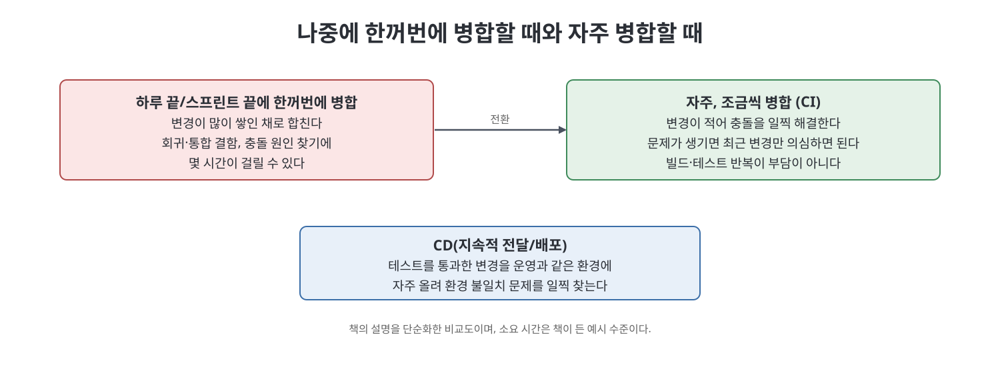
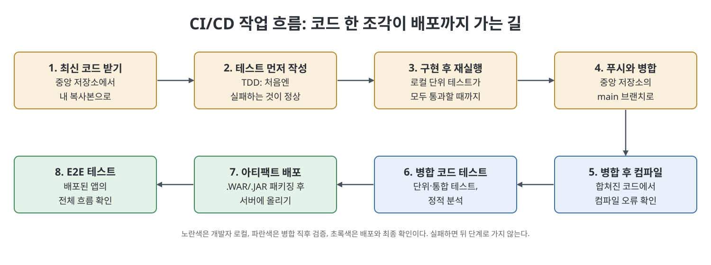

# 1장 CI/CD 이해 (Understanding CI/CD)

이 장은 CI/CD가 실제 개발에서 무엇이고, 왜 애자일 방식의 개발과 잘 맞는지를 설명한다. 애자일에서는 하루에도 여러 개발자가 기능을 끝내고 main 브랜치에 합치는데, 이렇게 한꺼번에 병합하면 회귀 결함, 통합 결함, 병합 충돌이 터지고 원인을 찾는 데 몇 시간씩 걸릴 수 있다. 저자는 이를 해결하는 습관이 지속적 통합(CI)이라고 소개하고, 계산기 웹 앱에 덧셈 기능을 넣는 가상 사례로 전체 흐름을 한 번 훑어 준다.

> **쉽게 말하면**
> 코드를 한꺼번에 합치지 말고 "조금씩, 자주" 합치고 그때마다 자동으로 확인하자는 이야기다.

## 이 장의 흐름

1. 애자일과 스프린트, 그리고 병합의 문제
2. CI의 개발 작업 흐름
3. 지속적 전달/배포가 필요한 이유
4. 계산기 앱 사례로 보는 CI/CD 흐름

## 1. 애자일과 병합 문제

책은 먼저 애자일을 짚는다. 애자일에서는 개발자, 테스터, 비즈니스 분석가가 같은 요구사항 묶음을 동시에 다룬다. 요구사항을 우선순위별로 나눠 한 묶음씩 구현하는 기간이 스프린트이고, 보통 1~3주다. 스프린트가 끝날 때마다 앱에 꽤 많은 기능이 붙는다. 반면 RAD 같은 모델은 사람마다 다른 요구사항을 맡아서, 테스터는 개발자가 끝낸 기능을, 개발자는 분석가가 끝낸 요구사항을 이어받는다고 비교한다.

문제는 하루 동안 여러 사람이 만든 변경을 한 번에 main(GitLab은 보통 master, GitHub는 main)에 합칠 때 생긴다. 이 코드에서 빌드를 만들기 때문에, 합친 순간 터지는 결함이 커진다. 그래서 CI에서는 하루 끝이나 스프린트 끝까지 기다리지 않고 변경을 자주, 적게 합친다. 합치는 양이 적으면 충돌도 일찍 풀고 회귀 결함도 빨리 찾는다.

## 2. CI의 개발 작업 흐름

책이 설명하는 CI의 한 사이클은 다음과 같다.

1. **로컬에서 단위 테스트 실행**: 개발자가 중앙 저장소의 최신 코드를 자기 복사본으로 받아 변경한다. 보통 테스트 주도 개발(TDD)로 진행하며, 작성해 둔 단위 테스트가 모두 통과할 때까지 개발을 이어 간다.
2. **푸시와 병합**: 로컬 작업이 끝나면 중앙 저장소로 푸시해 main에 합친다.
3. **병합 후 컴파일**: 합친 코드를 컴파일해서, 합치다가 새로 생긴 컴파일 오류를 드러낸다.
4. **병합 코드 테스트**: 단위·통합 테스트로 회귀 결함을 찾는다. 일부 CI는 코딩 표준 준수와 죽은 코드 여부를 보는 정적 분석도 같이 돌린다.
5. **아티팩트 배포**: 여러 품질 검사를 통과하면 아티팩트를 만들어 배포 서버에 올린다. 책의 예는 .WAR나 .JAR 파일이다.

> 책의 설명을 따르면 TDD는 코드보다 테스트를 먼저 쓰는 방식이다. 기대 동작을 담은 테스트를 먼저 돌리면 코드가 없으니 당연히 실패하고, 그 뒤에 테스트를 통과시키는 코드를 만든다.

## 3. 지속적 전달/배포

CI에서는 변경을 개발 환경에서 테스트해 실패를 찾는다. 책은 여기서 한 걸음 더 나아가, 개발 환경에서 확인한 변경을 정기 빌드에 계속 포함시키는 일이 중요하다고 말한다. 앱이 개발 환경에서는 멀쩡한데 운영 환경에서만 문제가 생길 수 있기 때문이다. 새 변경이 운영 환경의 하드웨어나 소프트웨어와 맞지 않는 경우가 그 예다. 운영 환경에 자주 배포하지 않으면 이런 문제를 나중에 한꺼번에 만나 디버깅이 악몽이 된다고 저자는 쓴다.

> **참고(노트 작성자)** 이 장은 지속적 전달(Delivery)과 지속적 배포(Deployment)를 엄밀히 구분해 정의하지 않고, 운영 환경 배포를 자주 하자는 취지로만 다룬다. 둘의 차이는 이 책의 이 장에서 정리되지 않으므로 이 노트에서도 구분하지 않는다.

## 4. 사례: 계산기 웹 앱의 덧셈 기능

책의 사례는 덧셈, 뺄셈, 곱셈, 나눗셈을 하는 계산기 웹 앱이다. 덧셈 기능을 추가하는 과정이 위 CI 사이클과 한 줄씩 대응한다.

1. 중앙 저장소의 최신 코드를 로컬로 받는다.
2. 코드를 짜기 전에 단위 테스트를 먼저 쓴다. 예를 들어 `Addition(10,20)`의 결과가 30인지 검사하는 식이다. 아직 함수가 없으니 이 테스트는 실패하며, TDD에서는 이 실패가 정상이다.
3. `Addition(a,b)`가 두 수를 더해 돌려주도록 구현한다. 화면에는 덧셈 버튼도 추가한다.
4. 테스트를 다시 돌리면 통과한다.
5. 코드를 푸시해 병합하고 앱 전체를 컴파일한다.
6. 통합 테스트와 뺄셈, 곱셈 등 다른 기능의 테스트를 돌려, 덧셈 추가가 기존 기능을 깨지 않았는지 확인한다.
7. 웹 앱을 빌드해 톰캣 같은 애플리케이션 서버에 배포한다.
8. Selenium 같은 UI 자동화 도구로 E2E 테스트를 해서 처음부터 끝까지의 흐름을 확인한다.

책은 특정 언어나 테스트 도구를 전제하지 않는다고 못 박는다. 이 장에서는 도구가 아니라 개념과 흐름을 이해하는 것이 목표다.

## 흐름 단계 정리

| 단계 | 하는 일 | 확인하려는 것 |
|------|---------|--------------|
| 로컬 단위 테스트 | 내 복사본에서 개발하며 테스트 통과 | 내 변경이 기대대로 동작하는지 |
| 푸시와 병합 | 중앙 저장소 main에 합침 | 다른 사람의 변경과 합쳐지는지 |
| 병합 후 컴파일 | 합친 코드 전체 컴파일 | 병합으로 생긴 컴파일 오류 |
| 병합 코드 테스트 | 단위·통합 테스트, 정적 분석 | 회귀 결함, 코딩 표준 위반, 죽은 코드 |
| 아티팩트 배포 | .WAR/.JAR로 만들어 서버에 올림 | 실제 사용자용 결과물 |
| E2E 테스트 | UI 자동화로 전체 흐름 점검 | 끝에서 끝까지 동작 |

| 용어 | 뜻 |
|------|-----|
| 스프린트 | 한 묶음의 요구사항을 검토부터 구현까지 마치는 기간(보통 1~3주) |
| 회귀 결함 | 새 변경 때문에 기존 기능이 깨지는 결함 |
| 통합 결함 | 따로 만든 부분을 합칠 때 드러나는 결함 |
| TDD | 테스트를 먼저 쓰고 그 테스트를 통과하도록 코드를 만드는 방식 |
| 아티팩트 | 빌드 결과물. 예: .WAR, .JAR 파일 |

## 핵심 정리

- 애자일에서 여러 개발자의 변경을 한꺼번에 병합하면 회귀·통합 결함과 충돌이 생기고 원인 찾기가 오래 걸린다.
- CI는 변경을 자주, 적게 병합하고 그때마다 컴파일, 테스트, 배포 준비를 수행하는 방식이다.
- 개발 환경에서만 확인하면 운영 환경 문제를 늦게 발견하므로, 환경에 자주 배포하는 습관이 필요하다.
- 계산기 덧셈 사례는 테스트 먼저 작성, 구현, 병합, 컴파일, 통합 테스트, 배포, E2E 순으로 흐른다.

 
 
 

이전: [1부 Readme](Readme.md) | 다음: [2장 Jenkins 소개](02%EC%9E%A5%20Jenkins%20%EC%86%8C%EA%B0%9C.md)

 

[CICD Pipeline Using Jenkins Unleashed](../)
