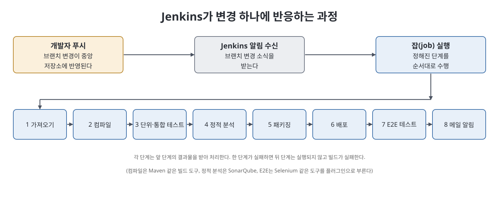

# 2장 Jenkins 소개 (Introducing Jenkins)

이 장은 CI/CD를 자동화해 주는 도구인 Jenkins를 소개한다. CI/CD의 각 단계(소스 가져오기, 컴파일, 테스트, 배포)는 서로 다른 도구를 부르는데, 이 흐름을 하루에 여러 번 사람이 직접 돌리면 개발자와 QA, 지원 엔지니어 모두 부담이 크다. 책은 Jenkins가 이 도구들을 하나로 엮어 정해진 주기로 끝에서 끝까지 실행해 주는 지휘자 역할을 한다고 설명한다. 이어서 Jenkins의 역사, 파이프라인 개념, 그리고 변경 하나가 들어왔을 때 Jenkins가 하는 일을 순서대로 보여 준다.

> **쉽게 말하면**
> 사람이 하던 "가져오기, 빌드, 테스트, 배포, 알림"을 순서대로 자동으로 돌려 주는 서버가 Jenkins다.

## 이 장의 흐름

1. 왜 자동화 서버가 필요한가
2. Jenkins란 무엇이고 어떻게 생겨났나
3. 단계가 이어지는 파이프라인 사고방식
4. Jenkins의 처리 흐름(아키텍처)과 Jenkins 이전과의 차이

## 1. 왜 자동화 서버가 필요한가

CI/CD에서는 작은 변경을 자주 통합하고, 테스트하고, 증분마다 피드백을 준다. 이를 손으로 관리하면 노동이 많이 들고 번거롭고 실수하기 쉽다. 애자일은 증분마다 동작하는 제품을 내놓고 새 기능이 가치를 더했음을 보여 주길 원하는데, 이 철학이 CI/CD와 닮았기 때문에 둘이 잘 맞는다고 책은 말한다.

Jenkins는 여러 플랫폼에서 앱을 빌드하고, 풀 리퀘스트 통합을 자동화하며, Nexus 같은 아티팩트 저장소에 결과물을 올리는 일도 맡는다. 저자의 주장은, 단위·통합 테스트 프레임워크나 테스트 컨테이너만으로는 품질 높은 빌드를 내기 어렵고 이들을 엮어 주는 오케스트레이션이 필요한데, 그 도구가 Jenkins라는 것이다.

## 2. Jenkins란, 그리고 그 역사

Jenkins는 소스 저장소에서 최신 코드를 받아 컴파일하고, 단위 테스트를 돌리고, 여러 형태의 아티팩트로 패키징해서, 여러 환경에 배포하는 단계를 자동화한다. 무료 오픈소스 서버이며 Java로 작성되어 Apache Tomcat 같은 서블릿 컨테이너 안에서 돌아간다. 소프트웨어 개발에 참여하는 다양한 도구 계열을 지원한다.

역사는 이렇게 요약된다.

| 시기 | 사건 |
|------|------|
| 2004 | 선 마이크로시스템즈의 Java 개발자 고스케 가와구치가 빌드가 깨지는 일을 싫어해 커밋 전에 코드가 동작할지 알고 싶어 했고, 그 호기심에서 Hudson이라는 자동화 서버가 나옴 |
| 2011 | 독립 Hudson 오픈소스 커뮤니티와 선을 인수한 오라클 사이에 분쟁이 생겨 포크가 만들어지고 이름이 Jenkins가 됨 |
| 이후 | 한동안 둘이 공존했지만 Jenkins가 더 선호됨 |
| 2020.1 | Hudson 프로젝트 종료. Jenkins는 계속 활발함 |

## 3. 파이프라인: 앞 단계의 결과를 받는 순차 구조

책은 CI/CD를, 아주 작은 변경이라도 코드 수준 테스트부터 실행 파일이나 라이브러리 생성, 운영 배포까지 빌드 수명주기 전체에 태우는 과정이라고 설명한다. 이 수명주기의 단계들은 서로 의존하기 때문에 정해진 순서로 따라가야 소스 코드가 쓸 수 있는 앱이 된다.

Jenkins는 이 단계를 DSL(도메인 특화 언어)로 구현한다. 단계마다 빌드 도구, 정적 분석 도구, 소스 관리 도구 같은 서로 다른 종류의 도구가 필요하고, Jenkins는 이를 위한 방대한 플러그인을 제공한다. Jenkins 스크립트인 **파이프라인**은 각 빌드 단계에서 Jenkins가 할 일과 하위 일을 순서대로 정의한다. 각 단계는 앞 단계의 출력을 받아 자기 일을 하고 다음 단계로 넘긴다. 끝까지 모두 성공하면 사용자가 쓸 빌드가 나온다.

한 단계가 실패하면 그 결과에 의존하는 다음 단계는 실행되지 않고 전체 빌드가 실패한다. 책의 예는 SCM에서 받은 코드의 컴파일이 실패하면, 컴파일된 코드가 필요한 단위 테스트를 이어 갈 이유가 없다는 것이다.

## 4. Jenkins 처리 흐름

책은 전형적인 Jenkins CI/CD 과정을 이렇게 설명한다.

1. 여러 개발자가 각자의 브랜치를 중앙 저장소에 푸시한다. 코드 리뷰 후 이 브랜치들이 다른 브랜치(보통 개발 브랜치)로 병합된다.
2. Jenkins가 해당 브랜치의 변경 알림을 받는다.
3. 알림에 따라 Jenkins가 **잡(job)**을 시작한다. 잡은 빌드 릴리스 수명주기의 단계를 순차로 구현한 일의 묶음이다.

잡에 보통 들어 있는 단계는 다음과 같다.

| 순서 | 단계 | 쓰는 도구 예 |
|:---:|------|-------------|
| 1 | 저장소에서 변경 가져오기 | Git 플러그인 |
| 2 | 컴파일 | Maven과 Maven 플러그인 |
| 3 | 단위·통합 테스트 | 빌드 도구 |
| 4 | 정적 분석(코딩 표준, 죽은 코드) | SonarQube |
| 5 | .JAR/.WAR 등으로 묶기 | 빌드 도구 |
| 6 | 운영/테스트 환경에 배포 | - |
| 7 | 배포된 앱의 E2E 테스트 | Selenium, Protractor 등 |
| 8 | 팀에 이메일로 결과 알림(E2E 보고서 포함) | - |

Jenkins 이전에는 모든 개발자의 변경이 받아들여져 병합되고 빌드가 만들어진 뒤에야 통합 테스트가 이뤄졌고, 통합·E2E 테스트도 아티팩트 대상 코드 전체에 대해 돌렸다. 회귀 테스트에서 버그가 나오면 원인을 찾기 어려웠고, 빌드 오류를 찾아 고치는 데도 시간이 걸려 납품이 늦어졌다.

Jenkins에서는 변경이 단위 테스트를 통과하는 대로 브랜치에 병합되고, 병합 후에는 통합 결함을 검사한다. 배포 단계에서 오류가 나면 마지막 성공 빌드 이후 모든 개발자가 추가한 파일만 확인하면 되고, 통합 테스트가 새 빌드의 버그를 찾아도 이번 빌드에 병합된 변경을 용의자로 보면 된다. 컴파일, 테스트, 배포를 자주 돌리기 때문에 이런 증분 변경이 공식적인 절차가 되었다고 책은 말한다.

## 핵심 개념 비교

| 구분 | Jenkins 이전 | Jenkins 사용 후 |
|------|-------------|----------------|
| 통합 테스트 시점 | 모든 변경이 합쳐지고 빌드가 만들어진 뒤 | 변경이 병합될 때마다 |
| 검사 범위 | 아티팩트가 될 코드 전체 | 마지막 성공 빌드 이후 변경분 |
| 원인 찾기 | 어렵고 시간이 오래 걸림 | 새로 병합된 변경에 집중 |
| 영향 | 납품 지연 | 증분 변경이 일상 절차로 정착 |

| 용어 | 뜻 |
|------|-----|
| 잡(job) | 빌드 수명주기 단계를 순차로 수행하는 일의 묶음 |
| 파이프라인 | 단계와 하위 일의 순서를 정의한 Jenkins 스크립트 |
| 플러그인 | Jenkins가 외부 도구와 연결되게 해 주는 부품 |
| SCM | Git, SVN 같은 소스 코드 관리 도구 |
| 아티팩트 | 빌드 결과물(.JAR, .WAR 등) |

## 핵심 정리

- Jenkins는 가져오기, 컴파일, 테스트, 패키징, 배포를 자동화하는 무료 오픈소스 서버로, Java 기반이며 서블릿 컨테이너에서 돈다.
- 2004년 Hudson에서 출발해 2011년 오라클과의 분쟁으로 포크되어 Jenkins가 되었고, Hudson은 2020년 1월 종료되었다.
- 파이프라인은 단계를 순서대로 잇는 스크립트이며, 한 단계가 실패하면 뒤 단계는 실행되지 않는다.
- 브랜치 변경 알림이 오면 Jenkins가 잡을 실행하고, 결과를 이메일로 알린다.
- 변경이 생길 때마다 검증하므로 문제의 원인이 마지막 성공 빌드 이후의 변경으로 좁혀진다.

 
 
 

이전: [1장 CI·CD 이해](01%EC%9E%A5%20CI%C2%B7CD%20%EC%9D%B4%ED%95%B4.md) | 다음: [3장 Jenkins 설치](03%EC%9E%A5%20Jenkins%20%EC%84%A4%EC%B9%98.md)

 

[CICD Pipeline Using Jenkins Unleashed](../)
