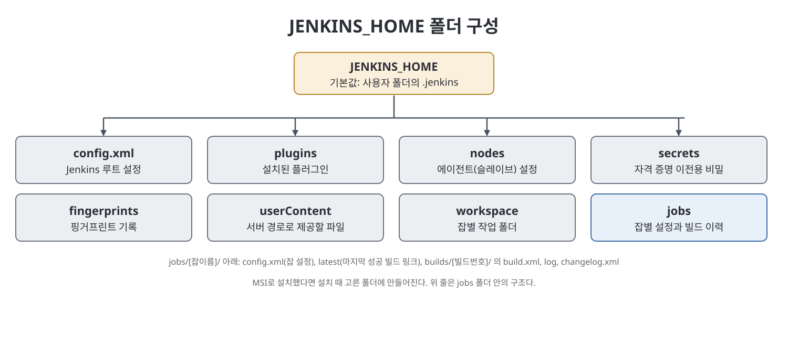

# 3장 Jenkins 설치 (Installing Jenkins)

이 장은 Windows를 중심으로 Jenkins를 설치하는 방법을 다룬다. 필요한 하드웨어와 소프트웨어 사양을 먼저 확인하고, Windows에 설치하는 세 가지 방식(MSI 설치 파일, WAR 파일, Docker 이미지)을 소개한다. 이어서 설치 후 만들어지는 `JENKINS_HOME` 폴더의 구조와, Windows 서비스 설정 파일인 `jenkins.xml`에서 Jenkins가 쓸 Java를 바꾸는 방법을 설명한다. 책은 단계별 설치 절차 자체는 공식 문서 링크로 안내하고, 이 장에서는 선택지와 구조를 정리하는 데 집중한다.

> **쉽게 말하면**
> 어떤 방식으로 깔지 고르고, 깔고 나면 Jenkins가 모든 것을 어느 폴더에 보관하는지를 알아 두는 장이다.

## 이 장의 흐름

1. 최소 사양과 Java 요건
2. Windows에서 설치하는 세 가지 방법
3. JENKINS_HOME의 구성
4. jenkins.xml에서 Java 지정하기

## 1. 최소 사양과 Java 요건

책이 제시하는 최소 하드웨어는 RAM 256MB와 디스크 1GB다. Docker 컨테이너로 돌린다면 10GB를 권장한다. 소프트웨어는 Java가 핵심이다. 책에 따르면 Jenkins가 지원하는 JDK는 JDK 8과 JDK 11뿐이고, JDK 11은 Jenkins 2.164 이후부터 지원된다. 그보다 오래된 Java는 지원하지 않는다.

## 2. 설치 방법 세 가지

| 방식 | 핵심 | 책이 안내하는 것 |
|------|------|-----------------|
| MSI 설치 파일 | 설치 마법사로 Windows에 설치. 설치 폴더는 직접 선택 | jenkins.io의 Windows 설치 안내 페이지 |
| WAR 파일 | Java 웹 앱은 WAR로 묶이는데, Jenkins도 이 WAR 번들로 서버를 띄울 수 있다 | jenkins.io의 war-file 설치 안내 페이지, 책은 2.290 WAR 주소를 예로 듦 |
| Docker 이미지 | 코드와 의존성을 컨테이너라는 배포 단위로 묶는 방식 | jenkins.io의 Docker 설치 안내 페이지 |

Docker에 대해 책은 개념 전체를 다루지 않고 비유 수준으로만 소개한다. 컨테이너는 가볍고, 애플리케이션의 설정도 코드(Infrastructure as Code)로 쓸 수 있다는 정도다.

설치 후 시작하는 방법은 둘로 나뉜다. `java -jar jenkins.war` 형태로 WAR를 직접 실행하거나, Windows 서비스로 등록해 서비스를 시작한다. 4장에서 구체적인 시작 절차를 다룬다.

## 3. JENKINS_HOME: Jenkins의 살림살이

Jenkins는 기본적으로 사용자 홈 폴더(`$user.home`) 아래 `.jenkins` 폴더에 설치된다. MSI로 설치했다면 설치할 때 고른 폴더가 된다. 이 설치 폴더를 `JENKINS_HOME`이라고 부른다. 책이 보여 주는 구조는 아래와 같다.

| 위치 | 담긴 것 |
|------|---------|
| `config.xml` | Jenkins 루트 설정 |
| `*.xml` | 그 밖의 서버 전체 설정 파일 |
| `userContent` | 이 폴더의 파일은 서버의 `/userContent/` 주소로 제공됨 |
| `fingerprints` | 핑거프린트 기록 |
| `nodes` | 슬레이브(에이전트) 설정 |
| `plugins` | 설치된 플러그인 |
| `secrets` | 자격 증명을 다른 서버로 옮길 때 필요한 비밀 |
| `workspace/[JOBNAME]` | 버전 관리 시스템에서 받은 코드를 두는 잡별 작업 디렉터리 |
| `jobs/[JOBNAME]` | 잡별 폴더 |

`jobs/[JOBNAME]` 아래에는 잡 설정 파일 `config.xml`, 마지막 성공 빌드를 가리키는 `latest` 링크, 그리고 `builds/[BUILD_ID]` 폴더가 있다. 각 빌드 폴더에는 결과 요약 `build.xml`, 로그 파일 `log`, 변경 내역 `changelog.xml`이 들어간다.

## 4. jenkins.xml에서 Java 바꾸기

`jenkins.xml`은 `JENKINS_HOME` 폴더 안에 있다. 이 파일의 서비스(`<service>`) 태그 안에는 Jenkins가 쓰는 `java.exe` 위치 같은 중요한 설정이 들어 있다. 기본적으로 Jenkins는 PATH 환경 변수에 잡힌 Java를 사용한다. 책은 환경 변수 편집 창에서 Java가 PATH에 추가된 화면을 보여 준다.

Jenkins가 다른 버전의 Java를 쓰게 하고 싶다면, 원하는 Java 설치 폴더의 `java.exe` 전체 경로를 서비스 태그 안의 `<executable>` 태그에 적으면 된다. 이렇게 하면 PATH의 Java와 무관하게 지정한 Java로 Jenkins가 실행된다.

> **참고(노트 작성자)** 책의 이 부분은 Windows 서비스(`jenkins.xml`) 기준이다. WAR 파일로 직접 띄우는 경우에는 어떤 Java로 실행했는지가 `java -jar` 명령을 입력한 환경에서 정해지는 것으로 이해하면 된다.

## 설치 선택 요약표

| 선택 항목 | 내용 |
|----------|------|
| 하드웨어 | RAM 256MB 이상, 디스크 1GB 이상(Docker는 10GB 권장) |
| Java | JDK 8 또는 JDK 11 |
| 설치 방식 | MSI, WAR, Docker 중 선택 |
| 설정 위치 | `JENKINS_HOME`(기본 `~/.jenkins`) |
| 서비스 설정 | `JENKINS_HOME\jenkins.xml`의 `<executable>`로 Java 지정 |

## 핵심 정리

- 최소 사양은 RAM 256MB와 디스크 1GB이고, 지원 Java는 JDK 8과 JDK 11이다.
- Windows에서는 MSI, WAR, Docker 세 방식으로 설치할 수 있으며 책은 상세 단계를 공식 문서 링크로 안내한다.
- `JENKINS_HOME`에는 설정, 플러그인, 잡, 빌드 로그와 작업 공간이 모두 모인다.
- `jenkins.xml`의 `<executable>`에 `java.exe` 경로를 쓰면 Jenkins가 사용할 Java 버전을 바꿀 수 있다.

 
 
 

이전: [2장 Jenkins 소개](02%EC%9E%A5%20Jenkins%20%EC%86%8C%EA%B0%9C.md) | 다음: [4장 Jenkins 설정](04%EC%9E%A5%20Jenkins%20%EC%84%A4%EC%A0%95.md)

 

[CICD Pipeline Using Jenkins Unleashed](../)
