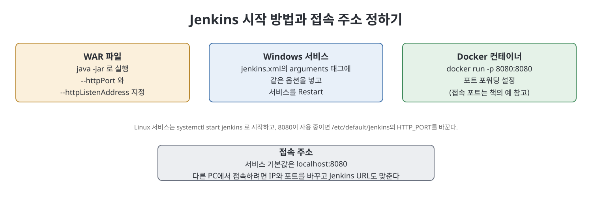
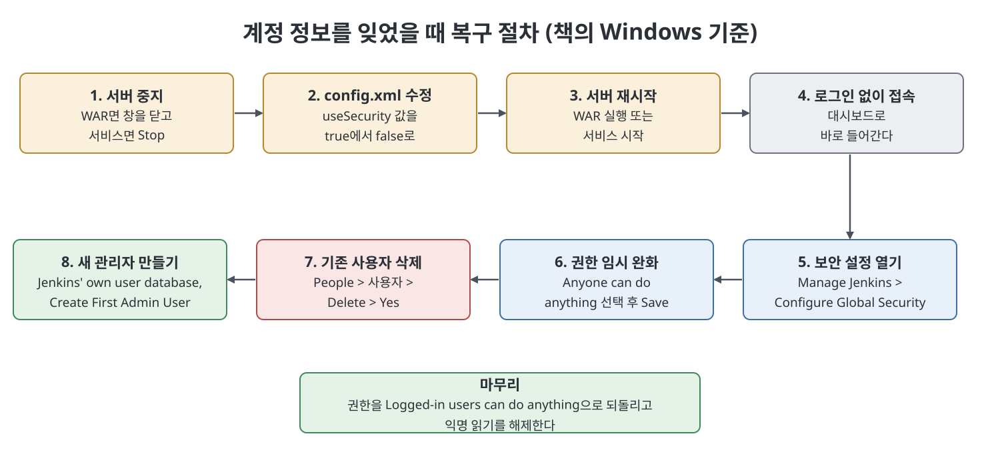

# 4장 Jenkins 설정 (Configuring Jenkins)

이 장은 설치한 Jenkins를 실제로 쓰기 위해 서버를 켜고, 로그인하고, 전역 설정을 살펴보는 방법을 다룬다. WAR 파일, Windows 서비스, Docker 컨테이너, Linux 서비스 각각으로 서버를 시작하는 법과 포트·주소를 바꾸는 법을 먼저 설명한다. 그다음 `Configure System` 화면의 대표 설정 세 가지(홈 디렉터리, Jenkins URL, 관리자 이메일)를 보고, 마지막으로 사용자 이름과 비밀번호를 잊었을 때 복구하는 절차와 새 관리자 계정을 만드는 절차를 단계별로 정리한다. 책은 이 책 전반에서 Jenkins 2.289 버전을 쓴다고 밝힌다.

> **쉽게 말하면**
> 서버를 켜는 방법과 접속 주소를 정하고, 비밀번호를 잊었을 때 어떻게 되살리는지를 익히는 장이다.

## 이 장의 흐름

1. Jenkins 서버 시작 방법
2. 브라우저 접속과 로그인
3. `Configure System`의 주요 설정
4. 사용자 정보 복구와 새 관리자 추가

## 1. 서버 시작 방법

| 방법 | 시작 | 주소·포트 바꾸기 |
|------|------|-----------------|
| WAR 파일(Windows) | 명령 프롬프트에서 `java -jar`로 WAR 실행 | 같은 명령에 `--httpListenAddress=<IP>`와 `--httpPort=<다른 프로세스가 쓰지 않는 포트>`를 붙임 |
| Windows 서비스 | 시작 메뉴에서 `Services`를 열고 Jenkins 항목을 우클릭해 `Start`(비활성이면 이미 실행 중) | `JENKINS_HOME\jenkins.xml`의 `<arguments>` 태그에 위 두 옵션을 추가하고 서비스를 `Restart` |
| Docker 컨테이너 | `docker run -p 8080:8080 --name=...` 형태로 Docker Hub의 Jenkins 이미지를 실행 | `-p 왼쪽:오른쪽`의 포트 포워딩 값 |
| Linux 서비스 | 서비스로 설치한 뒤 `systemctl start`, 상태는 `systemctl status` | `/etc/default/jenkins`의 `HTTP_PORT` 값을 바꾸고 재시작 |

WAR로 띄웠다면 서버가 완전히 올라올 때까지 기다려야 한다. 서비스로 시작하면 기본 주소는 `localhost:8080`이다. 책은 `JENKINS_HOME`이 기본적으로 현재 사용자 폴더 안에 만들어진다고 하면서, 저자의 PC에서는 `C:\magicuser\.jenkins`였다고 예를 든다.

Docker의 `-p 8080:8080`은 포트 포워딩, 즉 한쪽 포트로 들어온 요청을 다른 쪽 포트로 넘기는 설정이다. 접속 주소에 쓸 포트에 대해 책은 콜론 오른쪽에 적은 포트를 쓰라는 예(`8080:8081`이면 8081)를 든다.

> **참고(노트 작성자)** 책의 포트 포워딩 설명은 콜론 양쪽의 역할을 서술한 부분이 모호해서 헷갈릴 수 있다. 이 노트는 어느 쪽이 호스트이고 어느 쪽이 컨테이너인지 단정하지 않는다. 직접 실행할 때는 Docker 공식 문서로 확인하는 편이 안전하다.

## 2. 접속과 로그인

서버가 뜨면 브라우저에 시작할 때 쓴 IP와 포트로 접속해 초기 설정에서 만든 사용자 이름과 비밀번호를 입력하고 `Sign In`을 누른다. Linux에서 WAR로 시작하는 방법은 Windows와 같다고 책은 짧게 덧붙인다. 로그인하면 Jenkins 대시보드가 보인다.

## 3. `Configure System`의 주요 설정

대시보드에서 `Manage Jenkins`를 누르고 `Configure System`을 누르면 `System Configuration` 화면이 열린다. 책이 짚는 설정은 다음 세 가지다.

| 설정 | 설명 |
|------|------|
| `Home directory` | UI에서 편집할 수 없다. Jenkins 관련 파일(잡, 설정 파일 등)이 모이는 곳이며 공간이 부족하거나 접근 권한이 없을 때 위치를 바꿀 수 있다. 바꾼 뒤 옛 위치에 남은 파일은 정리해야 한다 |
| `Jenkins URL` | Jenkins에 접속할 수 있는 주소. 기본은 `http://localhost:8080`이며, 다른 PC에서 접속하려면 PC의 IP 주소로 바꾼다 |
| `System admin e-mail address` | Jenkins가 잡 실행 결과 알림을 보낼 때 보낸 사람(From) 주소로 쓰는 이메일 |

홈 디렉터리 위치를 바꾸는 방법으로 책은 다음을 든다. 어느 방법이든 `JENKINS_HOME` 값을 정하는 것이다.

1. Jenkins 설정 파일의 `JENKINS_HOME` 변수를 편집한다(예: Red Hat 계열 Linux의 `/etc/sysconfig/jenkins`).
2. 웹 컨테이너의 관리 도구로 `JENKINS_HOME` 환경 변수를 설정한다.
3. WAR로 직접 띄우기 전에 운영체제 시스템 환경 변수에 `JENKINS_HOME`을 설정한다.
4. 웹 컨테이너나 WAR를 시작할 때 `JENKINS_HOME` Java 시스템 속성을 지정한다.
5. `jenkins.war` 안의 `web.xml`을 수정한다. 책은 이 방법을 권장하지 않는다.

## 4. 사용자 이름과 비밀번호를 잊었을 때

책이 Windows 기준으로 설명하는 복구 절차는 보안을 잠시 끄고 들어가서 사용자를 지운 뒤 다시 만드는 방식이다.

1. Jenkins 서버를 멈춘다. WAR로 실행 중이면 명령 프롬프트 창을 닫고, 서비스라면 `Services`에서 `Stop`을 선택한다.
2. `JENKINS_HOME`의 `config.xml`을 열어 `useSecurity` 태그 값을 기본값 `true`에서 `false`로 바꿔 저장한다. MSI로 설치했다면 `JENKINS_HOME`은 `C:\System32\Config\SystemProfile\AppData\Local\Jenkins\.jenkins` 아래라고 책은 안내한다.
3. 서버를 다시 시작한다(WAR 실행 또는 서비스 시작).
4. 브라우저로 접속하면 로그인 없이 바로 대시보드로 들어간다. 처음이 아니라면 기존 잡이 보일 수 있다.
5. `Manage Jenkins`를 누른다.
6. `Configure Global Security`를 연다.
7. `Authorization` 영역에서 `Anyone can do anything`을 선택한다.
8. `Save`를 누른다.
9. 왼쪽의 `People`을 눌러 사용자 목록으로 간다.
10. 비밀번호를 잊은 사용자 항목을 누른다.
11. 왼쪽의 `Delete` 링크를 누른다.
12. `Yes`로 삭제를 확정한다.

### 새 관리자 추가

사용자를 지운 뒤에는 새 관리자를 만든다.

1. `Manage Jenkins`, `Configure Global Security`로 가서 `Security Realm`에서 `Jenkins' own user database`를 선택한다.
2. `Authorization`에서 `Logged-in users can do anything`을 선택하고 `Allow anonymous read access`의 체크를 해제한 뒤 `Save`를 누른다.
3. `Create First Admin User` 화면에 관리자 정보를 입력하고 `Create First Admin User` 버튼을 누른다.

이렇게 새 관리자 계정이 만들어진다. 복구 중에 열어 둔 `Anyone can do anything` 상태를 위 2번에서 `Logged-in users can do anything`으로 바꿔 닫는 셈이다.

## 핵심 정리

- Jenkins는 WAR 실행, Windows 서비스, Docker, Linux 서비스로 시작할 수 있고 포트·주소는 시작 방식마다 다른 곳에서 바꾼다.
- `Configure System`에서 홈 디렉터리(읽기 전용), Jenkins URL, 관리자 이메일을 확인한다.
- 비밀번호 복구는 `config.xml`의 `useSecurity`를 false로 바꿔 보안을 끄고 들어가 사용자를 지운 뒤 새 관리자를 만드는 절차다.
- 복구 뒤에는 인증 영역을 `Logged-in users can do anything`으로 바꾸고 익명 읽기를 끈다.

 
 
 

이전: [3장 Jenkins 설치](03%EC%9E%A5%20Jenkins%20%EC%84%A4%EC%B9%98.md) | 다음: [5장 플러그인 관리](05%EC%9E%A5%20%ED%94%8C%EB%9F%AC%EA%B7%B8%EC%9D%B8%20%EA%B4%80%EB%A6%AC.md)

 

[CICD Pipeline Using Jenkins Unleashed](../)
