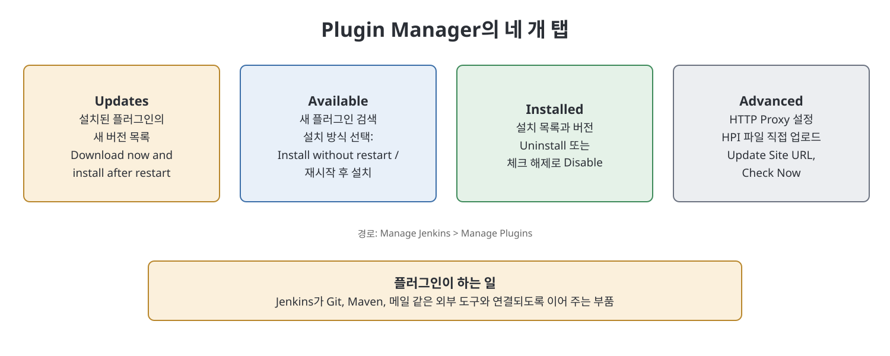
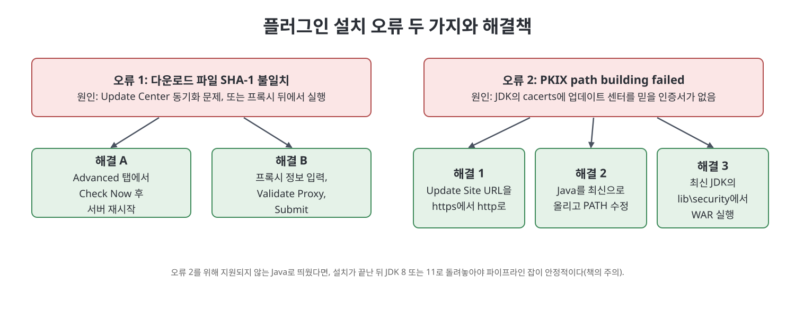

# 5장 플러그인 관리 (Managing Plugins in Jenkins)

이 장은 Jenkins가 외부 도구와 연결되는 통로인 플러그인을 다룬다. 빌드 수명주기에는 소스 관리, 테스트, 빌드 도구 등 다양한 도구가 끼어드는데, Jenkins는 플러그인을 통해 이들과 이어진다. 책은 플러그인이 무엇인지, 자주 쓰는 플러그인은 무엇인지, `Plugin Manager`의 네 개 탭은 각각 무슨 일을 하는지, 그리고 설치 중 자주 만나는 오류 두 가지와 해결책을 차례로 정리한다.

> **쉽게 말하면**
> 플러그인은 Jenkins에 끼우는 부품이고, `Plugin Manager`는 그 부품을 설치·갱신·삭제하는 창구다.

## 이 장의 흐름

1. 플러그인이란 무엇이고 어떤 것을 많이 쓰나
2. `Plugin Manager` 열기와 네 개 탭
3. 프록시 환경과 특정 버전 수동 설치
4. 설치 오류 두 가지와 해결

## 1. 플러그인과 자주 쓰는 플러그인

플러그인은 기존 프로그램에 특정 기능을 더해 주는 소프트웨어 구성요소다. Jenkins 팀이 Jenkins 사용을 맞춤화하도록 만든 플러그인이 여러 가지 있다. 책이 꼽는 대표 플러그인은 다음과 같다.

| 플러그인 | 연결하는 도구 | 설명 |
|----------|--------------|------|
| `Git` | Git 버전 관리 시스템 | 여러 개발자가 코드를 함께 다루게 해 주는 분산 버전 관리와 연동(10, 12장에서 자세히) |
| `Maven Integration` | Maven 빌드 도구 | 컴파일, 패키징, 테스트 같은 빌드 단계를 자동화하는 도구와 연동 |
| `Email Extension` | 이메일 알림 | 현재 빌드 상태 알림을 맞춤화하고 더 많은 내용을 담음 |

## 2. Plugin Manager 열기

1. Jenkins에 로그인해 대시보드를 본다.
2. `Manage Jenkins`를 누른다.
3. `Manage Plugins`를 누르면 `Plugin Manager` 화면이 열린다.

화면 위쪽에는 `Updates`, `Available`, `Installed`, `Advanced` 네 개 탭이 있다.

### Updates 탭

설치된 플러그인 중 새 버전이 있는 것을 보여 준다. 갱신하려는 항목을 체크하고 `Download now and install after restart` 버튼을 누른다.

### Available 탭

설치할 수 있는 플러그인 목록이다. `Search` 칸에 이름(예: JUnit)을 넣어 찾고 체크박스를 선택한다. 설치 버튼은 두 가지다.

| 버튼 | 동작 |
|------|------|
| `Install without restart` | 다운로드 후 바로 설치. 상태가 초록색 `Success`가 되면 사용할 수 있다. 인터넷 속도에 따라 시간이 걸린다 |
| `Download now and install after restart` | 일단 내려받기만 하고, Jenkins 서버를 재시작할 때 설치된다 |

### Installed 탭

설치된 모든 플러그인과 버전을 보여 준다. 삭제하려면 이름으로 검색해 체크하고 `Uninstall`을 누른다. `JENKINS_HOME/plugins` 폴더에서 해당 .HPI 파일을 지워도 삭제된다. 플러그인을 은퇴시키는 또 다른 방법은 비활성화(disable)다. 이 경우 Jenkins는 플러그인을 설치된 것으로 보지만 실행하지 않고, 플러그인이 더한 확장도 보이지 않는다. 비활성화는 이 탭에서 해당 체크박스를 해제해 한다.

### Advanced 탭

인터넷이 프록시 서버를 통하는 조직에서는 Jenkins가 잡을 돌릴 때 외부로 직접 나가지 못한다. 예컨대 gitlab.com에서 소스를 받는 일이나 Update Center에서 플러그인을 받는 일이 막힌다. 이럴 때 IT 부서에서 프록시 정보를 받아 `HTTP Proxy Configuration` 영역에 입력한다.

| 필드 | 입력할 것 |
|------|----------|
| `Server` | 프록시 서버 IP |
| `Port` | 프록시 서버 포트 |
| `Username` | 프록시에 인증이 있을 때만 사용자 이름. 없으면 비움 |
| `Password` | 프록시에 인증이 있을 때만 비밀번호. 없으면 비움 |
| `No Proxy Host` | 프록시를 거치지 않고 직접 접근할 서버의 IP나 호스트 패턴 |

입력을 마치면 `Submit`을 누른다.

Update Center로는 플러그인의 최신 릴리스만 설치할 수 있다. 특정 버전이 필요하면 해당 버전의 .HPI 파일을 내려받아 `Upload Plugin` 영역에서 직접 올린다. 순서는 .HPI 파일 내려받기, `Choose File`로 파일 선택, `Upload` 클릭이다. 플러그인을 내려받는 Update Center 주소는 `Update Site` 영역의 URL 칸에 표시된다.

## 3. 설치 오류 두 가지

### 오류 1: 다운로드한 파일의 SHA-1이 맞지 않음

플러그인 설치가 `Downloaded file ... does not match expected SHA-1` 형태의 IOException으로 실패한다. 책이 드는 원인은 두 가지다. Jenkins와 Update Center의 동기화가 되어 있지 않거나, 프록시 뒤의 머신에서 Jenkins를 돌리고 있는 경우다.

- 동기화 문제 해결: `Manage Jenkins > Manage Plugins`의 `Advanced` 탭에서 아래쪽 `Update Site` 영역의 `Check Now`를 누른다. 서버를 재시작하고 다시 설치한다.
- 프록시 문제 해결: `Advanced` 탭에서 프록시 정보를 입력한다(인증이 없으면 사용자·비밀번호는 비움). 고급 설정에서 `Test URL`에 Update Center 주소를 넣고 `Validate Proxy`를 눌러 확인한 뒤 `Submit`을 누른다. 다시 설치하고, 실패하면 서버를 재시작해서 다시 시도한다.

### 오류 2: PKIX path building failed (SSL 핸드셰이크 예외)

`unable to find valid certification path to requested target` 메시지가 나오는 경우다. 책의 원인 설명은 이렇다. Update Center URL은 기본이 HTTPS인데, Jenkins를 띄우는 JDK의 신뢰 인증서 모음(`lib\security`의 `cacerts`)에 이 사이트를 믿게 해 줄 인증서가 없다는 것이다. 오래된 Java로 서버를 띄웠을 때 생길 수 있다.

| 해결책 | 방법 |
|--------|------|
| 1. URL을 http로 변경 | `Advanced` 탭 맨 아래 `Update Site`에서 `https://updates.jenkins.io/update-center.json`을 `http://...`로 바꾸고 `Submit` |
| 2. Java 최신화 | 최신 Java를 설치하고 그 `bin` 폴더를 PATH에 넣은 뒤 서버를 재시작 |
| 3. 최신 JDK 폴더에서 WAR 실행 | 최신 JDK를 설치하고, 명령 프롬프트의 작업 폴더를 그 JDK의 `lib\security`로 옮긴 뒤 거기서 jenkins.war를 실행 |

세 해결책에 대한 책의 보충은 다음과 같다.

- JDK 8, 11이 아닌 버전으로 올렸다면 WAR 실행 시 `--enable-future-java` 플래그를 붙여야 한다(책의 예: `java -jar D:\Jenkins\Jenkins.war --enable-future-java`).
- 해결책 3은 다른 프로그램이 특정 Java 버전을 요구해서 PATH를 최신 Java로 바꿀 수 없을 때 쓴다.
- 오류 2를 풀려고 최신 Java로 Jenkins를 띄웠다면, 플러그인 설치가 끝난 뒤 지원 버전(JDK 8 또는 11)으로 되돌려야 한다. 지원하지 않는 버전을 계속 쓰면 파이프라인 잡을 돌릴 때 오류를 만난다고 책은 경고한다.

## 탭 비교표

| 탭 | 한 줄 역할 |
|----|-----------|
| `Updates` | 설치된 것의 새 버전을 갱신 |
| `Available` | 새 플러그인을 검색해 설치 |
| `Installed` | 설치 현황 확인, 삭제, 비활성화 |
| `Advanced` | 프록시, 수동 업로드, Update Site 설정 |

## 핵심 정리

- 플러그인은 Jenkins가 Git, Maven, 이메일 등 외부 도구와 연동되게 하는 부품이다.
- `Plugin Manager`는 `Updates`, `Available`, `Installed`, `Advanced` 네 탭으로 구성된다.
- `Install without restart`는 즉시 설치, `Download now and install after restart`는 재시작 때 설치한다.
- 프록시 환경에서는 `Advanced` 탭에서 프록시를 설정해야 하고, 특정 버전은 .HPI 파일을 직접 업로드한다.
- 설치 오류는 `Check Now`와 프록시 설정(SHA-1), http 전환·Java 최신화·최신 JDK에서 실행(PKIX)으로 푼다. 지원되지 않는 Java는 설치 후 JDK 8/11로 되돌린다.

 
 
 

이전: [4장 Jenkins 설정](04%EC%9E%A5%20Jenkins%20%EC%84%A4%EC%A0%95.md) | 다음: [6장 전역 도구 설정](06%EC%9E%A5%20%EC%A0%84%EC%97%AD%20%EB%8F%84%EA%B5%AC%20%EC%84%A4%EC%A0%95.md)

 

[CICD Pipeline Using Jenkins Unleashed](../)
