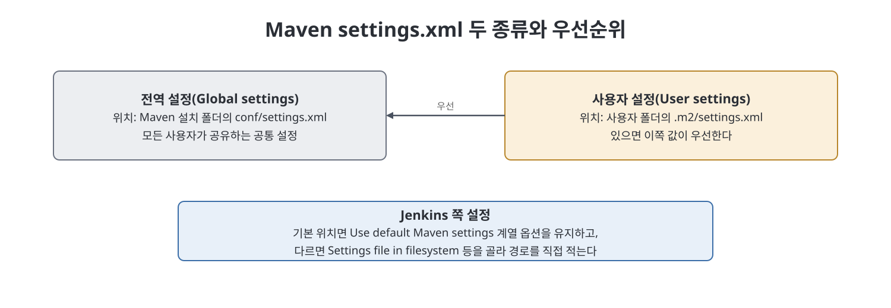
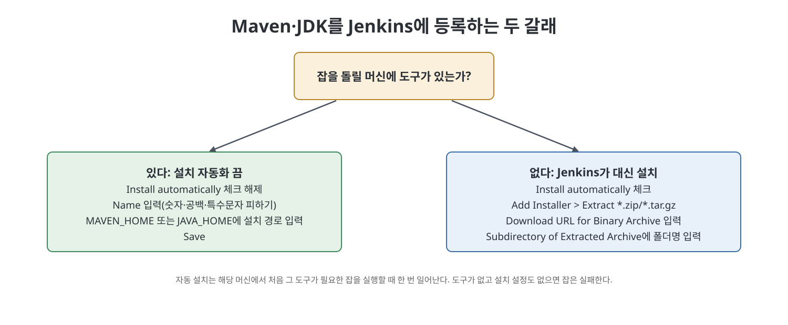

# 6장 전역 도구 설정 (Understanding the Global Tool Configuration Page)

이 장은 Jenkins 잡이 쓸 도구, 그중에서도 Maven과 JDK를 `Global Tool Configuration` 화면에서 등록하는 방법을 다룬다. Maven은 설정 파일 두 종류(전역·사용자 `settings.xml`)가 있어서 Jenkins에 그 위치를 알려 줘야 하고, Maven 설치 자체는 이미 깔려 있는 경로를 알려 주는 방식과 Jenkins가 자동으로 내려받아 설치하게 하는 방식 중 고를 수 있다. JDK도 같은 원리다. 이 장의 마지막 문장이 요점이다. 잡이 필요로 하는 도구가 실행 머신에 없으면 그 잡은 실패하고, 설치기(installer) 설정으로 Jenkins가 대신 깔 수 있다.

> **쉽게 말하면**
> "Maven과 Java가 어디 있는지, 없으면 어디서 받아 깔지"를 Jenkins에 미리 적어 두는 장이다.

## 이 장의 흐름

1. 전역 도구 설정 화면 열기
2. Maven 설정 파일 두 종류
3. Maven 설치 정보 등록 (이미 설치됨 / 자동 설치)
4. JDK 설정

## 1. 화면 열기

1. Jenkins에 로그인해 대시보드를 본다.
2. `Manage Jenkins`를 누른다.
3. `Global Tool Configuration`을 누른다.

Gradle, Git 같은 다른 타사 도구용 플러그인을 설치했다면 해당 도구의 설정 항목도 이 화면에 보인다고 책은 말한다.

## 2. Maven의 설정 파일 두 종류

Maven은 Java 앱의 컴파일, 패키징, 배포 같은 빌드 단계를 자동화하는 명령줄 빌드 도구이며, 여러 플러그인을 통해 일을 한다. 책은 11장에서 Maven을 자세히 다룬다고 안내한다. Maven은 두 개의 `settings.xml`로 설정한다.

| 구분 | 이름 | 기본 위치 | 용도 |
|------|------|----------|------|
| Maven 설치 쪽 | 전역 설정(global settings) | `${maven.home}\conf\settings.xml` (maven.home은 Maven 설치 폴더) | 모든 사용자 프로필이 공유하는 공통 설정 |
| 사용자 쪽 | 사용자 설정(user settings) | `{user.home}/.m2/settings.xml` | 같은 PC의 사용자마다 따로 유지하려는 설정 |

사용자 쪽 파일은 반드시 있어야 하는 것은 아니다. 없으면 필요한 설정은 Maven 설치 쪽 `settings.xml`에서 가져온다. 같은 설정이 두 파일에 모두 있으면 `{user.home}/.m2/settings.xml`의 값이 우선한다.

### Jenkins에 파일 위치 알리기

Jenkins는 두 파일의 위치를 알아야 한다. 기본 위치에 있다면 `Default Settings Provider`에서 `Use default maven settings`를, `Default Global Settings Provider`에서 `Use default maven global settings`를 그대로 둔다. 다른 위치에 있다면 `Default Settings Provider` 드롭다운에서 `Settings file in filesystem`을, `Default Global Settings Provider`에서 `Global settings file on filesystem`을 고르고 각각 파일 경로를 적는다.

## 3. Maven 설치 정보 등록

`Add Maven` 버튼을 누르면 `Maven installations` 영역이 열린다. `Name`에는 이 Maven 설정의 이름을 적는다. 숫자, 공백, 특수문자는 쓰지 말라고 책은 당부한다. 파이프라인이 이 이름으로 Maven을 가리키기 때문이다(파이프라인은 14장).

### 경우 1: 실행 머신에 Maven이 이미 설치됨

1. `Install automatically` 체크를 해제한다.
2. `MAVEN_HOME`에 Maven 설치 폴더 경로를 입력한다.
3. `Save`를 누른다.

### 경우 2: Maven이 없어서 Jenkins가 설치하게 함

Jenkins는 Maven이 없는 머신에서 잡을 처음 실행할 때 한 번만 설치한다.

1. `Install automatically`를 체크한다.
2. `Add Installer` 드롭다운에서 `Extract *.zip/*.tar.gz`를 고른다.
3. `Download URL for Binary Archive`에 Maven 사이트의 압축 파일(예: 책의 예는 apache-maven-3.8.x-bin.zip) 주소를 입력한다.
4. `Subdirectory of Extracted Archive`에는 압축을 풀었을 때 Maven이 들어 있는 폴더 이름을 적는다. 책의 예는 `apache-maven-3.8.1`이며, 그러면 Jenkins가 이 폴더를 Maven 설치 위치로 보고 `bin` 폴더 안의 `mvn` 명령을 쓴다.
5. 화면의 `Save`를 누른다.

> **참고(노트 작성자)** 책의 본문과 그림에서 Maven 버전(3.8.1과 3.8.2)이 섞여 나온다. 요점은 다운로드 URL의 압축 파일 이름과 `Subdirectory of Extracted Archive` 값이 서로 맞아야 한다는 것이다. 이 노트는 특정 버전 번호를 따라 하라고 권하지 않는다.

## 4. JDK 설정

`Add JDK`를 누른다. 머신에 Java가 이미 있으면 `Install automatically`(책 본문 한 곳은 Installed Automatically로 표기) 체크를 해제하고, `Name`에 알맞은 이름을, `JAVA_HOME`에 Java 설치 폴더의 절대 경로를 입력한다. JDK가 없고 필요할 때 Jenkins가 설치하게 하고 싶다면 자동 설치를 체크하고 앞서 Maven에서 설명한 방식대로 설치기를 설정한다.

## 설정 항목 정리

| 대상 | 핵심 입력 | 설치된 경우 | 설치 안 된 경우 |
|------|----------|-------------|-----------------|
| Maven | `Name`, `MAVEN_HOME` | 자동 설치 해제, 설치 경로 입력 | 자동 설치 체크, `Add Installer`에서 압축 파일 URL과 폴더명 입력 |
| JDK | `Name`, `JAVA_HOME` | 자동 설치 해제, 절대 경로 입력 | 자동 설치 체크, 설치기 설정 |
| Maven settings | `Default Settings Provider` 두 가지 | 기본 위치면 default 옵션 유지 | 다른 위치면 파일 경로 직접 지정 |

## 핵심 정리

- `Global Tool Configuration`에서 Maven, JDK 등 잡이 쓸 도구의 위치와 설치 방식을 등록한다.
- Maven은 전역·사용자 `settings.xml` 두 종류가 있고, 둘에 같은 설정이 있으면 사용자 쪽이 우선한다.
- 도구가 이미 있으면 `Install automatically`를 끄고 `MAVEN_HOME`/`JAVA_HOME`에 경로를 적는다.
- 도구가 없으면 설치기를 설정해 Jenkins가 처음 필요할 때 내려받아 풀게 한다. 필요한 도구가 없고 설치기 설정도 없으면 잡은 실패한다.
- Maven 설정의 `Name`에는 숫자, 공백, 특수문자를 쓰지 않는다. 파이프라인이 이 이름으로 가리킨다.

 
 
 

이전: [5장 플러그인 관리](05%EC%9E%A5%20%ED%94%8C%EB%9F%AC%EA%B7%B8%EC%9D%B8%20%EA%B4%80%EB%A6%AC.md) | 다음: [핵심 정리](%ED%95%B5%EC%8B%AC%20%EC%A0%95%EB%A6%AC.md)

 

[CICD Pipeline Using Jenkins Unleashed](../)
