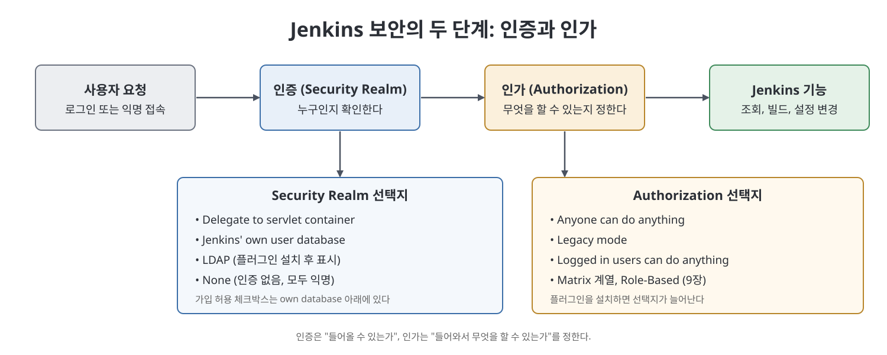
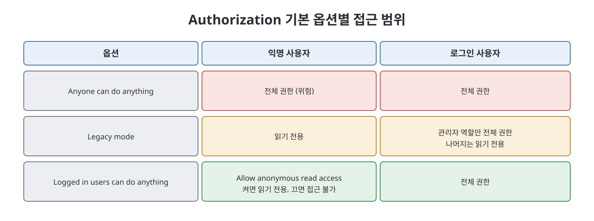

# 7장 보안 관리 (Managing Security with Jenkins)

이 장은 Jenkins의 `Configure Global Security` 화면에 있는 설정들을 위에서 아래로 훑으며, 인증(authentication)과 인가(authorization)를 어떻게 정하는지 설명한다. 저자는 인증을 "유효한 사용자는 들어오고 아닌 사용자는 막는 것", 인가를 "관리자와 일반 사용자처럼 사용자 종류별로 허용 범위를 나누는 것"이라고 짧게 구분한다. 장 후반에는 사용자 계정을 Jenkins 바깥의 디렉터리(LDAP)에서 가져와야 하는 이유와 연동 절차의 큰 줄기가 나온다.

> **쉽게 말하면**
> Jenkins의 출입문 설정 장이다. "누가 들어올 수 있나(인증)"와 "들어와서 무엇을 할 수 있나(인가)"를 한 화면에서 정한다.

## 이 장의 흐름

1. 보안 설정 화면 열기와 로그인 관련 설정
2. 사용자 목록을 어디서 가져올지 고르는 Security Realm
3. 권한 범위를 고르는 Authorization
4. 에이전트 포트, CSRF, API 토큰, SSH 서버
5. LDAP을 연동해야 하는 이유와 설정 개요

## 1. 보안 설정 화면과 로그인 옵션

화면은 `Manage Jenkins`의 Security 영역에 있는 `Configure Global Security`다. 먼저 `Disable remember me`가 나온다. 기본은 해제 상태여서 로그인 화면에 `Keep Me Signed In` 체크박스가 보이고, 이를 선택하면 브라우저를 로그아웃 없이 닫아도 다시 로그인을 요구하지 않는다. 이 옵션을 체크하면 그 체크박스 자체가 로그인 화면에서 사라진다.

## 2. Security Realm: 사용자는 어디서 오나

Security Realm은 "로그인 정보를 어디에서 확인할지"를 고르는 항목이다.

| 선택지 | 의미 | 메모 |
|--------|------|------|
| `Delegate to servlet container` | Jenkins가 올라간 서블릿 컨테이너(기본은 Jetty, Tomcat 등)에 설정된 사용자를 그대로 쓴다 | 컨테이너 쪽 사용자 설정이 있을 때 사용 |
| `Jenkins' own user database` | Jenkins가 자체 DB에 사용자를 만들고 관리한다 | 외부 시스템에 의존하고 싶지 않을 때 |
| `LDAP` | 조직의 디렉터리에 있는 사용자 정보로 로그인한다 | 플러그인을 설치해야 표시된다 |
| `None` | 인증을 아예 요구하지 않고 모두 익명으로 본다 | 아래 설명 참조 |

자체 DB를 쓰면 `Manage Jenkins` > `Manage Users` > `Create User`에서 사용자명, 비밀번호, 비밀번호 확인, 이름, 이메일을 넣어 계정을 만든다. 이 옵션 아래에 `Allow users to sign up`이 있는데 기본은 해제다. 켜면 로그인 화면에 `Create an Account` 링크가 생겨 누구나 스스로 계정을 만들 수 있다. 저자는 같은 서버 도메인의 누구든 인증된 사용자가 될 수 있으므로 켜 두지 말라고 권한다.

`None`을 고르고 접속하면 서버 로그에 "anonymous is missing the Overall/Read permission" 오류가 남는다. 익명에게 읽기를 열려면 `$Jenkins_Home`의 `config.xml`에서 `<denyAnonymousReadAccess>` 값을 `true`에서 `false`로 바꾸고 서버를 재시작한다. 그러면 인증 없이 대시보드로 들어가지만 읽기 전용이다.

## 3. Authorization: 무엇을 할 수 있나

이 장에서 다루는 Authorization 기본 옵션은 세 가지다.

| 옵션 | 동작 | 저자의 평가 |
|------|------|-------------|
| `Anyone can do anything` | 로그인하지 않은 익명 사용자까지 모든 권한을 가진다 | 신뢰된 사내망에서 빠른 변경용으로 쓸 수는 있으나 일반적으로 비권장 |
| `Legacy mode` | 관리자 역할은 전체 권한, 익명을 포함한 나머지는 읽기 전용. 1.164 이전 Jenkins의 기본 동작 | 비권장 |
| `Logged in users can do anything` | 반드시 로그인해야 하고, 로그인한 사용자는 전체 권한 | 하위 옵션으로 익명 읽기 허용 여부를 정한다 |

`Logged in users can do anything` 아래의 `Allow anonymous read access`를 켜면 익명 사용자가 읽기 전용으로 접근하고, 끄면 익명 사용자는 접근할 수 없으며 Figure 7-5의 화면(접근 불가 안내)을 만난다.

더 세밀한 Matrix 계열과 Role-Based 전략은 9장에서 다룬다.

## 4. 에이전트, CSRF, API 토큰, SSH

**TCP port for inbound agents** 는 분산 빌드(17장)에서 Jenkins 컨트롤러가 에이전트 머신과 통신할 포트를 정한다. `Random`은 쓰이지 않는 포트를 동적으로 고르고, `Fixed`는 직접 포트 번호를 적는다. 저자는 방화벽의 인바운드 규칙에 포트를 등록해야 하므로 보통 `Fixed`를 선호한다고 설명한다. 매번 바뀌는 임의 포트에는 규칙을 만들기 어렵다. 방화벽 제약이 없다면 `Random`도 된다. 분산 빌드를 쓰지 않는다면 `Disable`을 고른다.

**CSRF protection** 은 사이트 간 요청 위조를 막는 장치다. Jenkins가 사용자 정보로 토큰(crumb)을 만들어 보내고, 빌드 설정 변경처럼 무언가를 수정하는 요청에는 이 토큰이 있어야 한다. 다른 사용자의 토큰으로 낸 요청은 거부된다. crumb은 사용자명, 웹 세션 ID, 사용자 IP, 그리고 Jenkins 인스턴스 고유의 salt를 바탕으로 만든 해시다.

**API Token** 은 REST API나 CLI로 Jenkins에 접근할 때의 인증 설정이다. `Generate a Legacy API Token for Each Newly Created User`를 켜면 새 사용자마다 토큰이 자동 생성되고, `Allow Users to Manually Create a Legacy API Token`을 켜면 사용자가 직접 만든다. 두 옵션 모두 2.129 이후 버전에서는 deprecated이며, 새 방식의 API 토큰은 19장과 20장에서 다룬다고 한다. `Agent > Controller security`는 17장에서 설명한다고만 짚고 넘어간다.

**SSH Server** 는 Jenkins CLI를 셸 프로그램으로 호출해 작업 생성이나 빌드 실행을 자동화할 때, Jenkins가 SSH 서버 역할을 하게 하는 설정이다(CLI는 20장). 포트 선택 방식은 에이전트 포트와 같다. `Random`은 임의 포트이고 `Fixed`는 지정 포트이며, 방화벽 규칙을 만들기 쉬운 `Fixed`가 선호된다. CLI로 접근할 계획이 없으면 `Disable`이 낫다고 한다.

## 5. LDAP 연동

LDAP(Lightweight Directory Access Protocol)은 조직·사람·파일 같은 자원 정보를 찾는 프로토콜이며, 흔한 용도는 사용자명과 비밀번호를 한곳에 두는 중앙 인증이다.

저자가 드는 시나리오는 이렇다. 도메인 사용자는 빌드 서버에 접근 권한이 있지만, Jenkins가 설치된 머신의 운영체제 사용자는 그 서버에 권한이 없다. Jenkins 작업은 운영체제의 로그인 사용자 권한으로 실행되므로, 배포 작업이 빌드 서버에 접근하지 못한다. LDAP으로 도메인 사용자 정보를 연동해 두면 자기 도메인 계정으로 Jenkins에 로그인할 수 있고, Authorize Project 플러그인을 쓰면 빌드를 실행한 사용자의 권한으로 작업을 돌리게 할 수 있다. 이 플러그인의 사용법은 책에서 다루지 않는다.

설정 절차의 뼈대는 다음과 같다.

1. `Manage Jenkins` > `Manage Plugins` > `Available` 탭에서 `LDAP`을 검색한다.
2. 체크하고 `Install Without Restart`를 눌러 성공 표시를 확인한다.
3. `Manage Jenkins` > `Configure Global Security`의 Security Realm에서 `LDAP` 라디오 버튼을 선택한다.
4. 세부 값은 조직의 IT 부서와 상의해 채운다. 책도 구체 값은 IT 부서에 문의하라는 정도로 맺는다.

## 핵심 정리

- 인증은 "누구인가", 인가는 "무엇을 할 수 있는가"이며 둘 다 `Configure Global Security`에서 정한다.
- 사용자 출처는 Security Realm으로 고르고, 자체 DB의 `Allow users to sign up`은 켜 두지 않는 것이 권장된다.
- 익명 사용자에게 읽기를 허용하는 방법은 Authorization 옵션이나 `config.xml`의 `denyAnonymousReadAccess` 값에 따라 달라진다.
- 에이전트와 SSH 포트는 방화벽 규칙을 만들기 쉬운 `Fixed`가 선호되고, 쓰지 않으면 `Disable`로 둔다.
- CSRF는 crumb 토큰으로, 레거시 API 토큰 옵션은 2.129 이후 deprecated다.
- LDAP은 도메인 계정으로 로그인해야 하는 환경에서 쓰며 플러그인 설치 후 Security Realm에서 선택한다.

> **참고(노트 작성자)** 책의 화면은 2021년경 Jenkins 기준이다. 이후 버전에서는 메뉴 위치나 이름이 다를 수 있다.

 
 
 

이전: [2부 Readme](Readme.md) | 다음: [8장 자격 증명 관리](08%EC%9E%A5%20%EC%9E%90%EA%B2%A9%20%EC%A6%9D%EB%AA%85%20%EA%B4%80%EB%A6%AC.md)

 

[CICD Pipeline Using Jenkins Unleashed](../)
