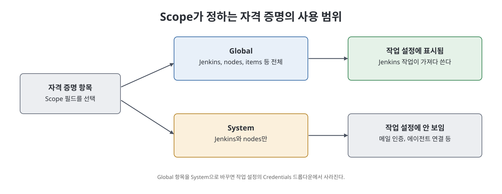
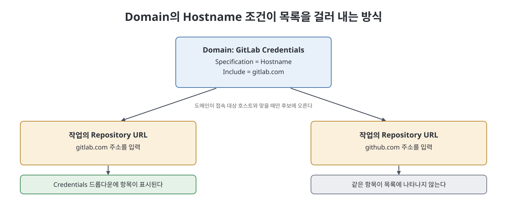
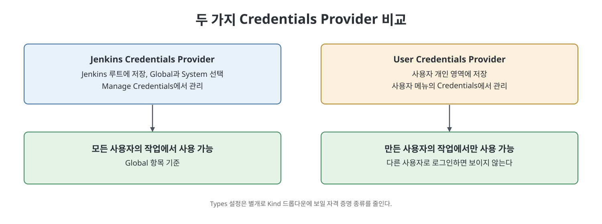

# 8장 자격 증명 관리 (Managing Credentials)

Jenkins는 CI/CD를 수행하느라 Nexus 같은 아티팩트 저장소, Git 같은 코드 저장소와 계속 통신한다. 이런 도구는 각자 인증 방식을 요구하는데, 저자는 사용자명과 비밀번호를 쓰는 기본(basic) 인증, 개인 키와 공개 키를 맞춰 보는 SSH 인증, 요청에 토큰을 실어 보내는 API 토큰 인증을 대표로 든다. 이 장은 Jenkins가 그 인증 정보를 안전하게 보관하고 작업에서 꺼내 쓰는 방법, 곧 자격 증명(credentials) 항목을 만드는 방법을 설명한다. 핵심 개념은 사용 범위를 정하는 Scope와 항목을 묶는 Domain이다.

> **쉽게 말하면**
> 비밀번호나 키를 작업 코드에 평문으로 적지 않고, Jenkins라는 금고에 넣어 두고 이름표(ID)로만 꺼내 쓰게 하는 방법이다.

## 이 장의 흐름

1. 자격 증명이 무엇이고 왜 필요한가
2. Scope(Global, System)와 Domain 개념
3. 기본 도메인·Global 범위에 항목 만들기와 수정
4. 특정 도메인에 SSH 항목 만들기와 효과 확인
5. Credentials Provider와 Types 설정

## 1. 자격 증명이란

자격 증명은 Jenkins에 저장해 두는 인증 정보다. 이렇게 저장하면 여러 작업이 같은 정보를 공유할 수 있고, 파이프라인 코드에 사용자명과 비밀번호 또는 개인 키를 사람이 읽을 수 있는 글자로 적지 않아도 된다. 모든 항목은 고유한 Credentials ID를 가지며, 작업에서는 이 ID로 정보를 불러 쓴다. 주로 쓰이는 인증 종류는 기본 인증, SSH 인증, API 토큰, 인증서 네 가지다. 항목은 Credentials 플러그인으로 만들고, 작업에서 ID로 꺼내 쓰는 일은 Credentials Binding 플러그인이 맡는다(14장에서 다룸).

## 2. Scope와 Domain

**Scope** 는 항목이 어디서 쓰일 수 있는지를 정한다.

| Scope | 사용 가능한 곳 | 예 |
|-------|----------------|-----|
| `Global` | 모든 Jenkins 작업과 Jenkins 서버 시스템 | Git 저장소 접근용 계정 |
| `System` | Jenkins 인스턴스(와 노드)의 시스템 관리 기능에만. 작업에서는 쓸 수 없다 | 이메일 인증, 에이전트 연결 |

**Domain** 은 비슷한 대상에 접근하는 항목을 묶는 방법이다. 기본으로는 default 도메인에 모두 만들어진다. 예를 들어 항목 열 개 중 셋은 GitLab용이고 일곱은 AWS 같은 다른 시스템용이라면, GitLab 저장소를 설정할 때 열 개가 다 보여 고르기 어렵다. "GitLab Credentials" 도메인을 만들어 셋만 넣으면 후보가 셋으로 줄어든다.

## 3. Global 범위의 기본 항목 만들기

화면 조작은 다음 순서다. 그림은 `Credentials` 페이지(Figure 8-1)부터 나온다.

1. 대시보드에서 `Manage Jenkins` > `Manage Credentials`를 연다.
2. `Stores Scoped to Jenkins` 영역의 Domain 열에서 `(global)` 링크를 눌러 `Global Credentials (Unrestricted)` 페이지로 간다.
3. 왼쪽의 `Add Credentials`를 누른다.
4. `Kind`에서 종류를 고른다. 기본 인증은 `Username with password`, SSH 인증은 `SSH Username with private key`다.
5. `Scope`는 `Global (Jenkins, nodes, items, all child items, etc)`을 유지한다.
6. `Username`과 `Password`에 접근 대상 시스템(예: GitLab 계정)의 값을 넣는다. 값은 `<사용자명>`, `<비밀번호>`에 해당하는 실제 정보이며 이 노트에는 적지 않는다.
7. `ID`는 작업에서 항목을 부를 이름이다. 비워 두면 Jenkins가 무작위 고유 ID를 만든다. `Description`도 비워도 된다.
8. `OK`로 저장한다.

저장된 항목은 `Global Credentials (Unrestricted)` 페이지에 나타나고, 작업 설정의 Credentials 드롭다운에서 고를 수 있다.

**수정** 은 `Manage Credentials`에서 항목 이름을 누르고 왼쪽 `Update`를 눌러 한다. 책은 예로 `Scope`를 `System (Jenkins and nodes only)`으로 바꿔 `Save` 했다. 그러자 같은 항목이 작업 설정의 드롭다운에서 보이지 않게 되었다. 이유는 System 범위가 Jenkins 시스템과 노드 전용이기 때문이다.

## 4. 특정 도메인에 항목 만들기

1. `Manage Jenkins` > `Manage Credentials`에서 `Stores Scoped to Jenkins`의 Store 열에 있는 `Jenkins` 드롭다운에서 `Add Domain`을 선택한다.
2. `Domain Name`에 도메인을 구분할 짧은 이름을 넣고, `Description`은 선택 사항이다.
3. `Specification`에서 `Hostname`을 고르고 `Include`에 `gitlab.com`을 적는다. 이 도메인의 항목은 해당 호스트에 접속할 때만 후보에 오른다.
4. `OK`로 도메인을 만든다. 그 안에서 `Add Credentials`를 눌러 `Kind`를 `SSH Username with private key`로 고르고, 사용자명과 개인 키(`Enter Directly`로 붙여넣기), 있다면 `Passphrase`를 입력한 뒤 `OK`를 누른다.

SSH 항목을 쓰려면 먼저 `ssh-keygen`으로 공개 키와 개인 키를 만들어 두어야 한다. 책은 키 생성을 뒤 장에서 다룬다고 하고, 이 장에서는 특정 도메인에 항목을 만드는 일에 집중한다.

효과는 작업 설정에서 확인한다. `Repository URL`에 gitlab.com 주소를 넣으면 이 항목이 Credentials 드롭다운에 나온다. 같은 칸의 주소를 github.com으로 바꾸면 이 항목이 목록에서 사라진다. 도메인이 gitlab.com 호스트용으로 만들어졌기 때문이다. 저자는 이를 "훌륭한 기능"이라고 평한다. 그 화면에 보이는 오류는 Git 연동 장에서 설명한다고 한다.

## 5. Credentials Provider 설정

`Manage Jenkins` > `Configure Credential Providers`에는 `Providers`와 `Types` 두 드롭다운이 있고 기본값은 `All available`이다.

| 항목 | 설정 | 효과 |
|------|------|------|
| Providers | `Only Selected`에서 `Jenkins Credentials Provider` | Jenkins 루트의 항목. Global과 System, 기본 도메인과 특정 도메인을 만들 수 있다. Global 항목은 모든 사용자의 작업에 제공된다 |
| Providers | `Only Selected`에서 `User Credentials Provider` | 그 항목을 만든 사용자가 만들고 실행한 작업에서만 쓸 수 있다 |
| Types | `Only Selected`로 종류를 체크 | 체크를 해제한 종류는 `Kind` 드롭다운에서 사라진다 |

사용자 단위 항목은 사용자 이름 메뉴에서 `Credentials`로 들어가 `Stores Scoped to <사용자명>`의 사용자 링크, 이어서 `Global Credentials (Unrestricted)`와 `Add Credentials`를 거쳐 만든다. 이후 입력 절차는 앞의 방식과 같다. 책의 확인 결과, 다른 사용자로 로그인하면 이 개인 항목은 보이지 않고 Jenkins Credentials Provider로 만든 항목만 보였다. Types에서 `Username with Password`를 해제하고 저장하면 `Kind` 드롭다운에서 그 종류가 빠지는 것도 확인했다.

> **참고(노트 작성자)** 책의 화면은 2021년경 Jenkins 기준이다. 이후 버전에서는 `Manage Credentials` 등의 메뉴 위치가 다를 수 있다.

## 핵심 정리

- 자격 증명은 인증 정보를 Jenkins에 저장하고 고유 ID로 작업에서 꺼내 쓰는 장치라 파이프라인에 비밀을 평문으로 적지 않아도 된다.
- Scope는 Global(작업과 시스템)과 System(시스템과 노드 전용) 두 가지이며, System 항목은 작업 설정에 보이지 않는다.
- Domain은 항목을 묶고 Hostname 같은 조건으로 후보를 걸러 선택 실수를 줄인다.
- Jenkins Credentials Provider는 공용 항목을, User Credentials Provider는 개인 전용 항목을 만든다.
- Types 설정으로 `Kind`에 나올 자격 증명 종류를 제한할 수 있다.

 
 
 

이전: [7장 보안 관리](07%EC%9E%A5%20%EB%B3%B4%EC%95%88%20%EA%B4%80%EB%A6%AC.md) | 다음: [9장 사용자 관리](09%EC%9E%A5%20%EC%82%AC%EC%9A%A9%EC%9E%90%20%EA%B4%80%EB%A6%AC.md)

 

[CICD Pipeline Using Jenkins Unleashed](../)
