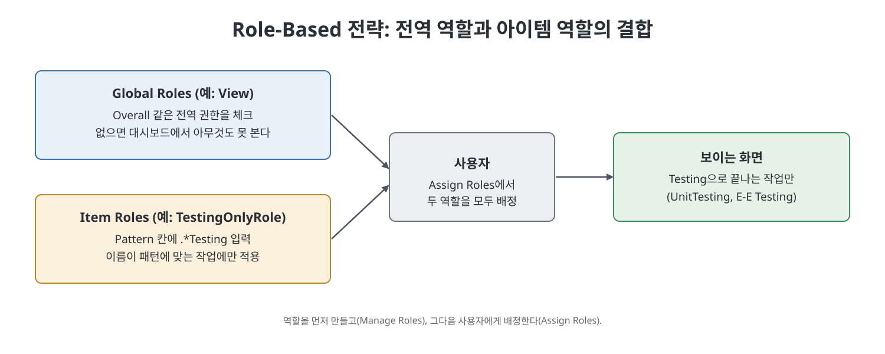
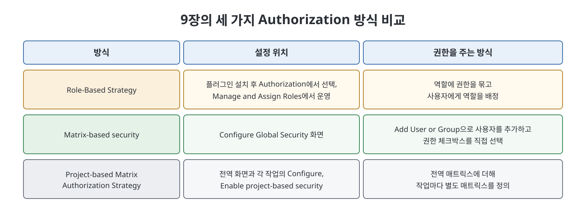

# 9장 사용자 관리 (Managing Users)

Jenkins는 팀 전체가 함께 쓰는 도구라서, 시스템 전체를 관리하는 관리자부터 작업을 보고 실행만 하는 최소 권한 사용자까지 역할이 갈린다. 이 장은 사용자를 만드는 법, 역할(role)을 정의해 사용자에게 배정하는 법, 그리고 Matrix 방식의 권한 설정 두 가지(전역 Matrix, 프로젝트 기반 Matrix)를 화면 조작 순서대로 보여 준다. 7장의 Authorization 옵션을 실제로 쓰는 실전편에 해당한다.

> **쉽게 말하면**
> 계정을 만든 뒤 "이 사람은 보기만", "이 사람은 테스트 작업만 만지기"처럼 권한 표를 붙여 주는 장이다. 방법은 역할로 묶어 주는 방식과 권한 표(매트릭스)에 직접 체크하는 방식으로 나뉜다.

## 이 장의 흐름

1. 사용자 만들기
2. Role-Based Authorization Strategy 플러그인 설치와 활성화
3. 역할 만들기와 사용자에게 배정(전역 역할, 프로젝트 기반 역할)
4. Matrix-based security
5. Project-based Matrix Authorization Strategy

## 1. 사용자 만들기

1. `Manage Jenkins` > `Manage Users`로 간다(이미 만들어진 사용자가 목록에 있다).
2. 왼쪽의 `Create User`를 누른다.
3. `Username`, `Password`, `Confirm Password`, `Full Name`, `E-mail address`를 입력하고 `Create User`를 누른다. 입력할 비밀번호는 `<비밀번호>`로 각자 정한다.
4. 새 사용자가 사용자 목록에 나타난다.

이 방식은 7장의 Security Realm이 `Jenkins' own user database`일 때 해당한다.

## 2. Role-Based Authorization Strategy 플러그인

역할을 만들려면 먼저 이 플러그인을 설치해야 한다.

1. 관리자로 로그인해 `Manage Jenkins` > `Manage Plugins`를 연다.
2. `Available` 탭에서 `Role-based Authorization Strategy`를 검색해 체크한다.
3. `Install without Restart`를 누르고 `Success` 표시를 기다린다.
4. `Manage Jenkins` > `Configure Global Security`의 Authorization에 `Role-Based Strategy`가 생겼으니 선택하고 `Save`한다.

활성화되면 `Manage Jenkins`의 Security 영역에 `Manage and Assign Roles` 링크가 새로 나타난다.

## 3. 역할 만들기와 배정

### 전역 역할

1. `Manage and Assign Roles` > `Manage Roles`로 들어간다.
2. `Role to Add`에 역할 이름(책은 `View`)을 넣고 `Add`를 누르면 `Global Roles` 표에 행이 생긴다.
3. 역할에 줄 권한을 각 섹션의 체크박스로 고른다. 책은 보기 전용 사용자를 만들려고 `View` 섹션의 체크박스를 전부 선택했다.
4. 아래로 내려 `Save`를 누른다.

배정은 `Manage and Assign Roles` > `Assign Roles`에서 한다. `User/Group to Add`에 사용자 ID를 넣고 `Add`를 누르면 `Global Roles` 표에 사용자 행이 생기고, 역할 열의 체크박스를 선택한 뒤 `Save`한다. 책에서 이렇게 `View` 역할을 배정한 사용자 pd로 로그인해 보니 `Access Denied` 메시지가 나왔다. 책은 이 결과의 원인까지 풀어 설명하지는 않는다. 다만 뒤 절에서 "Overall 접근이 없으면 대시보드에서 아무것도 볼 수 없다"고 짚는다.

### 프로젝트 기반 역할

특정 작업에만 접근하게 하려면 `Item Roles`를 쓴다.

1. `Manage Roles` 화면의 `Item Roles` 영역에서 `Role to Add`에 역할 이름(책은 `TestingOnlyRole`)을 넣고 `Pattern`에 `.*Testing`을 입력한 뒤 `Add`를 누른다. 이름에 Testing이 들어간 단위 테스트, 종단 간(end-to-end) 테스트 작업에 맞추려는 의도다.
2. 새 행의 `Job` 열 체크박스를 전부 선택하고 `Save`한다.

> **참고(노트 작성자)** `Pattern` 값은 작업 이름과 대조하는 정규식으로 알려져 있다. 책의 예에서도 `.*`가 "앞에 무엇이 와도 된다"는 뜻으로 쓰였다.

배정은 `Assign Roles`에서 두 군데에 한다.

1. `Item Roles` 영역에서 `User/Group to Add`에 사용자 ID를 넣고 `Add` 한 뒤 `TestingOnlyRole` 열을 체크한다.
2. `Global Roles` 영역에서도 같은 사용자를 추가하고 `View` 역할을 체크한다. 이 역할에 Overall 종류의 접근이 들어 있기 때문이다.
3. `Save`한다.

결과를 확인하려고 `CreateAPIJar`, `E-E Testing`, `UnitTesting` 세 작업을 만들고 그 사용자로 로그인하자, 이름이 Testing으로 끝나는 두 작업만 목록에 보였다.

## 4. Matrix-based security

Authorization 영역의 `Matrix-based security`를 고르면 사용자와 권한을 가로세로로 놓은 표가 나온다. 기본 행은 `Anonymous Users`(인증되지 않은 특별 사용자)와 `Authenticated Users`(Jenkins에서 인증된 모든 사용자)다. 사용자나 그룹은 `Add User or Group`을 눌러 뜨는 브라우저 입력창에 ID를 넣어 추가한다.

책의 예는 한 사용자에게 `Job` 섹션 권한을 모두 주고 `Overall` 섹션의 `Read`를 함께 체크한 뒤 `Save`한 것이다. 이 사용자로 로그인하면 왼쪽 메뉴가 일부만 보이고 `Manage Jenkins` 같은 메뉴는 없다.

## 5. Project-based Matrix Authorization Strategy

이 방식은 Matrix-based security를 확장해 프로젝트(작업)마다 추가 매트릭스를 둘 수 있게 한다. 전역 단계는 앞과 같다. `Add User or Group`으로 사용자를 추가하고, 책은 `Job`의 `Build`와 `Overall`의 `Read`만 체크했다.

작업별 설정은 다음과 같다.

1. 대시보드의 작업 드롭다운에서 `Configure`를 연다.
2. `Enable project-based security` 체크박스를 켠다. 이 항목은 전역 설정에서 Project-based Matrix Authorization Strategy가 켜져 있을 때만 모든 작업에 나타난다.
3. `Add User or Group`으로 사용자를 추가한다.
4. `Inheritance Strategy`를 `Do Not Inherit Permission Grants from Other ACLs`로 두면 여기서 정한 권한만 이 작업에 적용된다.
5. `Build`와 `Read`만 체크한다.

이 사용자로 로그인하면 작업을 빌드(시계 모양 아이콘)할 수는 있지만 설정을 보거나 수정할 수 없고 삭제도 못 한다. 드롭다운에서 `Configure`와 `Delete Project`가 빠져 있다.

## 방식별 한눈 비교

| 방식 | 장점 | 주의할 점 |
|------|------|-----------|
| Role-Based Strategy | 역할을 한 번 정의해 여러 사용자에게 배정, 이름 패턴으로 작업 범위 지정 | 전역 역할의 Overall 접근이 없으면 대시보드가 비어 보인다 |
| Matrix-based security | 사용자별 권한 표를 한눈에 본다 | 작업 단위 제한이 없다(전체에 적용) |
| Project-based Matrix | 전역 권한에 작업별 매트릭스를 더한다 | 작업마다 `Enable project-based security`와 `Inheritance Strategy`를 확인해야 한다 |

> **참고(노트 작성자)** 위 표의 "작업 단위 제한이 없다"는 책이 이 장에서 Matrix-based security를 전역 설정으로만 설명한 점에서 정리한 것이다. 책의 화면은 2021년경 Jenkins 기준이다.

## 핵심 정리

- 사용자는 `Manage Users`에서 만들고, 권한 모델은 Authorization 영역에서 고른다.
- Role-Based 전략은 플러그인 설치 후 `Manage and Assign Roles`에서 역할을 만들고(Manage Roles) 사용자에게 배정한다(Assign Roles).
- 작업 범위 제한은 `Item Roles`의 `Pattern`으로 하며, 전역 역할에서 Overall 접근도 함께 줘야 대시보드가 보인다.
- Matrix-based security는 사용자·그룹별 체크박스 표이고, Project-based Matrix는 작업별 표를 더한다.
- 작업별 설정에서 `Do Not Inherit Permission Grants from Other ACLs`를 쓰면 `Build`와 `Read`만 가진 사용자를 만들 수 있다.

 
 
 

이전: [8장 자격 증명 관리](08%EC%9E%A5%20%EC%9E%90%EA%B2%A9%20%EC%A6%9D%EB%AA%85%20%EA%B4%80%EB%A6%AC.md) | 다음: [핵심 정리](%ED%95%B5%EC%8B%AC%20%EC%A0%95%EB%A6%AC.md)

 

[CICD Pipeline Using Jenkins Unleashed](../)
