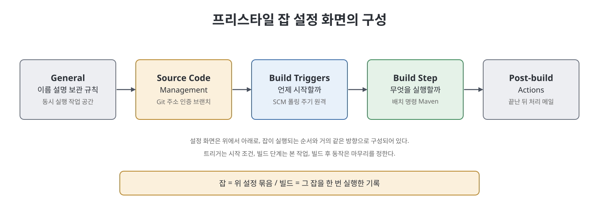
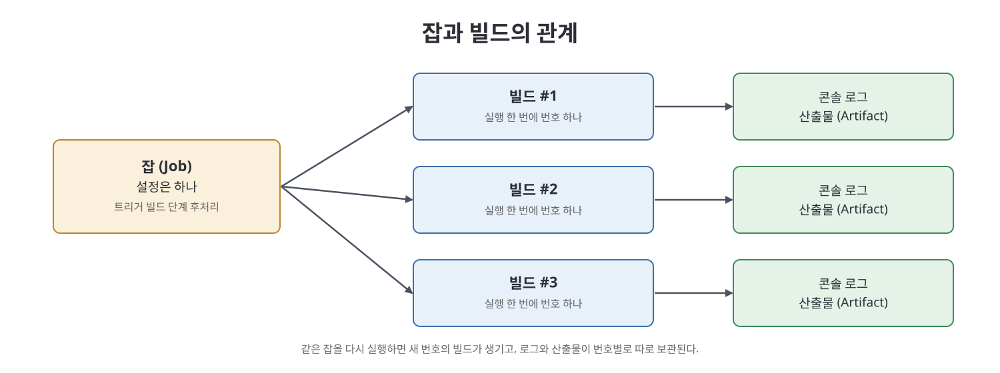

# 10장 잡 이해 (Understanding Jobs in Jenkins)

이 장은 Jenkins의 가장 기본 단위인 잡(job)을 다룬다. 잡이 무엇인지, 잡과 빌드는 어떻게 다른지를 정리한 뒤, 가장 단순한 종류인 프리스타일(Free-Style) 잡을 하나 만들어 보면서 설정 화면의 항목을 위에서 아래로 훑는다. 저자는 이 장을 "실전으로 넘어가는 첫걸음"으로 두고, 여기서 익힌 설정 항목을 뒤 장의 Java 프로젝트 자동화에 그대로 쓴다. 파이프라인 같은 다른 잡 유형은 이후 장에서 다룬다고 안내한다.

> **쉽게 말하면**
> 잡은 "언제 시작해서, 무엇을 하고, 끝난 뒤 무엇을 할지"를 적어 둔 Jenkins의 작업 지시서이고, 이 장은 그 지시서의 입력 칸을 하나씩 설명한다.

## 이 장의 흐름

1. 잡과 빌드의 정의, 프리스타일 잡
2. 잡 만들기와 `General` 섹션 설정
3. 소스 코드 관리(`Source Code Management`)와 인증
4. 빌드 트리거(`Build Triggers`)
5. 빌드 단계와 빌드 후 동작
6. 실행, 로그 확인, 수정, 작업 공간 관리, 삭제

## 1. 잡과 빌드

잡(프로젝트라고도 부른다)은 Jenkins에게 할 일을 알려 주는 명령 묶음이며 세 가지로 나뉜다.

| 구분 | Jenkins 용어 | 의미 | 예 |
|------|-------------|------|----|
| 언제 | 트리거(trigger) | 작업을 시작하는 조건 | 코드 변경 감지, 정해진 시각 |
| 무엇을 | 빌드 단계(build step) | 실제로 실행하는 일 | 배치 명령, 빌드 도구 실행 |
| 끝난 뒤 | 빌드 후 동작(post-build actions) | 결과 처리 | 알림 메일, 산출물 복사 |

빌드(build)는 잡을 한 번 실행한 결과를 가리킨다. 실행할 때마다 고유한 빌드 번호가 붙고, 그 실행에서 나온 산출물과 콘솔 로그가 번호별로 보관된다. 프리스타일 잡은 테스트 실행, 애플리케이션 빌드와 패키징, 보고서 발송처럼 단순한 작업에 알맞은 유형이다.

## 2. 잡 만들기와 General 설정

잡을 만드는 순서는 다음과 같다.

1. 대시보드에서 `Create a job`(잡이 하나도 없을 때) 또는 왼쪽의 `New Item`을 누른다.
2. 이름을 입력하고 `Freestyle Project`를 고른 뒤 `OK`를 누른다.
3. 설정 화면에서 섹션별로 값을 채운다.

`General` 섹션의 주요 항목은 아래와 같다.

| 항목 | 역할 |
|------|------|
| `Description` | 잡의 용도 설명 |
| `Discard old builds` | 오래된 빌드 기록 삭제 규칙 (디스크 절약) |
| `This project is parameterized` | 실행 시 외부 입력(문자열, 불리언 등)을 받음 |
| `Disable this project` | 잡을 잠시 꺼 두어 새 빌드가 만들어지지 않게 함 |
| `Execute concurrent builds if necessary` | 같은 잡의 병렬 실행 허용 |
| `Quiet period` | 트리거 후 지정한 초만큼 큐에서 대기 |
| `SCM checkout retry count` | 소스 체크아웃 실패 시 재시도 횟수 |
| `Block build when upstream/downstream project is building` | 연관 잡이 큐에 있으면 실행 보류 |
| `Use custom workspace` | 작업 디렉터리 위치 변경 |
| `Display Name` | 화면에 보이는 이름 |

핵심 개념을 풀어 쓰면 다음과 같다.

- **오래된 빌드 삭제**: 보관 일수(`Days to keep builds`)와 보관 개수(`Max # of builds to keep`)를 정하며, 둘 중 하나를 넘으면 가장 오래된 빌드부터 지운다. `Advanced`를 누르면 산출물(artifact)만 따로 더 짧게 보관하는 설정도 있다. 산출물은 잡이 만들어 낸 결과 파일(예: 컴파일 후 생긴 JAR)이다.
- **매개변수화**: 책은 `String Parameter`로 이름, 기본값, 설명을 적고 빌드 단계에서 그 값을 꺼내 콘솔에 찍는 예를 든다. 값을 쓰는 방법은 이후 장에서 다룬다고 한다.
- **동시 실행**: 기본값은 한 번에 하나만 실행하고 나머지는 큐에서 기다리는 방식이다. 같은 디렉터리나 파일을 독점해야 하는 잡에는 이 기본값이 안전하다. 단계가 서로 독립적인 긴 빌드는 병렬로 돌려 시간을 줄일 수 있다.
- **조용한 기간(quiet period)**: 짧은 시간에 커밋이 여러 개 들어올 때, 첫 커밋만 보고 즉시 빌드가 시작되는 일을 막고 같이 들어온 커밋을 한 빌드에 묶는다. 예를 들어 5초로 두면 큐에서 5초를 기다린다.
- **업스트림과 다운스트림**: 잡 A의 산출물을 잡 B가 쓰면 A는 B의 업스트림, B는 A의 다운스트림이다.
- **작업 공간(workspace)**: 빌드가 실행되는 디렉터리다. 기본 위치는 Jenkins 홈 아래 `workspace` 폴더의 잡 이름 폴더이고, 소스를 체크아웃하는 곳도 여기다. 사용자 지정 경로를 쓰면 다른 잡이 이 잡의 산출물 경로를 고정해 쓰는 경우에 도움이 된다.
- **표시 이름**: 웹 화면에서만 바뀐다. 작업 공간 폴더 이름과 트리거 URL에는 표시 이름이 아니라 원래 잡 이름이 쓰인다.

## 3. 소스 코드 관리와 인증

`Source Code Management`에서 `Git`을 고르려면 Git 플러그인이 설치되어 있어야 한다(6장). `Repository URL`에 저장소 주소를 넣으면 빌드 때마다 최신 코드를 내려받는다.

공개 저장소는 인증이 필요 없지만 비공개 저장소는 자격 증명이 있어야 한다. 책이 보여 주는 해결 순서는 다음과 같다.

1. `Credentials` 드롭다운 옆에서 `Add` > `Jenkins`를 눌러 자격 증명 창을 연다.
2. 종류와 아이디, 비밀번호(또는 토큰)를 입력하고 `Add`로 저장한다(자세한 항목은 8장).
3. 방금 만든 항목을 드롭다운에서 선택하고 `Apply`를 눌러 인증 오류가 사라졌는지 확인한다.

저자가 따로 강조하는 함정이 있다. Windows 자격 증명 관리자(Credential Manager)에 같은 저장소의 계정이 이미 저장되어 있으면, Jenkins에서 자격 증명을 고르지 않아도 오류가 나지 않는다. 그러다 관리자에서 항목을 지우면 Jenkins가 인증 오류(Error 128)를 낸다. 즉 "내 PC에서 되니까 설정이 맞다"고 믿으면 디버깅이 어려워지므로, Jenkins에 자격 증명을 명시적으로 지정해야 한다는 뜻이다. `Branches to build`는 기본이 `master` 브랜치이며 다른 브랜치를 보려면 이름을 바꾼다.

## 4. 빌드 트리거

`Build Triggers`는 잡이 언제 시작하는지를 정한다.

| 트리거 | 동작 | 책의 설명 포인트 |
|--------|------|------------------|
| `Trigger builds remotely (e.g., from scripts)` | 외부에서 토큰이 붙은 URL을 호출해 실행 | SCM 쪽 이벤트(병합 등)로 시작할 때 사용 |
| `Build after other projects are built` | 지정한 잡이 끝난 뒤 실행 | 안정, 불안정, 실패 중 어떤 결과에서 실행할지 선택 |
| `Build periodically` | cron 식 일정으로 실행 | 저자는 CI 원칙(변경 즉시 피드백)과 어긋난다고 평가 |
| `Poll SCM` | 일정 간격으로 저장소 변경 확인 후 실행 | 변경이 있을 때만 빌드 |

- 원격 트리거 주소는 `JENKINS_URL/job/<잡 이름>/build?token=<토큰>` 형태이며, 잡 이름은 표시 이름이 아니라 실제 이름이다. 토큰은 자리표시자(`<토큰>`)로 두고 실제 값은 노출하지 않는다.
- 선행 잡의 결과는 세 가지로 나뉜다. 안정(stable)은 성공, 불안정(unstable)은 작업은 끝났으나 테스트 보고기 같은 게시자가 문제를 보고한 경우(예: 컴파일은 성공했는데 단위 테스트가 실패), 실패(failed)는 빌드 단계 자체가 실패한 경우다.
- cron 식은 `MINUTE HOUR DOM MONTH DOW` 다섯 칸이다. `45 8 * * *`는 매일 8시 45분, `H/5 * * * *`는 5분 간격 확인이다. 정기 실행의 쓸모 있는 예로 저자는 테스트 환경 배포 후 매일 도는 E2E 테스트를 든다.

## 5. 빌드 단계와 빌드 후 동작

`Add build step`에서 `Execute Windows batch command` 같은 항목을 고르고 명령을 적는다. 단계를 여러 개 추가하면 위에서 아래로 순서대로 실행되며, 빨간 X 표시로 단계를 지운다. `Add post-build action`에서는 이메일 알림 같은 동작을 여러 개 붙일 수 있다.

## 6. 실행과 관리

1. 대시보드에서 해당 잡의 시계 아이콘을 눌러 수동으로 실행한다. 진행 상황은 `Build Executor Status`의 진행 막대로 본다.
2. 끝난 뒤 `Build History`에서 빌드 번호별 기록을 보고, 해당 빌드의 `Console Output`으로 상세 로그를 본다.
3. 수정은 잡 드롭다운의 `Configure`로 들어가 값을 바꾸고 `Save`한다.
4. 작업 공간은 잡 페이지의 `Workspace` 링크로 열고, `Wipe Out Current Workspace`로 비운다.
5. 삭제는 드롭다운의 `Delete Project`를 누르고 확인 창에서 `OK`한다.

> **참고(노트 작성자)**: 책의 화면은 2021년경 Jenkins 기준이라 최신 버전에서는 메뉴 위치와 이름이 조금 다를 수 있다.

## 핵심 정리

- 잡은 트리거, 빌드 단계, 빌드 후 동작의 세 덩어리로 구성되고, 빌드는 그 잡을 한 번 실행한 기록이다.
- `Discard old builds`로 빌드 기록과 산출물의 보관 한도를 정해 디스크를 아낀다.
- 동시 실행은 기본 꺼짐, `Quiet period`는 몰려오는 커밋을 한 빌드로 묶을 때 쓴다.
- 비공개 저장소는 Jenkins에 자격 증명을 명시적으로 지정해야 하며, Windows 자격 증명 관리자에 기대면 원인을 찾기 어려운 오류를 만든다.
- 트리거는 원격 호출, 선행 잡 완료, 주기 실행, SCM 폴링이 있고, 저자는 변경 즉시 피드백하는 방식을 선호한다.

 
 
 

이전: [3부 Readme](Readme.md) | 다음: [11장 Maven으로 Java API 프로젝트 준비](11%EC%9E%A5%20Maven%EC%9C%BC%EB%A1%9C%20Java%20API%20%ED%94%84%EB%A1%9C%EC%A0%9D%ED%8A%B8%20%EC%A4%80%EB%B9%84.md)

 

[CICD Pipeline Using Jenkins Unleashed](../)
