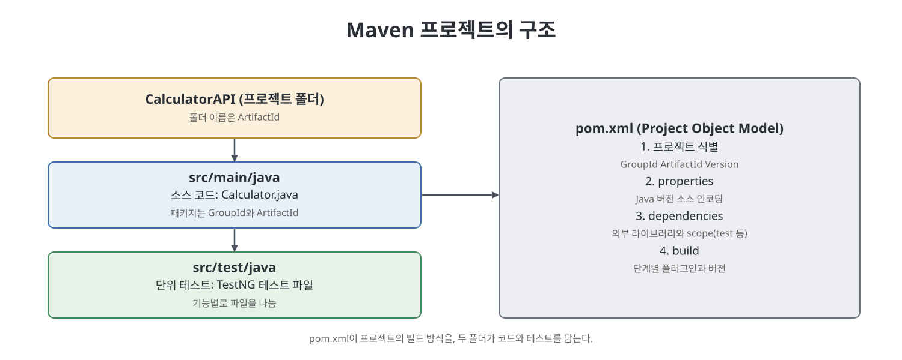
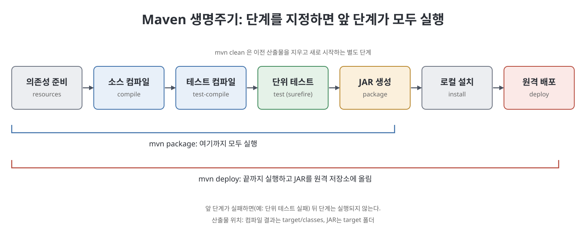

# 11장 Maven으로 Java API 프로젝트 준비 (Preparing a Java API Project Using Maven)

이 장은 Jenkins로 자동화할 대상이 되는 Java API(라이브러리) 프로젝트를 먼저 만들어 보는 장이다. 저자는 애플리케이션 종류마다 빌드와 배포 방식이 다르다는 점에서 출발한다. Java 라이브러리는 JAR 파일로 묶어 아티팩트 저장소에 올리고, Java 웹 애플리케이션은 WAR 파일로 묶어 Tomcat 같은 서버에 배포한다. 그래서 Jenkins 잡을 만들기 전에 프로젝트가 거치는 빌드 생명주기와 이를 대신 수행해 주는 빌드 도구 Maven을 이해해야 한다고 말한다. 예제는 사칙연산 라이브러리(CalculatorAPI)이고 단위 테스트는 TestNG로 작성한다.

> **쉽게 말하면**
> 컴파일, 테스트, 패키징처럼 손으로 하면 번거롭고 실수하기 쉬운 일을 Maven 명령 하나로 순서대로 돌리게 만들어 두는 준비 장이다.

## 이 장의 흐름

1. Java API 프로젝트의 개발 흐름과 빌드 도구의 필요성
2. Eclipse에서 Maven 프로젝트 만들기
3. 디렉터리 구조와 `pom.xml`
4. Maven 빌드 생명주기 단계
5. 명령줄(CLI)에서 Maven 쓰기
6. `settings.xml`로 기본값 바꾸기

## 1. 개발 흐름과 빌드 도구

저자가 정리한 Java API 개발의 일반적 흐름은 아래와 같다.

| 순서 | 작업 | 설명 |
|:---:|------|------|
| 1 | 외부 라이브러리 내려받기 | mvnrepository.com 같은 저장소에서 JAR를 받는다 |
| 2 | 빌드 경로(CLASSPATH)에 추가 | 내려받은 라이브러리를 프로젝트가 참조하게 한다 |
| 3 | 코드와 단위 테스트 작성 | TDD라면 테스트를 먼저 쓴다 |
| 4 | 컴파일 | 소스와 테스트 코드를 모두 컴파일한다 |
| 5 | 단위 테스트 실행 | TestNG, Pytest, NUnit 등 환경에 맞는 도구를 쓴다 |
| 6 | 패키징 | JAR 파일로 묶는다 |
| 7 | 릴리스 | 아티팩트 저장소에 올려 사용자가 받게 한다 |

컴파일 때 필요한 라이브러리, 테스트 때만 필요한 라이브러리, 실행 때 필요한 라이브러리가 다르므로 이를 수작업으로 관리하면 오류가 잦다. 이 반복 작업을 자동화하는 도구가 빌드 도구이며 Ant, Maven, Gradle 등이 있다.

## 2. Eclipse에서 Maven 프로젝트 만들기

사전 준비물은 JDK와 최신 Eclipse다. 책의 절차를 요약하면 다음과 같다.

1. Eclipse를 켜고 작업 공간(workspace) 폴더를 지정한 뒤 `Launch`를 누른다.
2. 최신 Eclipse에는 Maven 플러그인이 이미 들어 있다. `Window` > `Preferences`에서 `Maven` 항목이 보이는지 확인한다.
3. `File` > `New` > `Other`를 열어 `Maven Project`를 고르고 `Next`를 누른다.
4. 아키타입(archetype) 선택 화면에서 `maven-archetype-quickstart`를 필터로 찾아 고른다. 아키타입은 애플리케이션 유형에 맞는 폴더 구조를 만들어 주는 틀이다(웹앱이라면 `maven-archetype-webapp`).
5. 플러그인 내려받기가 끝나면 `Group Id`, `Artifact Id`, `Version`을 입력하고 `Finish`를 누른다.

인터넷이 필요하며, 프록시 환경에서는 사용자 홈의 `.m2` 폴더에 `settings.xml`을 만들어 프록시 정보를 적어야 한다고 책은 알려 준다.

세 값은 저장소에서 프로젝트를 유일하게 식별하는 좌표다.

| 좌표 | 의미 | 책의 예 |
|------|------|---------|
| `GroupId` | 소유자 또는 비슷한 프로젝트를 묶는 그룹 | `Pranodayd` |
| `ArtifactId` | 프로젝트 이름 | `CalculatorAPI` |
| `Version` | 저장소에서 받을 수 있는 특정 릴리스 | `1.0` |

## 3. 디렉터리 구조와 pom.xml

- `src/main/java`: 소스 코드 위치. 그룹 ID와 아티팩트 ID로 패키지 폴더가 만들어지고 템플릿 `App.java`가 들어 있다(저자는 지웠다).
- `src/test/java`: 단위 테스트 위치. 템플릿 테스트 파일이 있다.
- 예제에서는 `Calculator.java`에 덧셈, 뺄셈, 곱셈, 나눗셈을 두고, 기능별 테스트 파일(예: `TestAdditionFunctionality.java`)을 따로 만들었다.
- TestNG는 `@Test`, `@BeforeClass`, `@AfterClass`, `@BeforeMethod` 같은 애너테이션으로 테스트 흐름을 제어하고 보고서를 만들어 주는 단위 테스트 도구다.

`pom.xml`(Project Object Model)은 Maven 프로젝트의 중심 파일이다. 책이 짚는 요소는 다음과 같다.

| pom.xml 요소 | 하는 일 |
|--------------|---------|
| `<groupId>`, `<artifactId>`, `<version>` | 프로젝트 식별 |
| `<properties>` | 컴파일에 쓸 Java 버전, 소스 인코딩(예: UTF-8) 지정 |
| `<dependencies>` | 외부 라이브러리와 필요한 단계(scope) 선언 |
| `<build>` | 빌드 생명주기에서 각 단계를 실행할 플러그인과 버전 고정 |

예제의 의존성은 TestNG 하나이고 `<scope>test</scope>` 덕분에 테스트 실행 때만 클래스패스에 들어간다.

Maven은 내려받은 플러그인과 의존성을 **로컬 저장소**(기본 `사용자홈\.m2\repository`)에 둔다. 빌드 중 필요한 항목이 로컬에 있으면 쓰고, 없으면 중앙 저장소에서 받아 온다. 이때 그룹 ID, 아티팩트 ID, 버전대로 폴더가 만들어지고 그 안에 JAR가 저장된다. 위치를 바꾸려면 `settings.xml`의 `<localRepository>` 태그를 쓴다.

## 4. 빌드 생명주기 단계

저자가 설명한 순서는 아래와 같다.

| 순서 | 단계 | 담당 플러그인 | 결과 |
|:---:|------|---------------|------|
| 1 | Clean | `maven-clean-plugin` | 이전 빌드 산출물을 지우고 새로 시작 |
| 2 | 리소스/의존성 준비 | `maven-resources-plugin` 등 | 필요한 의존성 내려받기 |
| 3 | 소스 컴파일 | `maven-compiler-plugin` (내부는 javac) | `target/classes`에 `.class` 생성 |
| 4 | 테스트 컴파일 | 컴파일러 플러그인 | `target/test-classes`에 테스트 클래스 생성 |
| 5 | 단위 테스트 | `maven-surefire-plugin` | JUnit 또는 TestNG 실행 |
| 6 | 패키징 | `maven-jar-plugin` | `target` 폴더에 JAR 생성 |
| 7 | 설치(install) | `maven-install-plugin` | JAR를 로컬 저장소에 설치 |
| 8 | 배포(deploy) | `maven-deploy-plugin` | 원격 저장소에 JAR 배포 |

사용자가 원격에 있다면 마지막 `deploy` 단계로 웹의 중앙 저장소에 올려야 개발자들이 내려받을 수 있다는 설명이다.

## 5. 명령줄에서 Maven 쓰기

설치와 환경 설정은 다음 순서다.

1. 공식 사이트에서 Maven 바이너리 ZIP을 받아 원하는 위치에 푼다(책은 3.8.1 버전을 썼다).
2. 환경 변수에서 `M2_HOME`에 Maven 설치 경로를, `JAVA_HOME`에 JDK 경로를 등록한다.
3. `PATH`에 `%M2_HOME%\bin`을 추가한다.
4. 새 명령 프롬프트에서 `mvn -version`으로 설치를 확인한다.

사용할 때는 `pom.xml`이 있는 프로젝트 폴더로 이동해 `mvn <단계 이름>`을 실행한다. 핵심 규칙은 한 단계를 실행하면 그보다 앞선 단계도 모두 실행된다는 점이다. 예를 들어 `mvn package`는 의존성 준비, 소스 컴파일, 테스트 컴파일, 단위 테스트, JAR 생성을 차례로 수행한다. 따라서 테스트가 실패하면 JAR는 만들어지지 않는다.

## 6. settings.xml

Maven은 기본 설정으로 동작하지만 `사용자홈\.m2\settings.xml`을 만들면 바꿀 수 있다. 책의 예는 로컬 저장소 위치(`<localRepository>`)와 프록시(`<proxies>`의 프로토콜, 호스트, 포트)를 지정하는 것이다. 이 파일은 다음 장에서 Nexus 계정 정보를 넣는 곳으로도 쓰인다.

## 핵심 정리

- Java API 개발은 라이브러리 확보, 코딩, 컴파일, 테스트, 패키징, 릴리스의 반복이며 Maven이 이를 자동화한다.
- `GroupId`, `ArtifactId`, `Version`이 저장소에서 아티팩트를 식별하는 좌표다.
- `src/main/java`와 `src/test/java`의 구조와 `pom.xml`의 의존성, 플러그인 설정이 빌드 방식을 결정한다.
- Maven 단계는 순서가 있어 `mvn package`는 앞 단계를 모두 거치고, `deploy`는 원격 저장소 배포까지 간다.
- `settings.xml`로 로컬 저장소 위치와 프록시 같은 기본값을 바꾼다.

 
 
 

이전: [10장 잡 이해](10%EC%9E%A5%20%EC%9E%A1%20%EC%9D%B4%ED%95%B4.md) | 다음: [12장 Maven·Nexus 연동과 프리스타일 잡 릴리스](12%EC%9E%A5%20Maven%C2%B7Nexus%20%EC%97%B0%EB%8F%99%EA%B3%BC%20%ED%94%84%EB%A6%AC%EC%8A%A4%ED%83%80%EC%9D%BC%20%EC%9E%A1%20%EB%A6%B4%EB%A6%AC%EC%8A%A4.md)

 

[CICD Pipeline Using Jenkins Unleashed](../)
