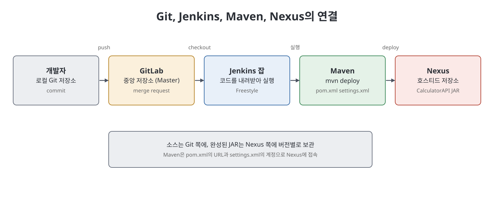
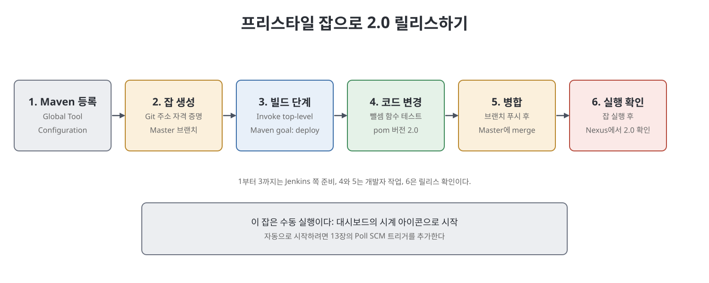

# 12장 Maven·Nexus 연동과 프리스타일 잡 릴리스 (Integrating Maven with Nexus and Creating Free-Style Jobs to Release the Java API)

이 장은 CI/CD 흐름의 나머지 두 부품인 코드 저장소(Git, GitLab)와 아티팩트 저장소(Nexus)를 붙이는 장이다. 먼저 Git의 개념과 로컬에서 중앙 저장소까지 코드를 올리는 과정을 따라가고, 다음으로 Nexus를 설치해 JAR를 올릴 호스티드 저장소를 만든다. 그리고 Maven이 이 저장소로 배포하도록 설정한 뒤, 마지막으로 Jenkins 프리스타일 잡이 "Git에서 코드를 받아 Maven으로 배포"까지 해 주도록 구성한다. 책의 예제는 CalculatorAPI에 뺄셈 기능을 더해 2.0 버전을 릴리스하는 시나리오다.

> **쉽게 말하면**
> 소스는 Git에, 완성된 JAR는 Nexus에 보관하고, Jenkins 잡이 둘 사이를 오가며 빌드와 배포를 대신하는 구조를 만든다.

## 이 장의 흐름

1. 버전 관리 시스템과 Git, GitLab
2. Git 로컬 작업과 GitLab으로 푸시
3. Nexus 저장소 설치와 호스티드 저장소 생성
4. Maven과 Nexus 연동 (`pom.xml`, `settings.xml`)
5. Jenkins 프리스타일 잡으로 릴리스

## 1. 버전 관리와 Git

버전 관리 시스템은 코드의 변경 이력을 남기고 여러 개발자가 협업하게 해 준다. 모두가 접근하는 중앙 저장소에 검증된 코드가 합쳐지고, 개발자는 자기 사본을 최신 상태로 맞춘다. 책은 세 가지 유형으로 나눈다.

| 유형 | 특징 | 예 / 단점 |
|------|------|-----------|
| 중앙집중형 | 서버의 저장소에 늘 연결되어야 이력을 관리 | Tortoise SVN. 오프라인에서는 버전 관리 불가 |
| 로컬형 | 내 컴퓨터에서만 관리 | 단순하나 엉뚱한 파일을 수정하기 쉬움 |
| 분산형 | 개발자별 로컬 저장소와 공용 중앙 저장소를 함께 사용 | Git. 오프라인에서도 버전 관리 가능 |

Git은 로컬 저장소 생성, 브랜치, 커밋 같은 명령을 제공하는 도구이고, GitHub나 GitLab은 웹에 있는 중앙 저장소를 제공하는 서비스라고 구분한다. 설치 후 Git 경로가 `PATH` 환경 변수에 있어야 하며, 환경 변수를 고쳤다면 명령 프롬프트를 다시 열어야 한다.

## 2. 코드를 GitLab까지 올리는 과정

책의 순서를 5단계로 줄이면 다음과 같다.

1. 프로젝트 폴더에서 `git init`으로 로컬 저장소를 만든다. 숨김 폴더 `.git`이 생긴다.
2. GitLab에서 `New project` > `Create blank project`로 비공개(Private) 빈 저장소를 만든다.
3. `git checkout -b <브랜치>`로 브랜치를 만든다. 변경하지 않을 파일은 `.gitignore`에 적어 추적에서 뺀다(예제는 소스와 `pom.xml`만 추적).
4. `git add`로 스테이징하고, 커밋자 이름과 이메일(`git config --global user.name`, `user.email`)을 설정한 뒤 `git commit -m "<메시지>"`로 커밋한다.
5. `git push -u <저장소 HTTPS URL> <브랜치>`로 올린다. 자격 증명 입력창이 뜨면 계정 정보를 넣는다.

Git은 작업 디렉터리(Working directory), 스테이징 영역(Staging area), 커밋 영역(Commit area)이라는 세 영역으로 변경을 단계별로 다룬다. 이후 GitLab에서 `Master` 브랜치를 만들고 `Settings` > `Repository`의 `Default branch`를 `Master`로 바꾼 뒤 처음 쓴 브랜치를 지운다. 릴리스는 `Master`에 합쳐진 코드를 기준으로 하겠다는 의도다.

## 3. Nexus 저장소

아티팩트는 빌드의 산출물(Java API는 JAR, 웹 앱은 WAR)이다. Git이 소스의 버전을 관리한다면, 아티팩트 저장소는 `CalculatorAPI` JAR의 버전들을 관리하고 사용자가 내려받게 해 준다. 공개 저장소(mvnrepository.com)에 올리면 누구나 받을 수 있으므로, 조직 내부 전용이 필요하면 Sonatype Nexus를 조직 네트워크에 둔다.

설치와 실행은 다음 순서다.

1. Nexus ZIP을 받아 풀면 `nexus-3.30.1-01`(실행 파일)과 `sonatype-work`(저장소 데이터) 폴더가 생긴다.
2. `etc/nexus-default.properties`에서 `application-port`(책은 8081)와 `application-host`를 정한다.
3. `bin` 폴더에서 `Nexus.exe /run`으로 시작한다. 처음에는 몇 분이 걸린다. 서비스로 쓰려면 `Nexus.exe /install <서비스명>`을 실행한 뒤 서비스를 시작한다.
4. 브라우저에서 `http://<IP>:<포트>`로 접속해 `Sign in`한다. 초기 관리자 `admin`의 비밀번호는 `sonatype-work/nexus3/admin.password` 파일에 있다.
5. 설정 마법사에서 새 비밀번호를 정하고 `Disable anonymous access`를 선택해 자격 증명이 있는 사용자만 접근하게 한다.
6. `Server Administration and Configuration` > `Repositories` > `Create repository`에서 `maven2 (hosted)`를 고르고 이름을 입력해 만든다(책의 예는 릴리스용 저장소 `JenkinsBookCalculatorAPI_Release`).

## 4. Maven과 Nexus 연동

Maven은 기본적으로 `repo.maven.apache.org/maven2`를 중앙 저장소로 쓰므로, 배포 대상을 내부 Nexus로 알려 줘야 한다. 두 파일을 손본다.

| 파일 | 넣는 내용 | 주의점 |
|------|-----------|--------|
| 프로젝트 `pom.xml` | `<distributionManagement>` 아래 `<repository>`의 `id`, `name`, `url` (Nexus 저장소 URL) | `id`를 기억해 둔다 |
| `사용자홈\.m2\settings.xml` | `<servers>` 아래 `<server>`의 `id`, `username`, `password` | `id`가 `pom.xml`의 것과 같아야 매칭됨 |

Nexus가 익명 접근을 막았으므로 계정은 `settings.xml`에 둔다. 책의 예시는 간단한 비밀번호를 그대로 적지만, 노트에서는 `<비밀번호>` 같은 자리표시자로 두고 실제 환경에서는 안전하게 관리해야 한다.

> **참고(노트 작성자)**: Maven은 `settings.xml`의 비밀번호를 암호화해 두는 기능도 제공하지만, 책은 이를 다루지 않는다.

배포는 프로젝트 폴더에서 `mvn deploy`를 실행하면 된다. 11장의 단계(의존성 준비, 컴파일, 테스트 컴파일, 테스트, 패키징)를 모두 거친 뒤 마지막으로 JAR가 Nexus로 올라간다. Nexus 화면의 `Browse`에서 저장소를 열면 올라간 파일을 확인할 수 있다.

## 5. Jenkins 프리스타일 잡으로 릴리스

책은 같은 일을 Jenkins가 대신하게 만든다. 준비 단계는 아래와 같다.

1. `Manage Jenkins` > `Global Tool Configuration`에서 `Add Maven`을 눌러 이름을 정하고, `Install automatically`를 해제한 뒤 Maven 설치 경로(`MAVEN_HOME`)를 입력한다. 기본 `settings.xml`(`Use Default Maven Settings`)에 Nexus 계정이 있으므로 이 항목은 그대로 둔다.
2. Jenkins `Credentials`에 Git 사용자 이름과 비밀번호 항목을 만든다(8장).
3. `New Item`에서 `Freestyle project`로 잡을 만든다(책의 이름은 `ReleaseCalculatorAPI`).
4. `Source Code Management`에서 `Git`을 고르고 `Repository URL`, `Credentials`, `Branch Specifier`(`Master`)를 입력한다.
5. `Add build step` > `Invoke top-level Maven targets`에서 `Maven Version`을 위에서 등록한 이름으로, `Goals`를 `deploy`로 지정하고 `Save`한다.

그다음 개발 시나리오를 재현한다. 새 브랜치(`SubtractionFunction`)에서 뺄셈 함수와 그 단위 테스트를 추가하고, `pom.xml`의 버전을 1.0에서 2.0으로 올린다. 개발자는 먼저 로컬에서 테스트가 통과하는지 확인한 뒤 커밋하고 푸시한다. GitLab에서 `Create merge request`로 `Master`에 병합하면(`Delete source branch when merge request is accepted`를 켜 두면 병합 후 브랜치가 지워진다) `Master`에 뺄셈이 반영된다.

마지막으로 대시보드에서 잡의 시계 아이콘을 눌러 수동 실행하고 콘솔 출력을 본 뒤, Nexus에서 2.0 버전의 JAR가 올라갔는지 확인한다.

## 핵심 정리

- Git은 분산 버전 관리 도구이고 GitLab은 그 중앙 저장소 서비스다. 로컬 작업은 작업 디렉터리, 스테이징, 커밋의 세 영역을 거친다.
- Nexus는 조직 내부용 아티팩트 저장소로, `maven2 (hosted)` 저장소를 만들고 익명 접근을 막아 둔다.
- Maven 배포 대상은 `pom.xml`의 `<distributionManagement>`로, 계정은 `settings.xml`의 `<servers>`로 지정하며 두 곳의 `id`가 일치해야 한다.
- `mvn deploy`는 앞의 모든 단계를 거쳐 JAR를 Nexus에 올리며, Jenkins 프리스타일 잡은 `Invoke top-level Maven targets`로 같은 일을 자동 수행한다.
- 릴리스 버전은 `pom.xml`의 `Version`을 올려 구분한다.

 
 
 

이전: [11장 Maven으로 Java API 프로젝트 준비](11%EC%9E%A5%20Maven%EC%9C%BC%EB%A1%9C%20Java%20API%20%ED%94%84%EB%A1%9C%EC%A0%9D%ED%8A%B8%20%EC%A4%80%EB%B9%84.md) | 다음: [13장 자동 트리거 프리스타일 잡](13%EC%9E%A5%20%EC%9E%90%EB%8F%99%20%ED%8A%B8%EB%A6%AC%EA%B1%B0%20%ED%94%84%EB%A6%AC%EC%8A%A4%ED%83%80%EC%9D%BC%20%EC%9E%A1.md)

 

[CICD Pipeline Using Jenkins Unleashed](../)
