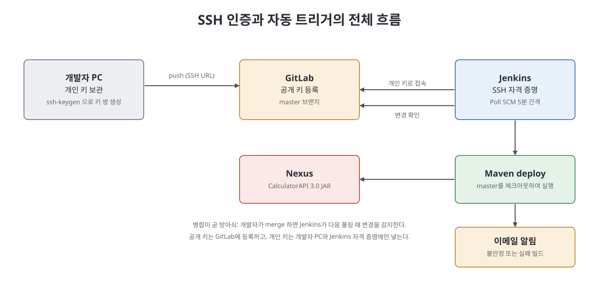
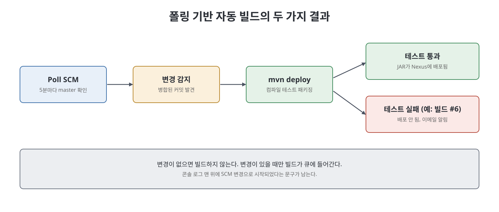

# 13장 자동 트리거 프리스타일 잡 (Creating an Auto-Trigger Free-Style Job to Manage Java API Releases)

12장에서는 사람이 잡의 실행 버튼을 눌러 릴리스했다. 이 장은 코드가 `master` 브랜치에 병합되면 Jenkins가 스스로 알아차려 빌드하고 Nexus에 배포한 뒤, 실패하면 이메일로 알리는 흐름을 만든다. 이를 위해 팀원을 GitLab 저장소에 기여자로 초대하는 방법, 비밀번호 대신 키 쌍으로 인증하는 SSH 방식, 이 SSH 인증을 Jenkins 잡에 연결하는 방법, 그리고 SCM 폴링과 메일 알림 설정을 차례로 다룬다. 예제는 곱셈 기능을 추가해 3.0 버전을 릴리스하는 시나리오다.

> **쉽게 말하면**
> "병합하면 알아서 빌드하고 배포하고, 깨지면 메일을 보내는" 자동화 한 사이클을 완성하는 장이다.

## 이 장의 흐름

1. GitLab 저장소에 기여자 초대
2. SSH 인증의 원리와 키 쌍 설정
3. SSH로 저장소를 복제하고 새 기능 개발
4. 자동 트리거 잡과 이메일 알림 설정
5. 병합으로 빌드를 일으키고 실패 알림 확인

## 1. 기여자 초대

저장소를 만든 사람은 관리자 권한을 가진다. 다른 개발자가 함께 일하려면 관리자가 기여자로 추가하고 역할을 준다. 예를 들어 버그만 보고하는 사람은 Reporter 권한, 코드를 쓰는 사람은 그보다 권한이 많은 Developer 권한이 알맞다. 책의 절차를 요약하면 다음과 같다.

1. 저장소를 만든 관리자 계정으로 GitLab에 로그인해 해당 저장소로 들어간다.
2. 왼쪽 메뉴 `Project information` > `Members`를 연다.
3. `Invite member` 탭에서 초대할 사용자의 GitLab 아이디를 검색해 선택한다(초대받는 사람은 GitLab 계정이 있어야 한다).
4. `Select a role`에서 `Developer` 같은 역할을 고르고 `Invite`를 누른다. 상대에게 초대 메일이 간다.

## 2. SSH 인증

기본 인증(아이디와 비밀번호)은 비밀번호만 알면 어느 컴퓨터에서든 접근할 수 있다. 접근을 회사 작업용 PC처럼 특정 기기로 제한하고 싶을 때 SSH 인증을 쓴다. 동작 방식은 이렇다.

1. 개발자가 자기 컴퓨터에서 개인 키(private key)와 공개 키(public key) 쌍을 만든다.
2. 공개 키를 GitLab에 등록한다(관리자에게 전달하는 형태로 설명).
3. 접속할 때 개인 키로 인증하고, GitLab이 등록된 공개 키와 짝이 맞는지 확인해 허용 또는 거부한다.

| 비교 | 기본 인증 | SSH 인증 |
|------|-----------|----------|
| 확인하는 것 | 아이디와 비밀번호 | 개인 키와 공개 키의 짝 |
| 접속 가능한 곳 | 정보만 알면 어느 기기든 | 키가 있는 기기 |
| 저장소 주소 | HTTPS URL | SSH URL(`git@gitlab.com:...`) |

키 만들기와 등록은 다음과 같다.

1. Windows 10 이후에는 OpenSSH 클라이언트가 보통 설치되어 있다. 없으면 `Settings` > `Apps & features` > `Manage optional features`에서 추가한다.
2. 명령 프롬프트에서 `ssh-keygen`을 실행해 키를 저장할 경로를 입력하고(비우면 사용자 홈의 `.ssh` 폴더 기본값), 패스프레이즈(키를 쓸 때마다 묻는 비밀번호)를 입력한다. 개인 키 파일과 `.pub` 공개 키 파일이 생긴다.
3. GitLab에서 사용자 아바타 > `Preferences` > `SSH Keys`를 열어 `.pub` 파일 내용을 `Key` 칸에 붙여넣고, `Title`을 적은 뒤 `Add key`를 누른다.

공개 키만 등록하고 개인 키는 절대 공유하지 않는다.

## 3. SSH로 복제하고 기능 개발

새 개발자는 처음이라 저장소 전체(이력 포함)를 `git clone`으로 내려받아야 한다. 키를 기본 위치가 아닌 곳에 만들었다면 SSH 클라이언트가 그 개인 키를 쓰게 알려 줘야 하는데, 책은 이를 위한 방법을 세 가지 제시한다. 노트에서는 책이 실제로 설명한 두 가지(전용 설정 파일의 `IdentityFile` 항목, Git 전역 설정의 `core.sshCommand`)와 "기본 위치에 두면 바로 clone 가능"이라는 점만 정리한다. 이후 GitLab의 Clone with SSH 주소로 `git clone`하면 처음 접속하는 호스트라 확인 질문이 나오고(`yes` 입력), 패스프레이즈를 입력하면 복제가 끝난다.

개발 과정은 12장과 같은 패턴이다.

1. Eclipse에서 `File` > `Import` > `Existing Maven Projects`로 복제한 프로젝트를 가져온다.
2. `Calculator.java`에 곱셈 함수를 추가하고, 데이터 제공자(`@DataProvider`)로 여러 입력 쌍을 시험하는 단위 테스트를 만든다.
3. `pom.xml`의 버전을 2.0에서 3.0으로 올린다.
4. `mvn test`로 새 기능이 동작하고 기존 덧셈, 뺄셈이 깨지지 않았는지(회귀) 확인한다.
5. 새 브랜치(`MultiplicationFunction`)를 만들어 `git add .`와 `git commit`을 하고, SSH URL로 푸시한다.
6. GitLab에서 `Create merge request`까지 만들되, 병합 버튼은 Jenkins 잡을 만든 뒤에 누른다. 병합이 곧 빌드의 방아쇠이기 때문이다.

## 4. 자동 트리거 잡과 이메일 알림

새 프리스타일 잡(책의 이름은 `ReleaseCalculatorAPIAutoTrigger`)은 12장과 달라지는 점이 세 가지다.

| 설정 | 12장 잡 | 13장 잡 |
|------|---------|---------|
| 저장소 주소 | HTTPS URL | SSH URL |
| 자격 증명 종류 | 사용자 이름과 비밀번호 | `SSH Username with private key` |
| 실행 방식 | 수동 | `Poll SCM`으로 자동 |

설정 절차는 다음과 같다.

1. `Source Code Management`에서 `Git`을 고르고 SSH 저장소 URL을 넣는다. 인증 전이므로 `Permission denied` 오류가 보인다.
2. `Credentials` > `Add` > `Jenkins`에서 `Kind`를 `SSH Username with private key`로 하고, `ID`를 정한다. `Private Key`는 `Enter directly`로 개인 키 내용을 붙여넣고 `Passphrase`를 입력한 뒤 `Add`를 누른다.
3. 만든 항목을 선택하고 `Apply`하면 오류가 사라진다. `Branch Specifier`는 `Master`로 한다.
4. `Build Triggers`에서 `Poll SCM`을 켜고 5분 간격 일정(10장의 `H/5 * * * *`)을 입력한다. Jenkins가 5분마다 `master`를 확인하고 변경이 있으면 빌드한다.
5. `Add build step` > `Invoke top-level Maven targets`에서 Maven 버전을 고르고 `Goals`에 `deploy`를 넣는다.
6. `Add post-build action` > `E-mail Notification`에 수신 주소를 넣는다. `Send e-mail for every unstable build`를 켜 두면 불안정 또는 실패한 빌드마다 메일이 간다.

메일을 실제로 보내려면 `Manage Jenkins` > `Configure System`에서 두 곳을 채워야 한다.

| 섹션 | 항목 | 설명 |
|------|------|------|
| `Jenkins Location` | `System Admin e-mail address` | 받는 메일의 보낸 사람(From)에 표시 |
| `E-mail Notification` | `SMTP server`, `Use SMTP Authentication`, 계정, `Use SSL`, 포트 | 책은 Gmail SMTP를 쓰고 SSL 포트 465 사용 |

`Test configuration by sending test e-mail`로 시험한다. 책의 저자는 처음에 인증 실패 오류를 만났고, 당시 Gmail의 보안 수준이 낮은 앱 허용 설정을 켜서 해결했다. 계정 정보는 자리표시자(`<계정>`, `<비밀번호>`)로 다루고 노출하지 않는다.

> **참고(노트 작성자)**: 책이 따른 "낮은 보안 수준 앱 허용" 방식은 2021년경 기준이며, 이후 Google 정책이 바뀌어 지금은 앱 전용 비밀번호나 다른 방식이 필요할 수 있다. 현재 방식은 각 서비스의 최신 문서를 확인해야 한다.

## 5. 병합으로 트리거하고 실패 알림 확인

1. GitLab의 `Merge Requests`에서 해당 요청을 열어 `Merge`를 누른다.
2. Jenkins가 다음 폴링 시점에 변경을 감지하면 `Build Queue`에 빌드가 보이고 이어서 `Build Executor Status`에서 실행된다.
3. 콘솔 출력 맨 위에는 SCM 변경으로 시작되었다는 문구가 보이고, 아래쪽에서 3.0 JAR가 Nexus에 배포된 것을 볼 수 있다. Nexus 화면에서도 확인한다.

SCM이 설정된 잡이 빌드를 시작하면 Jenkins 홈 아래 `workspace/<잡 이름>` 폴더가 만들어지고, 지정한 브랜치가 거기에 체크아웃된다. 이 폴더가 작업 디렉터리이며 `mvn deploy`도 여기서 실행된다.

실패 알림은 일부러 확인한다. 덧셈 테스트의 기대값을 틀리게 바꿔 커밋하고, 새 브랜치로 푸시한 뒤 `master`에 병합하면 트리거된 빌드(#6)가 테스트 실패로 깨진다. 이때 알림 메일이 오고, 메일에서 실패한 빌드의 콘솔 로그를 볼 수 있다. 테스트가 실패하면 배포 단계까지 가지 않는다는 점이 안전장치 역할을 한다.

## 핵심 정리

- 기여자는 `Project information` > `Members`에서 초대하고 역할(Reporter, Developer 등)로 권한을 구분한다.
- SSH 인증은 개인 키와 공개 키 짝으로 기기를 제한하며, 공개 키만 GitLab에 등록한다.
- Jenkins에서는 `SSH Username with private key` 자격 증명으로 SSH 저장소에 접근한다.
- `Poll SCM`(5분 간격)을 쓰면 병합이 곧 빌드와 배포의 방아쇠가 되고, 이메일 알림으로 실패를 즉시 알 수 있다.
- 테스트 통과가 배포의 관문이므로, 기대값을 일부러 틀리게 해 실패 시 알림이 가는지까지 확인하는 것이 좋다.

 
 
 

이전: [12장 Maven·Nexus 연동과 프리스타일 잡 릴리스](12%EC%9E%A5%20Maven%C2%B7Nexus%20%EC%97%B0%EB%8F%99%EA%B3%BC%20%ED%94%84%EB%A6%AC%EC%8A%A4%ED%83%80%EC%9D%BC%20%EC%9E%A1%20%EB%A6%B4%EB%A6%AC%EC%8A%A4.md) | 다음: [핵심 정리](%ED%95%B5%EC%8B%AC%20%EC%A0%95%EB%A6%AC.md)

 

[CICD Pipeline Using Jenkins Unleashed](../)
