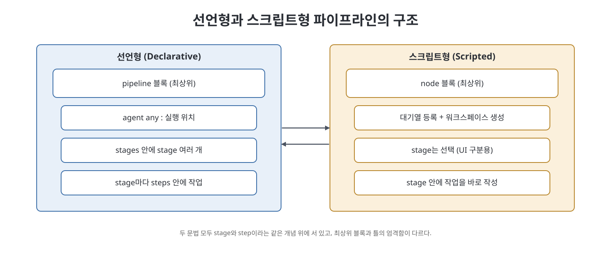
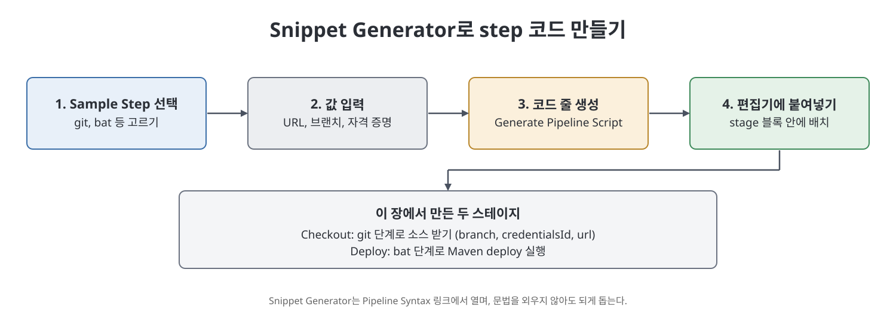

# 14장 Jenkins 파이프라인 이해 (Understanding the Jenkins Pipeline)

이 장은 13장까지 만든 프리스타일 잡(Freestyle job)에서 한 걸음 나아가, 빌드 과정을 코드로 적는 Jenkins 파이프라인(Pipeline)을 소개한다. 파이프라인이 무엇이고 왜 쓰는지, 핵심 용어(pipeline, node, stage, step)가 무엇인지, 문법이 선언형(Declarative)과 스크립트형(Scripted) 두 가지로 나뉜다는 점을 먼저 설명한다. 이어서 화면에서 파이프라인 잡을 만들고, `Snippet Generator`로 단계(step) 코드를 뽑아내며, 앞 장의 Java API(CalculatorAPI)를 Nexus 저장소에 배포하는 일을 파이프라인으로 다시 구현한다.

> **쉽게 말하면**
> 클릭으로 설정하던 빌드 절차를 "글로 적은 레시피"로 바꾸는 법을 배우는 장이다. 레시피는 코드이므로 저장하고 공유하고 고칠 수 있다.

## 이 장의 흐름

1. 파이프라인이란 무엇이며 프리스타일 잡보다 무엇이 나은가
2. 파이프라인의 기본 개념: pipeline, node, stage, step
3. 선언형과 스크립트형 문법의 뼈대
4. 화면에서 만드는 가장 단순한 파이프라인과 잡 설정 옵션
5. 문자열 보간(string interpolation)과 환경 변수
6. `Snippet Generator`로 CalculatorAPI 배포 파이프라인 만들기

## 1. 파이프라인이란

저자는 파이프라인을 지속적 전달(continuous delivery)을 Jenkins 안에서 구현하도록 돕는 플러그인들의 스크립트 묶음으로 설명한다. 지속적 전달 파이프라인은 소스 관리 시스템에 있는 코드가 사용자에게 가 닿기까지의 과정을 자동화한 코드 형태의 절차다. 사람이 프로그램에서 엑셀을 다루려면 API가 필요하듯, Jenkins 플러그인에게 일을 시키려면 스크립트 참조(문법)가 필요하고, 그것을 코드로 적은 것이 파이프라인이라는 비유를 든다.

책이 꼽는 프리스타일 잡 대비 장점은 다섯 가지다.

| 장점 | 의미 |
|------|------|
| Code | 빌드 절차를 코드로 두어 애플리케이션 소스와 같은 저장소에 넣고 팀이 공유한다 |
| Durable | 컨트롤러가 계획했든 아니든 재시작되어도 파이프라인이 살아남는다 |
| Pausable | 사람의 입력이나 승인을 기다리며 멈출 수 있다 |
| Versatile | 분기, 반복, 병렬 같은 복잡한 요구를 담을 수 있다 |
| Extensible | 다른 플러그인과 연동하는 선택지가 많다 |

## 2. 기본 개념 네 가지

- **Pipeline**: 빌드, 테스트, 전달 전체 과정을 정의한 코드.
- **Node**: 파이프라인을 실행할 수 있는 머신.
- **Stage**: 빌드, 테스트, 배포처럼 소프트웨어가 거치는 단계. 한 `stage` 블록 안에 그 단계의 작업이 들어간다.
- **Step**: 한 단계 안의 낱개 작업(배치 명령 실행, Maven 목표 실행 등). stage는 여러 step의 모음이다.

## 3. 두 가지 문법의 뼈대

**선언형**은 전체를 `pipeline` 블록으로 감싸고, 그 안에 실행 위치(`agent`)와 `stages`, 각 `stage`, 그 안의 `steps`를 정해진 틀대로 둔다. 책의 예시는 `agent any`로 아무 에이전트에서나 실행하고 Build, Test, Deploy 세 스테이지를 두는 구조다.

**스크립트형**은 전체를 `node` 블록으로 감싼다. 책에 따르면 `node` 블록으로 감싸지 않아도 되지만, 감싸면 두 가지가 생긴다. 하나는 블록 안의 steps가 Jenkins 대기열(queue)에 올라가 실행기(executor)가 비면 돌아간다는 것, 다른 하나는 SCM에서 받은 파일을 작업하는 워크스페이스 디렉터리가 만들어진다는 것이다. 스크립트형에서 `stage`는 필수가 아니지만, 쓰면 UI에서 각 단계가 구분되어 보인다고 한다.

직접 정리한 뼈대 비교 예시다(책의 코드를 옮긴 것이 아니다).

```groovy
// 선언형
pipeline {
    agent any
    stages {
        stage('Build') { steps { echo 'build' } }
    }
}
// 스크립트형
node {
    stage('Build') { echo 'build' }
}
```

| 구분 | 선언형(Declarative) | 스크립트형(Scripted) |
|------|---------------------|----------------------|
| 최상위 블록 | `pipeline` | `node` |
| 실행 위치 지정 | `agent any` 같은 지시 | `node` 블록 자체 |
| stage 안의 작업 | 반드시 `steps` 안에 둠 | `stage` 안에 바로 적음 |
| `stage` 사용 | 구조상 포함 | 선택이지만 시각화에 도움 |
| 성격 | 틀이 정해진 간결한 문법 | 전통적이고 Groovy 기반의 자유로운 문법 |

> **참고(노트 작성자)** 16장에서 책은 선언형을 "더 단순하고 선택지가 많은 문법", 스크립트형을 "전통 방식이며 더 엄격한 Groovy 문법"으로 비교한다. 위 표의 마지막 줄은 이 설명을 요약한 것이다.

## 4. 화면에서 단순 파이프라인 만들기

1. Jenkins에 로그인하고, 5장에서 설명한 대로 `Pipeline: Job`과 `Pipeline` 플러그인을 설치한다.
2. 대시보드 왼쪽의 `New Item`을 눌러 잡 이름을 입력하고 `Pipeline`을 고른 뒤 `OK`를 누른다.
3. 잡 설정 화면의 `Pipeline` 절에서 코드 편집기에 파이프라인을 적는다(책은 "Hello World"를 출력하는 선언형 예제를 쓴다).
4. `Save` 후 대시보드에서 시계 아이콘으로 실행하고 `Console Output`에서 결과를 확인한다.

이 화면에는 파이프라인 전용 설정이 있다. `Do not allow the pipeline to resume if the controller restarts`를 켜면 컨트롤러 재시작 뒤 파이프라인을 재개하지 않는다. `Pipeline Speed/Durability Override`는 실행 중 디스크에 얼마나 상태를 기록할지 정한다. 기본은 많이 기록해 재시작 후 이어갈 수 있지만 느리다.

| 내구성 옵션 | 책의 설명 |
|-------------|-----------|
| Performance-optimized | 필요한 데이터만 기록해 훨씬 빠름. 안전하게 종료해야 실행 중 파이프라인이 저장됨 |
| Less durability, a bit faster | 기록이 적어 내구성이 낮고 약간 빠름. 특수한 용도 |
| Maximum durability but slowest | 최대한 기록해 장애에 강하지만 매우 느림. 과거에는 이것만 있었음 |

자주 만나는 오류도 소개한다. `Unsupported class file major version` 오류는 Jenkins가 지원하지 않는 Java 버전을 쓸 때 나며, 책은 `PATH`와 `JAVA_HOME`이 Java 11(또는 8)을 가리키게 하고 서버를 재시작하라고 안내한다. `Global Tool Configuration`에서 JDK를 지정하는 방법도 있다.

## 5. 문자열 보간과 환경 변수

문자열 보간은 문자열 안의 변수 이름을 값으로 바꿔 넣는 일이다. 책은 `BUILD_ID`, `BUILD_NUMBER`, `JENKINS_URL`, `JOB_NAME` 같은 환경 변수가 파이프라인에서 `env`로 노출된다고 하고, 전체 목록은 Jenkins 주소 뒤에 `/pipeline-syntax/globals#env`를 붙여 볼 수 있다고 알려 준다. 예시는 `"... ${env.BUILD_ID} ... ${env.JENKINS_URL}"` 형태로 에코하는 것이다.

> **참고(노트 작성자)** 책의 보간 설명 문단은 따옴표 종류에 따른 규칙이 뒤바뀐 듯 읽힌다. Groovy의 일반 규칙은 큰따옴표(`"`) 문자열에서만 `$변수`와 `${식}`이 값으로 바뀌고, 작은따옴표(`'`) 문자열은 글자 그대로 출력된다는 것이다. 이 노트는 이 일반 규칙을 기준으로 하며, 따옴표 선택은 실습 때 직접 한 번 확인해 보기를 권한다.

## 6. Snippet Generator로 API 배포 파이프라인 만들기

목표는 13장의 프리스타일 잡과 같은 일, 곧 GitLab에서 소스를 받아 Nexus에 `CalculatorAPI` JAR를 배포하는 것이다.

1. `New Item`에서 `Pipeline` 잡을 만든다.
2. `Pipeline` 절의 `Try sample Pipeline` 드롭다운에서 `Scripted Pipeline`을 고르면 템플릿이 채워진다. 책은 이를 지우고 직접 작성한다.
3. 코드 편집기 아래 `Pipeline Syntax` 링크로 `Snippet Generator`를 연다.
4. `Sample Step` 드롭다운에서 `git: Git`을 고르고 저장소 SSH URL, 브랜치, 인증 정보(Credentials)를 입력한 뒤 `Generate Pipeline Script`를 눌러 생성된 줄을 복사한다.
5. 같은 방법으로 `bat` 단계를 골라 Maven의 배포 명령(`mvn deploy`)을 실행하는 줄을 생성한다.

완성된 구조를 요약하면 다음과 같다. 두 스테이지로 이루어지며, 변수에 Global Tool Configuration에 등록한 Maven의 경로를 담고(`tool '이름'`), `withEnv`로 환경 변수를 만들어 `bat`에서 그 경로의 `mvn`을 호출한다.

```groovy
node {
    def mvnHome
    stage('Checkout') {
        git branch: 'master', credentialsId: '<자격증명 ID>', url: '<저장소 URL>'
    }
    stage('Deploy') {
        mvnHome = tool 'MyMaven'
        withEnv(["MVN_HOME=${mvnHome}"]) { bat '%MVN_HOME%\\bin\\mvn deploy' }
    }
}
```

주석은 한 줄은 `//`, 여러 줄은 `/* */`로 쓴다. 실행 전에는 앞 장에서 일부러 틀리게 해 둔 테스트 기대값을 바로잡고 `pom.xml`의 버전을 7.0으로 올려 병합한 뒤, 잡을 수동 실행한다. 콘솔에서 배포 성공을 확인하고 Nexus에서 `CalculatorAPI 7.0.jar`가 올라온 것을 확인하는 것이 마무리다.





## 핵심 정리

- 파이프라인은 빌드 절차를 코드로 적은 것이며, 코드 공유, 재시작 내구성, 일시 정지, 분기와 병렬, 확장성이 프리스타일 잡 대비 장점이다.
- 개념은 pipeline > node > stage > step 순으로 포함 관계다.
- 선언형은 `pipeline` 블록과 정해진 틀, 스크립트형은 `node` 블록과 Groovy 자유 문법이 특징이다.
- `Snippet Generator`는 화면에서 입력한 값으로 step 코드를 만들어 주므로 문법을 외우지 않아도 된다.
- 문자열 보간은 큰따옴표 문자열에서 동작하며, 환경 변수는 `env.이름`으로 쓴다.
- 이 장에서 프리스타일 잡이 하던 일을 파이프라인으로 그대로 옮겨, 같은 Nexus 배포 결과를 얻는다.

<br>
<br>
<br>

이전: [4부 Readme](Readme.md) | 다음: [15장 웹 애플리케이션 프로젝트 잡](15%EC%9E%A5%20%EC%9B%B9%20%EC%95%A0%ED%94%8C%EB%A6%AC%EC%BC%80%EC%9D%B4%EC%85%98%20%ED%94%84%EB%A1%9C%EC%A0%9D%ED%8A%B8%20%EC%9E%A1.md)

<br>

[CICD Pipeline Using Jenkins Unleashed](../)
