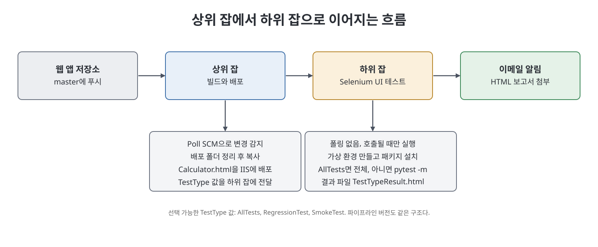

# 15장 웹 애플리케이션 프로젝트 잡 (Creating Jenkins Jobs to Manage a Web Application Project)

이 장은 Java API가 아닌 간단한 계산기 웹 애플리케이션(HTML 파일 하나짜리 Maven 프로젝트)의 릴리스 흐름을 Jenkins로 자동화한다. 소스를 받아 IIS 웹 서버에 배포하고, Python과 Selenium WebDriver로 만든 엔드투엔드(E2E) UI 테스트를 돌린 뒤, 결과 보고서를 이메일로 보내는 것까지가 범위다. 같은 일을 먼저 매개변수가 있는 프리스타일 잡 두 개(상위·하위)로 만들고, 이어 파이프라인 잡 두 개로 다시 만든다.

> **쉽게 말하면**
> "배포 담당 잡"이 일을 마치고 "테스트 담당 잡"에게 어떤 테스트를 돌릴지 쪽지(매개변수)를 넘기는 이어달리기를 만드는 장이다.

## 이 장의 흐름

1. 대상 애플리케이션과 배포 방식(IIS 가상 디렉터리)
2. Selenium 기반 UI 자동화 테스트의 개념과 실행 준비
3. GitHub 저장소에 두 프로젝트 올리기
4. 매개변수 프리스타일 잡: 상위 잡(빌드·배포)과 하위 잡(UI 테스트)
5. 확장 이메일 알림(Email Extension)
6. 같은 구조의 매개변수 파이프라인 잡

## 1. 대상 애플리케이션과 배포

계산기 앱은 `Calculator.html` 한 파일에 화면(HTML, CSS)과 로직(JavaScript)이 모두 들어 있다. 컴파일이나 패키징이 필요 없어서, 책은 Jenkins 기능에 집중하려고 일부러 단순한 예제를 골랐다고 말한다. 배포는 이 파일을 IIS 웹 서버의 별칭(alias)이 가리키는 디렉터리로 복사하는 한 단계다. 책에서는 `CalculatorWebApp`이라는 별칭이 로컬의 한 폴더를 가리키고, 기본 사이트가 8082번 포트에서 열리므로 `http://localhost:8082/CalculatorWebApp/Calculator.html`로 접속한다.

## 2. UI 자동화 테스트와 Selenium

E2E 테스트는 사용자 관점에서 정상·비정상 업무 흐름을 끝까지 실행해 보고 올바르게 동작하는지 확인하는 테스트다. UI 자동화 도구는 사람 대신 화면 요소를 찾아(ID, name, class 같은 속성으로 식별) 입력하고 클릭하는 두 가지 지시로 동작한다. 책은 오픈소스 도구인 Selenium WebDriver의 Python 라이브러리를 쓴다.

책 속 테스트 프로젝트의 구성은 다음과 같다.

| 구성 요소 | 역할 |
|-----------|------|
| `EnvVars.csv` | 크롬 드라이버 경로, 오브젝트 저장소 폴더, 앱 URL 같은 환경 설정 |
| `CalculatorPage.csv` | UI 요소를 찾기 위한 식별 정보(오브젝트 저장소) |
| AutomationFramework 패키지 | 설정 파일을 읽고 브라우저와 UI를 다루는 공통 코드 |
| CalculatorWebApp_Pages 패키지 | 페이지 클래스(예: 덧셈, 뺄셈 흐름을 자동화한 함수) |
| CalculatorWebApp_TestCases 패키지 | 기능별 테스트 파일. RegressionTest, SmokeTest 같은 그룹으로 분류 |

> **참고(노트 작성자)** 스모크 테스트는 새 빌드가 더 깊은 테스트를 받을 최소 조건을 갖췄는지 보는 검사, 회귀 테스트는 변경이 기존 기능을 망치지 않았는지 보는 검사라고 책이 설명한다.

실행 준비물은 Python(과 `PATH` 등록), `pip`, Chrome 브라우저, 브라우저와 맞는 버전의 Chrome Driver, 그리고 `selenium`과 `pytest` 패키지다. 책은 프로젝트마다 별도 환경을 쓰려고 `virtualenv`로 가상 환경을 만들고, 그 안에 `pytest`, `selenium`, 보고서 생성용 `pytest-html`을 설치한 뒤 `pytest --html=TestsResult.html`로 실행한다. 이 명령은 이름이 `test_`로 시작하는 파일 안의 `test`로 시작하는 함수들을 실행해 HTML 보고서를 만든다.

## 3. GitHub에 두 프로젝트 올리기

저자는 앞서 쓴 GitLab 대신 GitHub을 이번 장에서 쓴다. 개념과 Git 명령은 같다고 한다. 순서는 비공개 저장소를 만들고, `ssh-keygen`으로 키 쌍을 만들어 개인 키 경로를 사용자 `.ssh\config`에 적고, 공개 키를 GitHub의 `Settings`에서 `SSH and GPG keys` 메뉴의 `New SSH Key`로 등록한 뒤, `git init`, `git add`, `git commit`, `git push` 순서로 올리는 것이다. 웹 앱과 Selenium 자동화 프로젝트, 이렇게 저장소를 두 개 만든다.

## 4. 매개변수 프리스타일 잡

두 잡의 관계를 먼저 잡아 두자.

| 구분 | 상위 잡 `BuildAndDeployCalculatorWebApplication` | 하위 잡 `TestCalculatorWebApplication` |
|------|-----------------------------------------------|-------------------------------------|
| 트리거 | 웹 앱 저장소 master 변경 시 SCM 폴링 | 상위 잡이 호출(폴링 없음) |
| 저장소 | 웹 앱 저장소 | Selenium 테스트 저장소 |
| 하는 일 | 배포 디렉터리 정리 후 `Calculator.html` 복사, 하위 잡 호출 | 가상 환경 만들고 패키지 설치, 테스트 실행, 보고서 메일 |
| 매개변수 | 배포 경로(String), `TypeOfTestsToRun`(Choice) | `TestType`(String) |

**플러그인 준비**: 잡 사이에 매개변수를 넘기려면 `Parameterized Trigger` 플러그인이 필요하고, 그 의존 플러그인으로 `Maven Integration`을 먼저 설치한다.

**상위 잡 만들기**

1. 프리스타일 잡을 만들고 `This project is parameterized`를 켠다.
2. `Add Parameter`에서 `String Parameter`로 배포 폴더 경로를 담을 매개변수를 만든다. 경로를 단계에 박아 두지 않으려는 목적이다.
3. `Choice Parameter`로 `TypeOfTestsToRun`을 만들고 `AllTests`(기본값, 첫 줄), `RegressionTest`, `SmokeTest`를 선택지로 둔다.
4. `Source Code Management`에서 `Git`을 고르고 SSH URL과 GitHub용 자격 증명을 지정한 뒤 `Poll SCM`을 켜서 `H/5 * * * *`로 설정한다.
5. 빌드 단계로 `Execute Windows batch command`를 추가한다. 기존 디렉터리 삭제, 새 디렉터리 생성, `src\main\webapp`의 `Calculator.html` 복사 세 줄이며, 매개변수는 `%이름%` 형태로 참조한다. SCM을 설정한 잡은 저장소가 워크스페이스에 클론되므로 상대 경로로 파일에 접근한다.
6. `Post-build Actions`에서 `Trigger parameterized build on other projects`를 고르고, 하위 잡 이름을 적고, `Trigger when build is`는 `Stable or unstable but not failed`로 둔다. `Add Parameters`의 `Predefined parameters`에 `TestType=$TypeOfTestsToRun` 꼴로 선택값을 전달한다.

**하위 잡 만들기**: `TestType`이라는 String 매개변수(상위에서 넘기는 이름과 같아야 한다)를 만들고 기본값을 `AllTests`로 둔다. Selenium 저장소를 지정하되 `Poll SCM`은 켜지 않는다. 상위 잡이 부를 때만 돌기 때문이다. 이어서 batch 단계를 여러 개 둔다. `virtualenv` 설치, 가상 환경 생성, 활성화, `selenium`, `pytest`, `pytest-html` 설치, 그리고 `TestType`이 `AllTests`면 전체 테스트를, 아니면 `pytest -m`으로 해당 그룹만 실행해 `<TestType>Result.html` 보고서를 만드는 조건 명령이다. Windows batch의 `if`/`else` 괄호 위치와 공백에 까다로운 규칙이 있다는 주의도 책에 나온다.

## 5. 확장 이메일 알림

기본 `Mailer` 플러그인으로는 메일 본문을 꾸미거나 파일을 첨부할 수 없다. 그래서 `Email Extension` 플러그인을 설치하고 `Manage Jenkins` 아래 시스템 설정의 `Extended E-mail Notification`에서 전 시스템 공통 값을 설정한다. 여기서는 `Default Recipients`, `Excluded Recipients`, `Default Subject`, `Default Content`를 정할 수 있고, 제목에는 `PROJECT_NAME`, `BUILD_NUMBER`, `BUILD_STATUS` 같은 환경 변수가 쓰인다. 책은 이 전역 설정에 특정 잡이나 앱 정보를 넣지 말라고 주의한다.

잡별 설정은 하위 잡의 `Post-build Actions`에 `Editable Email Notification`을 추가해서 한다. `Project Recipient List`는 전역 기본 수신자를 덮어쓰고, `Attachments` 칸에 `**/<TestType>Result.html` 같은 패턴을 쓴다. `**/`는 워크스페이스와 그 하위 디렉터리에서 찾는다는 뜻이다. `Advanced Settings`의 `Add Trigger`에서 `Always`를 골라 성공 여부와 관계없이 메일이 가게 한다.

실행은 상위 잡을 수동으로 돌려 `RegressionTest`를 고르거나, `Calculator.html`의 색을 바꿔 master에 푸시하는 것으로 자동 트리거해 본다. 후자는 기본값으로 상위 잡이 돌고, 이어서 하위 잡이 UI 테스트를 실행하고, 결과 메일이 온다.



## 6. 매개변수 파이프라인 잡

같은 구조를 파이프라인 두 개(`...Pipeline`)로 다시 만든다. 상위 파이프라인은 `Checkout`, `Deploying Web Application`, `Testing Calculator Web Application` 세 스테이지로 구성되고, 마지막 스테이지가 `build` 단계로 하위 파이프라인을 호출하며 `TestType`을 넘긴다. 하위 파이프라인은 테스트 코드를 받고 조건에 따라 `pytest`를 돌린 뒤 `finally`에서 메일을 보낸다. 직접 정리한 하위 쪽 뼈대다.

```groovy
node {
    try {
        stage('Run tests') {
            if (params.TestType == 'AllTests') { bat "pytest --html=${params.TestType}Result.html" }
            else { bat "pytest -m ${params.TestType} --html=${params.TestType}Result.html" }
        }
    } finally {
        emailext attachmentsPattern: "**/${params.TestType}Result.html", body: '보고서 첨부', subject: '테스트 결과', to: '<수신자>'
    }
}
```

핵심 포인트는 세 가지다. 첫째, 파이프라인에서 매개변수는 `params.이름`으로 참조한다. 둘째, `try`로 스테이지를 감싸고 `finally`에서 메일을 보내므로 실패해도 알림이 간다. 셋째, 책은 이메일 첨부 패턴과 본문을 만들 때 매개변수 값을 `+`로 이어 붙이는(concatenation) 방식을 보여 준다. 문자열 안에 값을 끼워 넣는 보간과 이어 붙이기는 다른 방법이라는 점이 요지다.

| 항목 | 프리스타일 잡 | 파이프라인 잡 |
|------|---------------|---------------|
| 매개변수 참조 | batch 안에서 `%이름%` | 스크립트에서 `params.이름` |
| 하위 잡 호출 | `Post-build Actions`의 `Trigger parameterized build...` | 스테이지 안의 `build job:` 단계 |
| 조건 분기 | Windows batch `if`/`else` | Groovy `if`/`else` |
| 실패 시 알림 | `Always` 트리거 설정 | `try`/`finally` 안에서 `emailext` |

> **참고(노트 작성자)** 책에 실린 파이프라인 코드에는 오타 흔적(변수명 불일치, 따옴표 깨짐)이 있다. 이 노트의 코드는 실행해 본 것이 아니라 구조 이해용으로 다시 쓴 것이다.

## 핵심 정리

- 계산기 앱은 HTML 한 파일이라 컴파일 없이 배포 디렉터리로 복사하는 것이 배포의 전부다.
- Selenium은 UI 요소를 식별하고 조작하는 두 단계로 동작하고, Python 라이브러리와 `pytest`, `pytest-html`로 실행해 HTML 보고서를 얻는다.
- 상위 잡은 폴링으로 시작해 배포하고, `Parameterized Trigger`로 `TestType` 값을 하위 잡에 넘긴다.
- 하위 잡은 폴링 없이 호출될 때만 돌며, 테스트 그룹(전체, 회귀, 스모크)을 매개변수로 고른다.
- `Email Extension`은 본문 꾸미기와 첨부를 지원하며, 전역 설정과 잡별 설정이 분리되어 있다.
- 파이프라인 버전에서는 `build job:`으로 하위 잡을 호출하고, `params.이름`으로 값을 읽고, `finally`로 알림을 보장한다.

<br>
<br>
<br>

이전: [14장 Jenkins 파이프라인 이해](14%EC%9E%A5%20Jenkins%20%ED%8C%8C%EC%9D%B4%ED%94%84%EB%9D%BC%EC%9D%B8%20%EC%9D%B4%ED%95%B4.md) | 다음: [16장 Pipeline as Code](16%EC%9E%A5%20Pipeline%20as%20Code.md)

<br>

[CICD Pipeline Using Jenkins Unleashed](../)
